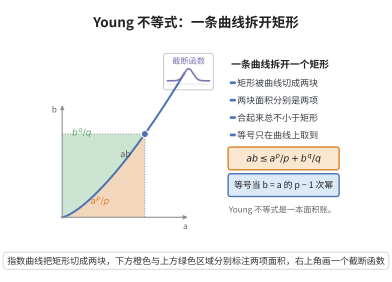

# 截断函数与 Young 不等式

> **一句话大白话**：乘积 $ab$ 可以用两个幂次 $a^p$、$b^q$ 的加权和来"压住"（Young 不等式）；而把局部信息限制在小球内的光滑"开关"（截断函数），则让这种估计能逐尺度地局部化。
>
> **小例子**：$p=q=2$ 时 $ab\leq\frac{a^2+b^2}2$；取 $a=3,b=4$ 得 $12\leq12.5$。截断函数的典型例子是 $\eta(x)=\theta(\lvert x\rvert)$，其中 $\theta$ 从 $1$ 光滑降到 $0$。

## 一、定理介绍

> **前置依赖**：Hölder 不等式、Jensen 不等式（凸性工具）、Fenchel 共轭（凸分析对偶）、弱导数与 Sobolev 空间定义、Moser 迭代。

Young 不等式（Young's inequality）得名于 William Henry Young（1912），是分析中最常用的初等估计之一。它的基本形式是：设 $1<p,q<\infty$ 且 $\frac1p+\frac1q=1$，则对一切 $a,b\geq0$
$$ab\leq\frac{a^p}{p}+\frac{b^q}{q}.$$
等号成立当且仅当 $a^p=b^q$。它的"带 $\varepsilon$ 版本"$ab\leq\varepsilon a^p+C_\varepsilon b^q$ 更为常用，因为它允许把一个较难控制的乘积项吸收到左边的主项中去。

截断函数（cut-off function，又称磨光/截断）是构造局部化估计的标准工具：给定 $0<r<R$，存在光滑函数 $\eta$ 在 $B_r$ 上恒为 $1$、在 $B_R$ 外恒为 $0$，且梯度一致地被 $\frac{2}{R-r}$ 控制。它的动机是为偏微分方程的先验估计制造"局部权重"，使积分只在关心的小区域内进行。

两者的结合是椭圆与抛物方程正则性理论的引擎：用截断函数把试验函数局部化，再用带 $\varepsilon$ 的 Young 不等式把交叉项"吸收"进主项，就得到逐尺度的能量估计，进而由 Sobolev 嵌入启动 Moser 迭代或 De Giorgi 迭代。这正是 Moser、Nash、De Giorgi 在 1950—1960 年代建立散度型方程弱解正则性的核心技术。

## 几何直观

图意在说明：矩形面积被曲线分成两块，两块之和总不小于矩形，等号只在点落在曲线上时成立。

## 二、原理思路

1. **几何/凸性来源**：$ab$ 是矩形面积，可被两条互逆曲线 $y=x^{p-1}$ 与 $x=y^{q-1}$ 下方的两块面积 $a^p/p$、$b^q/q$ 覆盖；等价地，由 $e^x$ 的凸性用 Jensen 不等式也可得到。

2. **尺度化得到带 $\varepsilon$ 版本**：对 $a$ 作替换 $a\mapsto\varepsilon^{1/p}a$、$b\mapsto\varepsilon^{-1/p}b$，即可把常数从 $1/p$ 调到任意 $\varepsilon$。

3. **凸共轭的一般形式**：对凸函数 $\Phi$ 与其共轭 $\Phi^*$，Fenchel–Young 不等式 $ab\leq\Phi(a)+\Phi^*(b)$ 把 Young 不等式推广为任意凸代价。

4. **截断函数的构造**：用一维光滑单调过渡函数复合 $\lvert x\rvert$，把"平台—过渡—零"的结构搬到 $\mathbb R^n$，并显式控制梯度大小。

5. **局部化吸收**：先用截断函数把试验函数写成"主项 + 交叉项"，再用带 $\varepsilon$ Young 把交叉项吸收回主项，得到只含低阶项的估计。

## 三、定理的严格表述

**定理（Young 不等式）**：设 $1<p,q<\infty$，$\frac1p+\frac1q=1$。则对一切 $a,b\geq0$
$$ab\leq\frac{a^p}{p}+\frac{b^q}{q},$$
等号当且仅当 $a^p=b^q$。

**推论（带 $\varepsilon$ 的 Young 不等式）**：对任意 $\varepsilon>0$ 与一切 $a,b\geq0$
$$ab\leq\varepsilon a^p+C_\varepsilon b^q,\qquad C_\varepsilon=\frac{1}{q}\,\varepsilon^{-q/p}.$$

**定理（Fenchel–Young 不等式）**：设 $\Phi:\mathbb R\to(-\infty,+\infty]$ 为凸下半连续函数，其凸共轭为 $\Phi^*(b)=\sup_{x\in\mathbb R}\{bx-\Phi(x)\}$。则对一切 $a,b$
$$ab\leq\Phi(a)+\Phi^*(b).$$

**引理（截断函数的存在性）**：设 $0<r<R$，$x_0\in\mathbb R^n$。则存在 $\eta\in C_c^\infty(\mathbb R^n)$ 使
$$0\leq\eta\leq1,\qquad \eta=1\ \text{于}\ B_r(x_0),\qquad \operatorname{supp}\eta\subset B_R(x_0),\qquad \lvert\nabla\eta\rvert\leq\frac{2}{R-r}.$$

## 四、证明过程

**步骤 1（几何证明：矩形被两块面积覆盖）。** 设 $a,b\geq0$。考虑两条互逆曲线：$y=x^{p-1}$ 与 $x=y^{q-1}$（因为 $\frac1p+\frac1q=1$ 蕴含 $q-1=\frac{1}{p-1}$）。区域
$$A=\{(x,y):0\leq x\leq a,\ 0\leq y\leq x^{p-1}\},\qquad B=\{(x,y):0\leq y\leq b,\ 0\leq x\leq y^{q-1}\}$$
的面积分别为
$$\lvert A\rvert=\int_0^a x^{p-1}\,dx=\frac{a^p}{p},\qquad \lvert B\rvert=\int_0^b y^{q-1}\,dy=\frac{b^q}{q}.$$
对矩形 $[0,a]\times[0,b]$ 中任一点 $(x,y)$：若 $y\leq x^{p-1}$ 则 $(x,y)\in A$；否则 $y>x^{p-1}$，由 $x\mapsto x^{p-1}$ 的逆为 $y\mapsto y^{q-1}$ 得 $x<y^{q-1}$，即 $(x,y)\in B$。故矩形 $\subset A\cup B$，从而
$$ab\leq\lvert A\rvert+\lvert B\rvert=\frac{a^p}{p}+\frac{b^q}{q}.$$
等号当且仅当 $(a,b)$ 落在两曲线交点处，即 $b=a^{p-1}$，等价于 $a^p=b^q$。

**步骤 2（凸性证明）。** 由 $e^x$ 的凸性与 Jensen 不等式（或直接用凸性的加权形式），对 $u,v\in\mathbb R$
$$\exp\Big(\frac up+\frac vq\Big)\leq\frac{e^{u}}{p}+\frac{e^{v}}{q}.$$
取 $u=p\log a$、$v=q\log b$（$a,b>0$），左端为 $\exp(\log a+\log b)=ab$，右端为 $\frac{a^p}{p}+\frac{b^q}{q}$，即得结论；$a=0$ 或 $b=0$ 时平凡。

**步骤 3（尺度化得到带 $\varepsilon$ 版本）。** 设 $\varepsilon>0$、$a,b\geq0$，令 $A=\varepsilon^{1/p}a$、$B=\varepsilon^{-1/p}b$。对 $A,B$ 用步骤 1 的不等式：
$$ab=AB\leq\frac{A^p}{p}+\frac{B^q}{q}=\frac{\varepsilon a^p}{p}+\frac{\varepsilon^{-q/p}b^q}{q}.$$
再由 $\frac1p<1$ 把第一项系数放宽为 $1$，得到带 $\varepsilon$ 的 Young 不等式
$$ab\leq\frac{\varepsilon a^p}{p}+\frac{\varepsilon^{-q/p}b^q}{q}\leq\varepsilon a^p+C_\varepsilon b^q,\qquad C_\varepsilon=\frac{1}{q}\,\varepsilon^{-q/p}.$$
特别地取 $p=q=2$、$\varepsilon=\frac12$ 得 $ab\leq\frac{a^2+b^2}{2}$，以及常用的吸收形式 $2XY\leq\varepsilon X^2+\frac{1}{\varepsilon}Y^2$。

**步骤 4（Fenchel–Young 的一般形式）。** 由凸共轭的定义，对任意 $a,b$ 有 $\Phi^*(b)=\sup_x\{bx-\Phi(x)\}\geq ba-\Phi(a)$，移项即得 $ab\leq\Phi(a)+\Phi^*(b)$。取 $\Phi(x)=\frac{x^p}{p}$（$x\geq0$，其余取 $+\infty$），则 $\Phi^*(b)=\frac{b^q}{q}$（由步骤 3 的不等式取上确界可知），故步骤 1 的不等式是 Fenchel–Young 的特殊情形。这一步说明"带 $\varepsilon$ 吸收"的做法有对偶解释。

**步骤 5（截断函数的构造）。** 先构造一维过渡函数：取光滑单调函数 $\theta\in C^\infty(\mathbb R)$ 使
$$\theta(t)=1\ (t\leq r),\qquad \theta(t)=0\ (t\geq R),\qquad 0\leq-\theta'(t)\leq\frac{2}{R-r}.$$
（这样的 $\theta$ 存在：把分段线性的"斜坡"$1-\frac{t-r}{R-r}$ 在区间端点做标准磨光即可，磨光后导数上界仍被 $\frac{2}{R-r}$ 控制。）定义
$$\eta(x)=\theta(\lvert x-x_0\rvert).$$
当 $x\neq x_0$ 时，$\nabla\eta(x)=\theta'(\lvert x-x_0\rvert)\frac{x-x_0}{\lvert x-x_0\rvert}$，故 $\lvert\nabla\eta(x)\rvert=\lvert\theta'(\lvert x-x_0\rvert)\rvert\leq\frac{2}{R-r}$；在 $x=x_0$ 附近 $\eta\equiv1$ 为常数，梯度的极限为 $0$，与上式一致，故 $\eta\in C^\infty$。又 $\eta=1$ 于 $B_r(x_0)$，$\operatorname{supp}\eta\subset B_R(x_0)$，$0\leq\eta\leq1$。引理得证。

**步骤 6（两者在 Moser 迭代中的配合）。** 设 $u\geq0$，$u\in W^{1,2}(\Omega)$ 满足弱形式 $\int_\Omega\nabla u\cdot\nabla\varphi=0$（调和情形，一般散度型方程同理）。取 $\eta$ 为截断函数、$\beta>0$，令试验函数 $\varphi=\eta^2u^{2\beta+1}$。由 $\nabla\varphi=\eta^2(2\beta+1)u^{2\beta}\nabla u+2\eta u^{2\beta+1}\nabla\eta$ 与弱形式得
$$(2\beta+1)\int_\Omega\eta^2u^{2\beta}\lvert\nabla u\rvert^2=-2\int_\Omega\eta u^{2\beta+1}\nabla u\cdot\nabla\eta .$$
记 $X=\big(\int\eta^2u^{2\beta}\lvert\nabla u\rvert^2\big)^{1/2}$，$Y=\big(\int u^{2\beta+2}\lvert\nabla\eta\rvert^2\big)^{1/2}$。由 Cauchy–Schwarz，右端绝对值不超过 $2XY$，故
$$(2\beta+1)X^2\leq2XY .$$
应用步骤 3 的吸收形式（$2XY\leq\frac{2\beta+1}{2}X^2+\frac{2}{2\beta+1}Y^2$）把 $\frac{2\beta+1}{2}X^2$ 移到左端，得
$$\int_\Omega\eta^2u^{2\beta}\lvert\nabla u\rvert^2\leq\frac{4}{(2\beta+1)^2}\int_\Omega u^{2\beta+2}\lvert\nabla\eta\rvert^2 .$$
左端等于 $\frac{4}{(\beta+1)^2}\int_\Omega\eta^2\lvert\nabla u^{\beta+1}\rvert^2$。再对 $\eta u^{\beta+1}\in W_0^{1,2}(B_R)$ 用 Sobolev 嵌入定理，即得 $\|u\|_{L^{2^*}(B_r)}$ 被 $\|u\|_{L^{2\beta+2}(B_R)}$ 控制，构成 Moser 迭代的递推基础。$\square$

## 五、应用与意义

- **Sobolev 与 Poincaré 不等式**：几乎所有插值估计（$\|u\|_{L^q}\leq C\|u\|_{L^p}^\theta\|\nabla u\|_{L^2}^{1-\theta}$ 等）都用带 $\varepsilon$ Young 把交叉项吸收。
- **Moser 迭代与 De Giorgi 迭代**：截断函数提供逐尺度局部化，Young 不等式完成吸收，是散度型方程弱解 Hölder 连续性的核心。
- **椭圆与抛物正则性**：由能量估计升级为 $L^\infty$ 估计、再由 Schauder/Calderón–Zygmund 理论给出高阶正则性。
- **凸分析与优化**：Fenchel–Young 不等式是共轭对偶、次梯度与对偶间隙为零的代数基础。
- **概率与信息论**：Young 不等式给出矩的控制，也是熵、KL 散度与 Young 型不等式的原型。

## 课堂问答

**老师**：Young 不等式 $ab\le\frac{a^p}{p}+\frac{b^q}{q}$ 的"带 $\varepsilon$ 版本"为什么在 PDE 里用处更大？

**学生**：因为它能把难控的交叉项"吸收"进左边主项。由尺度化 $a\mapsto\varepsilon^{1/p}a$、$b\mapsto\varepsilon^{-1/p}b$ 得 $ab\le\varepsilon a^p+C_\varepsilon b^q$（$C_\varepsilon=\frac1q\varepsilon^{-q/p}$）。在能量估计里，交叉项 $2XY$ 用一个 $\varepsilon X^2$ 吸收后，剩下的 $\frac1\varepsilon Y^2$ 只含已知低阶量，于是可把主项解出来，得到形如 $X^2\le CY^2$ 的估计。没有这个"吸收"，交叉项会一直黏在不等号右边无法整理。

**老师（追问）**：最漂亮的证明是几何的还是凸性的？

**学生**：几何证明最直观：两条互逆曲线 $y=x^{p-1}$ 与 $x=y^{q-1}$（因 $\frac1p+\frac1q=1$ 蕴含 $q-1=\frac1{p-1}$）下方的两块面积分别是 $\frac{a^p}{p}$ 与 $\frac{b^q}{q}$，矩形 $[0,a]\times[0,b]$ 中任一点必落在其中一块内（若 $y>x^{p-1}$，则 $x<y^{q-1}$），故 $ab\le$ 两块面积之和，等号当且仅当 $a^p=b^q$。凸性证明则用 $e^x$ 的 Jensen：$\exp(\frac up+\frac vq)\le\frac{e^u}{p}+\frac{e^v}{q}$，取 $u=p\log a$、$v=q\log b$ 即得。

**老师（拓展）**：Fenchel-Young 与截断函数怎样和 Moser 迭代配合？

**学生**：Fenchel-Young 把 Young 推广到任意凸 $\Phi$，即 $ab\le\Phi(a)+\Phi^*(b)$（$\Phi^*$ 为凸共轭），说明"吸收"有对偶解释。截断函数 $\eta$（$=1$ 于 $B_r$、$\mathrm{supp}\,\eta\subset B_R$、$|\nabla\eta|\le\frac2{R-r}$）提供局部化：取试验函数 $\eta^2u^{2\beta+1}$，交叉项用带 $\varepsilon$ Young 吸收后得 $\int\eta^2u^{2\beta}|\nabla u|^2\le\frac4{(2\beta+1)^2}\int u^{2\beta+2}|\nabla\eta|^2$，再对 $\eta u^{\beta+1}$ 用 Sobolev 嵌入，便启动了 Moser 迭代的可积性升级。

## 相关条目

- [Moser-Nash迭代](./Moser-Nash迭代.md)：截断函数与 Young 不等式配合的直接应用，逐尺度提升可积性。
- [对偶变分原理](./对偶变分原理.md)：Fenchel–Young 不等式的对偶框架，凸共轭与次梯度的来源。
- [Ekeland变分原理](./Ekeland变分原理.md)：同为非线性分析中构造近似解的估计工具。
- [Sobolev空间定义](../第40级-偏微分方程/Sobolev空间定义.md)：步骤 6 中 $W^{1,2}$ 与弱形式的语言。
- [Sobolev嵌入定理](../第40级-偏微分方程/Sobolev嵌入定理.md)：把梯度估计提升为可积性提升，启动迭代。
- [Poincaré不等式](../第40级-偏微分方程/Poincaré不等式.md)：典型使用带 $\varepsilon$ Young 吸收交叉项的不等式。
- [椭圆正则性定理](../第40级-偏微分方程/椭圆正则性定理.md)：本条目技术组合的最终应用场景。
- [Jensen不等式](../第24级-概率论基础/Jensen不等式.md)：步骤 2 中凸性证明的依据。
