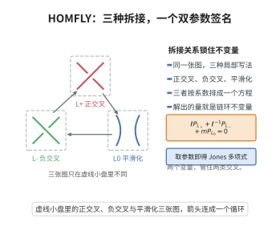

# HOMFLY多项式

> **一句话大白话**：给一条打了结的绳子的绕法编一个含有两个字母的多项式"签名"，打结方式不同签名就不同，能用来分辨不同的结。
>
> **小例子**：圆环（平凡结）取 $1$；三叶结的 HOMFLY 多项式为 $-l^2-l^{-2}+l^2m^2$（以 $l,m$ 为参数），令 $l=-t^{1/2},\,m=-t^{-1/4}$ 就退化为 Jones 多项式。

## 一、定理介绍

> **前置依赖**：链环的拆接关系与 Reidemeister 移动、辫群与 Alexander 定理、Hecke 代数表示、Markov 定理与 Ocneanu 迹。

HOMFLY 多项式是 Jones 多项式的双参数推广，由 Hoste、Ocneanu、Millett、Freyd、Lickorish 与 Yetter 在 1985 年左右独立发现。通过参数 specialization 后可得到 Jones、Alexander–Conway 等多项式。

## 几何直观

图意在说明：三张图只在一个小盘里不同，把它们的多项式按固定系数排成一条拆接方程，就唯一确定了 HOMFLY 多项式。

## 二、原理思路
与 Jones 多项式类似，HOMFLY 多项式通过辫群到 Hecke 代数的表示以及两个自由参数的 Ocneanu 型迹来构造；这两个参数分别控制拆接关系中 $L_+$ 与 $L_-$ 的系数。

## 三、定理的严格表述
设 $L$ 为定向链环。存在唯一 Laurent 多项式
$$
P_L(\ell,m)\in\mathbb{Z}[\ell^{\pm1},m^{\pm1}]
$$
称为 $L$ 的 HOMFLY 多项式，满足：
1. 规范化：$P_{\bigcirc}(\ell,m)=1$；
2. 拆接关系：
   $$
   \ell P_{L_+}(\ell,m)+\ell^{-1}P_{L_-}(\ell,m)+mP_{L_0}(\ell,m)=0;
   $$
3. 同痕不变性：若 $L\simeq L'$，则 $P_L=P_{L'}$。

在变量替换 $a=\ell^{-1}$、$z=-m/\ell$ 下，该关系也常写为
$$
a^{-1}P_{L_+}-aP_{L_-}=zP_{L_0}.
$$

## 四、证明过程
1. **Hecke 代数与双参数迹**：考虑 Hecke 代数 $H_n(\ell,m)$，其生成元 $g_i$ 满足辫关系及二次关系
   $$
   (g_i-\ell)(g_i+\ell^{-1})=0\quad\text{或等价地}\quad g_i^2+m g_i=1.
   $$
   构造线性迹 $\operatorname{tr}$ 满足循环性与 Markov 条件
   $$
   \operatorname{tr}(wg_n)=z\operatorname{tr}(w)
   $$
   对 $w\in H_n$ 成立。
2. **Markov 参数确定**：要求迹在 Markov I 型（共轭）与 II 型（稳定化）下不变。共轭不变由循环性保证；稳定化给出参数约束，解得
   $$
z=-\frac{\ell-\ell^{-1}}{m}.
   $$
3. **闭辫公式**：对 $\beta\in B_n$，定义
   $$
   P_{\widehat{\beta}}(\ell,m)=\left(\frac{\ell-\ell^{-1}}{-m}\right)^{n-1}\ell^{-e(\beta)}\operatorname{tr}\bigl(\rho(\beta)\bigr).
   $$
   由 Markov 定理，此式只依赖于闭辫的同痕类。
4. **唯一性**：拆接关系允许对交叉数进行归纳；结合规范化条件，可唯一确定任意链环图的 $P_L$。

## 五、应用与意义
HOMFLY 多项式统一了 Jones、Alexander–Conway 与 $sl_N$ 量子不变量，是纽结分类与表格编制的重要工具，并在弦论、拓扑弦以及卫星纽结的研究中具有深刻应用。

## 课堂问答

**老师**：HOMFLY 与 Jones 多项式究竟差在哪里？

**学生**：结论：HOMFLY 是双参数不变量，Jones 是它的单参数特化。HOMFLY 满足 $\ell P_{L_+}+\ell^{-1}P_{L_-}+mP_{L_0}=0$ 且 $P_{\bigcirc}=1$，由 Hecke 代数 $H_n$ 的双参数迹构造，稳定化给出 $z=-\frac{\ell-\ell^{-1}}{m}$。取 $l=-t^{1/2},\,m=-t^{-1/4}$ 即退化为 Jones 多项式，故 HOMFLY 能区分 Jones 分不开的结。

**老师（追问）**：为什么它又叫 $sl_N$ 的量子不变量？

**学生**：因为在 $\ell=q^{N}$ 之类的参数化下，HOMFLY 对应 $U_q(\mathfrak{sl}_N)$ 以基本表示着色链环的 Reshetikhin–Turaev 值。$\ell,m$ 两个自由度相当于记录 $N$ 与 $q$；Jones 是 $N=2$ 的切片。这正是它统一 Alexander–Conway 与 Jones 的原因。

**老师（拓展）**：多变量推广是什么样？

**学生**：对 $n$ 分量链环有多变量 HOMFLY，每个分量给一个变量，记录各分量间的环绕数信息，故一般是 $n+1$ 变量的多项式。它记录了 $L_+,L_-,L_0$ 与环绕数的完整数据，与 Kauffman 双变量多项式互为重排，并能区分手性。
