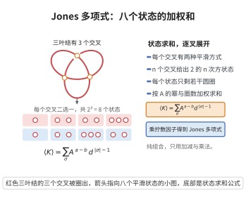

# Jones多项式

> **一句话大白话**：给每个绳结附一个整式（一个多变量约化成的单变量整数多项式），它对绳结的"变形"保持不变，却能把很多以前分不清的结区分开。
>
> **小例子**：平凡结的 Jones 多项式是 $1$；三叶结的 Jones 多项式为 $-t^{-4}+t^{-3}+t^{-1}$，可见两者不同。它的引入甚至推翻了 Alexander 多项式的若干猜想。

## 一、定理介绍

> **前置依赖**：辫群与 Markov 定理、Temperley–Lieb 代数与 Hecke 代数、Ocneanu 迹、Kauffman 括号与拆接关系。

1984 年 Vaughan Jones 在研究算子代数时发现了一个全新的纽结不变量——Jones 多项式。它通过辫群表示或 Kauffman 括号来定义，是 HOMFLY 多项式的一个重要特例。

## 几何直观

图意在说明：每个交叉二选一，三叶结展开成八个无交叉状态，按 A 的幂与圆圈个数加权求和就是括号多项式。

## 二、原理思路
Jones 首先构造了辫群 $B_n$ 到 Temperley–Lieb 代数（或 Hecke 代数）的表示，并找到一个满足 Markov 性质的迹；然后将闭辫与纽结对应，得到只依赖于闭链环同痕类的多项式。

## 三、定理的严格表述
设 $L$ 为定向链环。存在唯一 Laurent 多项式 $V_L(t)\in\mathbb{Z}[t^{\pm1/2}]$，称为 $L$ 的 Jones 多项式，满足：
1. 规范化条件：$V_{\bigcirc}(t)=1$（$\bigcirc$ 为 unknot）；
2. 拆接关系（skein relation）：
   $$
   t^{-1}V_{L_+}(t)-tV_{L_-}(t)=\bigl(t^{1/2}-t^{-1/2}\bigr)V_{L_0}(t),
   $$
   其中 $L_+,L_-,L_0$ 仅在某一交叉点处分别为正交叉、负交叉与平滑；
3. 环境同痕不变性：若 $L$ 与 $L'$ 同痕，则 $V_L(t)=V_{L'}(t)$。

等价地，对任意辫 $\beta\in B_n$，记 $\widehat{\beta}$ 为其闭辫，$e(\beta)$ 为 $\beta$ 的指数和，则
$$
V_{\widehat{\beta}}(t)=\left(-\frac{t+1}{\sqrt{t}}\right)^{n-1}\sqrt{t}^{-e(\beta)}\operatorname{tr}\bigl(\rho(\beta)\bigr),
$$
其中 $\rho:B_n\to H_n(q)$ 为 Hecke 代数表示，$\operatorname{tr}$ 为 Ocneanu 迹。

## 四、证明过程
1. **Hecke 代数表示**：定义 $\rho(\sigma_i)=g_i$，其中 Hecke 代数 $H_n(q)$ 的生成元 $g_i$ 满足辫关系与二次关系
   $$
   g_ig_j=g_jg_i\ (|i-j|>1),\quad g_ig_{i+1}g_i=g_{i+1}g_ig_{i+1},
   $$
   $$
   g_i^2=(q-1)g_i+q.
   $$
2. **Ocneanu 迹**：在 $\bigcup_n H_n(q)$ 上构造满足 $\operatorname{tr}(ab)=\operatorname{tr}(ba)$ 与 Markov 性质
   $$
   \operatorname{tr}(wg_n)=z\operatorname{tr}(w)
   $$
   的线性泛函。取 $z=(1-q)/(1+q)$ 并调整参数，使迹在 Markov 等价下不变。
3. **闭辫对应**：由 Alexander 定理，每个定向链环均可表为闭辫；由 Markov 定理，闭辫同痕当且仅当可通过 Markov 移动互化。因此上述规范化迹只依赖于链环同痕类。
4. **Kauffman 括号推导**：将 Kauffman 括号 $\langle D\rangle$ 用 writhe 规范化后令 $A=t^{-1/4}$，可直接验证其满足上述拆接关系，从而说明 $V_L(t)$ 存在。

## 五、应用与意义
Jones 多项式能区分许多手性纽结，揭示了纽结理论与算子代数、统计力学之间的联系；它开启了量子不变量的研究，并激发了 HOMFLY、Kauffman、Khovanov 同调等后续理论。

## 课堂问答

**老师**：Jones 多项式凭什么在 1984 年震动纽结界？它满足什么？

**学生**：结论：它来自全新的 skein 关系，并推翻了 Alexander 多项式的若干猜想。$V_L(t)\in\mathbb Z[t^{\pm1/2}]$ 满足
$$
t^{-1}V_{L_+}(t)-tV_{L_-}(t)=\bigl(t^{1/2}-t^{-1/2}\bigr)V_{L_0}(t),\qquad V_{\bigcirc}(t)=1 .
$$
三叶结 $V=-t^{-4}+t^{-3}+t^{-1}$，不同于平凡结的 $1$，且能区分手性纽结。

**老师（追问）**：为什么它落在半整数幂 $t^{1/2}$ 里？

**学生**：因为 skein 系数 $(t^{1/2}-t^{-1/2})$ 本身含 $t^{1/2}$。用 Kauffman 括号 $A=t^{-1/4}$ 看更清楚：$A$ 的幂是 $1/4$，故 $V$ 的幂为 $1/4$ 的整数倍，约化后落在 $1/2$ 的格上，成为半整数 Laurent 多项式。

**老师（拓展）**：Jones 与算子代数有何渊源？

**学生**：Jones 最初在 von Neumann 代数指标理论中发现它。用 Hecke 代数或 Temperley–Lieb 代数的 Markov 迹，$\rho(\sigma_i)=t^{1/2}e_i+t^{-1/2}$，闭辫公式为 $V_{\widehat\beta}(t)=(-\frac{t+1}{\sqrt t})^{n-1}\sqrt t^{-e(\beta)}\operatorname{tr}(\rho(\beta))$。这条线索把纽结理论、统计力学与算子代数连成一体，催生了量子不变量与 Khovanov 同调。
