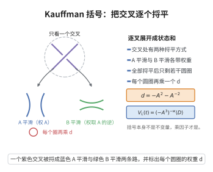

# Kauffman括号

> **一句话大白话**：把一个绳结图在每个交叉点岔成两种"捋平"方式，加起来乘一个权值，得到的不变量就是括号多项式——只用加减法就能算出 Jones 多项式。
>
> **小例子**：设平滑 A 乘 $A$、平滑 B 乘 $A^{-1}$，每个全接圈再加权 $(-A^2-A^{-2})$；对圈图 $\langle\,\bigcirc\,\rangle=-A^2-A^{-2}$，经规范化就得到 Jones 多项式。

## 一、定理介绍

> **前置依赖**：链环图与 Reidemeister 移动、交叉的平滑化与状态求和、拧数（writhe）、Jones 多项式的拆接关系。

Kauffman 括号是 Louis Kauffman 于 1987 年为 Jones 多项式给出的一个纯组合状态求和定义。它不依赖算子代数，只需对链环图的每个交叉进行两种“平滑”即可计算。

## 几何直观

图意在说明：括号公理只做两件事——把交叉换成两种平滑并记权重 A 与它的逆，把每个圆圈乘上 d。

## 二、原理思路
对一个非定向链环图 $D$，在每个交叉处选择 $A$–平滑或 $B$–平滑，从而得到一组无交叉的“状态”；每个状态是若干圆圈之并。对状态赋予 $A$ 与 $A^{-1}$ 的权重并求和，即得 Kauffman 括号。

## 三、定理的严格表述
设 $D$ 为非定向链环图。Kauffman 括号 $\langle D\rangle\in\mathbb{Z}[A,A^{-1}]$ 由以下公理递归定义：
1. $\langle\bigcirc\rangle=1$；
2. 不相交并：  $$
   \langle D\sqcup\bigcirc\rangle=(-A^2-A^{-2})\langle D\rangle;
   $$
3. 拆接规则：对单个交叉，
   $$
   \langle\text{交叉}\rangle=A\langle\text{A-平滑}\rangle+A^{-1}\langle\text{B-平滑}\rangle.
   $$

若记 $w(D)$ 为 $D$ 的拧数（writhe），则
$$
X_D(A)=(-A^3)^{-w(D)}\langle D\rangle
$$
是 Reidemeister 移动下的不变量，且经替换 $A=t^{-1/4}$ 后得到 Jones 多项式 $V_D(t)$。

## 四、证明过程
1. **良定性**：拆接规则将交叉数逐次降低，最终得到无交叉图即若干圆圈的并；规则 (1)、(2) 唯一确定每个状态的贡献，因此 $\langle D\rangle$ 作为 Laurent 多项式被良好定义。
2. **R-II 不变性**：对相邻的两个反向交叉，连续应用拆接规则并化简，可得局部等式
   $$
   \langle\text{双交叉}\rangle=\langle\text{平行两线段}\rangle.
   $$
3. **R-III 不变性**：利用 R-II 不变性与拆接规则，三组交叉的局部变换不改变括号值。
4. **R-I 修正**：单个正拧结使得括号值多出一个因子 $-A^3$，单个负拧结多出一个因子 $-A^{-3}$。因此乘以 $(-A^3)^{-w(D)}$ 消去该影响。
5. **得到 Jones 多项式**：将 $X_D(A)$ 的拆接关系用 $A=t^{-1/4}$ 改写，即化为 Jones 拆接关系。

## 五、应用与意义
Kauffman 括号提供了计算 Jones 多项式的直观算法，是统计力学中 Potts 模型与 Temperley–Lieb 代数的桥梁；它也是 Khovanov 同调的组合起点，在现代低维拓扑中仍具有重要价值。

## 课堂问答

**老师**：Kauffman 括号与 Jones 多项式是什么关系？为什么前者不是不变量？

**学生**：结论：括号 $\langle D\rangle\in\mathbb Z[A^{\pm1}]$ 只是链环图的组合量，乘 writhe 修正后才不变。规则为 $\langle\bigcirc\rangle=1$、$\langle D\sqcup\bigcirc\rangle=(-A^2-A^{-2})\langle D\rangle$ 与交叉拆接 $\langle\text{交叉}\rangle=A\langle A\text{-平滑}\rangle+A^{-1}\langle B\text{-平滑}\rangle$。令 $X_D(A)=(-A^3)^{-w(D)}\langle D\rangle$，则 $X_D$ 是 Reidemeister 不变量；取 $A=t^{-1/4}$ 得 $V_D(t)$。

**老师（追问）**：括号在 R-I 下差了什么因子？

**学生**：差 $-A^{\pm3}$。单个正拧结被平滑后净效应为 $-A^3\langle\,|\,\rangle$，负拧结为 $-A^{-3}$。因为 writhe $w(D)$ 恰统计正负交叉数之差，乘以 $(-A^3)^{-w(D)}$ 就把每个 R-I 的因子逐一抵消，这正说明括号本身不是不变量、修正后才是不变量。

**老师（拓展）**：这套组合定义的深层意义？

**学生**：它把不变量化归为纯状态求和，是统计力学 Potts 配分函数的翻版，也是 Temperley–Lieb 代数的图形实现。作为 Khovanov 同调的组合起点，它的拆分交叉思想给出范畴化入口。
