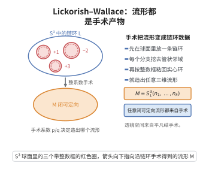

# Lickorish–Wallace 手术定理

> **一句话大白话**：任意闭的可定向三维流形，都能由三维球面 $S^3$ 沿某个链环做整系数的 Dehn 手术得到——三维流形虽然千奇百怪，但全部是"链环手术"的产物。
>
> **小例子**：透镜空间 $L(p,q)$ 由 $S^3$ 沿平凡纽结做 $p/q$-手术得到；Poincaré 同调球由 $S^3$ 沿右三叶结做 $+1$-手术得到。

## 一、定理介绍

> **前置依赖**：Dehn手术定理、Heegaard分解、三维流形基本定理、映射类群的Dehn扭转生成定理、辫群与框（framing）概念。

Lickorish–Wallace 手术定理（Lickorish–Wallace surgery theorem）由 Andrew Wallace（1960）与 W. B. R. Lickorish（1962）独立证明。Wallace 研究余边界（cobounding）流形的"修改"操作，Lickorish 研究可定向组合三维流形的表示，二人都得到同一结论：任意闭、可定向、连通三维流形都是 $S^3$ 沿某链环做整数框 Dehn 手术的结果。Lickorish 的版本更强：手术链环可以是只带 $\pm1$ 框的分支。

该定理的动机是把三维流形的分类问题"代数化、组合化"。三维流形没有类似于曲面的简单分类，但手术描述把它化归为 $S^3$ 中的链环加上一组整数；两个描述何时给出同胚流形，则由 Kirby 演算（Kirby 1978）用 Kirby 移动完全刻画。这使三维拓扑的许多问题变成链环的符号演算。

定理的意义有三个层面。其一，它与 Heegaard 分解、映射类群的 Dehn 扭转生成定理构成三位一体的框架：流形 $\to$ 粘合映射 $\to$ 扭转 $\to$ 手术。其二，它是三维流形量子不变量的入口：Witten–Chern–Simons 理论与 Reshetikhin–Turaev 不变量都以"手术公理"（每个 $\pm1$ 手术分支贡献一个量子维数因子）为基础。其三，它为构造反例、验证不变量（如 Casson 不变量、finite type 不变量）提供统一的演算平台。

## 几何直观

图意在说明：从三维球面里挖去链环的管状邻域再按整数框粘回实心环，就能造出任意闭可定向三维流形。

## 二、原理思路

1. **Heegaard 分解**：每个闭可定向三维流形有分解 $M=H_1\cup_h H_2$，其中 $H_i$ 是亏格 $g$ 的柄体，$h$ 是 $\partial H_1=\Sigma_g=\partial H_2$ 上的保定向粘合映射；而 $S^3=H_1\cup_{\operatorname{id}}H_2$。

2. **粘合映射的扭转分解**：由映射类群的 Dehn 扭转生成定理，$h$ 的同痕类可写成有限个沿 $\Sigma_g$ 上简单闭曲线的 Dehn 扭转之积 $T_{c_1}^{e_1}\circ\cdots\circ T_{c_m}^{e_m}$。

3. **扭转到手术**：每一条 Dehn 扭转 $T_c$ 的"粘合效果"都可由沿 $S^3$ 中一条纽结 $K_c$（由 $c$ 局部地推入柄体得到）做 $\pm1$-框手术实现。

4. **复合为链环**：把这些手术曲线并成一个链环 $L$，逐个手术即得 $M\cong S^3_{\pm1}(L)$；再用 Kirby 演算的 Rolfsen 扭转把手术曲线"搬回"固定的 $S^3$，于是得到 $S^3$ 中的一个框链环描述。

## 三、定理的严格表述

**定理（Wallace 1960；Lickorish 1962）**：设 $M$ 是闭、可定向、连通的三维流形。则存在 $S^3$ 中的链环 $L=K_1\cup\cdots\cup K_n$ 与整数 $p_1,\dots,p_n\in\mathbb Z$ 使
$$M\cong S^3_{p_1,\dots,p_n}(L),$$
其中右端表示沿 $K_i$ 做框为 $p_i$ 的 Dehn 手术所得流形。

**加强形式（Lickorish）**：在上面的描述中可取所有 $p_i=\pm1$，即
$$M\cong S^3_{\pm1}(L).$$
换言之，$M$ 由 $S^3$ 经有限次 $\pm1$-框手术得到。

**结论的完备性（Kirby 演算）**：设 $L$、$L'$ 是 $S^3$ 中两个整系数框链环。则 $S^3(L)\cong S^3(L')$（保定向同胚）当且仅当 $L$ 与 $L'$ 可由有限次 Kirby 移动（$\pm1$-框分支上的 Rolfsen 扭转与手柄滑动）互相转换。因此三维流形的分类被完全编码为链环的 Kirby 演算。

## 四、证明过程

**步骤 1（Heegaard 分解与粘合映射）。** 由三维流形基本定理，$M$ 可三角剖分、有唯一光滑结构，且存在 Heegaard 曲面 $\Sigma_g\subset M$ 使
$$M=H_1\cup_h H_2,\qquad \partial H_1=\Sigma_g=\partial H_2,$$
其中 $h:\Sigma_g\to\Sigma_g$ 保定向。标准模型 $S^3=H_1\cup_{\operatorname{id}}H_2$。于是 $M$ 可由 $S^3$ 通过"挖去 $H_2$ 再按 $h$ 粘回"得到。

**步骤 2（Dehn 扭转分解）。** 记 $\operatorname{Mod}(\Sigma_g)$ 为 $\Sigma_g$ 的保定向映射类群。由映射类群的 Dehn 扭转生成定理，存在简单闭曲线 $c_1,\dots,c_m\subset\Sigma_g$ 与整数 $e_j$ 使
$$h=T_{c_1}^{e_1}\circ T_{c_2}^{e_2}\circ\cdots\circ T_{c_m}^{e_m}\quad\text{在}\ \operatorname{Mod}(\Sigma_g)\ \text{中}.$$
把 $T^{e}$ 写成 $T^{\pm1}$ 的 $|e|$ 次复合，可设每个 $e_j=\pm1$，即 $h$ 是有限个 $\pm1$ 次 Dehn 扭转之积。

**步骤 3（关键的扭转实现引理）。** 设 $V$ 是实心环（亏格 $1$ 柄体），$c\subset\partial V$ 是一条简单闭曲线，$A\subset\partial V$ 是以 $c$ 为核心的环带。则存在 $V$ 内一条纽结 $K_c$（把 $c$ 沿 $A$ 的纤维方向平移进 $V$ 所得的平行曲线），使得：

- 在 $M'=H_1\cup_{h}H_2$ 中沿 $K_c$ 做 $+1$-框手术，等价于把粘合映射 $h$ 左乘（或右乘）$T_c$ 的某个整数幂；
- 做 $-1$-框手术则对应 $T_c^{-1}$。

理由：在环带 $A$ 的管状邻域 $A\times[-1,1]$ 内部，$\pm1$-框手术把该邻域沿纤维作一次"半扭转"（half-twist）；半扭转是 Dehn 扭转 $T_c$ 的局部模型（Dehn 扭转就是沿 $A$ 的纤维作整扭转并固定边界），故把粘合映射复合成 $T_c^{\pm1}$。这一步是定理的核心，其严格版本见 Rolfsen《Knots and Links》第 9 章：若 $K$ 是以实心环的经线盘面为 Seifert 曲面的纽结，则手术与沿边界曲线的扭转一一对应。

**步骤 4（逐个手术）。** 由步骤 2 与步骤 3，从 $S^3=H_1\cup_{\operatorname{id}}H_2$ 出发，对每个 $j$ 沿相应的纽结 $K_{c_j}$ 做 $\pm1$-框手术，依次把粘合映射复合成 $T_{c_1}^{\pm1},\dots,T_{c_m}^{\pm1}$，最终得到
$$H_1\cup_{h}H_2=M .$$
过程中每一步的手术曲线都落在"当前流形"内；由 Kirby 演算中的 Rolfsen 扭转（Kirby 移动），可以逐次把手术曲线搬回初始的 $S^3$（代价是改变其余分支的框数），故存在固定的 $S^3$ 中框链环 $L$ 使 $M\cong S^3_{\pm1}(L)$。这就证明了加强形式。

**步骤 5（导出 Wallace 的整系数形式）。** 由于 $\pm1$-框手术是整数框手术的特例，加强形式直接给出定理的一般陈述 $M\cong S^3_{p_1,\dots,p_n}(L)$。反过来，任意整系数手术描述都可用有限次 $\pm1$-框手术（配合手柄滑动与 Rolfsen 扭转）改写，因此两种形式等价；这说明"整系数手术"与"$\pm1$ 手术"给出的流形族相同。

**步骤 6（Kirby 演算的完备性）。** 手术描述的非唯一性由 Kirby 定理刻画：改变链环的图（diagram）若只涉及 Rolfsen 扭转与手柄滑动，则流形不变；反之任何两个给出同胚流形的描述都可由这些移动连接。其证明思路是把两种描述都化为同一 Heegaard 分解的粘合映射，再用步骤 2 的扭转分解与步骤 3 的实现引理比较。$\square$

**注**：定理并不给出手术描述的唯一性，这正是需要 Kirby 演算的原因；Lickorish 加强形式在量子不变量理论中尤为重要，因为 $\pm1$-框分支的贡献可显式计算（量子维数 $S_{0i}$ 因子），而一般整系数框的贡献依赖框数的连续变化。

## 五、应用与意义

- **三维流形的统一描述**：把任意闭可定向三维流形写成 $S^3$ 中的框链环，是构造透镜空间、Seifert 纤维化空间、Brieskorn 同调球、Poincaré 同调球等的标准手段。
- **Kirby 演算与分类程序**：三维流形同胚判定化归为链环的 Rolfsen 扭转与手柄滑动，是低维拓扑的重要计算工具。
- **量子不变量与手术公理**：Reshetikhin–Turaev 不变量、Witten–Chern–Simons 不变量以手术描述为基础，$+1$ 手术分支按量子维数加权，从而把 Jones 多项式等推广为三维流形不变量。
- **辫群与 Markov 定理的对接**：经由 Heegaard 分解与闭辫表示，手术描述与 Markov 移动、Markov 迹联系起来，统一了纽结不变量的代数构造。
- **有限型不变量与拓扑量子计算**：Casson 不变量、Levine–Tristram 型不变量的演算，以及 Turaev–Viro 型拓扑量子计算模型都以手术描述为出发点。

## 课堂问答

**老师**：Lickorish–Wallace 定理为什么被称为三维流形的统一描述？

**学生**：结论：任意闭可定向连通三维流形都是 $S^3$ 沿某链环做整系数 Dehn 手术的结果，即 $M\cong S^3_{p_1,\dots,p_n}(L)$；加强形式可取全部 $p_i=\pm1$，即 $M\cong S^3_{\pm1}(L)$。它把三维流形分类代数化、组合化。

**老师（追问）**：证明的关键一步是什么？

**学生**：是扭转到手术的实现引理。把 Heegaard 粘合映射写成 Dehn 扭转之积 $h=T_{c_1}^{e_1}\circ\cdots\circ T_{c_m}^{e_m}$，而每条 $T_c^{\pm1}$ 都可由沿 $S^3$ 中一条相应纽结做 $\pm1$-框手术实现——因为 $\pm1$-框手术在环带管状邻域内恰作一次半扭转，正是 $T_c$ 的局部模型。逐个实现并复合即得结论。

**老师（拓展）**：为什么手术描述离不开 Kirby 演算？

**学生**：因为描述不唯一。Kirby 定理给出判别：$S^3(L)\cong S^3(L')$ 当且仅当两框链环可由有限次 Kirby 移动（Rolfsen 扭转与手柄滑动）互化。这正是量子不变量良定义的前提：$\pm1$-框分支贡献量子维数因子，只有它在 Kirby 移动下不变，Reshetikhin–Turaev 不变量才不依赖链环的选取。

## 相关条目

- [Jones多项式](./Jones多项式.md)：以 Markov 迹构造纽结不变量，其手术公理推广处依赖本定理。
- [Kauffman括号](./Kauffman括号.md)：skein 关系与框修正的手术实现，是量子不变量的组合基础。
- [Reshetikhin-Turaev不变量](./Reshetikhin-Turaev不变量.md)：直接把框链环的手术表示变为三维流形不变量的框架。
- [Chern-Simons理论与纽结不变量](./Chern-Simons理论与纽结不变量.md)：物理侧的路径积分以手术描述为定义基础。
- [Dehn手术定理](../第62级-低维拓扑/Dehn手术定理.md)：本定理所使用的基本手术操作及其对同调的影响。
- [Heegaard分解](../第62级-低维拓扑/Heegaard分解.md)：把三维流形化为两个柄体粘合，是证明的第一步。
- [三维流形基本定理](../第62级-低维拓扑/三维流形基本定理.md)：三角剖分与素分解、光滑结构唯一性等基础结果。
- [映射类群的Dehn扭转生成定理](../第62级-低维拓扑/映射类群的Dehn扭转生成定理.md)：把粘合映射写成扭转之积，是证明的代数输入。
