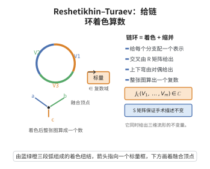

# Reshetikhin–Turaev不变量

> **一句话大白话**：给每个组成结"项链"的珠子（不可约表示）配上颜色，按拆解规则搭积木，最终得到的不变量不仅能区分纽结，还能给整个三维空间贴一个数字标签。
>
> **小例子**：取 $SU(2)$ 在二级别 $r$ 的模表示，用其 $6j$ 符号沿三角剖分求和，即得三维流形的不变量，并可计算如 $L(3,1)$ 等透镜空间的不变量。

## 一、定理介绍

> **前置依赖**：ribbon Hopf 代数与拟三角结构、Yang–Baxter 方程与辫范畴、Lickorish–Wallace 手术定理、Kirby 移动与 Dehn 手术、模范畴的 $S$–矩阵与量子维数。

Reshetikhin–Turaev 不变量是由 N. Reshetikhin 与 V. Turaev 在 1991 年严格构造的一类量子纽结不变量。它们从 ribbon/modular Hopf 代数的表示出发，不仅给纽结着色，还能进一步构造三维闭流形的不变量。

## 几何直观

图意在说明：给每个分支配一个表示，交叉用 R 矩阵、上下弯用对偶，整张图缩并成一个复数，就是量子不变量。

## 二、原理思路
将链环的每个分量用量子群的有限维表示“着色”，交叉由 $R$–矩阵表示，上下弯由对偶映射表示；这样整个链环图对应到单位对象上的一个标量。若表示范畴是模化的，则该标量在 Kirby 移动下不变，从而成为三维流形的不变量。

## 三、定理的严格表述
设 $H$ 为 ribbon Hopf 代数，其表示范畴 $\mathcal{C}=\operatorname{Rep}(H)$ 是 ribbon 范畴。对定向带框链环 $L=L_1\cup\cdots\cup L_m$，取简单模 $V_1,\dots,V_m\in\mathcal{C}$ 着色各分量，定义
$$
J_L(V_1,\dots,V_m)\in\operatorname{End}_{\mathcal{C}}(\mathbf{1})\cong\mathbb{C}
$$
为按链环图将 $R$–矩阵、余单位、对偶映射复合而成的态射。

若 $\mathcal{C}$ 是模 ribbon 范畴，令 $\{V_i\}_{i\in I}$ 为一组互不同构的简单对象的代表元，记 $\dim_i=\dim V_i$，且
$$
D^2=\sum_{i\in I}(\dim_i)^2,\qquad \Delta=\sum_{i\in I}(\dim_i)^2\theta_i^{-1}
$$
（$\theta_i$ 为 twist）。则对由带框链环 $L\subset S^3$ 经 Dehn 手术得到的闭定向三维流形 $M$，其 Reshetikhin–Turaev 不变量为
$$
\tau_{\mathcal{C}}(M)=\Delta^{\sigma(L)}D^{-\sigma(L)-m-1}\sum_{\lambda_1,\dots,\lambda_m\in I}
\left(\prod_{j=1}^m\dim_{\lambda_j}\right)
J_L(V_{\lambda_1},\dots,V_{\lambda_m}),
$$
其中 $\sigma(L)$ 为 $L$ 的 linking 矩阵的符号差，$m$ 为 $L$ 的分量数。

## 四、证明过程
1. **Ribbon 范畴不变性**：在 ribbon 范畴中，$R$–矩阵满足 Yang–Baxter 方程，twist $\theta_V$ 满足 ribbon 条件。于是任意带框链环图的着色值在 Reidemeister 移动（包括带框 R-I）下不变。
2. **手术表示**：Lickorish–Wallace 定理断言任意闭定向三维流形可由 $S^3$ 沿某带框链环 $L$ 的 Dehn 手术得到。
3. **Kirby 定理**：两个带框链环给出同胚的三维流形当且仅当它们可通过 Kirby 移动（handle slide 与 blow-up/down）互化。
4. **模性保证 Kirby 不变性**：模 ribbon 范畴的可逆 $S$–矩阵恰好对应 linking 矩阵的 handle slide；twist 与量子维数保证 blow-up/down 不变。因此上述求和式在 Kirby 移动下不变。
5. **结论**：$\tau_{\mathcal{C}}(M)$ 只依赖于 $M$ 的微分同胚类。

## 五、应用与意义
Reshetikhin–Turaev 不变量为 Witten 的 Chern–Simons 路径积分不变量提供了严格的代数实现，是拓扑量子场论与量子群表示论的交汇点；它们在拓扑量子计算、三维流形分类以及范畴化同调理论中都有深远影响。

## 课堂问答

**老师**：RT 不变量怎么从链环升级为三维流形不变量？范畴要满足什么？

**学生**：结论：用 ribbon Hopf 代数的表示范畴给链环着色得 $J_L(V_1,\dots,V_m)$，再用手术拼出流形不变量。关键是表示范畴须为模 ribbon 范畴，此时求和 $\tau_{\mathcal C}(M)=\Delta^{\sigma(L)}D^{-\sigma(L)-m-1}\sum_{\lambda_1,\dots,\lambda_m}(\prod_j\dim_{\lambda_j})J_L(V_{\lambda_1},\dots,V_{\lambda_m})$ 在 Kirby 移动下不变，其中 $D^2=\sum_i(\dim_i)^2$、$\Delta=\sum_i(\dim_i)^2\theta_i^{-1}$。

**老师（追问）**：为什么模性（可逆 $S$-矩阵）是必要的？

**学生**：因为三维流形的描述靠手术链环，不同描述差一次 Kirby 移动。手柄滑动在着色求和中对应 $S$-矩阵的作用，blow-up/down 对应 twist 与量子维数因子。只有当 $S$-矩阵可逆、范畴模化，这些因子才能系统抵消，求和才在全部 Kirby 移动下不变。ribbon 结构保证带框 R-I 不变，Yang–Baxter 保证 R-II、R-III 不变。

**老师（拓展）**：取具体范畴会得到什么？

**学生**：取 $\mathcal C=\mathrm{Rep}(U_q(\mathfrak{sl}_2))$ 在 $q=e^{\pi i/r}$ 处的可积表示范畴，得 $SU(2)$ 量子不变量，$\pm1$-框手术分支按量子维数加权。它与 Turaev–Viro 不变量满足 $TV_{\mathcal C}(M)=|\mathrm{WRT}(M)|^2$，从而把 Chern–Simons 的物理期望值落成可算的组合量。
