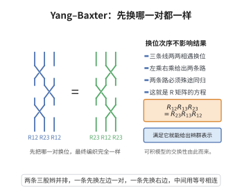

# Yang–Baxter方程

> **一句话大白话**：一个"交叉换序"的代数等式：三条线两两相遇，先换谁后换谁结果一样，等于说粒子两两碰撞满足可结合、可交换的守恒律，是"可积系统"的命门。
>
> **小例子**：矩阵 $R$ 满足 $R_{12}R_{13}R_{23}=R_{23}R_{13}R_{12}$。当 $R$ 取六顶点模型中 $R=i\{\mathbb{1},\sigma^z,\sigma^\pm\}$ 的矩阵元时即给出著名的 XXX 模型的解。

## 一、定理介绍

> **前置依赖**：张量积空间与线性算子、Hopf 代数的余乘积与余结合律、拟三角 Hopf 代数与泛 $R$–矩阵、辫群表示。

Yang–Baxter 方程是数学物理中的一个三次张量方程，描述多体散射的因子化条件，也是构造纽结不变量与可积模型的核心工具。

## 几何直观

图意在说明：三条线两两换位时，无论先换哪一对，最终编织结果相同，这正是 R 矩阵必须满足的三次方程。

## 二、原理思路
在一个向量空间 $V$ 上给定可逆线性算子 $R:V\otimes V\to V\otimes V$，将其嵌入 $V\otimes V\otimes V$ 的不同张量因子得到 $R_{12},R_{13},R_{23}$。若它们满足某种“辫子”关系，则相应的转移矩阵可交换、辫群表示良定义。

## 三、定理的严格表述
设 $V$ 为有限维复向量空间，$R\in\operatorname{End}(V\otimes V)$ 可逆。记
$$
R_{12}=R\otimes\mathrm{id}_V,\quad R_{23}=\mathrm{id}_V\otimes R,\quad R_{13}=(P_{23}R_{12}P_{23})\in\operatorname{End}(V\otimes V\otimes V),
$$
其中 $P_{23}$ 为第二、第三因子交换映射。则 $R$ 称为 Yang–Baxter 算子，若
$$
R_{12}R_{13}R_{23}=R_{23}R_{13}R_{12}.
\tag{YBE}
$$

更一般地，若 $(H,R)$ 是拟三角 Hopf 代数，$R=\sum_i a_i\otimes b_i\in H\otimes H$ 为泛 $R$–矩阵，则 $R$ 满足
$$
R_{12}R_{13}R_{23}=R_{23}R_{13}R_{12}
$$
在 $H\otimes H\otimes H$ 中成立。

## 四、证明过程
对拟三角 Hopf 代数 $(H,R)$，泛 $R$–矩阵满足两条基本公理：
$$
(\Delta\otimes\mathrm{id})(R)=R_{13}R_{23},\qquad (\mathrm{id}\otimes\Delta)(R)=R_{12}R_{13}.
\tag{1}
$$
由 $\Delta^{\mathrm{op}}(h)=R\Delta(h)R^{-1}$，对 $R$ 应用 $\Delta^{\mathrm{op}}\otimes\mathrm{id}$ 可得
$$
(\Delta^{\mathrm{op}}\otimes\mathrm{id})(R)=R_{23}R_{13}.
\tag{2}
$$
另一方面，利用 (1) 中第一式，
$$
(\Delta^{\mathrm{op}}\otimes\mathrm{id})(R)=(R\otimes 1)(\Delta\otimes\mathrm{id})(R)(R^{-1}\otimes 1)
=R_{12}R_{13}R_{23}R_{12}^{-1}.
\tag{3}
$$
比较 (2) 与 (3) 并右乘 $R_{12}$，即得
$$
R_{12}R_{13}R_{23}=R_{23}R_{13}R_{12}.
$$
对于具体矩阵解，可直接将 $R$ 写为 $N^2\times N^2$ 矩阵并验证上式，例如 $U_q(\mathfrak{sl}_2)$ 在二维表示下的 $R$–矩阵给出标准的六顶角模型解。

## 五、应用与意义
Yang–Baxter 方程是可积统计模型与量子可积系统的可解性判据；它提供了辫群 $B_n$ 的线性表示，进而构造 Jones、HOMFLY 等纽结多项式，也是 Reshetikhin–Turaev 三维流形不变量的起点。

## 课堂问答

**老师**：Yang–Baxter 方程为什么是可解性的核心？它长什么样？

**学生**：结论：它是三次张量方程，即两种换序方式结果相同：
$$
R_{12}R_{13}R_{23}=R_{23}R_{13}R_{12}.
$$
其中 $R_{12}=R\otimes\mathrm{id}$、$R_{23}=\mathrm{id}\otimes R$、$R_{13}=P_{23}R_{12}P_{23}$。它保证转移矩阵互相交换，是量子可积系统的判据，也给辫群 $B_n$ 的线性表示。

**老师（追问）**：在拟三角 Hopf 代数里怎么证？

**学生**：用泛 $R$-矩阵两条公理 $(\Delta\otimes\mathrm{id})(R)=R_{13}R_{23}$ 与 $(\mathrm{id}\otimes\Delta)(R)=R_{12}R_{13}$。由 $\Delta^{\mathrm{op}}(h)=R\Delta(h)R^{-1}$，对 $R$ 作用 $\Delta^{\mathrm{op}}\otimes\mathrm{id}$ 得 $(\Delta^{\mathrm{op}}\otimes\mathrm{id})(R)=R_{23}R_{13}$；另一方面展开为 $R_{12}R_{13}R_{23}R_{12}^{-1}$。两者相等后右乘 $R_{12}$ 即得 YBE。

**老师（拓展）**：它与纽结、流形不变量的关系？

**学生**：YBE 是辫关系的矩阵化身，故 $\rho(\sigma_i)=PR$ 给出 $B_n$ 的表示，闭辫取迹即得 Markov 迹式的链环不变量，Jones、HOMFLY 都是其特化。再把 $R$ 与 $6j$ 符号（五边形方程）组合，就搭出 Reshetikhin–Turaev 与 Turaev–Viro 的三维流形不变量，因此 YBE 是整条量子拓扑链条的起点。
