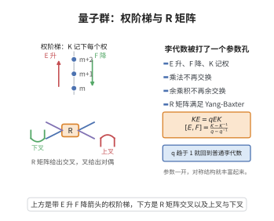

# 量子群定义与结构

> **一句话大白话**：把普通李代数"打一个参数孔"变成一族带参数的代数，参数回到特殊值时就是原来的李代数，却额外多了非交换非余交换的对称结构，叫"量子形变"。
>
> **小例子**：量子包络代数 $U_q(sl_2)$ 由 $E,F,K,K^{-1}$ 生成，满足 $KE=qEK,\,[E,F]=\tfrac{K-K^{-1}}{q-q^{-1}}$；$q\to1$ 时回到 $sl_2$ 的通常关系式。

## 一、定理介绍

> **前置依赖**：Hopf 代数公理（余乘积、余单位、对极）、复单李代数与 Cartan 矩阵、量子整数与 $q$–二项式系数、泛包络代数 $U(\mathfrak{g})$ 的形变思想。

量子群是 1980 年代由 Drinfeld 与 Jimbo 独立引入的一类非交换、非余交换 Hopf 代数，可以看作李群（或李代数）的“量子形变”。它们在量子可积系统、纽结不变量以及三维拓扑量子场论中起着核心作用。

## 几何直观

图意在说明：量子群由升、降、记权三组生成元与 R 矩阵的辫关系构成，参数趋于 1 时退回普通李代数。

## 二、原理思路
量子群的基本思想是将普通包络代数 $U(\mathfrak{g})$ 通过一个形式参数 $q$ 进行形变，使得其乘法结构保持李代数的本质信息，但余乘积 $\Delta$ 不再余交换。这样得到的代数既保留了 Hopf 代数的结构，又能产生满足 Yang–Baxter 方程的 $R$–矩阵。

## 三、定理的严格表述
设 $\mathfrak{g}$ 为复单李代数，$(a_{ij})_{i,j=1}^n$ 为其 Cartan 矩阵，$d_i$ 为正整数使得 $(d_i a_{ij})$ 对称。令 $q_i=q^{d_i}$。Drinfeld–Jimbo 量子包络代数 $U_q(\mathfrak{g})$ 是域 $\mathbb{C}(q)$ 上以 $E_i,F_i,K_i,K_i^{-1}$ $(i=1,\dots,n)$ 生成的结合代数，满足关系：
$$
K_iK_i^{-1}=K_i^{-1}K_i=1,\qquad K_iK_j=K_jK_i,
$$
$$
K_iE_jK_i^{-1}=q_i^{a_{ij}}E_j,\qquad K_iF_jK_i^{-1}=q_i^{-a_{ij}}F_j,
$$
$$
[E_i,F_j]=\delta_{ij}\frac{K_i-K_i^{-1}}{q_i-q_i^{-1}},
$$
以及对 $i\neq j$ 的 $q$–Serre 关系
$$
\sum_{k=0}^{1-a_{ij}}(-1)^k\begin{bmatrix}1-a_{ij}\\ k\end{bmatrix}_{q_i}E_i^{1-a_{ij}-k}E_jE_i^k=0,
$$
$$
\sum_{k=0}^{1-a_{ij}}(-1)^k\begin{bmatrix}1-a_{ij}\\ k\end{bmatrix}_{q_i}F_i^{1-a_{ij}-k}F_jF_i^k=0.
$$
此外，$U_q(\mathfrak{g})$ 具有 Hopf 代数结构：
$$
\Delta(K_i)=K_i\otimes K_i,\quad \Delta(E_i)=E_i\otimes K_i+1\otimes E_i,\quad \Delta(F_i)=F_i\otimes 1+K_i^{-1}\otimes F_i,
$$
$$
\varepsilon(K_i)=1,\quad \varepsilon(E_i)=\varepsilon(F_i)=0,
$$
$$
S(K_i)=K_i^{-1},\quad S(E_i)=-E_iK_i^{-1},\quad S(F_i)=-K_iF_i.
$$
因此，$(U_q(\mathfrak{g}),\Delta,\varepsilon,S)$ 构成一个 Hopf 代数。

## 四、证明过程
1. **代数关系相容性**：直接验证生成元间的 $q$–交换关系与 $q$–Serre 关系相互协调；例如检查 $[E_i,F_i]$ 对 $E_j$ 的作用与 $K_i$ 的作用一致。
2. **余代数公理**：验证 $\Delta$ 满足余结合律
   $$
   (\Delta\otimes\mathrm{id})\Delta=(\mathrm{id}\otimes\Delta)\Delta
   $$
   在生成元 $E_i,F_i,K_i$ 上成立；由于 $\Delta$ 是代数同态，它可延拓到整个 $U_q(\mathfrak{g})$。
3. **对极公理**：验证对极映射 $S$ 满足
   $$
   m(S\otimes\mathrm{id})\Delta(h)=m(\mathrm{id}\otimes S)\Delta(h)=\varepsilon(h)1
   $$
   对所有生成元 $h$ 成立。例如对 $E_i$：
   $$
   m(S\otimes\mathrm{id})\Delta(E_i)=S(E_i)K_i+E_i=(-E_iK_i^{-1})K_i+E_i=0.
   $$
   类似可验证 $F_i,K_i$。
4. **Hopf 代数结论**：由于生成元满足所有 Hopf 代数公理，且关系理想在 $\Delta,\varepsilon,S$ 下稳定，$U_q(\mathfrak{g})$ 为 Hopf 代数。

## 五、应用与意义
量子群为量子可积模型提供了代数框架，其表示范畴是辫范畴，从而导出 Jones、HOMFLY、Reshetikhin–Turaev 等纽结不变量。它们也是低维拓扑量子场论与量子计算中拓扑纠错码的数学基础。

## 课堂问答

**老师**：量子群形变在哪里？为什么它还是 Hopf 代数？

**学生**：结论：$U_q(\mathfrak g)$ 是 $U(\mathfrak g)$ 的单参数形变，乘法关系被 $q$ 化但 Hopf 结构保留。生成元 $E_i,F_i,K_i^{\pm1}$ 满足 $K_iE_jK_i^{-1}=q_i^{a_{ij}}E_j$、$[E_i,F_j]=\delta_{ij}\frac{K_i-K_i^{-1}}{q_i-q_i^{-1}}$ 及 $q$-Serre 关系；$q\to1$ 回到通常关系。

**老师（追问）**：为什么说它非余交换？

**学生**：因为 $\Delta(E_i)=E_i\otimes K_i+1\otimes E_i$、$\Delta(F_i)=F_i\otimes1+K_i^{-1}\otimes F_i$ 出现 $K_i$ 扭结因子而不再对称。正是这个非余交换性产生泛 $R$-矩阵，使表示范畴成为辫范畴；对极 $S(E_i)=-E_iK_i^{-1}$、$S(F_i)=-K_iF_i$ 保证 Hopf 公理。

**老师（拓展）**：为什么它是纽结不变量的来源？

**学生**：因为 $U_q(\mathfrak g)$ 的表示范畴是 ribbon 范畴：泛 $R$-矩阵满足 Yang–Baxter 方程给出辫群表示与交叉记号，量子维数与 twist 给出框架修正。于是闭辫取量子迹得 Jones、HOMFLY；模化后进一步得 Reshetikhin–Turaev 与 Turaev–Viro 不变量，把量子群与低维拓扑彻底绑定。
