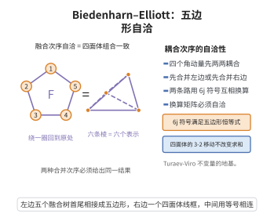

# Biedenharn-Elliott恒等式

> **一句话大白话**：把四份角动量按两种不同的次序先两两"合并"成中间态，再用翻译系数（6j 符号）把两种次序互相转换，两条路必须给出同一个结果；这条"结合律"写成等式就是五边形恒等式。

> **小例子**：在融合范畴中，$F$-符号（量子 6j 符号）满足五边形方程；在 Turaev–Viro 态求和中，它恰好保证四面体剖分之间 3–2 Pachner 移动不改变不变量。

## 一、定理介绍

> **前置依赖**：量子群定义与结构、Yang-Baxter方程、6j 符号与 Racah–Wigner 代数、Reshetikhin-Turaev不变量、三角剖分与 Turaev-Viro 不变量。

Biedenharn–Elliott 恒等式（Biedenharn–Elliott identity）最初由 Lawrence Biedenharn（1953）与 James Elliott（1955）在角动量耦合理论中发现，是 Racah–Wigner 代数中 6j 符号必须满足的一条基本一致性关系。物理背景是量子力学中四份角动量的耦合：把四个角动量先两两耦合成中间态，存在不同的耦合次序，而这些不同次序之间由 6j（Racah）系数互相转换；要求不同次序得到的基完全一致，就得到 Biedenharn–Elliott 恒等式。

在数学上，这条恒等式被识别为张量范畴的结合约束（associator）所满足的**五边形公理**（pentagon axiom）。Moore 与 Seiberg（1989）在二维共形场论中把它重述为融合矩阵的结合律（Moore–Seiberg 结合律）；Drinfeld 的准三角 Hopf 代数、Kashaev–Sergeev 的"五边形方程"也给出同一关系的代数形式。Turaev 与 Viro（1992）构造三维流形不变量时，正是用 6j 符号（$F$-符号）作为四面体的权，而 Biedenharn–Elliott 恒等式恰好对应态求和关于 3–2 Pachner 移动的不变性，从而保证所定义的不变量与三角剖分选取无关。因此这条恒等式是量子群表示论、融合范畴分类、拓扑量子场论与拓扑量子计算共享的枢纽性结果。

## 几何直观

图意在说明：四个角动量两种合并次序的换算必须首尾自洽，这条五边形恒等式等价于四面体的组合一致性。

## 二、原理思路

1. **把 6j 符号定义为换基矩阵**：同一条融合树的两种"结合次序"给出同一空间的两个基，$F$-矩阵（即归一化的 6j 符号）就是这两基之间的过渡矩阵。

2. **四重张量积给出两条路径**：从最左括号化 $((ab)c)d$ 走到最右括号化 $a(b(cd))$，可以先合并 $ab$（再处理 $cd$），也可以一路向右合并；每条路径都是一串 $F$-移动的复合。

3. **比较两条路径的复合**：两者都是从同一出发基到同一到达基的线性映射，结合一致性要求它们相等；按中间简单对象求和展开复合（每条路径展开成若干 $F$-符号的乘积之和），比较矩阵元即得五边形方程。

4. **球面归一化与 $q$-形变**：在球面（pivotal）结构下用迹与量子维度 $\Delta_h$ 归一化 6j 符号，五边形方程两端出现权 $\Delta_h = [2h+1]_q$；这一步由量子群的 ribbon 结构与 Yang–Baxter 方程保证自洽。

5. **几何解释与不变性**：五边形方程等价于四面体权在 3–2 Pachner 移动下不变，从而 Turaev–Viro 不变量良定义；同时它是融合环"可范畴化"的判别方程。

## 三、定理的严格表述

设 $\mathcal{C}$ 是 multiplicity-free 的（有限、球面）融合范畴，简单对象集合为 $\{a,b,c,\dots\}$，融合规则
$$a\otimes b \;\cong\; \bigoplus_{c} N_{ab}^{c}\, c,\qquad N_{ab}^{c}\in\{0,1\}.$$
记对偶对象为 $a^*$，量子维度为 $\Delta_a$，并约定 $N_{ab}^{c}=0$ 时相应的 $F$-符号为零。对每个允许的四元组，定义 $F$-符号（6j 符号）$F^{abf}_{cde}$ 为换基矩阵元：
$$|(ab)f;c\rangle = \sum_{e} F^{abf}_{cde}\,|a(bc)e\rangle .$$

**定理（Biedenharn–Elliott 恒等式 / 五边形方程）**：$F$-符号满足
$$F^{cfg^*}_{e^*dl^*}\,F^{baf^*}_{e^*lk^*} \;=\; \sum_{h} F^{baf^*}_{g^*ch^*}\,F^{hag^*}_{e^*dk^*}\,F^{cbh}_{k^*dl^*},$$
其中右端按所有允许的中间简单对象 $h$ 求和。该方程对一切使各项有定义的标号成立。

**等价的 6j 符号形式**：在 $\mathcal{C}$ 取为 $U_q(\mathfrak{sl}_2)$ 的（截断）表示范畴时，$F$-符号与量子 6j 符号成正比；用球面归一化（把 6j 符号除以合适的量子维度幂）后，上式化为经典的 Biedenharn–Elliott 恒等式：一个含五个 6j 符号、以量子维度 $\Delta_h=[2h+1]_q$ 为权的求和恒等式，它刻画了四个角动量两种耦合次序之间的一致性。

**定理（Pachner 不变性）**：若给三维流形三角剖分的每个四面体赋权 $F$-符号、每条边赋权 $\Delta_a$、每个顶点赋权 $\Delta_a^{-1}$，则所得态求和
$$TV(M) = \sum_{\text{coloring}} \prod_{\text{tet}} F \cdot \prod_{\text{edge}} \Delta \cdot \prod_{\text{vertex}} \Delta^{-1}$$
在 3–2 与 2–3 Pachner 移动下不变，从而只依赖于 $M$ 的拓扑。

## 四、证明过程

**步骤 1（回顾 $F$-移动的正交性）。** 由 $|(ab)f;c\rangle$ 与 $|a(bc)e\rangle$ 各自都是所在空间的幺正基，$F$-矩阵满足正交关系
$$\sum_e F^{abf}_{cde}\,\overline{F^{abf'}_{cde}} = \delta_{f}^{f'}$$
（在球面归一化下还需乘以 $\Delta_f/\Delta_a\Delta_b$ 之类的因子，这里取 multiplicity-free 且已归一化）。这是由"两组基都正交归一"直接得到的。

**步骤 2（给出四重张量积的两条路径）。** 考虑 $V_a\otimes V_b\otimes V_c\otimes V_d$ 的四种括号化。从 $((ab)c)d$ 出发，要用 $F$-移动走到 $a(b(cd))$，有两条本质不同的路径：

- **路径 A（先合并 $ab$，再把 $bc$、$cd$ 结合）**：
$$((ab)c)d \;\longrightarrow\; (ab)(cd) \;\longrightarrow\; a(b(cd)).$$
- **路径 B（一路向右结合）**：
$$((ab)c)d \;\longrightarrow\; (a(bc))d \;\longrightarrow\; a((bc)d) \;\longrightarrow\; a(b(cd)).$$

**步骤 3（把每条路径写成 $F$-符号的乘积）。** 路径 A 中，第一步把 $c$ 与 $d$ 结合需要一个 $F$-移动，第二步把 $ab$ 与 $cd$ 结合需要另一个 $F$-移动；把它们的矩阵元相乘并按 $cd$ 的中间态求和，得到
$$F^{cfg^*}_{e^*dl^*}\,F^{baf^*}_{e^*lk^*},$$
这是"先处理右侧"的复合。路径 B 中依次把 $bc$、$(bc)d$ 与 $a$ 结合，展开为
$$\sum_{h} F^{baf^*}_{g^*ch^*}\,F^{hag^*}_{e^*dk^*}\,F^{cbh}_{k^*dl^*},$$
其中求和指标 $h$ 遍历路径 B 中出现的中间简单对象。

**步骤 4（比较两条路径得五边形方程）。** 路径 A 与路径 B 都是把同一出发基变到同一到达基的线性映射。由张量范畴的结合约束满足相干性（Mac Lane 五边形公理），两条复合必须相等，因此在每一组标号上比较矩阵元即得
$$F^{cfg^*}_{e^*dl^*}\,F^{baf^*}_{e^*lk^*} = \sum_{h} F^{baf^*}_{g^*ch^*}\,F^{hag^*}_{e^*dk^*}\,F^{cbh}_{k^*dl^*}.$$
这正是 Biedenharn–Elliott（五边形）恒等式。$\square$

**步骤 5（$q$-形变与球面归一化的一致性）。** 取 $\mathcal{C}=\mathrm{Rep}_q(\mathfrak{sl}_2)$。量子群的结构给出 $R$-矩阵满足 Yang–Baxter 方程
$$R_{12}R_{13}R_{23} = R_{23}R_{13}R_{12},$$
它是 6j 符号"交换两个耦合次序"的实现；而把 $R$ 与 $F$ 组合并取量子迹（球面结构），即得球面 6j 符号。由于 $R$ 满足 YBE、$F$ 满足五边形方程，二者共同保证球面 6j 符号自洽，量子维度 $\Delta_h=[2h+1]_q$ 自然出现在求和中作为权。在此归一化下，步骤 4 的方程就是经典的 Biedenharn–Elliott 恒等式。$\square$

**步骤 6（推出 Pachner 不变性）。** 3–2 Pachner 移动把一个由三个四面体组成的"三棱柱"剖分换成两个四面体的剖分，中间共享一个内部三角形。态求和的局部因子之比恰为"两条耦合路径"之比；由步骤 4 的五边形方程，把内部三角形的标号 $h$ 求和后可把三个四面体的权化为两个四面体的权，且边权、顶点权的幂次恰好抵消。2–3 移动是 3–2 的逆，同理成立。由于任何两个三角剖分都可用 Pachner 移动互相转换，态求和与剖分无关，只依赖 $M$ 的拓扑。$\square$

## 五、应用与意义

- **角动量耦合与 Racah–Wigner 代数**：它是 6j 符号递推计算与重耦合矩阵完备性的基本关系，是原子物理、核物理中角动量理论的计算基础。

- **融合范畴与模张量范畴的分类**：解五边形方程（即寻找满足 Biedenharn–Elliott 恒等式的 $F$-符号）是"融合环可范畴化"的核心问题，用于分类 anyon 模型与模张量范畴。

- **共形场论**：Moore–Seiberg 结合律与 Verlinde 公式以五边形/六边形恒等式为骨架，保证相关函数的融合一致性。

- **三维流形不变量**：Turaev–Viro 不变量、Reshetikhin–Turaev 不变量与 Chern–Simons 理论的量子不变量，均以 Biedenharn–Elliott 恒等式保证剖分无关性（3–2 Pachner 移动）。

- **拓扑量子计算**：Fibonacci anyon 等模型的 $F$-矩阵与 $R$-矩阵必须满足五边形方程与六边形方程，这是通用量子门构造与编织计算的代数前提。

- **代数结构**：在准 Hopf 代数中它化为 associator 的一致性方程，在五边形方程研究中与四面体方程（3-单纯形方程）紧密相连。

## 课堂问答

**老师**：Biedenharn–Elliott 恒等式与 Mac Lane 五边形公理是同一件事吗？

**学生**：结论：是。$F$-符号是两种结合次序基之间的过渡矩阵 $|(ab)f;c\rangle=\sum_eF^{abf}_{cde}|a(bc)e\rangle$；把四重张量积从 $((ab)c)d$ 到 $a(b(cd))$ 的两条 $F$-移动路径比较，即得
$$
F^{cfg^*}_{e^*dl^*}F^{baf^*}_{e^*lk^*}=\sum_hF^{baf^*}_{g^*ch^*}F^{hag^*}_{e^*dk^*}F^{cbh}_{k^*dl^*}.
$$
这正是五边形方程。

**老师（追问）**：它为什么保证 Turaev–Viro 不变量与剖分无关？

**学生**：因为 $3\leftrightarrow2$ Pachner 移动把三个四面体换成两个、共享内部三角形 $h$。态求和的局部因子之比恰是两条耦合路径之比，五边形方程把三个四面体的权合并成两个，边权与顶点权幂次正好抵消；$2\leftrightarrow3$ 为其逆。任意两剖分可由 Pachner 移动互化，故态求和只依赖 $M$。

**老师（拓展）**：这条恒等式还有哪些身份？

**学生**：在角动量理论中是量子 $6j$ 符号的重耦合一致性；在融合范畴中是 associator 的五边形公理，是融合环可范畴化的核心方程；在共形场论中是 Moore–Seiberg 结合律的骨架；在拓扑量子计算中 Fibonacci anyon 的 $F$-矩阵必须满足它。它与 Yang–Baxter（六边形）并列为量子拓扑的两大一致性方程。

## 相关条目

- [三角剖分与Turaev-Viro不变量](./三角剖分与Turaev-Viro不变量.md)：本恒等式正是其态求和剖分无关性的代数保证。
- [量子群定义与结构](../第61级-量子群与纽结不变量/量子群定义与结构.md)：$q$-形变 6j 符号所在的代数框架。
- [Yang-Baxter方程](../第61级-量子群与纽结不变量/Yang-Baxter方程.md)：与五边形方程并列的结合/换序一致性方程。
- [Reshetikhin-Turaev不变量](../第61级-量子群与纽结不变量/Reshetikhin-Turaev不变量.md)：依赖同一套 6j 符号数据构造的流形不变量。
- [Jones多项式](../第61级-量子群与纽结不变量/Jones多项式.md)：量子群表示论与 6j 符号计算的重要应用出口。
