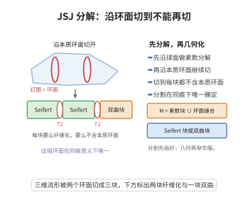

# JSJ 分解与环面定理

> **一句话大白话**：三维流形先沿球面切成"素数块"，再在每块里沿本质环面一直切到"要么规整（Seifert 纤维化）、要么空旷（再无本质环面，配双曲几何）"为止；这套环面分割在同痕意义下是唯一的。

> **小例子**：把两个 Seifert 纤维空间沿一个边界环面粘起来，粘合环面就是一块 JSJ 环面；沿它切开后两块都是 Seifert 块，故这已经是该流形的 JSJ 分解。

## 一、定理介绍

> **前置依赖**：三维流形基本定理、双曲化定理、Dehn手术定理、Heegaard分解、不可压缩曲面与本质环面、基本群与覆盖空间。

三维流形的分类遵循"先分解、再几何化"的路线：Kneser–Milnor 先沿球面做连通和，把流形拆成素数块；但素数块内部仍可能藏着彼此纠缠的本质环面。Jaco 与 Shalen、Johannson 于 1979 年分头证明：可以再沿一族本质环面切下去，直到每一块要么是 Seifert 纤维空间，要么不含本质环面（atoroidal）。这一"二次分解"很快成为 Thurston 几何化的组合骨架——几何化说每块要穿一件标准几何的外衣，而 JSJ 事先告诉你该在哪些缝下剪子。

与之配套的是环面定理：它把"基本群含 $\mathbb Z\oplus\mathbb Z$ 子群"这一纯代数信息翻译为几何信息（存在本质环面或 Seifert 结构），从而保证分割的切入口存在。本节先叙述环面定理，再给出 JSJ 分解的存在与唯一性，并说明它与几何化定理如何衔接。

## 几何直观

图意在说明：沿本质环面把流形切到每块都不含本质环面，这组分割在同痕意义下唯一。

## 二、原理思路

1. **环面定理提供切入口**：若 $\pi_1(M)$ 含 $\mathbb Z\oplus\mathbb Z$，则 $M$ 或已是 Seifert 纤维空间，或含有一块本质环面，故"切得下去"。

2. **极大性与有限性**：在所有互不相交、两两不平行的本质环面族中取极大者，并利用 Haken 流形的有限性（可由极小曲面/几乎正规曲面论证给出）证明这样的族是有限集。

3. **唯一性来自内蕴刻画**：JSJ 环面恰好是所有"极大 Seifert 块"（$M$ 中极大的 Seifert 纤维化子流形）的边界，而极大 Seifert 块由 $M$ 内蕴决定（特征子流形），故环面族在同痕意义下唯一。

4. **与几何化衔接**：切完以后，Seifert 块由 Thurston 几何化得到相应的 $S^3$、$E^3$、$S^2\times\mathbb R$、$\widetilde{\mathrm{SL}}(2,\mathbb R)$、$\mathrm{Nil}$、$\mathrm{Sol}$ 几何；atoroidal 块由双曲化定理得到双曲结构。

## 三、定理的严格表述

设 $M$ 是紧致、可定向、不可约的三维流形（允许边界由不可压缩环面组成）。称嵌入环面 $T\subset M$ 为**本质环面**，若 $T$ 是 $\pi_1$-单的（不可压缩）且不平行于边界、不是边界平行的分离环面。

**环面定理（Torus theorem；Feustel、Jaco–Shalen、Johannson、Scott）**：设 $M$ 紧致、可定向、不可约，且 $\pi_1(M)$ 含子群同构于 $\mathbb Z\oplus\mathbb Z$。则 $M$ 是 Seifert 纤维空间，或 $M$ 含有本质环面。

**JSJ 分解定理（Jaco–Shalen、Johannson）**：存在有限个互不相交、两两不平行的本质环面
$$
\mathcal T=\{T_1,\dots,T_k\},\qquad k\ge0,
$$
使得取每块环面的开管状邻域后开补的每个分支 $C$ 满足下列之一：

（i）$C$ 具有 Seifert 纤维化（作为带边流形的 Seifert 纤维空间）；

（ii）$C$ 不含本质环面，即 $C$ 是 atoroidal 的。

且 $\mathcal T$ 在极大性与唯一性意义下由 $M$ 唯一决定：$\mathcal T$ 正是 $M$ 中所有极大 Seifert 纤维化区块的边界，任意两个这样的极大环面族都相互同痕，故 JSJ 分解在同痕与置换意义下唯一。

## 四、证明过程

**步骤 1（归约到不含球面的情形）。** 不可约性保证 $\pi_2(M)=0$；若 $M$ 含可压缩环面 $T$，由 Dehn 引理与不可约性可把 $T$ 沿圆盘压缩，或 $M\cong S^1\times S^2$（后者单列处理，其 $\pi_1\cong\mathbb Z$ 不含 $\mathbb Z\oplus\mathbb Z$）。故可设 $M$ 中所有环面都不可压缩。

**步骤 2（由 $\mathbb Z\oplus\mathbb Z$ 构造不可压缩曲面）。** 设 $\mathbb Z\oplus\mathbb Z\cong P\le\pi_1(M)$。由覆盖空间对应与 Stallings 的构造，$P$ 的实现给出 $M$ 的一个有限叶覆盖及其中不可压缩曲面（在 $n$-流形中用 $H_1$ 的配对把群元素变成曲面）；在三维情形可取为嵌入环面，即得本质环面。故环面定理成立：$M$ 要么已由该环面或整体给出 Seifert 纤维化，要么获得一块本质环面。

**步骤 3（Seifert 块的基本群结构）。** 若 $C$ 是 Seifert 纤维空间，纤维类 $h$ 在 $\pi_1(C)$ 中正规，且
$$
1\to\langle h\rangle\cong\mathbb Z\to\pi_1(C)\to\pi_1^{\mathrm{orb}}(B)\to1 .
$$
其几何由底轨形 $B$ 的轨形 Euler 数
$$
\chi^{\mathrm{orb}}(B)=\chi(B)-\sum_{i}\Big(1-\frac1{\beta_i}\Big)
$$
决定：$\chi^{\mathrm{orb}}>0,=0,<0$ 分别对应球面型、欧氏型与 $\widetilde{\mathrm{SL}}(2,\mathbb R)$ 型几何。这条结构式说明 Seifert 块是"可算的规整块"。

**步骤 4（极大环面族的有限性）。** 按包含关系考虑所有互不相交、两两不平行的本质环面族。由 Haken 流形的有限性（对 $M$ 的每个补块的 Haken 复杂度 $-\chi$ 有下界，且环面数量不超过复杂度），任何极大族都只能含有限块环面。对补块逐个检查：若某补块仍含本质环面 $T'$，则可把 $T'$ 加入，与极大性矛盾，故极大族已使补块要么 Seifert（此时其边界环面可继续并入）、要么 atoroidal。

**步骤 5（唯一性）。** 定义 $M$ 中的极大 Seifert 区块为不含在更大 Seifert 子流形中的 Seifert 纤维化紧子流形。它是一个特征子流形（characteristic submanifold）：任何同痕无关的定义都给出同一族，因而已是内蕴的。JSJ 环面恰为这些极大 Seifert 区块的边界环面，于是 $\mathcal T$ 由 $M$ 唯一决定（差一同痕）。这就给出了存在性与唯一性。

**步骤 6（与几何化衔接）。** 设 $C$ 是 JSJ 分解的一个分支。若 $C$ 是 atoroidal 且既非 $S^3$、$S^2\times S^1$、也非 Seifert，则由双曲化定理，$C$ 的内部承认完备有限体积双曲度量；若 $C$ 是 Seifert，则由几何化取六种模型几何之一。于是 $M$ 被分解为若干几何块，每块几何经环面边界粘连。$\square$

## 五、应用与意义

- **三维流形分类的骨架**：JSJ 分解把一般三维流形的分类问题归约为 Seifert 流形与双曲流形的分类，是与连通和分解并列的两级结构。
- **判定算法**：JSJ 环面可由 $M$ 的拓扑（极大 Seifert 块）算法化识别，是三维流形判定问题（如几何化、双曲体积、基本群判定）的可计算前提。
- **几何化与双曲体积**：对双曲块可定义双曲体积，Gromov–Thurston 型结果给出体积是拓扑不变量；JSJ 分解保证这些量逐块良定义。
- **映射类群与曲面自同胚**：环面粘合面的映射类群（Dehn 扭转）刻画块与块之间如何粘合，是研究流形自同胚与 Heegaard 分解的连接点。
- **低维拓扑的前沿应用**：三维流形的虚拟纤维化、虚拟 Haken、L-space 猜想等都在 JSJ 分解的框架下表述与推进。

## 课堂问答

**老师**：JSJ 分解与素分解是什么关系？它切到什么时候停？

**学生**：结论：素分解沿球面切到素块，JSJ 再沿本质环面切下去，直到每块要么 Seifert 纤维化、要么 atoroidal。存在有限族互不相交不平行的本质环面 $\mathcal T=\{T_1,\dots,T_k\}$，使每块补分流形满足 Seifert 纤维化或不含本质环面，且 $\mathcal T$ 在同痕意义下唯一。

**老师（追问）**：环面定理在其中扮演什么角色？

**学生**：它提供切得下去的入口：若 $\pi_1(M)$ 含 $\mathbb Z\oplus\mathbb Z$ 子群，则 $M$ 已是 Seifert 纤维空间，或含本质环面。证明用覆盖空间对应与 Stallings：把群元素的实现变成有限叶覆盖里的不可压缩曲面，三维情形取为嵌入环面，于是纯代数信息被翻译成几何对象。

**老师（拓展）**：唯一性从何而来？

**学生**：从内蕴刻画。JSJ 环面恰是所有极大 Seifert 区块（特征子流形）的边界，而极大 Seifert 区块由 $M$ 内蕴决定，故任意两极大环面族相互同痕。切完后 atoroidal 块由双曲化定理得 $\mathbb H^3$ 几何，Seifert 块给出相应模型几何，正好衔接几何化。

## 相关条目

- [三维流形基本定理](./三维流形基本定理.md)：提供不可约性、素数分解与基本群的基础结论，是 JSJ 分解的出发点。
- [双曲化定理](./双曲化定理.md)：JSJ 分解后 atoroidal 块的双曲结构与几何块来源。
- [Dehn手术定理](./Dehn手术定理.md)：可压缩环面的压缩与环面改造所依赖的手术工具。
- [Heegaard分解](./Heegaard分解.md)：另一种把三维流形标准化分解的视角，与 JSJ 分解互补。
