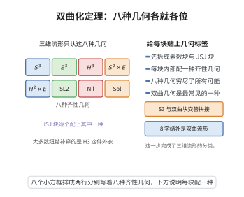

# 双曲化定理

> **一句话大白话**：一个闭的三维流形，只要它"不可约、不含环面、基本群无限"，就一定是双曲流形——可以赋予一个体积有限的完备双曲度量。三维流形的大多数都是双曲的。
>
> **小例子**：8 字结补 $S^3\setminus K_{8}$ 与 Whitehead 链环补都是有限体积双曲流形（8 字结补的体积约为 $2.0299\ldots$）；而 $S^3$、$S^2\times S^1$ 不具备双曲结构。

## 一、定理介绍

> **前置依赖**：三维流形基本定理、Dehn手术定理、Heegaard分解、曲面映射类群、JSJ分解与环面定理、Mostow刚性定理（概念）。

双曲化定理（hyperbolization theorem）是 William Thurston 在 1970 年代末提出的三维流形几何化纲领的核心部分，其 Haken 流形情形由他在 1970 年代末完成证明（1982 年正式发表），非 Haken 情形则随 Perelman（2002–2003）用带手术的 Ricci 流证明几何化定理而被覆盖。Thurston 宣布此结果时，三维流形被普遍认为是"难以理解"的对象；双曲化定理表明绝大多数三维流形其实都承载着刚性的双曲几何。

定理的动机来自对三维流形的分类：二维情形有单值化定理（每个曲面有球面、欧氏或双曲度量），Thurston 猜测三维流形沿球面与环面分解后，每块恰有八种几何之一，其中双曲几何是最普遍的一种。双曲化定理断言：在不可约、atoroidal 且 $\pi_1$ 无限的前提下，双曲几何必然出现。

定理的意义有四个层面。其一，配合 Mostow 刚性定理，双曲结构在同构意义下唯一，于是体积、cusps、谱等都是拓扑不变量。其二，它把三维流形基本群与离散群（Kleinian 群）、算术群联系起来。其三，它使纽结与链环补的分类变得可行：除环面纽结与卫星纽结外，所有纽结补都是双曲的。其四，它为几何群论提供了丰富的例子：绝大多数三维流形基本群是 Gromov 双曲群。

## 几何直观

图意在说明：三维流形经素数分解与 JSJ 分解后，每一块内部只承载八种齐性几何中的一种。

## 二、原理思路

1. **化归到不可约、atoroidal 的 piece**：由 Kneser–Milnor 素分解与 JSJ 环面分解，任何紧可定向三维流形沿球面与不可压缩环面分解为若干块；只需对不可约且 atoroidal 的块证明双曲化，其余（Seifert 纤维化块）由其他七种几何处理。

2. **Haken 情形的分层双曲化**：若流形含不可压缩曲面 $S$，把它沿 $S$ 切开得到较简单的流形，分别构造"底角足够大"的双曲结构，再用 Thurston 的双极限（double limit）论证拼回。

3. **2π 定理控制拼接条件**：Gromov–Thurston 的 2π 定理把"能否拼接出双曲结构"化归为边界曲线底角的几何条件，使归纳拼接成为可能。

4. **Hyperbolic Dehn filling 处理环面边界**：带环面边界的双曲流形除有限个斜度外的一切 Dehn 填实仍为双曲，从而把带边界的双曲结构封闭为闭流形的情形。

5. **非 Haken 情形与几何化**：不含不可压缩曲面的情形由 Perelman 的 Ricci 流证明几何化定理覆盖；最后由 Mostow 刚性给出唯一性。

## 三、定理的严格表述

**定理（Thurston 双曲化定理）**：设 $M$ 为闭、可定向、连通的三维流形。若
$$M\ \text{不可约},\qquad M\ \text{atoroidal},\qquad \lvert\pi_1(M)\rvert=\infty,$$
则 $M$ 上存在完备、有限体积的双曲度量，即存在离散、无挠子群 $\Gamma<\operatorname{Isom}^+(\mathbb H^3)$ 与等距同构
$$M\cong\mathbb H^3/\Gamma .$$
"不可约"指每个嵌入 $S^2\subset M$ 都界一个三维球；"atoroidal"指每个 $\pi_1$-injective 的嵌入环面都与边界平行（闭情形即不存在）。

**带边界 / cusp 版本**：设 $N$ 紧、可定向、不可约，$\partial N$ 由环面构成，且 $N$ 带有向 pared 结构（Haken 且 atoroidal 是典型情形）。则 $\operatorname{int}N$ 上有完备、有限体积的双曲结构，每个环面边界分支对应一个 cusp（尖点）。

**唯一性（Mostow–Prasad 刚性）**：上述双曲结构在保定向等距同构意义下唯一；特别地，双曲体积 $\operatorname{Vol}(M)$ 是拓扑不变量。

**几何化定理（Thurston 猜想，Perelman 2003）**：每个闭可定向三维流形经素分解与 JSJ 分解后，每个 piece 上承载八种几何之一（$\mathbb H^3$、$\mathbb R^3$、$\mathbb S^3$、$\mathbb S^2\times\mathbb R$、$\mathbb H^2\times\mathbb R$、$\widetilde{SL_2\mathbb R}$、Nil、Sol）；双曲化定理是其中 $\mathbb H^3$ 情形的精确表述。

## 四、证明过程

**步骤 1（素分解与 JSJ 化归）。** 由三维流形基本定理，$M$ 有唯一素分解（Kneser–Milnor）$M=M_1\#\cdots\#M_k$，且可沿一组互不相交的不可压缩环面作 JSJ 分解，使每个 piece 或是 Seifert 纤维化，或是 atoroidal。球面型 piece（$S^3$、透镜空间等）与 Seifert piece 由球面几何或 $\mathbb H^2\times\mathbb R$、$\widetilde{SL_2\mathbb R}$、Nil、Sol 几何处理；因此只剩下"不可约 + atoroidal"的 piece 需要构造双曲结构。这一步把定理化为对 Haken 与 atoroidal 情形的断言。

**步骤 2（Haken 流形的分层结构与双极限）。** 设 $M$ 紧、可定向、不可约、Haken，且 atoroidal。取 $M$ 中一条不可压缩曲面 $S$，把 $M$ 沿 $S$ 切开得到 $M_S$（边界含 $S$ 的两个拷贝）。对 $M$ 递归地作"分层"（hierarchy）：反复沿不可压缩曲面切开，直到各 piece 都是三维球（由 Haken 的层级定理，这总能做到）。Thurston 的策略是从层级末端（三维球，有标准的双曲理想多面体结构，如正理想四面体）出发，逐层把双曲结构"粘回"：每一步要用一个由"分层曲面"控制的 gluings，并保证粘合处的底角至少 $2\pi$。这把问题化为逐步的粘合问题。

**步骤 3（2π 定理与底角条件）。** 粘合之所以可行的核心是 Gromov–Thurston 的 2π 定理：设 $N$ 紧、可定向、带不可压缩边界，若 $N$ 上存在双曲结构使每条边界曲线对应的底角总和 $\ge2\pi$，则 $N$ 允许完备双曲结构。更一般的形式用 $\pi_1(N)$ 与边界子群的表示语言表述。于是步骤 2 中每一步的粘合只要保证底角条件，就能得到双曲结构；借助层级中"分层曲面可任意变复杂"的自由度（沿曲面作 Dehn 扭转可使底角增大），底角条件可以逐步满足。

**步骤 4（Hyperbolic Dehn filling 与封闭环面边界）。** 设 $N$ 紧、可定向、$\partial N$ 由环面构成，$\operatorname{int}N$ 有完备有限体积双曲结构。由 Thurston 的 hyperbolic Dehn filling 定理，除有限个斜度 $p/q\in\mathbb Q\cup\{\infty\}$ 外，沿边界环面作 $p/q$-填实所得闭流形 $N(p/q)$ 仍是双曲的；并且当 $p/q\to\infty$（即 cusp 变长）时有 $\operatorname{Vol}(N(p/q))\to\operatorname{Vol}(N)$。这使步骤 3 得到的带边界双曲结构能封闭为闭流形的情形。

**步骤 5（闭 Haken 情形）。** 设 $M$ 闭、不可约、atoroidal、Haken（例如含不可压缩曲面）。由步骤 2 至步骤 4，对 $M$ 的层级与粘合逐个构造双曲结构：每一步的边界环面都可填实，而 atoroidal 假设保证不会出现"额外的"不可压缩环面（由环面定理与 JSJ 分解，$\pi_1$-injective 环面必进入 JSJ 分解；atoroidal 使 JSJ 分解平凡，故不存在此类障碍）。于是 $M\cong\mathbb H^3/\Gamma$，双曲体积有限。这给出闭 Haken 情形的证明。

**步骤 6（非 Haken 情形与唯一性）。** 对不含不可压缩曲面的（非 Haken）闭流形，Thurston 原证不适用。Perelman（2002–2003）用带手术的 Ricci 流证明了几何化定理：任意闭可定向三维流形沿球面与环面分解后，每个 piece 上出现八种几何之一，双曲 piece 上由此获得双曲度量。最后，Mostow–Prasad 刚性定理（对有限体积双曲三维流形）给出结构的唯一性：任何两个双曲结构在保定向等距同构意义下相同，因而体积、cusps 的个数与形状、闭测地线长度谱都是拓扑不变量。$\square$

**注**：定理的"atoroidal"条件不可省略：含不可压缩环面的流形经 JSJ 分解后可能出现 Seifert piece，其几何不是 $\mathbb H^3$。"$\pi_1$ 无限"同样必要，否则流形为球面型（$S^3$ 或透镜空间），由 $\mathbb S^3$ 几何刻画。

## 五、应用与意义

- **三维流形的分类**：与 Mostow 刚性配合，使双曲体积成为拓扑不变量；结合补空间的体积计算，成为区分双曲三维流形的强不变量。
- **纽结与链环补**：除环面纽结与卫星纽结外，所有纽结补都是双曲的；8 字结补、Whitehead 链环补是经典例子，其 cusp 与 Alexander 多项式、A-多项式相关。
- **Kleinian 群与算术性**：把三维流形化为 $\mathbb H^3$ 的离散群商，与 Kleinian 群、Bianchi 群、迹域（trace field）等数论对象相连。
- **几何群论**：大部分三维流形基本群是 Gromov 双曲群，具有线性 Dehn 函数与有理增长函数，是几何群论最重要的例子来源之一。
- **映射环面与曲面自同构**：亏格 $g\geq2$ 曲面沿伪 Anosov 映射的映射环面是双曲的，把 Nielsen–Thurston 分类与双曲几何联系起来。
- **物理与拓扑量子场论**：双曲体积猜想（Volume conjecture）把双曲体积与 Jones 多项式、Chern–Simons 理论的渐近行为联系起来。

## 课堂问答

**老师**：双曲化定理的假设为什么正好是不可约、atoroidal 且 $\pi_1$ 无限？

**学生**：结论：这三条恰好排除所有非双曲退化。不可约排除 $S^2$ 分裂（否则有球面几何块），atoroidal 排除本质环面（否则由环面定理落入 Seifert 情形），$\pi_1$ 无限排除 $S^3$、透镜空间等球面型。剩下只能赋予 $\mathbb H^3$，即 $M\cong\mathbb H^3/\Gamma$，$\Gamma<\operatorname{Isom}^+(\mathbb H^3)$ 离散无挠余有限。

**老师（追问）**：Haken 情形怎么证？

**学生**：用分层（hierarchy）。取不可压缩曲面切开 $M$，递归切到各块都是三维球；从末端球的标准正理想四面体双曲结构出发逐层粘回，每步可行性由 Gromov–Thurston 的 $2\pi$ 定理控制——只要边界曲线的底角总和 $\ge2\pi$ 就能拼接，而沿分层曲面作 Dehn 扭转可任意增大底角。最后用 hyperbolic Dehn filling 封闭环面边界。

**老师（拓展）**：非 Haken 情形与唯一性由谁补上？

**学生**：非 Haken 情形由 Perelman 用带手术的 Ricci 流证明几何化定理覆盖，任意闭可定向流形沿球面与环面分解后每块落八几何之一。唯一性由 Mostow–Prasad 刚性保证：有限体积双曲结构的等距类只依赖 $\pi_1$，故体积、cusps、长度谱都是拓扑不变量。定理把三维流形基本群与 Kleinian 群、算术群、Gromov 双曲群连成整体。

## 相关条目

- [三维流形基本定理](./三维流形基本定理.md)：素分解、三角剖分存在性与光滑结构唯一性，是化归步骤的基础。
- [Dehn手术定理](./Dehn手术定理.md)：hyperbolic Dehn filling 与手术描述的语言。
- [Heegaard分解](./Heegaard分解.md)：把三维流形分解为两个柄体，是构造各种例子的常用工具。
- [曲面映射类群](./曲面映射类群.md)：映射环面的双曲性与映射类群的 Nielsen–Thurston 分类直接相关。
- [映射类群的Dehn扭转生成定理](./映射类群的Dehn扭转生成定理.md)：粘合映射的扭转分解是构造与比较双曲结构的代数手段。
- [Alexander多项式](./Alexander多项式.md)：纽结补的拓扑不变量，与丛的 acyclicity 及双曲性判定相关。
- [Ricci流与Poincare猜想](../第49级-黎曼几何/Ricci流与Poincare猜想.md)：Perelman 证明几何化定理的解析工具。
- [双曲群的Cartan-Hadamard定理](../第90级-几何群论/双曲群的Cartan-Hadamard定理.md)：双曲三维流形基本群的 Gromov 双曲性及其几何推论。
