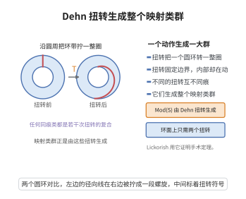

# 映射类群的 Dehn 扭转生成定理

> **一句话大白话**：曲面上的每个"对称"（保定向同胚的同痕类）都能拆成有限个基本动作——沿简单闭曲线把曲面切开、扭转一圈再粘回去。
>
> **小例子**：环面 $T^2$ 的映射类群是 $\operatorname{SL}_2(\mathbb Z)$，由沿两条生成曲线的 Dehn 扭转 $T_a,T_b$ 生成，满足 $(T_aT_b)^6=1$；亏格 $g$ 的闭曲面只需 $2g+1$ 条曲线的扭转（Humphries 生成元）。

## 一、定理介绍

> **前置依赖**：曲面映射类群、简单闭曲线与 Dehn 扭转概念、基本群定义与性质、Nielsen 实现定理、双曲曲面的测地线理论。

映射类群的 Dehn 扭转生成定理（Dehn–Lickorish theorem）断言：紧可定向曲面 $S$ 的保定向映射类群 $\operatorname{Mod}(S)$ 可由有限个 Dehn 扭转生成。Dehn 在 1938 年对闭曲面给出证明（其思想基于三角剖分与弧的缩短算法），Lickorish 在 1964 年给出 $3g-1$ 条曲线的显式生成集，Humphries 在 1979 年指出对 $g\geq2$ 的闭曲面只需 $2g+1$ 条曲线且此数不可再减，Wajnryb 在 1983 年进一步给出有限表示。

定理的动机是把"曲面的对称性"这一几何对象代数化。映射类群本身定义抽象（同胚的同痕类），难以直接计算；Dehn 扭转生成定理把它化归为有限个组合生成元的自由积取商，从而使换位子结构、同调作用、表示等问题都变得可计算。

定理的意义有三层。其一，它是 Lickorish–Wallace 手术定理的代数输入：把 Heegaard 粘合映射写成 Dehn 扭转之积，再把每条扭转实现为 $\pm1$-框手术，即得三维流形的手术描述。其二，它为 Nielsen–Thurston 分类提供了生成的出发点：每个映射类群元素由 Dehn 扭转表达后，可用它们对测地线的作用判定其为有限阶、可约或伪 Anosov 型。其三，它是几何群论与 Teichmüller 理论的基本工具：Dehn 扭转在 Teichmüller 空间上的作用是构造 earthquake 流、Fenchel–Nielsen 坐标与 curve complex 上的（双曲）作用的起点。

## 几何直观

图意在说明：沿圆环把带状区域拧一整圈，这种扭转以及它们的复合就生成了整个映射类群。

## 二、原理思路

1. **Dehn 扭转的定义**：沿本质简单闭曲线 $a$ 的管状邻域作整扭转、外部保持不动，得到同胚 $T_a$；其同痕类只依赖 $a$ 的同痕类，且满足共轭公式 $T_{f(a)}=fT_af^{-1}$。

2. **用弧系统把曲面切成盘**：取互不相交的弧把曲面切成圆盘（等价于 pants 分解），若一个同胚固定所有弧的同痕类，则它同痕于恒等。

3. **Dehn 的缩短归纳**：若 $f$ 不固定某条弧，则可用适当的 $T_a^{\pm1}$ 减少 $f(\alpha)$ 与 $\alpha$ 的交点数，对交点数归纳即把 $f$ 化为恒等。

4. **局部生成元与拼接**：pants 分解中每个 pair of pants 的交换同胚由三条边界曲线的扭转组合实现，沿分解拼接即得有限生成性与 Lickorish 生成元。

5. **极小生成集**：对闭曲面取链式曲线加一条额外曲线共 $2g+1$ 条，足以生成；极小性由曲线图上的组合论证给出。

## 三、定理的严格表述

**定理（Dehn 1938；Lickorish 1964）**：设 $S$ 是紧、可定向、连通曲面（可带边界分支与 puncture），$\operatorname{Mod}(S)$ 为其保定向映射类群。则存在有限条本质简单闭曲线 $a_1,\dots,a_k\subset S$ 使
$$\operatorname{Mod}(S)=\langle T_{a_1},T_{a_2},\dots,T_{a_k}\rangle .$$

**具体生成集**：
$$\text{Lickorish 生成元：}\quad 3g-1\ \text{条曲线（亏格 }g\ge1\text{）;}$$
$$\text{Humphries 生成元：}\quad a_1,b_1,a_2,b_2,\dots,a_g,b_g,c\ \text{共}\ 2g+1\ \text{条曲线}\ (g\ge2),$$
其中 $a_i,b_i$ 依次链式排列（相邻者恰好相交一次、非相邻者不交），$c$ 为链端附近的一条曲线。Humphries 生成元是极小的：$\operatorname{Mod}(S_g)$ 不能由少于 $2g+1$ 个 Dehn 扭转生成。

**环面情形**：$\operatorname{Mod}(T^2)\cong\operatorname{SL}_2(\mathbb Z)$，且存在同构
$$\langle T_a,T_b\mid (T_aT_b)^6=1,\ T_aT_bT_a=T_bT_aT_b\rangle\ \cong\ \operatorname{SL}_2(\mathbb Z),$$
即 braid 关系。一般 $g\geq2$ 时，Dehn 扭转生成元之间的关系由 lantern 关系、braid 关系与 chain 关系生成，从而给出有限表示（Wajnryb 1983）。

## 四、证明过程

**步骤 1（Dehn 扭转的定义与基本性质）。** 设 $a\subset S$ 为本质简单闭曲线，$A$ 为其余管状邻域，取保持定向的坐标 $A\cong S^1\times[0,1]$，使 $a=S^1\times\{\tfrac12\}$。定义 $T_a:S\to S$ 为
$$T_a(\theta,t)=(\theta+2\pi t,\ t)\quad\text{于 }A,\qquad T_a=\operatorname{id}\quad\text{于 }S\setminus\operatorname{int}A .$$
在 $\partial A$ 上 $t=0$ 与 $t=1$ 处扭转角分别为 $0$ 与 $2\pi$，故 $T_a$ 与恒等在边界相容，是良定义的同胚。基本性质：(i) $T_a$ 只依赖 $a$ 的同痕类；(ii) 若 $f$ 为同胚则 $T_{f(a)}=f\,T_a\,f^{-1}$；(iii) $T_a$ 在 $H_1(S)$ 上的作用为 $[b]\mapsto[b]+i(b,a)[a]$（$i$ 为代数交数）。

**步骤 2（环面情形，直接计算）。** 取 $T^2=\mathbb R^2/\mathbb Z^2$，$a$ 为 $x$ 方向曲线、$b$ 为 $y$ 方向曲线。沿 $a$ 切开 $T^2$ 得圆柱，扭转一圈后粘回，使 $y$ 方向整体平移一格：在基 $\{a,b\}$ 下
$$T_a=\begin{pmatrix}1&1\\0&1\end{pmatrix},\qquad T_b=\begin{pmatrix}1&0\\1&1\end{pmatrix}.$$
这两个矩阵生成 $\operatorname{SL}_2(\mathbb Z)$（欧几里得算法）。又 $T_aT_b$ 是绕某点的 $60^\circ$ 旋转，故 $(T_aT_b)^6=1$；且 $T_a,T_b$ 满足 braid 关系。由 $T^2$ 的映射类群同构于 $\operatorname{SL}_2(\mathbb Z)$（由其在 $H_1(T^2)=\mathbb Z^2$ 上的作用与保交数形式给出，作用已是同构），环面情形得证。

**步骤 3（弧系统与化归到"固定弧"）。** 取 $S$ 的一组互不相交的真弧（proper arcs）$\alpha_1,\dots,\alpha_m$，它们把 $S$ 切成若干圆盘（若 $S$ 有边界；闭曲面情形用"弧的枚举 + pants 分解"同样可组织）。设 $f\in\operatorname{Homeo}^+(S)$。若 $f(\alpha_i)$ 同痕于 $\alpha_i$（相对端点固定）对一切 $i$ 成立，则 $f$ 同痕于恒等：事实上 $S$ 沿这些弧切割后的每块都是圆盘，$f$ 在每块上由边界值决定，而同痕固定边界的圆盘同胚同痕于恒等（Alexander 技巧），故整体同痕于恒等。

**步骤 4（Dehn 的缩短归纳）。** 设 $f$ 不满足步骤 3 的条件。取弧 $\alpha$ 与其像 $f(\alpha)$ 处于一般位置，令 $k=\#(\alpha\cap f(\alpha))$ 为最小交点数（对所有弧取最小者），不妨 $k>0$。取交点 $p$ 与由 $\alpha\cup f(\alpha)$ 围出的最内层区域所确定的本质曲线 $a$（"枚举曲线"），则 $T_a^{\pm1}$ 把 $f(\alpha)$ 沿 $a$ 滑动，消去 $p$ 处的交叉，使 $\#(\alpha\cap T_a^{\pm1}f(\alpha))<k$。对 $k$ 作归纳，存在 Dehn 扭转之积 $g=T_{a}^{(r)}\cdots T_{a}^{(1)}$ 使 $gf$ 固定全部弧，由步骤 3，$gf$ 同痕于恒等。于是
$$f\ \text{同痕于}\ (T_{a}^{(r)}\cdots T_{a}^{(1)})^{-1},$$
是 Dehn 扭转之积。这给出 Dehn 的原始论证。

**步骤 5（pants 分解给出的显式生成元）。** 把 $S$ 沿一组互不相交的本质曲线（pants 分解曲线）切成 pair of pants。每个 pair of pants $P$（边界曲线 $c_1,c_2,c_3$）的"交换"同胚（把 $c_1,c_2$ 互换的 $120^\circ$ 型对称）可写成
$$\sigma_P=T_{c_1}T_{c_2}T_{c_3}\quad\text{的适当幂与组合},$$
而圆周的半扭转可写成沿一条链式曲线族的 Dehn 扭转之积。把这些局部生成元沿 pants 分解曲线拼接（对相邻 pants 之间的曲线再各取一个扭转），即得：$\operatorname{Mod}(S)$ 由 pants 分解的曲线（共 $3g-3+b$ 类）加若干对偶曲线生成，总计 $3g-1$（$b=0$）条。这就是 Lickorish 生成元。

**步骤 6（Humphries 生成元的充分性与极小性）。** 取其相邻相交一次的链
$$a_1,b_1,a_2,b_2,\dots,a_g,b_g,$$
再加一条 $c$（$c$ 与链端相交一次）。由上一步的局部生成元与 lantern 关系（对 pair of pants $P_1,P_2$ 沿公共边界粘合，有 $T_{\partial P_1}T_{\partial P_2}=T_{\partial P_3}$ 型关系）与 braid 关系，可把每个 Lickorish 生成元表示为这些链式扭转的乘积，故这 $2g+1$ 个扭转生成 $\operatorname{Mod}(S_g)$。极小性（Humphries 1979）：若一组简单闭曲线在"曲线图"（顶点为曲线同痕类、相邻当且仅当可用不交代表实现相交数 1）上的邻域图连通并生成 $\operatorname{Mod}(S)$，则该子图必含一个生成图，而曲线图上的最小生成图恰有 $2g+1$ 个顶点（$g=2$ 时由枚举曲线图验证，一般 $g$ 由曲线图的结构与连通性论证）。

**步骤 7（关系与有限表示）。** Dehn 扭转之间的关系分为三类：lantern 关系（三个 pair of pants 的关系）、braid 关系（$T_aT_bT_a=T_bT_aT_b$，当 $a,b$ 相交一次时）与 chain 关系（链式曲线的较长关系）。对 $g\geq1$，这些关系给出 $\operatorname{Mod}(S_g)$ 的有限表示（Wajnryb 1983）；$g=1$ 时退化为步骤 2 中的 braid 关系。$\square$

## 五、应用与意义

- **Lickorish–Wallace 手术定理**：Heegaard 粘合映射的扭转分解加"扭转可由 $\pm1$-框手术实现"，直接给出三维流形的手术描述。
- **Nielsen–Thurston 分类**：Dehn 扭转生成元使映射类群元素的作用可计算，从而判定其有限阶、可约或伪 Anosov 类型，并构造映射环面的双曲结构。
- **Teichmüller 理论与模空间**：Dehn 扭转在 Teichmüller 空间上的作用是 earthquake 变形与 Fenchel–Nielsen 坐标的来源；也是 Thurston 紧化理论的工具。
- **曲线图与几何群论**：$\operatorname{Mod}(S_g)$ 在曲线复形（curve complex）上的作用是（相对）双曲的（Masur–Minsky、Mazur–Minsky），Dehn 扭转是其基本元素。
- **同调与 Torelli 群**：Dehn 扭转在 $H_1(S)$ 上的显式作用给出 $\operatorname{Mod}(S)\to\operatorname{Sp}(2g,\mathbb Z)$ 的满同态，Torelli 群、Johnson 同态与 Johnson 滤过都由 Dehn 扭转生成元刻画。

## 课堂问答

**老师**：Dehn 扭转生成定理的证明为什么能归结为归纳？

**学生**：结论：靠 Dehn 的缩短归纳。取互不相交的真弧把曲面切成圆盘；若同胚 $f$ 固定所有弧的同痕类，则由 Alexander 技巧它在每块圆盘上同痕于恒等。若不固定，取弧 $\alpha$ 与其像 $f(\alpha)$ 的最内层区域定出本质曲线 $a$，$T_a^{\pm1}$ 消去一个交点使 $\#(\alpha\cap T_a^{\pm1}f(\alpha))<k$，对交点数归纳即把 $f$ 写成 Dehn 扭转之积。

**老师（追问）**：环面情形怎么算？

**学生**：$T^2=\mathbb R^2/\mathbb Z^2$，沿 $a,b$ 的扭转在基 $\{a,b\}$ 下是 $T_a=\begin{pmatrix}1&1\\0&1\end{pmatrix}$、$T_b=\begin{pmatrix}1&0\\1&1\end{pmatrix}$，两者生成 $\operatorname{SL}_2(\mathbb Z)\cong\mathrm{Mod}(T^2)$；$T_aT_b$ 是 $60^\circ$ 旋转，故 $(T_aT_b)^6=1$，且满足 braid 关系 $T_aT_bT_a=T_bT_aT_b$。

**老师（拓展）**：Humphries 生成元为何既够用又极小？

**学生**：够用靠 pants 分解：每对裤子的交换同胚可写成三条边界曲线扭转的组合，沿分解拼接即得 $3g-1$ 个 Lickorish 生成元；再用 lantern 与 braid 关系化到链式曲线 $a_1,b_1,\dots,a_g,b_g$ 加一条 $c$，共 $2g+1$ 个。极小性由曲线图论证：能生成 $\operatorname{Mod}(S_g)$ 的最小邻域图恰有 $2g+1$ 个顶点。它是 Lickorish–Wallace 手术定理的代数输入。

## 相关条目

- [曲面映射类群](./曲面映射类群.md)：本定理所生成的群的几何与代数结构与 Nielsen–Thurston 分类。
- [双曲化定理](./双曲化定理.md)：映射环面的双曲性依赖扭转生成与伪 Anosov 理论。
- [三维流形基本定理](./三维流形基本定理.md)：Heegaard 分解与三维流形的基本结果。
- [Dehn手术定理](./Dehn手术定理.md)：把 Dehn 扭转对应到手术操作的实现机制。
- [Lickorish–Wallace手术定理](../第61级-量子群与纽结不变量/Lickorish–Wallace手术定理.md)：本定理最著名的下游应用。
- [Dehn函数的性质](../第90级-几何群论/Dehn函数的性质.md)：双曲群中 Dehn 函数的线性性，与映射类群的双曲性相呼应。
- [群的拟等距分类](../第90级-几何群论/群的拟等距分类.md)：映射类群的拟等距不变性质的研究框架。
