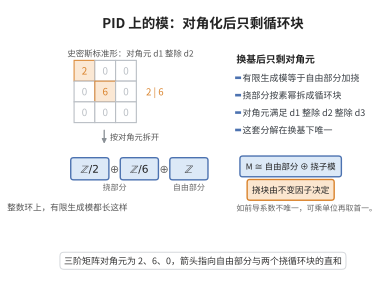

# 主理想整环上的有限生成模结构定理

> **一句话大白话**：在主理想整环上，每个有限生成模都能唯一地拆成"自由部分加若干循环挠模"，像整数唯一分解一样干净；整数、多项式、线性算子三套"标准形"其实是同一条定理。
>
> **小例子**：$R=\mathbb Z$ 时得有限生成阿贝尔群分类 $\mathbb Z^r\oplus\mathbb Z/d_1\oplus\cdots\oplus\mathbb Z/d_s$（$d_1\mid\cdots\mid d_s$），如 $\mathbb Z/6\cong\mathbb Z/2\oplus\mathbb Z/3$；$R=k[x]$ 时得 Jordan 标准形，$k[x]/((x-\lambda)^e)$ 对应一个 Jordan 块。

## 一、定理介绍

> **前置依赖**：主理想整环（PID）与唯一分解整环概念、自由模与子模的有限生成性、Smith标准形、Hilbert基定理、Krull–Schmidt定理。

主理想整环上的有限生成模结构定理（structure theorem for finitely generated modules over a PID）是抽象代数的核心定理之一。它断言：若 $R$ 是主理想整环、$M$ 是有限生成 $R$-模，则 $M$ 唯一地同构于一个自由模与若干循环挠模的直和，其中循环模的零化子满足整除链 $d_1\mid d_2\mid\cdots\mid d_s$（不变因子形式），或等价地写为素元幂的直和（初等因子形式）。

这一思想有漫长的历史：有限生成阿贝尔群的分类由 Kronecker、Frobenius 与 Stickelberger 在 19 世纪 70 年代给出；Dedekind 与 Weber 在代数数论中研究理想类群；Noether 在 1921 年用升链条件把结论抽象化，得到现代环论形式。定理的动机是统一三类看似不同的分类问题：整数的唯一分解（$R=\mathbb Z$）、多项式因式分解（$R=k[x]$）与线性算子的标准形（$k[x]$-模）。

定理的意义有三层。其一，它是有限生成阿贝尔群分类的完整答案，也是整数矩阵 Smith 标准形的模论解释。其二，它给出线性代数的两大标准形：取 $R=k[x]$、$M=k^n$（$x$ 作用为线性算子）即得有理标准形与 Jordan 标准形。其三，它是拓扑数据分析中 barcode 分解的代数引擎：把持久模看作分次 $k[x]$-模，定理的不变因子恰好对应区间 $[b,d)$（参见区间分解定理）。

## 几何直观

图意在说明：换一组基后矩阵只剩对角线，模便拆成一个自由部分加上若干素幂循环块。

## 二、原理思路

1. **有限生成的传递**：PID 是 Noether 环，$R^n$ 的每个子模都有限生成（Hilbert 基定理的推广），故可用一个自由模"表示"$M$。

2. **取自由表示**：由 $M$ 的 $n$ 个生成元得满射 $R^n\twoheadrightarrow M$，其核由有限多个列向量生成，组成矩阵 $A$。

3. **Smith 标准形**：用可逆行列变换把 $A$ 化为对角形 $\operatorname{diag}(d_1,\dots,d_r,0,\dots)$，$d_1\mid\cdots\mid d_r$。

4. **读出分解**：对角形直接给出 $M\cong R^{n-r}\oplus\bigoplus_iR/(d_i)$。

5. **唯一性**：先分离出挠子模（秩由 $M/T$ 的自由性决定），再对每个素元 $p$ 作 $p$-准素分解，用"长度维数函数"证明初等因子唯一，最后重组不变因子。

## 三、定理的严格表述

**定理**：设 $R$ 是主理想整环，$M$ 是有限生成 $R$-模。则存在整数 $t\geq0$ 与非单位的元素 $d_1,d_2,\dots,d_s\in R\setminus\{0\}$ 使
$$d_1\mid d_2\mid\cdots\mid d_s,\qquad M\cong R^{t}\oplus R/(d_1)\oplus R/(d_2)\oplus\cdots\oplus R/(d_s).$$
其中 $t$ 与理想链 $(d_1)\supseteq(d_2)\supseteq\cdots\supseteq(d_s)$ 由 $M$ 唯一决定（不计顺序与单位；去掉 $d_i$ 为单位的情形）。$t$ 称为 $M$ 的秩，$d_i$ 称为不变因子。

**初等因子形式**：若把每个 $d_i$ 分解为素元幂 $d_i=\prod_p p^{e_{p,i}}$，则
$$M\cong R^{t}\oplus\bigoplus_{p}\Big(\bigoplus_{i}R/(p^{\,e_{p,i}})\Big),$$
指数 $e_{p,i}$ 唯一（$p$ 取遍 $R$ 的素元，重排后 $e_{p,1}\leq e_{p,2}\leq\cdots$）。两种形式的互相转换由"第 $i$ 个不变因子 = 各素元第 $i$ 大指数之积"给出。

**特例**：
- $R=\mathbb Z$（素元为素数）：有限生成阿贝尔群 $\cong\mathbb Z^t\oplus\bigoplus_i\mathbb Z/d_i$；
- $R=k[x]$（$k$ 为域）：设 $V$ 有限维、$T\in\operatorname{End}_k(V)$，令 $x\cdot v=Tv$，则 $V$ 是有限生成 $k[x]$-模（因 $k[x]$ 的维数有限），$k[x]/((x-\lambda)^e)$ 对应 Jordan 块 $J_e(\lambda)$，$k[x]/(f^e)$（$f$ 不可约）对应有理标准形中的块；
- $R$ 为任意 PID、$M$ 有限生成挠模时，$t=0$，$M$ 有限长。

## 四、证明过程

**步骤 1（$R^n$ 的子模有限生成）。** PID 是 Noether 环：每个理想由单个元素生成，故满足升链条件。证明 $R^n$ 的每个子模 $N$ 有限生成，对 $n$ 归纳：$n=1$ 时 $N\subseteq R$ 是理想，$N=(a)$ 有限生成；$n\to n+1$ 时设 $\pi:R^{n+1}\to R$ 为最后一个坐标投影，则 $\pi(N)\subseteq R$ 是理想，取有限生成元 $y_1,\dots,y_m$，并取原像 $\tilde y_j\in N$；又 $N\cap R^n$ 由归纳假设有限生成，设生成元为 $z_1,\dots,z_\ell$。则 $N$ 由 $\tilde y_1,\dots,\tilde y_m,z_1,\dots,z_\ell$ 生成（任何 $x\in N$ 减去 $\tilde y_j$ 的适当组合后最后坐标为 $0$，落入 $N\cap R^n$）。故 $N$ 有限生成。

**步骤 2（自由表示与 Smith 标准形）。** 设 $M$ 由 $n$ 个元素生成，取满射 $\pi:R^n\twoheadrightarrow M$，其核 $K=\ker\pi$ 由步骤 1 有限生成，设生成元为 $k_1,\dots,k_m$。把这些生成元写成长度 $n$ 的列向量，拼成矩阵 $A\in M_{n\times m}(R)$，则 $K$ 是 $A$ 的列空间（像）。对 $A$ 施行初等变换——左乘可逆矩阵（更换 $R^n$ 的基）与右乘可逆矩阵（更换 $K$ 的生成元）——可将 $A$ 化为 Smith 标准形
$$UAV=\operatorname{diag}(d_1,d_2,\dots,d_r,0,\dots,0),\qquad d_1\mid d_2\mid\cdots\mid d_r,\quad d_i\neq0 .$$
算法：取所有非零元中"被尽可能少地整除"的一个作主元，用 PID 中的带余除法（欧几里得算法）消去其所在行与列的全部其他元素，然后归纳到余下的子矩阵。整除链 $d_1\mid d_2\mid\cdots$ 由每步消去自动保证；等价地 $d_i=\Delta_i/\Delta_{i-1}$，其中 $\Delta_i$ 是 $A$ 的所有 $i$ 阶子式生成的理想（行列式因子）。

**步骤 3（读出分解）。** 在标准形的基下，$\pi$ 的核为 $K=\langle d_1e_1,\dots,d_re_r\rangle$，其中 $e_1,\dots,e_n$ 是 $R^n$ 的标准基。于是
$$M\cong R^n/K\cong R^{\,n-r}\oplus R/(d_1)\oplus R/(d_2)\oplus\cdots\oplus R/(d_r).$$
删去其中 $d_i$ 为单位（即 $R/(d_i)=0$）的项，并把自由部分的秩记为 $t=n-r$，即得定理中的形式。这一步说明：任何有限生成 $R$-模都是"自由模 $\oplus$ 循环挠模"。

**步骤 4（秩的唯一性）。** 令
$$T=\{m\in M:\ \exists\,a\neq0,\ am=0\}$$
为 $M$ 的挠子模，它是子模。则 $M/T$ 无挠且有限生成。PID 上无挠有限生成模自由：取 $M/T$ 的一组生成元 $x_1,\dots,x_N$ 与其中的极大线性无关组 $x_{i_1},\dots,x_{i_t}$（在无挠模中"线性无关"即通常意义），则对每个 $j$，存在 $a_j\neq0$ 使 $a_jx_j\in\langle x_{i_1},\dots,x_{i_t}\rangle$；取 $a=\prod_j a_j\neq0$，则 $a(M/T)\subseteq\langle x_{i_1},\dots,x_{i_t}\rangle$，而"乘以 $a$"在无挠模上是单射，故 $M/T$ 与其子模 $\langle x_{i_j}\rangle\cong R^t$ 有相同的极小生成元个数，得 $M/T\cong R^t$。再对 $M/T$ 张量 $\otimes_R\operatorname{Frac}(R)$（或对每个极大理想作局部化）得 $t=\dim_{\operatorname{Frac}(R)}(M\otimes_R\operatorname{Frac}(R))$，仅依赖 $M$。故自由部分的秩唯一，问题化归为有限生成挠模的不变因子唯一性。

**步骤 5（挠模的准素分解与唯一性）。** 设 $M$ 有限生成且为挠模。对每个素元 $p$，令
$$M_p=\{m\in M:\ \exists\,e\geq1,\ p^em=0\},$$
则 $M_p$ 是子模，且由 $M$ 的有限生成性与中国剩余定理（不同素元的幂互素，可用 Bézout 系数把任一元素分解到各 $M_p$）得有限直和分解
$$M=\bigoplus_{p}M_p .$$
每个 $M_p$ 是有限生成挠 $R/(p^N)$-模，因而是有限长度模，故可分解为循环模 $\bigoplus_iR/(p^{\,e_{p,i}})$（用 PID 情形的"循环模分解"或由步骤 2、3 应用于 $M_p$ 即得）。唯一性：对每个 $k\geq1$ 计算
$$\dim_{R/(p)}\Big(p^{\,k-1}M_p\big/p^{\,k}M_p\Big)=\#\{i:\ e_{p,i}\geq k\},$$
左端由 $M$ 完全决定（$p^{\,k-1}M_p$ 与 $p^{\,k}M_p$ 是 $M$ 的内在子模），故对每个 $k$，指数 $\geq k$ 的重数唯一，从而全部 $e_{p,i}$ 唯一。故每个 $M_p$ 的分解唯一。

**步骤 6（重组为不变因子并核对特例）。** 由步骤 5 得到全部初等因子 $\{e_{p,i}\}$ 唯一。对每个 $i$，令 $d_i=\prod_p p^{\,e_{p,i}}$（按指数降序排列后清零空缺），并适当排序使 $d_1\mid d_2\mid\cdots\mid d_s$，则 $M\cong R^t\oplus\bigoplus_iR/(d_i)$ 且 $\{d_i\}$ 唯一，定理得证。

核对特例：$R=\mathbb Z$ 时素元为素数，$M_p$ 的分解即 $p$-准素部分的循环分解，把各素数按指数重组得 $\mathbb Z/d_i$。$R=k[x]$ 时把 $V$ 视作 $k[x]$-模（$x\cdot v=Tv$），$k[x]$ 也是 PID；若 $d_i=(x-\lambda)^{e}$ 则 $k[x]/(d_i)$ 是广义特征子空间的循环部分，写成 Jordan 块即 $J_e(\lambda)$；若 $d_i=f^e$（$f$ 不可约、$\deg f>1$）则对应有理标准形中的伴随块。这解释了三类"标准形"实为同一定理的化身。$\square$

**注**：定理中"主理想"条件是本质的：对一般的 Noether 环（如 $k[x,y]$）有限生成模未必分解为循环模直和（存在非自由、非循环的不可分解模，如 $(x,y)\subset k[x,y]$）。"有限生成"也不可省略：$\mathbb Q$ 作为 $\mathbb Z$-模无挠、秩 $1$，但不是自由 $\mathbb Z$-模。

## 五、应用与意义

- **有限生成阿贝尔群分类**：$R=\mathbb Z$ 的情形即群论中的基本分类定理，也是整数矩阵方程可解性的判据。
- **Smith 标准形**：整数矩阵与多项式矩阵在可逆变换下的标准形，用于解同余方程组、判定线性方程组整数解与计算矩阵等价的充要条件。
- **线性算子标准形**：有理标准形、Jordan 标准形、最小多项式与特征多项式的关系（$R=k[x]$）。
- **持久同调与 barcode**：分次 $k[x]$-模的分解给出区间分解与 barcode，是拓扑数据分析的理论核心。
- **同调代数的计算**：PID 上链复形的分解（Smith 形）是万有系数定理与 Künneth 公式证明的关键步骤。
- **模论与代数 K 理论**：有限生成投射模、稳定自由性问题（Serre 猜想）与 $K_0(R)$ 的计算都以本定理为出发点。

## 课堂问答

**老师**：这条定理为什么能统一整数、多项式与线性算子三套标准形？

**学生**：因为它论的是任意 PID $R$ 上有限生成模：$M\cong R^t\oplus R/(d_1)\oplus\cdots\oplus R/(d_s)$，$d_1\mid\cdots\mid d_s$ 且唯一。取 $R=\mathbb Z$ 得有限生成阿贝尔群分类；取 $R=k[x]$、$x$ 作用为线性算子 $T$，得 Jordan 与有理标准形。

**老师（追问）**：不变因子和初等因子怎么互推，唯一性靠什么？

**学生**：由 $d_i=\prod_p p^{e_{p,i}}$，把每个 $d_i$ 按素元幂拆开就是初等因子；反之第 $i$ 个不变因子取各素元第 $i$ 大指数的乘积。唯一性上，先用挠子模 $T$ 与 $M/T$ 的自由性定出秩 $t$，再对每个素元 $p$ 用 $\dim_{R/(p)}(p^{k-1}M_p/p^kM_p)=\#\{i:e_{p,i}\ge k\}$ 定出全部指数。

**老师（拓展）**：定理里主理想与有限生成哪个能省？

**学生**：都不能省。对 $k[x,y]$ 这类非 PID 的 Noether 环，有限生成模未必分解为循环模直和（如理想 $(x,y)$ 不可分解）；不要求有限生成也不行，$\mathbb Q$ 作为 $\mathbb Z$-模无挠秩 $1$ 却不自由。

## 相关条目

- [Gabriel定理](./Gabriel定理.md)：$A_n$ 型箭图表示的另一条分解路径，与分次模路线互为镜鉴。
- [区间分解定理](./区间分解定理.md)：把本定理用于分次 $k[x]$-模即持久模的 barcode 分解。
- [持久同调基本定理](./持久同调基本定理.md)：barcode 分解的存在与唯一性，是定理在拓扑数据分析中的形式。
- [Hilbert基定理](../第37级-交换代数/Hilbert基定理.md)：把"$R^n$ 的子模有限生成"推广到一般 Noether 环。
- [主理想分解定理](../第37级-交换代数/主理想分解定理.md)：PID 中理想的分解理论，是本定理整除链结构的环论基础。
- [万有系数定理](../第35级-同调代数/万有系数定理.md)：用 PID 上的模分解把同调与上同调联系起来。
- [Künneth公式](../第35级-同调代数/Künneth公式.md)：PID 上链复形分解的对偶计算。
- [五引理](../第35级-同调代数/五引理.md)：同调代数中处理自由表示与子复形时的标准工具。
