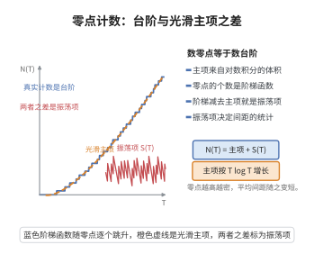

# Riemann-von Mangoldt 显式公式

> **一句话大白话**：素数的分布不是随机的秘密，而是被 Riemann ζ 函数的零点精准地"调音"出来；显式公式就是那台把零点翻译成素数计数的仪器。

> **小例子**：Chebyshev 函数 $\psi(x)=\sum_{n\leq x}\Lambda(n)$ 与 $x$ 几乎相等，但差出一串由 ζ 的非平凡零点 $\rho$ 贡献的振荡项 $-x^{\rho}/\rho$；正是这些振荡给出了素数分布的"误差"大小。

## 一、定理介绍

> **前置依赖**：RiemannZeta函数与Euler乘积、Zeta函数函数方程、素数定理、DirichletL函数、Perron 公式（概念）、辐角原理（概念）、Stirling 公式（概念）、Chebyshev 函数 $\psi$ 与 von Mangoldt 函数 $\Lambda(n)$（概念）。

Riemann 在 1859 年的论文《论小于给定大小的素数个数》中首次把素数计数与复变函数的零点联系起来：他引入 $\zeta(s)=\prod_p(1-p^{-s})^{-1}$ 的解析延拓与函数方程，并写下了一个"显式公式"，把 $\psi(x)$ 表示为 $x$ 减去零点求和加上若干初等项。Riemann 的推导依赖当时尚未严格建立的整函数因子分解与对数导数工具，很多步骤是启发式的。1895 年 von Mangoldt 完成了严格化：他证明了零点求和按共轭配对并对称截断时收敛，给出了精确的常数项 $-\log 2\pi$ 与平凡零点项 $-\tfrac12\log(1-x^{-2})$，并证明了零点计数公式 $N(T)=\frac{T}{2\pi}\log\frac{T}{2\pi e}+O(\log T)$。这个公式是解析数论的中心枢纽：素数定理（$\psi(x)\sim x$）等价于说 ζ 在 $\mathrm{Re}\,s=1$ 上没有零点，而 Riemann 假设（所有非平凡零点满足 $\mathrm{Re}\,\rho=\tfrac12$）等价于误差项达到 $O(\sqrt x\log^2 x)$ 的最优阶。公式的动机是：把关于整数的离散、加法信息（素数与 $\Lambda(n)$），通过 Mellin 变换与留数定理，转换为关于 $\zeta$ 的连续、乘法信息（零点），从而可以用复分析工具研究素数。

## 几何直观

图意在说明：零点计数等于体积主项加上振荡项，涨落虽小却决定了间距的统计规律。

## 二、原理思路

1. 用 von Mangoldt 函数 $\Lambda(n)$ 与 Chebyshev 函数 $\psi(x)$ 代替 $\pi(x)$，因为 $\psi$ 的生成级数恰好是 $-\zeta'/\zeta$，具有最简洁的对数导数结构。
2. 用 Perron 公式把 $\psi(x)=\sum_{n\leq x}\Lambda(n)$ 写成竖直线上的围道积分 $\frac{1}{2\pi i}\int_{c-i\infty}^{c+i\infty}\left(-\frac{\zeta'}{\zeta}(s)\right)\frac{x^s}{s}\,ds$，把"求和"变成"复积分"。
3. 引入整函数 $\xi(s)=\tfrac12 s(s-1)\pi^{-s/2}\Gamma(s/2)\zeta(s)$，它满足 $\xi(s)=\xi(1-s)$，其零点正是 ζ 的非平凡零点；于是 $-\zeta'/\zeta$ 可以写成 $B(s)-\xi'/\xi(s)$，其中 $B$ 是初等项，而 $\xi'/\xi(s)=\sum_\rho\left(\frac{1}{s-\rho}+\frac{1}{\rho}\right)$。
4. 把积分围道向左移动并取极限，用留数定理逐个收集极点贡献：$s=1$ 给主项 $x$，$s=\rho$ 给 $-x^\rho/\rho$，$s=0$ 给 $-\log 2\pi$，平凡零点 $s=-2k$ 合并为 $-\tfrac12\log(1-x^{-2})$；横边贡献用 $N(T)$ 的估计控制并趋于零。

## 三、定理的严格表述

设 $\Lambda(n)=\log p$ 当 $n=p^k$、否则为 $0$，$\psi(x)=\sum_{n\leq x}\Lambda(n)$。则对 $x>1$ 且 $x$ 不为素数幂时，

$$\psi(x)=x-\sum_{\rho}\frac{x^{\rho}}{\rho}-\log 2\pi-\frac12\log\!\left(1-x^{-2}\right),$$

其中 $\rho$ 遍历 ζ 的全部非平凡零点，求和按共轭对 $(\rho,\bar\rho)$ 配对、并以 $|\mathrm{Im}\,\rho|\leq T$ 对称截断后取 $T\to\infty$ 的极限。

零点计数（Riemann–von Mangoldt 公式）：记 $N(T)$ 为 $0<\mathrm{Im}\,\rho\leq T$ 的非平凡零点个数，则

$$N(T)=\frac{T}{2\pi}\log\frac{T}{2\pi e}+O(\log T),\qquad S(T):=N(T)-\frac{T}{2\pi}\log\frac{T}{2\pi e}=O(\log T).$$

## 四、证明过程

**步骤 1（$\Lambda$ 与对数导数的 Dirichlet 级数）。** 对 $\mathrm{Re}\,s>1$，由 Euler 乘积取对数得 $\log\zeta(s)=-\sum_p\log(1-p^{-s})=\sum_p\sum_{k\geq1}\frac{p^{-ks}}{k}$。逐项求导得

$$-\frac{\zeta'}{\zeta}(s)=\sum_p\sum_{k\geq1}\log p\cdot p^{-ks}=\sum_{n\geq1}\frac{\Lambda(n)}{n^{s}},$$

故 $\psi(x)=\sum_{n\leq x}\Lambda(n)$ 是 $-\zeta'/\zeta$ 的系数部分和，这正是选择 $\psi$ 的理由。

**步骤 2（Perron 公式）。** 设 $f(s)=\sum_{n\geq1}a_n n^{-s}$ 在 $\mathrm{Re}\,s>1$ 绝对收敛，$c>1$，则对 $x>1$ 不是跳跃点，

$$\sum_{n\leq x}a_n=\frac{1}{2\pi i}\int_{c-i\infty}^{c+i\infty}f(s)\frac{x^{s}}{s}\,ds .$$

取 $a_n=\Lambda(n)$、$f=-\zeta'/\zeta$，得 $\psi(x)=\frac{1}{2\pi i}\int_{c-i\infty}^{c+i\infty}\left(-\frac{\zeta'}{\zeta}(s)\right)\frac{x^{s}}{s}\,ds$。公式的来历是对 $\frac{x^s}{s}$ 逐项作竖直积分：当 $n\leq x$ 时积分为 $1$，当 $n>x$ 时为 $0$。

**步骤 3（用 $\xi$ 表示 $-\zeta'/\zeta$）。** 定义整函数 $\xi(s)=\tfrac12 s(s-1)\pi^{-s/2}\Gamma(s/2)\zeta(s)$。由 ζ 的函数方程可验证 $\xi(s)=\xi(1-s)$，且 $\xi$ 的零点恰为 ζ 的非平凡零点 $\rho$（以及经函数方程对应的点）。对 $\log\zeta=\log 2+\tfrac{s}{2}\log\pi+\log\xi-\log s-\log(s-1)-\log\Gamma(s/2)$ 求导，并记 digamma 函数 $\Psi(z)=\Gamma'(z)/\Gamma(z)$，得

$$-\frac{\zeta'}{\zeta}(s)=B(s)-\frac{\xi'}{\xi}(s),\qquad B(s)=\frac1s+\frac1{s-1}+\frac12\Psi\!\left(\frac{s}{2}\right)-\frac12\log\pi .$$

由 $\Gamma$ 在 $0$ 的极点可知 $\Psi(s/2)\sim-2/s$，故 $B$ 在 $s=0$ 的 $\frac1s$ 极点与 $\frac12\Psi(s/2)$ 的极点相消，$B$ 在 $s=0$ 正则。

**步骤 4（$\xi'/\xi$ 的零点展开）。** $\xi$ 为有限阶整函数，其零点 $\rho$ 均满足 $0<\mathrm{Re}\,\rho<1$。由 Hadamard 因子分解与对数导数得

$$\frac{\xi'}{\xi}(s)=\sum_{\rho}\left(\frac{1}{s-\rho}+\frac{1}{\rho}\right),$$

右侧按共轭配对对称求和收敛（$\sum_\rho|\rho|^{-2}<\infty$，而配对后 $\sum|\rho|^{-1}$ 的对称部分收敛）。因此 $-\zeta'/\zeta(s)=B(s)-\sum_\rho\left(\frac{1}{s-\rho}+\frac1\rho\right)$，其极点恰在 $s=1$、$s=\rho$、$s=0$ 与平凡零点处。

**步骤 5（移动围道并计算留数）。** 取矩形围道 $\mathcal R$：右竖边 $\mathrm{Re}\,s=c$，左竖边 $\mathrm{Re}\,s=-U$，上下横边 $\mathrm{Im}\,s=\pm T$，其中 $U\in(2k-1,2k)$ 避开平凡零点，$T$ 避开零点虚部。由留数定理

$$\frac{1}{2\pi i}\oint_{\mathcal R}\left(-\frac{\zeta'}{\zeta}(s)\right)\frac{x^{s}}{s}\,ds=\sum\text{内部极点留数}.$$

逐个计算：（i）在 $s=1$，$-\zeta'/\zeta$ 有来自 $B$ 中 $\frac1{s-1}$ 的简单极点、留数为 $1$，故 $x^s/s$ 给出留数 $x$。（ii）在 $s=\rho$，来自 $-\frac{1}{s-\rho}$ 的留数为 $-1$，故留数为 $-x^{\rho}/\rho$。（iii）在 $s=0$，被积函数正则，留数等于 $-\zeta'/\zeta(0)$；由 ζ 的取值 $\zeta(0)=-\tfrac12$、$\zeta'(0)=-\tfrac12\log 2\pi$ 得 $-\zeta'/\zeta(0)=-\log 2\pi$。（iv）在平凡零点 $s=-2k$，$-\zeta'/\zeta$ 留数为 $-1$，留数为 $\frac{x^{-2k}}{2k}$，对 $k\geq1$ 求和得 $\sum_{k\geq1}\frac{x^{-2k}}{2k}=-\frac12\log(1-x^{-2})$。

**步骤 6（横边与左竖边的估计）。** 用 $\log\Gamma$ 的 Stirling 展开可证：在 $|s|\leq M$ 的竖条内有 $\left|\frac{\zeta'}{\zeta}(s)\right|=O(\log|s|)$，而在 $\mathrm{Re}\,s\leq-1$ 处由函数方程与 Stirling 公式同一估计成立。于是横边积分为 $O\!\left(\frac{x^{c}\log T}{T}\right)+O\!\left(\frac{x^{-U}\log T}{T}\right)\to0$（$T\to\infty$）；左竖边积分为 $O\!\left(x^{-U}\log T\right)\to0$（$U\to\infty$）。再用零点计数 $N(T)=\frac{T}{2\pi}\log\frac{T}{2\pi e}+O(\log T)$：对 $\xi'/\xi$ 沿矩形边界用辐角原理，结合 $\xi(s)=\xi(1-s)$ 与 Stirling 公式对 $\mathrm{Im}\log\Gamma$ 的主项估计即得，从而横边上穿过的零点数带来的误差为 $O(x\log T/T)\to0$。

**步骤 7（取极限得公式）。** 令 $T\to\infty$、$U\to\infty$，围道积分在极限下等于右竖边积分，即 $\psi(x)$；留数求和给出

$$\psi(x)=x-\sum_{\rho}\frac{x^{\rho}}{\rho}-\log 2\pi-\frac12\log(1-x^{-2}).$$

对 $x$ 为素数幂的情形，取左右极限的算术平均（Perron 公式的跳跃处理），结论不变。

$\square$

## 五、应用与意义

- 素数定理：由显式公式，$\psi(x)/x\to1$ 等价于所有零点满足 $\mathrm{Re}\,\rho<1$（无零点区域），1920 年代由 Hadamard 与 de la Vallée Poussin 独立证明。
- Riemann 假设：误差 $\psi(x)-x$ 的振荡幅度由 $\mathrm{Re}\,\rho$ 决定；RH（$\mathrm{Re}\,\rho=\tfrac12$）等价于 $\psi(x)=x+O(\sqrt x\log^2 x)$，即素数分布的最优波动阶。
- 零点计数与显式公式是零点的统计研究（零点间距分布、$S(T)$ 的涨落）的出发点，也是"随机矩阵与数论"联系的起点。
- 同一论证对 Dirichlet $L$ 函数逐字复制，给出算术级数中的素数定理与广义 Riemann 假设的误差刻画。

## 课堂问答

**老师**：显式公式把素数计数和 $\zeta$ 的零点连起来，它的骨架是什么？

**学生**：$\psi(x)=x-\sum_\rho\frac{x^\rho}{\rho}-\log2\pi-\frac12\log(1-x^{-2})$，其中 $\rho$ 遍历非平凡零点。主项 $x$ 来自 $s=1$ 的极点，振荡项 $-x^\rho/\rho$ 来自每个零点，常数项 $-\log2\pi$ 来自 $s=0$，平凡零点合并成 $-\frac12\log(1-x^{-2})$。零点计数另有 $N(T)=\frac{T}{2\pi}\log\frac{T}{2\pi e}+O(\log T)$。

**老师（追问）**：从 $\psi(x)$ 到零点和，技术上靠什么把求和变成零点？

**学生**：两步。先用 Perron 公式把 $\psi(x)=\frac{1}{2\pi i}\int_{c-i\infty}^{c+i\infty}\bigl(-\frac{\zeta'}{\zeta}(s)\bigr)\frac{x^s}{s}\,ds$ 表示成围道积分；再把围道向左平移，用留数定理逐个收极点。关键是 $\frac{\xi'}{\xi}(s)=\sum_\rho\bigl(\frac{1}{s-\rho}+\frac1\rho\bigr)$（Hadamard 因子分解），使零点成为 $-\zeta'/\zeta$ 的极点，横边用 $N(T)$ 估计趋于零。

**老师（拓展）**：这个公式怎么直接刻画素数定理与 Riemann 假设？

**学生**：素数定理 $\psi(x)\sim x$ 等价于 $\zeta$ 在 $\operatorname{Re}s=1$ 无零点（此时 $x^\rho$ 项相对 $x$ 可忽略）；而 RH（$\operatorname{Re}\rho=\frac12$）等价于误差 $\psi(x)-x=O(\sqrt x\log^2 x)$，即每个振荡振幅 $\sqrt x$。常见误区是以为要逐个算零点，其实只需知道零点的实部上界就能控制误差阶。

## 相关条目

- [随机矩阵与数论.md](./随机矩阵与数论.md)：零点间距的统计猜想与显式公式所描述的零点涨落直接相关。
- [Wigner半圆律.md](./Wigner半圆律.md)：随机矩阵的谱统计为 ζ 零点统计提供类比模型。
- [Tracy-Widom分布.md](./Tracy-Widom分布.md)：极值统计的类比对象，与零点最大间距的语言相通。
- [普适性猜想.md](./普适性猜想.md)：解释为何零点统计应只依赖对称类而不依赖算术细节。
- [RiemannZeta函数与Euler乘积.md](../第44级-解析数论/RiemannZeta函数与Euler乘积.md)：定义了 $-\zeta'/\zeta$ 的 Dirichlet 级数与 Euler 乘积，是本文的出发点。
- [Zeta函数函数方程.md](../第44级-解析数论/Zeta函数函数方程.md)：用于构造对称整函数 $\xi$ 并给出零点对称性与 Stirling 估计。
- [素数定理.md](../第44级-解析数论/素数定理.md)：显式公式的直接推论与主要应用场景。
- [DirichletL函数.md](../第44级-解析数论/DirichletL函数.md)：同一套 Perron 公式与留数论证推广到算术级数。
