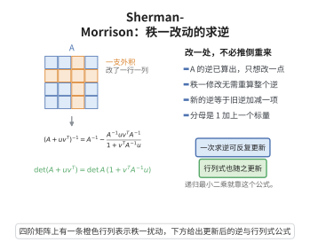

# Sherman-Morrison矩阵逆引理

> **一句话大白话**：给一个可逆矩阵做一次"秩一"修补（加上外积 $uv^\top$）后，它的逆不需要从头再算，只要在原逆的基础上做一处简单的修正即可。

> **小例子**：设 $A=I$ 为 $2\times2$ 单位阵，$u=v=(1,0)^\top$。则 $A+uv^\top$ 为对角阵 $\mathrm{diag}(2,1)$，其逆为 $\mathrm{diag}(1/2,1)$。而引理给出 $I-\frac{uv^\top}{1+v^\top u}=I-\frac{uv^\top}{2}=\mathrm{diag}(1/2,1)$，两者一致。

## 一、定理介绍

> **前置依赖**：可逆矩阵等价条件、秩-零化度定理、行列式乘积定理、Cauchy-Schwarz不等式。

Sherman-Morrison 引理由 Sherman 与 Morrison 于 1949 至 1950 年间在求解线性方程组与统计估计问题时提出，几乎同时 Woodbury 给出了多秩推广，故常合称 Sherman-Morrison-Woodbury 公式。它回答了这样一个问题：当可逆矩阵 $A$ 被秩一矩阵 $uv^\top$ 扰动后，新矩阵 $(A+uv^\top)^{-1}$ 与原逆矩阵 $A^{-1}$ 之间是什么关系。由于在 $A^{-1}$ 已知时直接重算新逆需要 $O(n^3)$ 代价，而该引理把成本降低到一次矩阵与向量乘法，因此被广泛用于递推最小二乘、卡尔曼滤波、拟牛顿法（如 BFGS 更新）与信号处理。它同时给出扰动可逆的精确判据 $1+v^\top A^{-1}u\neq0$，把秩一扰动下的可逆性问题化归为一个标量条件，这也是它在随机矩阵理论中追踪秩一扰动谱变化的出发点。

## 几何直观

图意在说明：只在原矩阵上叠加一支外积时，新逆可由旧逆加减一项直接写出，不必重新求逆。

## 二、原理思路

1. 猜想修正形式：新逆应为 $A^{-1}$ 减去一个"方向被 $A^{-1}$ 扭曲过两次"的秩一项，即 $A^{-1}-\alpha\,(A^{-1}u)(v^\top A^{-1})$，其中标量系数 $\alpha$ 待定。
2. 关键是把问题约化为一个纯向量恒等式，先独立证明：只要 $1+v^\top w\neq0$，就有 $(I+wv^\top)^{-1}=I-\frac{wv^\top}{1+v^\top w}$，这可用直接乘法验证。
3. 令 $w=A^{-1}u$，把 $A+uv^\top=A(I+wv^\top)$ 分解为"可逆部分乘秩一扰动"，再由逆的乘积法则 $(AB)^{-1}=B^{-1}A^{-1}$ 立刻读出结论，并用标量条件 $1+v^\top A^{-1}u\neq0$ 保证扰动因子确实可逆。

## 三、定理的严格表述

设 $A\in\mathbb{R}^{n\times n}$ 可逆，$u,v\in\mathbb{R}^{n}$。若

$$
1+v^{\top}A^{-1}u\neq 0,
$$

则 $A+uv^{\top}$ 可逆，且其逆由下式给出：

$$
(A+uv^{\top})^{-1}=A^{-1}-\frac{A^{-1}uv^{\top}A^{-1}}{1+v^{\top}A^{-1}u}.
$$

作为推论，成立矩阵行列式引理

$$
\det(A+uv^{\top})=\det(A)\bigl(1+v^{\top}A^{-1}u\bigr).
$$

## 四、证明过程

**步骤 1（先证向量恒等式）。** 设 $w,v\in\mathbb{R}^n$ 且 $1+v^\top w\neq0$。直接相乘：

$$
(I+wv^{\top})\Bigl(I-\frac{wv^{\top}}{1+v^{\top}w}\Bigr)=I+wv^{\top}-\frac{wv^{\top}+w(v^{\top}w)v^{\top}}{1+v^{\top}w}.
$$

利用 $w(v^\top w)v^\top=(v^\top w)\,wv^\top$，分子第二项恰为 $(1+v^\top w)wv^\top$，与括号外的 $wv^\top$ 相消，故乘积为 $I$。同理从右侧相乘也得 $I$，因此

$$
(I+wv^{\top})^{-1}=I-\frac{wv^{\top}}{1+v^{\top}w}.
$$

**步骤 2（分解与可逆性）。** 取 $w=A^{-1}u$，则 $uv^\top=A w v^\top$，于是

$$
A+uv^{\top}=A+Awv^{\top}=A\,(I+wv^{\top}).
$$

由步骤 1，条件 $1+v^\top A^{-1}u=1+v^\top w\neq0$ 保证 $I+wv^\top$ 可逆；而 $A$ 可逆，两个可逆矩阵之积可逆，故 $A+uv^\top$ 可逆。

**步骤 3（由乘积法则读出逆的表达式）。** 由 $(AB)^{-1}=B^{-1}A^{-1}$ 及步骤 1，

$$
(A+uv^{\top})^{-1}=(I+wv^{\top})^{-1}A^{-1}=\Bigl(I-\frac{wv^{\top}}{1+v^{\top}w}\Bigr)A^{-1}=A^{-1}-\frac{A^{-1}uv^{\top}A^{-1}}{1+v^{\top}A^{-1}u},
$$

其中末步代回 $w=A^{-1}u$，即得引理。对行列式，由 $\det(A+uv^\top)=\det(A)\det(I+wv^\top)$ 以及 $\det(I+wv^\top)=1+v^\top w$（矩阵 $I+wv^\top$ 的特征值除一个等于 $1+v^\top w$ 外其余全为 $1$），即得行列式引理。

$\square$

## 五、应用与意义

- 递推最小二乘与卡尔曼滤波：观测更新是一次秩一修正，用该引理可在 $O(n^2)$ 内更新逆协方差矩阵。
- 拟牛顿法：BFGS 与 DFP 的秩二更新公式可由 Sherman-Morrison 引理反复叠加得到，是保正定性的关键。
- 数值线性代数：当 $A$ 的分解已知、而系数矩阵仅作低秩修改时，可避免重新分解。
- 随机矩阵理论：秩一扰动下的谱分布（毛刺峰）与自由概率 Cauchy 变换的递推，都以该引理为基础。
- 机器学习：核方法中在线更新 Gram 矩阵逆以及低秩微调（如 LoRA 类）的参数合并都直接使用该恒等式。

## 课堂问答

**老师**：为什么秩一扰动后逆只需在原逆上改一处，而不是重算？

**学生**：因为 $A+uv^\top=A(I+A^{-1}uv^\top)=A(I+wv^\top)$，其中 $w=A^{-1}u$。而纯向量恒等式 $(I+wv^\top)^{-1}=I-\frac{wv^\top}{1+v^\top w}$ 可直接相乘验证（$wv^\top$ 的项相消）。由 $(AB)^{-1}=B^{-1}A^{-1}$ 立即得到 $(A+uv^\top)^{-1}=A^{-1}-\frac{A^{-1}uv^\top A^{-1}}{1+v^\top A^{-1}u}$。

**老师（追问）**：扰动可逆的判据为什么是一个标量条件？

**学生**：因为 $A+uv^\top=A(I+wv^\top)$ 可逆当且仅当 $A$ 与 $I+wv^\top$ 都可逆。$A$ 已可逆，而 $I+wv^\top$ 的特征值除一个是 $1+v^\top w$ 外全为 $1$，故可逆当且仅当 $1+v^\top A^{-1}u\neq0$。顺带得到矩阵行列式引理 $\det(A+uv^\top)=\det(A)(1+v^\top A^{-1}u)$。

**老师（拓展）**：这个引理在随机矩阵和机器学习里的定位？

**学生**：它是递推更新的引擎——卡尔曼滤波的观测更新、BFGS 的秩二更新都靠它把 $O(n^3)$ 降为 $O(n^2)$。在随机矩阵里，秩一扰动导致的谱毛刺峰和自由概率中 Cauchy 变换的递推都以它为出发点。常见误区是忘了标量条件 $1+v^\top A^{-1}u\neq0$，此时 $A+uv^\top$ 恰奇异，逆不存在。

## 相关条目

- [Wigner半圆律](./Wigner半圆律.md)：秩一扰动下的谱演化是半圆律局部统计的入口。
- [Marchenko-Pastur定律](./Marchenko-Pastur定律.md)：样本协方差阵的秩一修正可用该引理追踪。
- [自由概率论基础](./自由概率论基础.md)：秩一扰动对应自由概率中 Cauchy 变换的递推。
- [可逆矩阵等价条件](../第14级-线性代数/可逆矩阵等价条件.md)：提供引理可逆性判据所需的矩阵可逆判定。
- [行列式乘积定理](../第14级-线性代数/行列式乘积定理.md)：行列式引理的推导用到 $\det(AB)=\det A\det B$。
