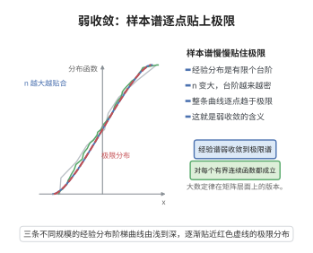

# 弱收敛与大数定律

> **一句话大白话**：把抽到的样本摊成一张"经验分布表"，样本一多，这张表就整体地贴向真实分布——弱收敛说的正是这种"整体贴合"，而大数定律保证它一定贴得上。
>
> **小例子**：抛一枚正反面概率各为 $1/2$ 的硬币 $n$ 次，经验测度 $\mu_n=\frac1n\sum_{i=1}^n\delta_{X_i}$ 完全由正面出现的频率决定；由大数定律该频率趋于 $1/2$，因此对任意有界连续函数 $f$ 有 $\int f\,d\mu_n\to\frac{f(1)+f(-1)}{2}$。

## 一、定理介绍

> **前置依赖**：弱大数定律、强大数定律、切比雪夫不等式、特征函数唯一性定理、连续性定理、Borel-Cantelli引理。

本条目把两件互补的工具放在一起：一是概率测度的**弱收敛**（检验函数意义下的收敛及其判据），二是**大数定律**（独立同分布样本平均的稳定化）。之所以必须合讲，是因为随机矩阵理论中两个最基本的定律——Wigner 半圆律与 Marchenko–Pastur 定律——的严格表述都是"经验谱分布几乎必然弱收敛到某个确定分布"。证明这一表述的标准路线正是两者配合：对每个固定检验函数用大数定律得到逐点收敛，再用可数判定类与 Borel-Cantelli 引理把"逐个函数收敛"升级为"整体弱收敛"；当极限矩已知时，还可用特征函数把矩收敛直接转成弱收敛，这正是矩方法的合法性来源。

## 几何直观

图意在说明：维数增大时经验分布整条曲线逼近极限分布，这就是矩阵层面的大数定律。

## 二、原理思路

1. 弱收敛是一种"检验函数"意义下的收敛：$\mu_n\Rightarrow\mu$ 即对一切有界连续 $f$ 有 $\int f\,d\mu_n\to\int f\,d\mu$。
2. 经验测度 $\mu_n=\frac1n\sum_{i=1}^n\delta_{X_i}$ 的积分恰是对样本取平均：$\int f\,d\mu_n=\frac1n\sum_{i=1}^n f(X_i)$。
3. 于是大数定律立刻给出：对每一个**固定**的 $f$，该样本平均收敛到 $\int f\,d\mu$。
4. 难点是把"每个 $f$ 各自几乎必然收敛"换成"所有 $f$ 同时收敛"：取可数的收敛判定类，用 Borel-Cantelli 引理在同一个零测集外对全部判定函数同时收敛，再借连续函数的逼近与紧性推广到一切有界连续函数。
5. 若已知的是矩的收敛，则用特征函数的 Taylor 展开配合特征函数唯一性定理与连续性定理，同样得到弱收敛，前提是极限测度由矩唯一确定。

## 三、定理的严格表述

设 $\mu$ 为 $\mathbb R$ 上的 Borel 概率测度，$\{\mu_n\}$ 为一列 Borel 概率测度。

**定义（弱收敛）**：称 $\mu_n$ **弱收敛**到 $\mu$，记作 $\mu_n\Rightarrow\mu$，若对一切有界连续函数 $f:\mathbb R\to\mathbb R$，

$$
\int_{\mathbb R}f\,d\mu_n\xrightarrow{n\to\infty}\int_{\mathbb R}f\,d\mu .
$$

**定理 1（弱大数定律）**：设 $X_1,X_2,\dots$ 独立同分布，$\mathbb E[X_1]=m$、$\operatorname{Var}(X_1)=\sigma^2<\infty$，则对任意 $\varepsilon>0$ 有 $\mathbb P(|\bar X_n-m|\ge\varepsilon)\le\sigma^2/(n\varepsilon^2)\to0$，即样本均值 $\bar X_n$ 依概率收敛到 $m$。

**定理 2（经验测度的几乎必然弱收敛）**：设 $X_1,X_2,\dots$ 独立同分布，公共分布为 $\mu$ 且 $\mathbb E|X_1|<\infty$。令 $\mu_n=\frac1n\sum_{i=1}^n\delta_{X_i}$，则 $\mu_n\Rightarrow\mu$ 几乎必然成立。

**定理 3（矩收敛蕴含弱收敛）**：若对每个正整数 $k$ 有 $\int x^k\,d\mu_n\to\int x^k\,d\mu$，且极限矩 $m_k=\int x^k\,d\mu$ 满足 Carleman 条件 $\sum_{k\ge1}m_{2k}^{-1/(2k)}=\infty$，则 $\mu_n\Rightarrow\mu$。

## 四、证明过程

**步骤 1（定理 1，切比雪夫不等式）。** 由独立性，$\mathbb E[\bar X_n]=m$ 且

$$
\operatorname{Var}(\bar X_n)=\frac{1}{n^2}\sum_{i=1}^n\operatorname{Var}(X_i)=\frac{\sigma^2}{n}.
$$

把切比雪夫不等式用于 $\bar X_n$，得 $\mathbb P(|\bar X_n-m|\ge\varepsilon)\le\sigma^2/(n\varepsilon^2)\to0$。

**步骤 2（对固定检验函数用大数定律）。** 设 $f$ 有界连续且 $\|f\|_\infty\le1$，则 $f(X_1),f(X_2),\dots$ 仍独立同分布且一阶矩有限，由强大数定律

$$
\int f\,d\mu_n=\frac1n\sum_{i=1}^n f(X_i)\xrightarrow{\text{a.s.}}\mathbb E[f(X_1)]=\int f\,d\mu .
$$

**步骤 3（Borel-Cantelli 升级为同时收敛）。** 记 $Y_i=f(X_i)-\mathbb E[f(X_1)]$，则 $Y_i$ 独立、均值为零、$|Y_i|\le2$。由独立性展开四阶矩得 $\mathbb E[(\sum_i Y_i)^4]=n\mathbb E[Y_1^4]+3n(n-1)(\mathbb E[Y_1^2])^2\le28n^2$，故对任意 $j\ge1$，

$$
\mathbb P\Bigl(\Bigl|\frac1n\sum_{i=1}^n Y_i\Bigr|\ge\frac1j\Bigr)
\le j^4\,\frac{\mathbb E\bigl[(\sum_i Y_i)^4\bigr]}{n^4}
\le \frac{28\,j^4}{n^2},
$$

右端关于 $n$ 可和。由 Borel-Cantelli 引理，几乎必然只有有限多个 $n$ 使 $\bigl|\frac1n\sum_i Y_i\bigr|\ge1/j$ 成立，故 $\limsup_n\bigl|\int f\,d\mu_n-\int f\,d\mu\bigr|\le1/j$ 几乎必然；令 $j\to\infty$ 即得 $\int f\,d\mu_n\to\int f\,d\mu$ 几乎必然。

**步骤 4（可数判定类与弱收敛）。** 取可数族 $\mathcal C=\{f_q:q\in\mathbb Q\}$，其中 $f_q$ 是支承在 $[q-1,q+1]$ 上、在 $q$ 处取值为 $1$ 且不超过 $1$ 的连续三角波，它光滑地逼近有理点处的"单点探测"。对每个 $q$ 由步骤 3 得 $\int f_q\,d\mu_n\to\int f_q\,d\mu$ 几乎必然，可数个几乎必然事件之交仍几乎必然，故存在概率为 $1$ 的事件 $\Omega_0$，在其上**同时**对一切 $q$ 有 $\int f_q\,d\mu_n\to\int f_q\,d\mu$。族 $\mathcal C$ 在紧集上一致稠密于有界连续函数，故为收敛判定类：对任意有界连续 $f$ 与 $\delta>0$，取 $N$ 使 $\mu([-N,N]^c)<\delta$ 并在 $[-N,N]$ 上取 $\mathcal C$ 中的有限组合 $g$ 使 $\sup_{[-N,N]}|f-g|<\delta$，则

$$
\Bigl|\int f\,d\mu_n-\int f\,d\mu\Bigr|
\le\Bigl|\int g\,d\mu_n-\int g\,d\mu\Bigr|+2\delta+2\|f\|_\infty\,\delta .
$$

在 $\Omega_0$ 上令 $n\to\infty$ 再令 $\delta\to0$，得 $\int f\,d\mu_n\to\int f\,d\mu$，即 $\mu_n\Rightarrow\mu$ 几乎必然。

**步骤 5（定理 3，特征函数方法）。** 记 $\varphi_n(t)=\int e^{itx}\,d\mu_n$、$\varphi(t)=\int e^{itx}\,d\mu$。用 $\bigl|e^{itx}-\sum_{k\le N}(itx)^k/k!\bigr|\le|tx|^{N+1}/(N+1)!$ 得

$$
\Bigl|\varphi_n(t)-\sum_{k=0}^{N}\frac{(it)^k}{k!}\int x^k\,d\mu_n\Bigr|
\le\frac{|t|^{N+1}}{(N+1)!}\int|x|^{N+1}\,d\mu_n .
$$

对固定 $N$，$\int|x|^{N+1}d\mu_n$ 随 $n$ 收敛而有界；由矩收敛，令 $n\to\infty$ 后 $\varphi_n$ 与 $\varphi$ 的 $N$ 阶 Taylor 多项式相同。Carleman 条件保证极限矩增长不过快，使 $\varphi$ 在 $0$ 的某邻域 $|t|\le t_0$ 内由矩的幂级数解析表示且上式关于 $n$ 一致，于是 $\varphi_n(t)\to\varphi(t)$ 对 $|t|\le t_0$ 成立。由特征函数唯一性定理与连续性定理，特征函数在一段区间上的逐点收敛足以断定 $\mu_n\Rightarrow\mu$。

## 五、应用与意义

- **随机矩阵经验谱分布**：Wigner 半圆律与 Marchenko–Pastur 定律的严格表述都是经验谱分布的几乎必然弱收敛，矩方法证明正是"先算矩、再用步骤 4 或步骤 5 升级为弱收敛"。
- **大样本统计**：样本分布函数、样本矩与经验过程的一致收敛都以大数定律与 Borel-Cantelli 引理为基础，是 Glivenko-Cantelli 型结论的雏形。
- **蒙特卡洛方法**：模拟求积的合法性来自 $\int f\,d\mu_n\to\int f\,d\mu$，其几乎必然稳定性由本条目给出。

## 课堂问答

**老师**：半圆律说经验谱分布几乎必然弱收敛，为什么不逐点比较分布函数就够？

**学生**：弱收敛是对一切有界连续 $f$ 要求 $\int f\,d\mu_n\to\int f\,d\mu$，它只约束平均而言的整体贴合，比逐点（依赖具体样本点位置）更合适也更弱。经验测度 $\mu_n=\frac1n\sum\delta_{X_i}$ 满足 $\int f\,d\mu_n=\frac1n\sum f(X_i)$，对每个固定 $f$ 用大数定律就得到该检验函数的收敛。

**老师（追问）**：对每个 $f$ 各自几乎必然收敛，怎么升级成所有 $f$ 同时收敛？

**学生**：用可数判定类：取一族支承在 $[q-1,q+1]$、在有理点 $q$ 取值为 $1$ 的连续三角波。对每个 $q$，用四阶矩 $O(1/n^2)$ 尾部估计加 Borel–Cantelli 得 $\int f_q\,d\mu_n\to\int f_q\,d\mu$ 几乎必然；可数交仍几乎必然，故存在概率 $1$ 的事件 $\Omega_0$ 使其上同时收敛。再借该族在有界连续函数中一致稠密，推广到一切 $f$。

**老师（拓展）**：如果只知道矩收敛，还能得到弱收敛吗？

**学生**：能，但要加条件。用特征函数 $e^{itx}$ 的 Taylor 展开把矩组装成 $\varphi_n$ 的幂级数；若极限矩满足 Carleman 条件 $\sum_k m_{2k}^{-1/(2k)}=\infty$，则 $\varphi$ 在 $0$ 邻域由矩唯一确定，再由特征函数唯一性定理与连续性定理得 $\mu_n\Rightarrow\mu$。这正是矩方法证明半圆律合法性的根据；缺了 Carleman 条件，不同测度可能同矩。

## 相关条目

- [Wigner 半圆律](./Wigner半圆律.md)：经验谱分布几乎必然弱收敛到半圆分布的典范。
- [Marchenko-Pastur定律](./Marchenko-Pastur定律.md)：样本协方差矩阵经验谱分布的弱收敛结论。
