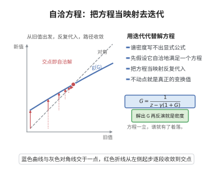

# 自洽方程

> **一句话大白话**：随机矩阵的极限谱分布没法直接算，但它的 Stieltjes 变换 $m(z)$ 一定满足一个"自己等于自己"的方程 $m=-1/(z+m)$——未知的 $m$ 在两边各出现一次，解这个方程就得到了谱分布的全部信息。
>
> **小例子**：半圆律对应 $m(z)=-\frac{1}{z+m(z)}$，整理得 $m^2+zm+1=0$，取上半平面解 $m(z)=\frac{-z+\sqrt{z^2-4}}{2}$，再用 Stieltjes 反演就还原出 $[-2,2]$ 上的半圆密度。

## 一、定理介绍

> **前置依赖**：Sherman-Morrison矩阵逆引理、Stieltjes变换的反演公式、矩阵的迹、弱收敛与大数定律、谱定理。

自洽方程（self-consistent equation，又称自洽条件、固定点方程）是随机矩阵理论中把"求极限谱分布"化归为"解一个标量方程"的核心技术。其内容是：经验谱分布的 Stieltjes 变换 $m_N(z)=\frac1N\operatorname{Tr}((W_N-zI)^{-1})$ 在 $N\to\infty$ 时收敛到一个确定性函数 $m(z)$，而 $m(z)$ 必满足一个由矩阵结构决定的非线性方程，方程两端都含 $m$ 本身，故称"自洽"。一旦解出 $m$，Stieltjes 反演公式立刻给出极限谱密度。这一方法由 Marchenko–Pastur、Pastur、Wigner 等人的工作确立，是推导半圆律、Marchenko–Pastur 律以及自由卷积律的统一入口；其合理性来自两步：分块求逆（Schur 补，即 Sherman-Morrison 型公式）给出局部的代数关系，概率的集中与大数定律把该局部关系取极限变成一个确定的方程。

## 几何直观

图意在说明：谱密度无法直接写出时，先列出 Stieltjes 变换的自洽方程，再把它当映射迭代到不动点。

## 二、原理思路

1. 写出矩阵预解式 $G_N(z)=(W_N-zI)^{-1}$ 的归一化迹，它正是经验谱分布的 Stieltjes 变换。
2. 把 $W_N$ 按最后一行一列分块，用分块求逆公式把 $G_N$ 的右下角元素表示为标量形式。
3. 该式中出现的二次型关于随机向量取条件期望后，恰好等于子矩阵预解式迹的归一化值，即 $m_{N-1}(z)$。
4. 二次型相对其期望的涨落为 $O(1/N)$，由切比雪夫不等式可忽略，于是得到含 $m$ 的确定性方程。
5. 由置换对称性，$m_N$ 与 $G_N$ 的任一固定对角元极限相同，故第三步的关系对 $m$ 自身成立；解出 $m$ 后反演即得密度。

## 三、定理的严格表述

设 $W_N$ 为 $N\times N$ Hermitian Wigner 矩阵，即上三角元素为 $\frac{1}{\sqrt N}X_{ij}$，其中 $\{X_{ij}\}$ 独立、$\mathbb E X_{ij}=0$、$\mathbb E|X_{ij}|^2=1$ 且各阶矩有界，$W_N$ 的谱测度为

$$
\mu_N=\frac1N\sum_{i=1}^N\delta_{\lambda_i},\qquad
m_N(z)=\frac1N\operatorname{Tr}\bigl((W_N-zI)^{-1}\bigr),\quad z\in\mathbb C^+.
$$

**定理（自洽方程）**：存在仅依赖于 $z$ 的确定性函数 $m(z)$，使得对每个 $z\in\mathbb C^+$ 有 $m_N(z)\to m(z)$ 依概率（事实上几乎必然）成立，且 $m$ 是方程

$$
m(z)=-\frac{1}{z+m(z)}
$$

在上半平面上唯一满足 $\operatorname{Im}m(z)>0$ 与 $m(z)\sim-1/z$（$|z|\to\infty$）的解

$$
m(z)=\frac{-z+\sqrt{z^2-4}}{2}.
$$

从而 $\mu_N$ 弱收敛到半圆分布，密度为 $\rho(x)=\frac{1}{2\pi}\sqrt{4-x^2}\,\mathbf 1_{[-2,2]}(x)$。

## 四、证明过程

**步骤 1（分块与 Schur 补）。** 把 $W_N$ 写成块形式

$$
W_N=\begin{pmatrix} W^{(N-1)} & b\\ b^{*} & w_{NN}\end{pmatrix},
$$

其中 $W^{(N-1)}$ 是删去第 $N$ 行第 $N$ 列的子矩阵，$b=(w_{1N},\dots,w_{N-1,N})^{\top}$ 且 $w_{iN}=\frac{1}{\sqrt N}X_{iN}$。由分块矩阵求逆（Schur 补）公式，取 $G_N=(W_N-zI)^{-1}$、$G^{(N-1)}=(W^{(N-1)}-zI)^{-1}$，则

$$
\bigl(G_N\bigr)_{NN}=\Bigl(w_{NN}-z-\sum_{i,j=1}^{N-1}\bar b_i\,G^{(N-1)}_{ij}\,b_j\Bigr)^{-1}
=\Bigl(w_{NN}-z-\frac1N\sum_{i,j=1}^{N-1}\bar X_{iN}G^{(N-1)}_{ij}X_{jN}\Bigr)^{-1}.
$$

**步骤 2（二次型取期望与大数定律）。** 记二次型 $Q_N=\frac1N\sum_{i,j}\bar X_{iN}G^{(N-1)}_{ij}X_{jN}$，条件于子矩阵 $W^{(N-1)}$，其中的 $X_{iN}$ 仍独立、零均值、二阶矩为 $1$，故

$$
\mathbb E\bigl[Q_N\,\big|\,W^{(N-1)}\bigr]
=\frac1N\sum_{i=1}^{N-1}G^{(N-1)}_{ii}
=\frac{N-1}{N}\,m_{N-1}(z)\xrightarrow{N\to\infty}m(z).
$$

又因 $\|G^{(N-1)}\|\le1/\operatorname{Im}z$，其条件方差 $\operatorname{Var}(Q_N\mid W^{(N-1)})=O(1/N)$，故由切比雪夫不等式，$Q_N-m(z)\to0$ 依概率：二次型可被确定性极限 $m(z)$ 替代而不改变极限（这正是大数定律在此处的用法）。

**步骤 3（自洽方程）。** 由步骤 1、2 得 $(G_N)_{NN}\to-\dfrac{1}{z+m(z)}$ 依概率。另一方面 $m_N(z)=\frac1N\operatorname{Tr}G_N(z)$。由于 $W_N$ 的分布在同一置换下不变，$\mathbb E[(G_N)_{ii}]$ 与 $i$ 无关；由谱定理 $G_N=\sum_k (u_k\otimes u_k)/(\lambda_k-z)$，可见 $m_N(z)$ 与 $(G_N)_{NN}$ 之差是 $N$ 个同分布项的平均偏差，由同样的 $O(1/N)$ 方差估计得 $(G_N)_{NN}-m_N(z)\to0$ 依概率。结合两式即得

$$
m(z)=-\frac{1}{z+m(z)}.
$$

**步骤 4（解方程与反演）。** 上式两边乘以 $z+m(z)$ 得 $m^2+zm+1=0$，故 $m(z)=\frac{-z\pm\sqrt{z^2-4}}{2}$。当 $z\in\mathbb C^+$ 时须有 $\operatorname{Im}m(z)>0$（Stieltjes 变换的 Nevanlinna 性质），且 $|z|\to\infty$ 时 $m(z)\sim-1/z$，故只能取

$$
m(z)=\frac{-z+\sqrt{z^2-4}}{2}.
$$

由 Stieltjes 反演公式，$\rho(x)=\frac1\pi\lim_{\varepsilon\downarrow0}\operatorname{Im}m(x+i\varepsilon)=\frac{1}{2\pi}\sqrt{4-x^2}\,\mathbf 1_{[-2,2]}(x)$，即 Wigner 半圆密度，证毕。

## 五、应用与意义

- **半圆律与 Marchenko–Pastur 律**：前者对应 $m=-1/(z+m)$，样本协方差矩阵情形给出含维数比的更一般自洽方程，都靠解方程再反演得到密度，见 [Marchenko-Pastur定律](./Marchenko-Pastur定律.md)。
- **自由概率论**：自洽方程是自由卷积与 R 变换的来源，独立随机矩阵之和的谱极限由此确定。
- **一般系综与数值计算**：块结构（对角块、带状、稀疏）只改变 Schur 补中的系数，方法不变；由自洽方程迭代求解 $m$ 可数值逼近极限谱密度。

## 课堂问答

**老师**：$m=-1/(z+m)$ 这个自己等于自己的方程是怎么冒出来的？

**学生**：把 $W_N$ 按最后一行一列分块，用 Schur 补公式得到 $(G_N)_{NN}=\bigl(w_{NN}-z-\frac1N\sum_{i,j}\bar X_{iN}G^{(N-1)}_{ij}X_{jN}\bigr)^{-1}$。条件于子矩阵，中间二次型的期望是 $\frac{N-1}{N}m_{N-1}(z)\to m(z)$，方差 $O(1/N)$ 可忽略，于是 $(G_N)_{NN}\to-\frac{1}{z+m(z)}$。再由置换对称性 $(G_N)_{NN}-m_N(z)\to0$，两端相等即得自洽方程。

**老师（追问）**：为什么可以把随机二次型换成它的期望，这一步的合法性在哪？

**学生**：因为 $\|G^{(N-1)}\|\le1/\operatorname{Im}z$，所以 $Q_N$ 关于 $W^{(N-1)}$ 的条件方差是 $O(1/N)$。由切比雪夫不等式 $Q_N-\mathbb E[Q_N\mid W^{(N-1)}]\to0$ 依概率，这正是大数定律在此处的用法——不是因为二次型总是接近期望，而是因为涨落被 $1/N$ 压制。

**老师（拓展）**：解出 $m$ 之后如何真正得到密度？方法能推广吗？

**学生**：由 $m^2+zm+1=0$ 取上半平面解 $m(z)=\frac{-z+\sqrt{z^2-4}}{2}$，再用反演 $\rho(x)=\frac1\pi\lim_{\varepsilon\to0^+}\operatorname{Im}m(x+i\varepsilon)=\frac{1}{2\pi}\sqrt{4-x^2}$。换成样本协方差矩阵时只是 Schur 补里的系数改变，自洽方程变为 $zcm^2+(z+c-1)m+1=0$，即 Marchenko–Pastur 律。常见误区是随手取 $-\sqrt{\cdot}$ 那一支，那会破坏 Nevanlinna 性质 $\operatorname{Im}m>0$。

## 相关条目

- [Stieltjes变换的反演公式](./Stieltjes变换的反演公式.md)：把自洽方程的解还原为谱密度的最后一步。
- [Wigner半圆律](./Wigner半圆律.md)：自洽方程最简单形态所刻画的极限律。
