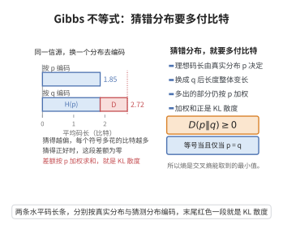

# Gibbs 不等式

> **一句话大白话**：如果你用一个"猜测的分布" $q$ 去描述真实分布 $p$，代价（交叉熵）永远不会低于 $p$ 自己的熵；两者的差额就是 KL 散度，只有猜得一模一样时差额才为零。
>
> **小例子**：取 $p=(1/2,1/2)$、$q=(1/4,3/4)$，则 $D(p\|q)=\frac12\log_2 2+\frac12\log_2\frac{2}{3}\approx0.2075>0$；把 $q$ 换成 $p$ 本身，散度立刻变成 $0$。

## 一、定理介绍

> **前置依赖**：Jensen不等式、对数运算法则、全概率公式。

Gibbs 不等式（又称 Gibbs' inequality、KL 散度非负性）是信息论的基石性不等式，由 J. W. Gibbs 在统计力学中关于自由能的观察演变而来。它断言：对任意两个概率分布 $p$ 与 $q$，交叉熵 $H(p,q)$ 不小于香农熵 $H(p)$，等号成立当且仅当 $p=q$；等价地说，Kullback–Leibler 散度 $D(p\|q)$ 恒非负。这一不等式把"熵是全局最小的平均编码长度"这一直觉变成了严格结论：任何基于错误分布 $q$ 设计的编码方案都比按真实分布 $p$ 设计的更"贵"。它同时是最大熵原理、最大似然估计的信息解释、以及 Shannon 信源编码下界证明（配合 Kraft 不等式）的核心工具。

## 几何直观

图意在说明：用错的分布去编码，平均码长只会变长，多付的期望比特正是 KL 散度。

## 二、原理思路

1. 交叉熵与熵之差恰是 KL 散度：$D(p\|q)=H(p,q)-H(p)=\sum_x p(x)\log\frac{p(x)}{q(x)}$，故只需证 $D(p\|q)\ge0$。
2. 把每项写成 $p(x)\log\frac{p(x)}{q(x)}=-p(x)\log\frac{q(x)}{p(x)}$，就得到一个"$\log$ 的加权平均"，其中权重为 $p(x)$。
3. 对数函数是严格凹函数，凹性蕴含"函数的加权平均不超过平均处的函数值"（Jensen 不等式），于是把 $\log$ 移到求和号之外。
4. 移出后求和号内只剩 $\sum_x p(x)\frac{q(x)}{p(x)}=\sum_x q(x)$，由概率分布的归一化（全概率公式）其值为 $1$，而 $\log 1=0$，即得非负性。
5. 凹函数的等号条件（当 $q(x)/p(x)$ 为常数）进一步给出 $p=q$ 的严格刻画。

## 三、定理的严格表述

设 $\mathcal X$ 为有限或可数集合，$p=\{p(x)\}_{x\in\mathcal X}$ 与 $q=\{q(x)\}_{x\in\mathcal X}$ 为 $\mathcal X$ 上的概率分布，即 $p(x)\ge0$、$\sum_x p(x)=1$，$q$ 同理。约定 $0\log 0=0$、$0\log\frac{0}{0}=0$。定义

$$
H(p)=-\sum_{x}p(x)\log p(x),\qquad
H(p,q)=-\sum_{x}p(x)\log q(x),\qquad
D(p\|q)=\sum_{x}p(x)\log\frac{p(x)}{q(x)} .
$$

**定理（Gibbs 不等式）**：若 $p\ll q$（即 $p(x)>0\Rightarrow q(x)>0$），则

$$
H(p,q)\ge H(p),\qquad\text{即}\qquad D(p\|q)=H(p,q)-H(p)\ge0 .
$$

等号成立当且仅当 $p=q$。若存在 $x$ 使 $p(x)>0$ 而 $q(x)=0$，则约定 $H(p,q)=+\infty$，不等式仍然成立。

**推论（有限支撑下的最大熵）**：若 $p$ 支撑在 $|\mathcal X|<\infty$ 上，取 $q$ 为均匀分布，则 $H(p)\le\log|\mathcal X|$，等号当且仅当 $p$ 为均匀分布。

## 四、证明过程

**步骤 1（对数函数的凹性与 Jensen 不等式）。** 函数 $\ln u$ 在 $(0,\infty)$ 上二阶导数为 $-1/u^2<0$，故严格凹。由 Jensen 不等式，对任意在 $p(x)>0$ 处取值于 $(0,\infty)$ 的函数 $r(x)$ 有

$$
\sum_{x}p(x)\ln r(x)\le\ln\Bigl(\sum_x p(x)\,r(x)\Bigr),
$$

其中等号成立当且仅当 $r$ 在 $p$ 的支撑上为常数。

**步骤 2（代入 $r=q/p$）。** 令 $r(x)=q(x)/p(x)$（在 $p(x)>0$ 处）。由对数运算法则 $\log\frac{q}{p}=-\log\frac{p}{q}$，于是

$$
D(p\|q)=\sum_x p(x)\log\frac{p(x)}{q(x)}
=-\sum_x p(x)\log\frac{q(x)}{p(x)}
\ge-\log\Bigl(\sum_{x}p(x)\frac{q(x)}{p(x)}\Bigr).
$$

**步骤 3（归一化）。** 上式求和号内

$$
\sum_{x:\,p(x)>0}p(x)\frac{q(x)}{p(x)}=\sum_{x:\,p(x)>0}q(x)\le\sum_{x}q(x)=1,
$$

其中最后一个等号由 $q$ 是概率分布（归一化）给出，也正是全概率公式在离散情形的内容。由于 $-\log$ 单调递减，$1$ 处取值为 $0$:

$$
D(p\|q)\ge-\log 1=0 .
$$

若某个 $p(x)>0$ 而 $q(x)=0$，则该求和项为 $0$、$-\log 0=+\infty$，不等式显然成立。这证明了 $D(p\|q)\ge0$，即 $H(p,q)\ge H(p)$。

**步骤 4（等号条件）。** 若 $p=q$，则每项 $\log\frac{p(x)}{q(x)}=\log1=0$，故 $D(p\|q)=0$。反之若 $D(p\|q)=0$，由步骤 1 的等号条件知 $r=q/p$ 在 $p$ 的支撑上等于常数 $c$，结合步骤 3 得

$$
1=\sum_{x}p(x)\frac{q(x)}{p(x)}=c\sum_{x}p(x)=c,
$$

故 $c=1$，即 $q(x)=p(x)$ 对一切 $p(x)>0$ 成立，再由两者都是概率分布知在支撑外也一致，故 $p=q$。

**步骤 5（最大熵推论）。** 取 $q(x)=1/|\mathcal X|$，则

$$
H(p,q)=-\sum_x p(x)\log\frac{1}{|\mathcal X|}=\log|\mathcal X|,
$$

由 Gibbs 不等式 $H(p)\le H(p,q)=\log|\mathcal X|$；等号条件 $p=q$ 即 $p$ 为均匀分布。顺带地，这一步给出了信息论中"先验无信息时应选均匀分布"的原则。

## 五、应用与意义

- **信源编码下界**：由 $\bar L\ge H(p)$ 的证明（nats/bit 单位下 $-\sum p\log q$ 与码长的关系）可见，Gibbs 不等式是把"Kraft 不等式"升级为"熵是最优压缩率"的关键一步，见 [Shannon信源编码定理](./Shannon信源编码定理.md)。
- **最大熵原理**：在约束集合中"最不偏不倚"的分布是使熵最大者，其合法性由 Gibbs 不等式与步骤 5 保证。
- **统计推断**：最大似然估计即最小化经验分布与模型分布之间的 KL 散度；Akaike 信息准则、变分推断与 EM 算法的下界构造都以其非负性为前提。
- **机器学习**：交叉熵损失、知识蒸馏、互信息最大化等目标的合理性均建立在"交叉熵不小于熵"这一基本事实之上。

## 课堂问答

**老师**：为什么用错误分布 $q$ 编码一定更贵？

**学生**：因为交叉熵与熵之差就是 KL 散度 $D(p\|q)=H(p,q)-H(p)=\sum_x p(x)\log\frac{p(x)}{q(x)}$，而 $D(p\|q)\ge0$，等号当且仅当 $p=q$。所以 $H(p,q)\ge H(p)$，用 $q$ 设计的编码平均代价不低于真实分布下的熵。

**老师（追问）**：非负性这一步靠什么？等号条件又怎么来？

**学生**：靠 $\ln$ 的严格凹性与 Jensen 不等式。令 $r=q/p$，则 $D(p\|q)=-\sum_x p(x)\log\frac{q(x)}{p(x)}\ge-\log\bigl(\sum_x p(x)\frac{q(x)}{p(x)}\bigr)\ge-\log1=0$，中间用 $\sum_x q(x)=1$。等号成立当且仅当 $r=q/p$ 在 $p$ 的支撑上为常数 $c$，由归一化得 $c=1$，即 $p=q$。

**老师（拓展）**：它最直接的推论与实际用途是什么？

**学生**：取 $q$ 均匀得 $H(p)\le\log|\mathcal X|$，即有限支撑上的最大熵原理——无信息先验应选均匀分布。它还给出信息论与统计的桥梁：最大似然估计等价于最小化经验分布与模型分布的 KL 散度，交叉熵损失、变分下界的合理性都以其非负性为前提，也是 Shannon 信源编码下界的证明工具。

## 相关条目

- [Shannon信源编码定理](./Shannon信源编码定理.md)：以 Gibbs 不等式为工具证明的压缩极限理论。
- [Kraft-McMillan不等式](./Kraft-McMillan不等式.md)：可译码码长必须满足的基本约束。
- [Jensen不等式](../第24级-概率论基础/Jensen不等式.md)：本条目的凹函数工具。
