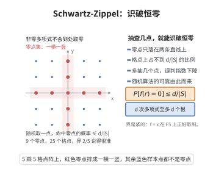

# Schwartz-Zippel 引理

> **一句话大白话**：一个非零多项式不会"到处都是根"——在有限集合里随机取点代入，它取零的概率被总次数除以集合大小压住，于是随机抽查几点就能高概率判定它是不是恒等于零。
>
> **小例子**：在 $\mathbb F_5$ 上取 $f(x)=x^2-1$，总次数 $d=2$，$S=\mathbb F_5$。随机取 $r\in\mathbb F_5$ 时 $f(r)=0$ 的概率为 $2/5$，恰等于 $d/|S|=2/5$，说明该界是紧的。

## 一、定理介绍

> **前置依赖**：多项式恒等定理、有限域理论、全期望公式、插值多项式的存在唯一性。

Schwartz-Zippel 引理（又称 DeMillo–Lipton 引理、多项式恒等检验引理）是随机算法与代数组合的基石，由 Schwartz、Zippel 与 DeMillo–Lipton 在 1970 年代末独立提出。它给出了"非零多项式在随机点取零"的概率上界 $d/|S|$，其中 $d$ 为多项式的总次数、$S$ 为取值集合大小。这条看似简单的不等式有两个方向的威力：反方向（对偶）上，它说明只要 $d<|S|$，非零多项式就不可能在各点处普遍取零，因此**多项式恒等检验**（polynomial identity testing）可以只做几次随机赋值，以单边错误高概率判定；正方向上，它把"某多项式不恒为零"这一存在性结论转化为概率估计，从而给出显式参数构造的存在性证明，网络编码中随机线性编码的失败概率界正是其直接应用。

## 几何直观

图意在说明：非零多项式的零点只占格点的很小比例，随机抽查几次就能以高概率识破恒零。

## 二、原理思路

1. 单变量情形是本引理的全部难度所在：域上次数不超过 $d$ 的非零多项式至多有 $d$ 个根，其证明只用到因式定理（每个根贡献一个一次因子）。
2. 多变量情形对变量个数 $n$ 作归纳：把多项式按最后一个变量 $x_n$ 的幂次整理，最高次项系数是 $n-1$ 元的多项式 $f_k$。
3. 先随机取定前 $n-1$ 个变量：若 $f_k$ 在这些点上取零，则条件概率只能粗略地估为 $1$；若 $f_k$ 不取零，则剩余的是关于 $x_n$ 的非零单变量多项式，次数恰为 $k$，可用单变量情形控制。
4. 把两种情形按全期望公式加权，$1$ 与 $k/|S|$ 的组合恰好给出 $d/|S|$，归纳完成。
5. 由归纳可见等号条件与"最高次项系数也被随机点打中"相关，这也是某些构造性问题中系数选取必须足够随机的原因。

## 三、定理的严格表述

设 $\mathbb F$ 为域，$S\subseteq\mathbb F$ 为有限非空子集，$f\in\mathbb F[x_1,\dots,x_n]$ 为总次数不超过 $d$ 的多项式（$f\not\equiv0$）。令 $r_1,\dots,r_n$ 为 $S$ 上独立均匀的随机变量。

**引理（Schwartz-Zippel）**：

$$
\Pr\bigl[f(r_1,\dots,r_n)=0\bigr]\le\frac{d}{|S|}.
$$

当 $|S|\le d$ 时右端不小于 $1$，结论平凡；故有意义的表述为 $|S|>d$ 时取零概率严格小于 $1$。

**推论 1（多项式恒等检验）**：若 $f$ 与 $g$ 的总次数都不超过 $d$ 且 $|S|>d$，则对随机点 $r$，

$$
\Pr\bigl[f(r)\ne g(r)\,\big|\,\text{存在 }x:f(x)\ne g(x)\bigr]\ge1-\frac{d}{|S|},
$$

即"恒等"或"在随机点上相等"的判定是单边错误的：重复 $t$ 次独立取值可将错误概率降到 $(d/|S|)^t$。

**推论 2（小集合上的非根存在性）**：若 $|S|>d$ 且 $f\not\equiv0$，则存在 $s_1,\dots,s_n\in S$ 使 $f(s_1,\dots,s_n)\ne0$；更定量地，这样的点占 $S^n$ 的比例至少为 $1-d/|S|$。

## 四、证明过程

**步骤 1（单变量引理）。** 设 $0\not\equiv h\in\mathbb F[x]$、$\deg h=m$。对任意根 $a\in\mathbb F$，由因式定理 $h(x)=(x-a)h_1(x)$ 且 $\deg h_1=m-1$。若 $h$ 有 $m+1$ 个不同根 $a_1,\dots,a_{m+1}$，反复提取因子得 $h(x)=\bigl(\prod_{i=1}^{m+1}(x-a_i)\bigr)h_{m+1}(x)$，右端次数至少 $m+1$，而左端次数为 $m$，矛盾。故 $h$ 在 $\mathbb F$ 中至多 $m$ 个根；特别地，在 $S$ 中至多 $\min(m,|S|)$ 个根。于是对随机 $r\in S$，

$$
\Pr[h(r)=0]\le\frac{m}{|S|}.
$$

**步骤 2（归纳的分解）。** 设结论对 $n-1$ 个变量成立，现证 $n$ 个变量。把 $f$ 按 $x_n$ 的幂整理：

$$
f(x_1,\dots,x_n)=\sum_{i=0}^{k}f_i(x_1,\dots,x_{n-1})\,x_n^{\,i},\qquad f_k\not\equiv0,
$$

其中 $k$ 为 $x_n$ 的最高出现次数。由总次数的定义，$\deg f_k\le d-k$。

**步骤 3（条件概率）。** 记 $r'=(r_1,\dots,r_{n-1})$，并令事件 $A=\{f_k(r')=0\}$。由归纳假设与 $\deg f_k\le d-k$，

$$
\Pr[A]=\Pr\bigl[f_k(r')=0\bigr]\le\frac{d-k}{|S|}.
$$

在 $A$ 发生时，对条件概率只能作平凡估计 $\Pr[f(r)=0\mid A]\le1$。在 $A$ 不发生时，$f(r',x_n)$ 是 $x_n$ 的非零多项式，且其 $x_n^k$ 的系数 $f_k(r')\ne0$，故次数恰为 $k$；由步骤 1 的单变量引理，

$$
\Pr\bigl[f(r)=0\mid A^c\bigr]\le\frac{k}{|S|}.
$$

**步骤 4（全期望公式合并）。** 由全期望公式（对条件事件 $A$ 分解），

$$
\Pr\bigl[f(r)=0\bigr]
=\Pr[A]\,\Pr\bigl[f(r)=0\mid A\bigr]+\Pr[A^c]\,\Pr\bigl[f(r)=0\mid A^c\bigr]
\le\frac{d-k}{|S|}\cdot1+1\cdot\frac{k}{|S|}
=\frac{d}{|S|},
$$

这正是所要证明的不等式；归纳由 $n=1$（步骤 1）起成立。

**步骤 5（推论的证明）。** 取 $h=f-g$，由多项式恒等定理，$f\not\equiv g$ 当且仅当 $h\not\equiv0$，且 $\deg h\le d$。把引理用于 $h$ 得 $\Pr[h(r)=0]\le d/|S|$，取补事件即推论 1；$t$ 次独立取值互不影响，错误概率为乘积 $\le(d/|S|)^t$。推论 2 只需注意概率为正数即意味着相应的点存在，且由 $\Pr[h(r)\ne0]\ge1-d/|S|$ 得比例下界；$|S|>d$ 时该下界为正，故非根点集非空。

**注（与插值的关系）**：步骤 1 中"至多 $m$ 个根"与"$m+1$ 个点唯一确定次数不超过 $m$ 的多项式"是同一事实的两面，后者即 [插值多项式的存在唯一性](../第103级-数值分析/插值多项式的存在唯一性.md)。这也解释了为何 $|S|\le d$ 时引理失效：此时点数不足以"分辨"两个不同多项式。

## 五、应用与意义

- **随机线性网络编码**：编码矩阵的行列式是局部编码系数的多项式，且不恒为零；引理给出随机选取系数时行列式退化的概率上界，从而得到多播成功概率 $\ge1-|T|h/q$，见 [网络编码基础](./网络编码基础.md)。
- **多项式恒等检验（PIT）**：判定两个电路/公式所表示的多项式是否相同，随机赋值法是已知最有效的通用手段之一。
- **代数算法的随机化**：矩阵乘法验证、行列式符号检测、稀疏插值等算法都用它把"代数恒等"化为"随机点上取零"。
- **存在性构造**：在组合设计中，先用引理证明"坏点集不足以覆盖全空间"，再得出好参数的存在性，是概率方法在代数中的典型用法。

## 课堂问答

**老师**：一个非零多项式凭什么随机取零的概率不超过 $d/|S|$？

**学生**：单变量是全部难度：$\mathbb F$ 上次数不超过 $d$ 的非零多项式至多 $d$ 个根，所以在 $S$ 上取零概率至多 $d/|S|$。多变量对变量个数归纳：按 $x_n$ 整理 $f=\sum_i f_i(x_1,\dots,x_{n-1})x_n^i$，最高次系数 $f_k$ 的次数不超过 $d-k$，先随机定前 $n-1$ 个变量，再对 $f_k\neq0$ 的情形用单变量情形，最后用全期望公式合并得至多 $d/|S|$。

**老师（追问）**：归纳里那个 $d/|S|$ 是怎么从两支拼出来的？

**学生**：条件于事件 $A=\{f_k(r')=0\}$：$A$ 上只能估至多 $1$，$A^c$ 上关于 $x_n$ 是次数恰为 $k$ 的非零单变量多项式，取零概率至多 $k/|S|$；而由归纳假设 $\Pr[A]\le(d-k)/|S|$。全期望公式给出至多 $\frac{d-k}{|S|}\cdot1+1\cdot\frac k{|S|}=\frac d{|S|}$。这一步把 $d-k$ 与 $k$ 拼回 $d$ 正是引理的巧妙之处。

**老师（拓展）**：这条引理在算法和编码里怎么用？

**学生**：它把代数恒等化为随机点上取零，是多项式恒等检验的通用手段，重复 $t$ 次把错误概率降到 $(d/|S|)^t$。在网络编码中，全局编码矩阵的行列式是系数的非零多项式，引理给出随机系数退化概率至多 $|T|h/q$，即随机线性编码成功概率至少 $1-|T|h/q$。常见误区是忘记 $|S|>d$ 的前提，点数不足时引理失效，因为不足以分辨两个不同多项式。

## 相关条目

- [网络编码基础](./网络编码基础.md)：随机线性编码失败概率界的主要应用场景。
- [多项式恒等定理](../第02级-初等代数/多项式恒等定理.md)：判定"$f\not\equiv0$"的代数基础。
- [有限域理论](../第36级-伽罗瓦理论/有限域理论.md)：取值集合 $S$ 与域上根结构的一般理论。
