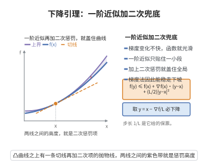

# 下降引理

> **一句话大白话**：只要函数的"陡峭程度"变化得不太快，那么从一点出发做一阶近似、再加一个与步长平方成正比的惩罚项，就一定是函数真实值的上界，这给了梯度法可以依赖的"下坡保证"。

> **小例子**：取 $f(x)=\frac{L}{2}\|x\|^2$，则 $\nabla f(x)=Lx$ 是 $L$-Lipschitz 的。此时下降引理给出 $f(y)\le f(x)+Lx^\top(y-x)+\frac{L}{2}\|y-x\|^2=\frac{L}{2}\|y\|^2$，恰为等式，说明该上界是最优的。

## 一、定理介绍

> **前置依赖**：凸函数与凸集、Cauchy-Schwarz不等式、方向导数与梯度的关系、梯度下降收敛性。

下降引理是光滑优化中最常用的基本不等式，其现代形式由 Nesterov 等人在梯度法复杂度分析中系统使用，而内容本质上是多元微积分中值定理与 Lipschitz 连续性的直接产物。它指出：当可微函数 $f$ 的梯度满足 $L$-Lipschitz 条件（梯度变化受控）时，$f$ 被一个"一阶 Taylor 多项式加二次惩罚项"的二次函数全局地控制住。这个上界之所以关键，是因为它把非线性函数局部地"装进"一个已知的抛物面里，于是在该抛物面上取最小值便能保证真实函数值也下降。梯度法的步长选取、加速方法的收敛率以及原始-对偶算法的复杂度证明都以此为出发点；没有它，就无法把连续优化的收敛性归约为简单的递推不等式。

## 几何直观

图意在说明：只要梯度变化不超过 L，切线加上二分之 L 乘距离平方就一定盖住真实函数值。

## 二、原理思路

1. 把函数增量写成沿线段的积分：$f(y)-f(x)$ 等于梯度在点 $x+t(y-x)$ 处与方向 $(y-x)$ 的内积关于 $t$ 的积分，这是一元微积分基本定理沿线段推广的标准写法。
2. 在被积函数里减去并加回 $\nabla f(x)$，把偏差 $\nabla f(x+t(y-x))-\nabla f(x)$ 用 Lipschitz 条件控制为不超过 $Lt\|y-x\|$。
3. 用 Cauchy-Schwarz 不等式把内积估计为模长之积，再对 $t$ 积分得 $\frac{L}{2}\|y-x\|^2$，即得二次上界；最后把 $y=x-\frac1L\nabla f(x)$ 代入，得到每次迭代的充分下降量。

## 三、定理的严格表述

设 $f:\mathbb{R}^n\to\mathbb{R}$ 连续可微，且其梯度满足 Lipschitz 条件：存在常数 $L>0$，使对一切 $x,y\in\mathbb{R}^n$ 有

$$
\|\nabla f(y)-\nabla f(x)\|\le L\|y-x\|.
$$

则对一切 $x,y\in\mathbb{R}^n$ 成立**下降引理**：

$$
f(y)\le f(x)+\nabla f(x)^{\top}(y-x)+\frac{L}{2}\|y-x\|^{2}.
$$

**推论（一步充分下降）**：取 $y=x-\frac1L\nabla f(x)$，则

$$
f(y)\le f(x)-\frac{1}{2L}\|\nabla f(x)\|^{2}.
$$

## 四、证明过程

**步骤 1（增量表示为积分）。** 固定 $x,y$，令 $\gamma(t)=x+t(y-x)$，$t\in[0,1]$。由链式法则有 $\frac{d}{dt}f(\gamma(t))=\nabla f(\gamma(t))^\top(y-x)$，于是

$$
f(y)-f(x)=\int_0^1 \nabla f(\gamma(t))^{\top}(y-x)\,dt.
$$

**步骤 2（减去梯度的基准值）。** 因 $\int_0^1 dt=1$，故 $\nabla f(x)^\top(y-x)=\int_0^1\nabla f(x)^\top(y-x)\,dt$，相减得

$$
f(y)-f(x)-\nabla f(x)^{\top}(y-x)=\int_0^1\bigl[\nabla f(\gamma(t))-\nabla f(x)\bigr]^{\top}(y-x)\,dt.
$$

**步骤 3（用 Lipschitz 与 Cauchy-Schwarz 估计）。** 注意 $\|\gamma(t)-x\|=t\|y-x\|$，由 Lipschitz 条件得 $\|\nabla f(\gamma(t))-\nabla f(x)\|\le Lt\|y-x\|$；再由 Cauchy-Schwarz 不等式，

$$
\bigl[\nabla f(\gamma(t))-\nabla f(x)\bigr]^{\top}(y-x)\le Lt\|y-x\|^{2}.
$$

对 $t$ 从 $0$ 到 $1$ 积分，右端为 $L\|y-x\|^2\int_0^1 t\,dt=\frac{L}{2}\|y-x\|^2$，即得下降引理。

**步骤 4（导出充分下降）。** 在引理中取 $y=x-\frac1L\nabla f(x)$，则 $y-x=-\frac1L\nabla f(x)$，代入得

$$
f(y)\le f(x)-\frac1L\|\nabla f(x)\|^2+\frac{L}{2}\cdot\frac1{L^2}\|\nabla f(x)\|^2=f(x)-\frac{1}{2L}\|\nabla f(x)\|^2.
$$

$\square$

## 五、应用与意义

- 梯度法收敛性：由步骤 4 的递推可得 $f(x_k)-\inf f\le\frac{L\|x_0-x^*\|^2}{2k}$，这是最基础 $O(1/k)$ 收敛率的来源。
- 步长选取：只要步长 $0<\eta<1/L$ 即可保证每次迭代函数值不增，为回溯线搜索提供理论依据。
- 加速与随机优化：Nesterov 加速、随机梯度下降的方差与步长分析均以下降引理为出发点。
- 非凸情形：它保证梯度法收敛到驻点，即 $\|\nabla f(x_k)\|\to0$，是分析深度网络训练动力学的基本工具。
- 与凸性配合：当 $f$ 还是凸函数时，下降引理与凸性不等式结合可得到更强的线性收敛率与对偶间隙估计。

## 课堂问答

**老师**：下降引理说的是什么？

**学生**：若 $\|\nabla f(y)-\nabla f(x)\|\le L\|y-x\|$，则 $f(y)\le f(x)+\nabla f(x)^\top(y-x)+\frac L2\|y-x\|^2$。它把函数全局装进以 $L$ 为曲率的抛物面里。

**老师（追问）**：怎么推出一层的充分下降？

**学生**：取 $y=x-\frac1L\nabla f(x)$ 代入，得 $f(y)\le f(x)-\frac1L\|\nabla f(x)\|^2+\frac{L}{2L^2}\|\nabla f(x)\|^2=f(x)-\frac{1}{2L}\|\nabla f(x)\|^2$。这正是 $O(1/k)$ 梯度法收敛率与回溯线搜索的依据。

**老师（拓展）**：证明的思想是什么？

**学生**：把增量写成积分 $f(y)-f(x)=\int_0^1\nabla f(\gamma(t))^\top(y-x)\,dt$，减去 $\nabla f(x)$ 后用 Lipschitz 控制偏差不超过 $Lt\|y-x\|$，再用 Cauchy–Schwarz 并积分 $\int_0^1 t\,dt=\frac12$。它只用中值定理与 Lipschitz，不要求凸性。

## 相关条目

- [凸函数与凸集](./凸函数与凸集.md)：凸性给出 $f$ 的下界，与下降引理的上界共同夹住函数。
- [梯度下降收敛性](./梯度下降收敛性.md)：该引理正是梯度法收敛率证明的核心估计。
- [Cauchy-Schwarz不等式](../第14级-线性代数/Cauchy-Schwarz不等式.md)：步骤 3 的内积估计直接使用它。
- [方向导数与梯度的关系](../第12级-多变量微积分/方向导数与梯度的关系.md)：步骤 1 中链式法则的来源。
- [Karush-Kuhn-Tucker条件](./Karush-Kuhn-Tucker条件.md)：约束优化的一阶条件与下降引理共同刻画最优性。
