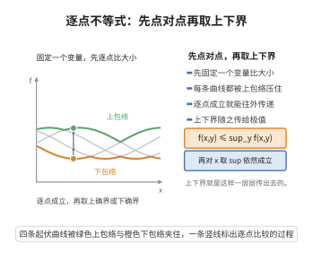

# 函数的逐点不等式

> **一句话大白话**：一个二元函数 $f(x,y)$ 不管怎么摆，它在某一点的值总被"对 $x$ 的最小值"压住下界、被"对 $y$ 的最大值"托住上界；把这种"点对点"的比较沿某个方向一次性取完，就得到全局的上下界。
>
> **小例子**：取 $f(x,y)=(x-y)^2$，$x,y\in\{0,1\}$。对固定的 $y$ 有 $\min_x f(x,y)=0\le f(0,1)=1$，对固定的 $x$ 有 $f(0,1)=1\le\max_y f(0,y)=1$，正是 $0\le1\le1$。

## 一、定理介绍

> **前置依赖**：确界原理、不等式基本性质、序公理。

函数的逐点不等式是极小极大理论、对偶理论与换序论证的"最小公分母"。它的内容十分朴素：对任意固定的 $x$ 与 $y$，函数值 $f(x,y)$ 夹在"沿 $x$ 方向取下确界"与"沿 $y$ 方向取上确界"之间；而对一个不含某变量的量再取该变量方向的确界，其值不变。正是这两条看上去平凡的事实，支撑起了弱极小极大不等式、弱对偶性 $d^*\le p^*$ 以及一切涉及 $\sup\inf$ 与 $\inf\sup$ 的估计。本条目把它们逐条陈述并证明，作为后续定理可直接调用的引理。

## 几何直观

图意在说明：对每个固定点先比较大小，得到逐点不等式，再取上下确界便传给全局极值。

## 二、原理思路

1. 上下确界的定义本身就是一个"逐点比较"：下确界是所有下界中最大者，上确界是所有上界中最小者。
2. 因此对每个固定的点 $(x,y)$，把 $y$ 固定后沿 $x$ 取 $\inf$ 得到的数不超过 $f(x,y)$；沿 $y$ 取 $\sup$ 得到的数不小于 $f(x,y)$。串联即得夹逼不等式。
3. 若一个量已经不依赖于某个变量，则对该变量取 $\inf$ 或 $\sup$ 都不改变它。这条"常数不变性"是换序论证的关键。
4. 逐点不等式沿一个方向取确界仍然保持：若 $A\le f(x,y)$ 对一切 $x$ 成立，则 $A\le\inf_x f(x,y)$。

## 三、定理的严格表述

设 $X,Y$ 为非空集合，$f:X\times Y\to\mathbb R$ 为实值函数（允许取 $\pm\infty$）。

**引理 1（逐点夹逼）**：对任意 $x_0\in X$、$y_0\in Y$，

$$
\inf_{x\in X}f(x,y_0)\le f(x_0,y_0)\le\sup_{y\in Y}f(x_0,y).
$$

**引理 2（常数不变性）**：若 $c$ 与 $x$ 无关，则 $\inf_{x\in X}c=c$、$\sup_{x\in X}c=c$。更一般地，记 $c(y)=\inf_{x\in X}f(x,y)$，则 $c(y)\le f(x,y)$ 对一切 $x\in X$ 成立。

**引理 3（取确界保持不等式）**：设 $A$ 为常数。若 $A\le f(x,y)$ 对一切 $x\in X$ 成立，则 $A\le\inf_{x\in X}f(x,y)$；若 $f(x,y)\le A$ 对一切 $y\in Y$ 成立，则 $\sup_{y\in Y}f(x,y)\le A$。

**引理 4（单调性）**：若 $f(x,y)\le g(x,y)$ 对一切 $x,y$ 成立，则对每个 $y$ 有 $\inf_x f(x,y)\le\inf_x g(x,y)$ 且 $\sup_x f(x,y)\le\sup_x g(x,y)$。

## 四、证明过程

**引理 1 的证明。** 固定 $y_0$。由下确界的定义，$\inf_{x\in X}f(x,y_0)$ 是集合 $\{f(x,y_0):x\in X\}$ 的一个下界，故对每个 $x_0\in X$ 有

$$
\inf_{x\in X}f(x,y_0)\le f(x_0,y_0).
$$

同理，固定 $x_0$ 时 $\sup_{y\in Y}f(x_0,y)$ 是集合 $\{f(x_0,y):y\in Y\}$ 的一个上界，故 $f(x_0,y_0)\le\sup_{y\in Y}f(x_0,y)$。两式串联即得。

**引理 2 的证明。** 若集合为单点集 $\{c\}$，则其下界构成区间 $(-\infty,c]$，其中最大者为 $c$，故 $\inf=c$；其上部界构成 $[c,+\infty)$，其中最小者为 $c$，故 $\sup=c$。至于第二部分：$c(y)$ 是集合 $\{f(x,y):x\in X\}$ 的下界，按定义对每个 $x\in X$ 有 $c(y)\le f(x,y)$。

**引理 3 的证明。** 设 $A\le f(x,y)$ 对一切 $x$ 成立，则 $A$ 是集合 $\{f(x,y):x\in X\}$ 的一个下界，而下确界是**最大**下界（确界原理的刻划），故 $A\le\inf_{x\in X}f(x,y)$。第二部分同理：此时 $A$ 是该集合的上界，而上确界是**最小**上界，故 $\sup_{y\in Y}f(x,y)\le A$。这里用到的正是由序公理保证的实数全序关系：比较大小可逐项传递。

**引理 4 的证明。** 固定 $y$。由假设 $f(x,y)\le g(x,y)$ 对一切 $x$ 成立，于是 $\inf_x f(x,y)$（作为 $f(\cdot,y)$ 的下界）也是 $g(\cdot,y)$ 的下界，从而不超过最大下界 $\inf_x g(x,y)$：

$$
\inf_{x\in X}f(x,y)\le\inf_{x\in X}g(x,y).
$$

上确界部分对偶：$\sup_x g(x,y)$ 是 $f(\cdot,y)$ 的上界，故不小于最小上界 $\sup_x f(x,y)$。

**推论（换序的总起点）。** 把引理 1 中 $x_0$ 换成任意 $x$，并用引理 3 第一式对 $x$ 取下确界；注意左端 $\inf_x f(x,y_0)$ 只依赖 $y_0$，再由引理 2 对其取上确界不改变它，得

$$
\sup_{y\in Y}\inf_{x\in X}f(x,y)\le\inf_{x\in X}\sup_{y\in Y}f(x,y).
$$

这就是弱极小极大不等式；它的全部内容都已被上面四条引理覆盖，故凡在弱对偶性、博弈值估计中需要用到该不等式的场合，都可以直接回到"逐点比较 + 确界刻划"这两条最原始的来源。

## 五、应用与意义

- **极小极大理论**：弱极小极大不等式是它的起点，而"鞍点值"的定义（左右两端相等）也依赖这些确界语言。
- **对偶理论**：弱对偶性 $d^*\le p^*$ 的证明只用到 Lagrange 函数上的逐点比较与引理 3。
- **概率与统计**：$\inf_\theta$ 与 $\sup_\theta$ 的换序估计、最坏情形风险的下界都反复调用引理 1 与引理 3。
- **分析中的换序**：$\sup$ 与 $\inf$ 的交换、极限与确界的交换，往往先要求逐点不等式成立，本条目提供了这类论证的统一模板。

## 课堂问答

**老师**：这么平凡的引理为什么值得单列？

**学生**：因为它是所有换序论证的最小公分母。引理 1 说 $\inf_x f(x,y_0)\le f(x_0,y_0)\le\sup_y f(x_0,y)$；引理 2 是常数不变性；引理 3 是取确界保持不等式。弱极小极大不等式与弱对偶性都能由它们直接推出来。

**老师（追问）**：怎么从逐点比较拼出换序不等式？

**学生**：把引理 1 中的 $x_0$ 换成任意 $x$，用引理 3 对 $x$ 取下确界，得 $\inf_x\sup_y f\ge\inf_x f(x,y_0)$；左端只依赖 $y_0$，再由引理 2 对 $y$ 取上确界不改变它，即得 $\sup_y\inf_x f\le\inf_x\sup_y f$。

**老师（拓展）**：容易在哪里出错？

**学生**：容易把 $\sup$ 与 $\inf$ 的交换当成无条件成立。事实上需要凸凹或紧性等结构，本引理只给出一侧不等式，另一侧的等号才是强定理的难点，别把弱结论误用为等号。

## 相关条目

- [弱极小极大不等式](./弱极小极大不等式.md)：本条目推论的直接应用者。
- [minimax不等式](./minimax不等式.md)：在凸性假设下把推论中的不等号升级为等号。
