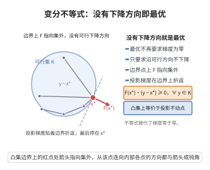

# 变分不等式

> **一句话大白话**：变分不等式把"求函数的极小值"推广成"找一个点，使得任何可行方向上的代价都不再下降"——最优性由一个不等式而非等式来刻画。

> **小例子**：取 $K=[0,1]$、$F(x)=x-\tfrac12$。在 $x^*=\tfrac12$ 处 $F(x^*)=0$，故 $\langle F(x^*),y-x^*\rangle=0\ge0$ 对一切 $y\in[0,1]$ 成立，所以 $x^*=\tfrac12$ 是解，恰是方程 $x-\tfrac12=0$ 的零点。

## 一、定理介绍

> **前置依赖**：凸函数与凸集、Karush-Kuhn-Tucker条件、凸优化对偶理论、正交投影定理。

变分不等式的现代形式由 Guido Stampacchia 于 1964 年在研究椭圆型偏微分方程的自由边界问题时提出，Lions 与 Stampacchia 随后在 1967 年的专著中系统建立了其存在性理论；同期 Hartman 与 Stampacchia 把投影方法与单调算子理论引入，使其成为一套独立而统一的最优性框架。它要解决的问题是：很多实际模型没有"能写下来的目标函数"（例如交通均衡、博弈均衡、接触力学中的单边约束），只有一组"每个可行方向上的力与位移的乘积必须非负"的条件，传统极小化框架无法覆盖。变分不等式把凸优化的最优性条件抽象出来，只要给定可行集 $K$ 与算子 $F$，就能描述均衡状态。它的意义在于统一：凸规划、互补问题、鞍点问题、非线性方程组（取 $K=\mathbb{R}^n$）都是它的特例，而投影算子与单调性理论则提供了存在性、唯一性与算法（投影法、外梯度法）的通用工具箱。

## 几何直观

图意在说明：最优点不再要求梯度为零，只要求沿任何可行方向 F 都不与之同向。

## 二、原理思路

1. 先把"最优"翻译成方向导数不等式：当 $F=\nabla f$、$f$ 凸时，$x^*$ 最优当且仅当 $\langle\nabla f(x^*),y-x^*\rangle\ge0$ 对一切 $y\in K$ 成立，这提示一般情形就取这个不等式作为定义。
2. 用最近点投影把不等式变成不动点方程：$K$ 闭凸时投影 $P_K$ 有变分特征 $\langle v-P_Kv,y-P_Kv\rangle\le0$，代入 $v=x-\alpha F(x)$ 即知 $x$ 解变分不等式等价于 $x=P_K(x-\alpha F(x))$，从而可用不动点与投影算法求解。
3. 用单调性讨论解的形态：单调 $F$ 让解集成为凸集，强单调 $F$ 让解唯一，这继承了凸优化的凸性与严格凸性。
4. 当 $K$ 由不等式约束给出时，把投影条件展开成 KKT 系统与互补条件，接回经典优化。

## 三、定理的严格表述

设 $K\subseteq\mathbb{R}^n$ 非空闭凸，$F:K\to\mathbb{R}^n$ 连续。变分不等式问题 $\mathrm{VI}(K,F)$ 求 $x^*\in K$ 使

$$
\langle F(x^*),\,y-x^*\rangle\ge0,\qquad\forall y\in K .
$$

**投影刻画**：对任意 $\alpha>0$，$x^*$ 是 $\mathrm{VI}(K,F)$ 的解，当且仅当 $x^*$ 是投影映射 $P_K$ 的不动点

$$
x^*=P_K\bigl(x^*-\alpha F(x^*)\bigr).
$$

**单调性**：$F$ 称为单调的，若 $\langle F(x)-F(y),x-y\rangle\ge0$ 对一切 $x,y\in K$；称为强单调（常数 $\mu>0$）的，若 $\langle F(x)-F(y),x-y\rangle\ge\mu|x-y|^2$。

## 四、证明过程

**步骤 1（投影的变分特征）。** $K$ 闭凸时投影 $z=P_K(v)$ 由最近点性质唯一确定，且满足

$$
z=P_K(v)\iff z\in K\ \text{且}\ \langle v-z,\,y-z\rangle\le0,\quad\forall y\in K .
$$

取 $v=x-\alpha F(x)$、$z=x$，即得：$x=P_K(x-\alpha F(x))$ 当且仅当 $\langle-\alpha F(x),y-x\rangle\le0$ 对一切 $y\in K$ 成立；两边同除 $\alpha>0$ 得 $\langle F(x),y-x\rangle\ge0$，正是 $\mathrm{VI}(K,F)$。故投影刻画成立。

**步骤 2（$F=\nabla f$ 时化归凸优化）。** 若 $f$ 凸可微且 $F=\nabla f$，则由凸函数的一阶最优性条件，$x^*$ 在 $K$ 上极小化 $f$ 当且仅当 $\langle\nabla f(x^*),y-x^*\rangle\ge0$ 对一切 $y\in K$，即 $x^*$ 解 $\mathrm{VI}(K,\nabla f)$。这解释了变分不等式是凸优化最优性条件的推广。

**步骤 3（单调性蕴涵解集凸）。** 设 $F$ 单调，$x^*,y^*$ 是两个解。把两条不等式相加：

$$
\langle F(x^*),y^*-x^*\rangle+\langle F(y^*),x^*-y^*\rangle\ge0\ \Longrightarrow\ \langle F(x^*)-F(y^*),x^*-y^*\rangle\le0 .
$$

另一方面单调性给出 $\langle F(x^*)-F(y^*),x^*-y^*\rangle\ge0$，故等号成立。对 $t\in[0,1]$ 令 $x_t=tx^*+(1-t)y^*\in K$（$K$ 凸）；由单调性与上式展开 $\langle F(x_t),y-x_t\rangle$ 可验证 $x_t$ 仍是解，故解集为凸集。

**步骤 4（强单调蕴涵解唯一）。** 若 $F$ 强单调且 $x^*,y^*$ 都是解，则把两条不等式相加得

$$
0\ge\langle F(x^*)-F(y^*),x^*-y^*\rangle\ge\mu|x^*-y^*|^2 ,
$$

于是 $x^*=y^*$，解至多一个；结合存在性结论即得唯一。

**步骤 5（KKT 与互补问题）。** 设 $K=\{x:g_i(x)\le0,\ h_j(x)=0\}$，在约束规范（如 Slater 条件）下，$x^*$ 解 $\mathrm{VI}(K,F)$ 当且仅当存在乘子 $\lambda\ge0$、$\nu$ 使

$$
F(x^*)+\sum_i\lambda_i\nabla g_i(x^*)+\sum_j\nu_j\nabla h_j(x^*)=0,\quad g_i(x^*)\le0,\quad\lambda_i g_i(x^*)=0,\quad h_j(x^*)=0 .
$$

特别地取 $K=\mathbb{R}^n_+$，条件变为互补问题：$x^*\ge0$、$F(x^*)\ge0$、$x^*_iF_i(x^*)=0$（记作 $0\le x^*\perp F(x^*)\ge0$），这正是线性与非线性互补问题的来源。

$\square$

## 五、应用与意义

- 均衡问题：交通网络均衡（Wardrop 原理）、Nash 均衡、市场均衡都以变分不等式刻画，因通常不存在统一的目标函数。
- 凸规划与互补问题：$F=\nabla f$ 时退化为凸优化；$K=\mathbb{R}^n_+$ 时退化为互补问题，与 KKT 理论一一对应。
- 接触与力学：单边接触、障碍问题、弹塑性本构中"不与约束冲突"的条件天然是变分不等式。
- 数值算法：投影法、外梯度法与 Korpelevich 算法以及各类分裂方法都建立在投影刻画之上。
- 偏微分方程：Stampacchia 框架下椭圆变分不等式的存在唯一性理论，是自由边界问题的基本工具。

## 课堂问答

**老师**：变分不等式和凸优化的关系是什么？

**学生**：$\mathrm{VI}(K,F)$ 求 $x^*\in K$ 使 $\langle F(x^*),y-x^*\rangle\ge0$ 对一切 $y\in K$ 成立。当 $F=\nabla f$ 且 $f$ 凸时，这正是 $f$ 在 $K$ 上的一阶最优性条件，故变分不等式是凸优化最优性条件的推广，还能刻画没有统一目标函数的均衡问题。

**老师（追问）**：投影刻画怎么来的？

**学生**：闭凸集上投影满足 $z=P_K(v)$ 当且仅当 $z\in K$ 且 $\langle v-z,y-z\rangle\le0$ 对一切 $y\in K$。取 $v=x-\alpha F(x)$ 与 $z=x$，得 $\langle-\alpha F(x),y-x\rangle\le0$，同除 $\alpha>0$ 即 $\langle F(x),y-x\rangle\ge0$，故 $x^*$ 是解当且仅当 $x^*=P_K(x^*-\alpha F(x^*))$ 是不动点。

**老师（拓展）**：单调性给出什么结论？

**学生**：$F$ 单调时解集是凸集，两解之差的内积被两面夹成零；$F$ 强单调时常数 $\mu>0$，两解之差满足 $0\ge\mu\|x^*-y^*\|^2$，故解唯一。取 $K=\mathbb R^n_+$ 时退化为互补问题 $0\le x^*\perp F(x^*)\ge0$。

## 相关条目

- [凸函数与凸集](./凸函数与凸集.md)：提供可行集的凸性与一阶最优性条件，是本理论的几何基础。
- [Karush-Kuhn-Tucker条件](./Karush-Kuhn-Tucker条件.md)：把变分不等式在约束集上展开为 KKT 系统与互补条件。
- [凸优化对偶理论](./凸优化对偶理论.md)：变分不等式的对偶与鞍点刻画，衔接均衡与极小极大问题。
- [正交投影定理](../第31级-泛函分析/正交投影定理.md)：最近点投影的存在唯一性，是投影刻画的依据。
- [KKT条件的充分性与必要性](../第109级-优化理论/KKT条件的充分性与必要性.md)：KKT 系统在约束优化中的完整讨论。
