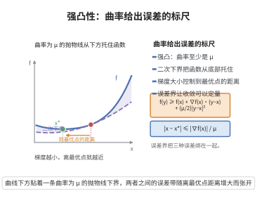

# 强凸性及其蕴含的误差界

> **一句话大白话**：强凸就是"比凸还要凸"——函数不只弯着向上，还至少带一个正比于距离平方的"碗底坡度"；这个坡度给出了距离、梯度、函数值三者之间的定量换算，让优化算法的误差不再只能"定性收敛"。
>
> **小例子**：取 $f(x)=\frac12x^2$（$\mu=1$，$x^*=0$）。此时 $f(x)-f(x^*)=\frac12\|x-x^*\|^2$ 与 $\|\nabla f(x)\|=|x|=\mu\|x-x^*\|$ 全部取等号，说明误差界中的常数 $\mu$ 不能再改进。

## 一、定理介绍

> **前置依赖**：凸函数与凸集、下降引理、Cauchy-Schwarz不等式。

强凸性是凸性的定量加强：除了"弦在图像上方"，还要求函数在每一点至少被一个固定的二次函数从下方托住。它的意义在于把凸分析的定性结论升级为**误差界**（error bounds）：函数值之差、梯度范数、到最优点的距离三者两两之间都有带常数 $\mu$ 的双向控制。正是这些不等式使梯度法的线性收敛率、条件数与迭代复杂度的估计成为可能：$f(x_k)-f(x^*)$ 可以换算成 $\|x_k-x^*\|$，也可以换算成 $\|\nabla f(x_k)\|$，从而把"目标值下降"翻译成"点序列逼近最优点"。本条目完整证明这些换算关系，并给出与 $L$-光滑（下降引理）配合得到的夹逼形式。

## 几何直观

图意在说明：强凸性给出二次下界，使到最优点的距离可用梯度范数除以 μ 来控制。

## 二、原理思路

1. 强凸性的定义本身就是一条"带二次惩罚项的一阶展开"，把它看作关于终点 $y$ 的二次函数并对 $y$ 取极小，立即得到函数值差与梯度范数的上界。
2. 把它用于最优点 $x^*$ 并在 $x^*$ 处使用一阶最优性条件 $\nabla f(x^*)=0$，得到函数值差与距离的下界。
3. 把方向 (2) 的不等式与凸性的一阶条件联立，再用 Cauchy-Schwarz 不等式把内积换成范数之积，得到梯度范数与距离的下界。
4. 把 (2)、(3) 串联，消去距离即得梯度范数与函数值差之间的双向控制。
5. 若再加上 $L$-光滑（下降引理），同一个二次函数从上方托住 $f$，于是得到以 $L$ 为上界、以 $\mu$ 为下界的"夹逼"。

## 三、定理的严格表述

**定义 1（$\mu$-强凸）**：设 $f:\mathbb R^n\to\mathbb R$ 可微。若存在 $\mu>0$ 使对一切 $x,y\in\mathbb R^n$ 有

$$
f(y)\ge f(x)+\nabla f(x)^{\top}(y-x)+\frac{\mu}{2}\|y-x\|^{2},
$$

则称 $f$ 为 $\mu$-强凸。当 $f$ 二阶连续可微时，这等价于 $\nabla^2f(x)\succeq\mu I$，也等价于 $f-\frac{\mu}{2}\|\cdot\|^2$ 为凸函数。

**定义 2（$L$-光滑）**：若 $\|\nabla f(x)-\nabla f(y)\|\le L\|x-y\|$ 对一切 $x,y$ 成立，则称 $f$ 为 $L$-光滑。

**定理（强凸性的误差界）**：设 $f$ 可微且 $\mu$-强凸，$x^*$ 为其全局极小点，$f^*=f(x^*)$。则对一切 $x\in\mathbb R^n$：

$$
f(x)-f^*\ \ge\ \frac{\mu}{2}\|x-x^*\|^{2},
$$

$$
\|\nabla f(x)\|\ \ge\ \mu\|x-x^*\|,
$$

$$
\|\nabla f(x)\|^{2}\ \ge\ 2\mu\bigl(f(x)-f^*\bigr),\qquad
f(x)-f^*\ \le\ \frac{1}{2\mu}\|\nabla f(x)\|^{2}.
$$

若 $f$ 同时还是 $L$-光滑，则进一步得到夹逼 $\frac{\mu}{2}\|x-x^*\|^{2}\le f(x)-f^*\le\frac{L}{2}\|x-x^*\|^{2}$ 以及 $\frac{1}{2L}\|\nabla f(x)\|^{2}\le f(x)-f^*\le\frac{1}{2\mu}\|\nabla f(x)\|^{2}$。

## 四、证明过程

**步骤 1（函数值差的上界，关于 $y$ 取极小）。** 固定 $x$，把定义 1 的右端看作 $y$ 的二次函数

$$
g(y)=f(x)+\nabla f(x)^{\top}(y-x)+\frac{\mu}{2}\|y-x\|^{2}.
$$

配方得 $g(y)=f(x)-\frac{1}{2\mu}\|\nabla f(x)\|^2+\frac{\mu}{2}\bigl\|y-x+\frac1\mu\nabla f(x)\bigr\|^2$，故 $g$ 在 $y=x-\frac1\mu\nabla f(x)$ 处取到最小值

$$
\min_y g(y)=f(x)-\frac{1}{2\mu}\|\nabla f(x)\|^{2}.
$$

因 $f(y)\ge g(y)$ 对一切 $y$ 成立，对两端取关于 $y$ 的极小便得

$$
f^*=\min_y f(y)\ \ge\ \min_y g(y)=f(x)-\frac{1}{2\mu}\|\nabla f(x)\|^{2},
$$

即 $f(x)-f^*\le\frac{1}{2\mu}\|\nabla f(x)\|^2$。

**步骤 2（距离下界）。** 凸性的一阶条件（在 $x^*$ 处）给出 $\nabla f(x^*)=0$：若不然，沿 $-\nabla f(x^*)$ 方向函数值会继续下降。把定义 1 用于 $(x,y)=(x^*,x)$：

$$
f(x)\ge f(x^*)+\nabla f(x^*)^{\top}(x-x^*)+\frac{\mu}{2}\|x-x^*\|^{2}=f^*+\frac{\mu}{2}\|x-x^*\|^{2},
$$

即 $f(x)-f^*\ge\frac{\mu}{2}\|x-x^*\|^2$。

**步骤 3（梯度范数的下界）。** 把定义 1 现在用于 $(x,y)=(x,x^*)$，得

$$
f^*=f(x^*)\ge f(x)+\nabla f(x)^{\top}(x^*-x)+\frac{\mu}{2}\|x-x^*\|^{2},
$$

移项即 $\nabla f(x)^{\top}(x-x^*)\ge f(x)-f^*+\frac{\mu}{2}\|x-x^*\|^{2}$。右端用步骤 2 估计 $f(x)-f^*\ge\frac{\mu}{2}\|x-x^*\|^2$，得

$$
\nabla f(x)^{\top}(x-x^*)\ \ge\ \mu\|x-x^*\|^{2}.
$$

当 $x\ne x^*$ 时，由 Cauchy-Schwarz 不等式 $\|\nabla f(x)\|\,\|x-x^*\|\ge\nabla f(x)^{\top}(x-x^*)$，两边约去 $\|x-x^*\|>0$ 得 $\|\nabla f(x)\|\ge\mu\|x-x^*\|$；$x=x^*$ 时两端均为 $0$，不等式平凡成立。

**步骤 4（梯度与函数值的双向控制）。** 由步骤 3 与步骤 2 消去距离：

$$
\|\nabla f(x)\|^{2}\ge\mu^{2}\|x-x^*\|^{2}\ge\mu^{2}\cdot\frac{2}{\mu}\bigl(f(x)-f^*\bigr)=2\mu\bigl(f(x)-f^*\bigr),
$$

这给出 $\|\nabla f(x)\|^2\ge2\mu(f(x)-f^*)$，与步骤 1 的 $f(x)-f^*\le\frac{1}{2\mu}\|\nabla f(x)\|^2$ 合并即为所需的双向控制。

**步骤 5（与 $L$-光滑配合的夹逼）。** 由下降引理（$L$-光滑的二次上界）取 $(x,y)=(x^*,x)$，并注意 $\nabla f(x^*)=0$：

$$
f(x)\le f(x^*)+\nabla f(x^*)^{\top}(x-x^*)+\frac{L}{2}\|x-x^*\|^{2}=f^*+\frac{L}{2}\|x-x^*\|^{2},
$$

与步骤 2 合并得 $\frac{\mu}{2}\|x-x^*\|^{2}\le f(x)-f^*\le\frac{L}{2}\|x-x^*\|^{2}$。同样地，由下降引理对一切 $y$ 有 $f(y)\le f(x)+\nabla f(x)^{\top}(y-x)+\frac{L}{2}\|y-x\|^{2}$，右端对 $y$ 的极小值为 $f(x)-\frac{1}{2L}\|\nabla f(x)\|^{2}$，故 $f^*\le f(x)-\frac{1}{2L}\|\nabla f(x)\|^2$，即 $\frac{1}{2L}\|\nabla f(x)\|^{2}\le f(x)-f^*$；再与步骤 1 合并即得第二个夹逼。条件数 $\kappa=L/\mu$ 正是这两个夹逼宽度的比值。

## 五、应用与意义

- **梯度法的线性收敛**：由 $\|\nabla f(x)\|^2\ge2\mu(f(x)-f^*)$ 与下降引理给出的充分下降量，可把函数值误差每一步的收缩因子表为 $1-\mu/L$，并把 $\varepsilon$-精度所需迭代数估为 $O(\kappa\log(1/\varepsilon))$，见 [梯度下降收敛性](./梯度下降收敛性.md)。
- **停止准则**：$\|x-x^*\|\le\frac{1}{\mu}\|\nabla f(x)\|$ 使"梯度范数小"可以直接翻译成"离最优解近"，为算法的停机判据与误差估计提供依据。

## 课堂问答

**老师**：强凸比凸多了什么？

**学生**：多了二次下界 $f(y)\ge f(x)+\nabla f(x)^\top(y-x)+\frac\mu2\|y-x\|^2$，等价于 $\nabla^2f\succeq\mu I$。它把函数值差、梯度范数、到最优点的距离三者两两定量换算。

**老师（追问）**：这些误差界怎么推出来？

**学生**：把强凸不等式右端看作 $y$ 的二次函数、配方取极小，得 $f(x)-f^*\le\frac{1}{2\mu}\|\nabla f(x)\|^2$；在 $(x^*,x)$ 处用一阶最优性 $\nabla f(x^*)=0$ 得 $f(x)-f^*\ge\frac\mu2\|x-x^*\|^2$；在 $(x,x^*)$ 处用并用 Cauchy–Schwarz 得 $\|\nabla f(x)\|\ge\mu\|x-x^*\|$；串联消去距离得 $2\mu(f(x)-f^*)\le\|\nabla f(x)\|^2$。

**老师（拓展）**：加上 $L$-光滑有什么好处？

**学生**：下降引理给出从上方托住的 $\frac L2\|x-x^*\|^2$，与强凸下界合成夹逼 $\frac\mu2\|x-x^*\|^2\le f(x)-f^*\le\frac L2\|x-x^*\|^2$，宽度之比就是条件数 $\kappa=L/\mu$，它决定梯度法的线性收敛速度。

## 相关条目

- [凸函数与凸集](./凸函数与凸集.md)：凸性的一阶条件与最优点刻画。
- [下降引理](./下降引理.md)：由 $L$-光滑给出的二次上界，与本条目一起构成夹逼。
- [梯度下降收敛性](./梯度下降收敛性.md)：误差界的主要应用场景。
