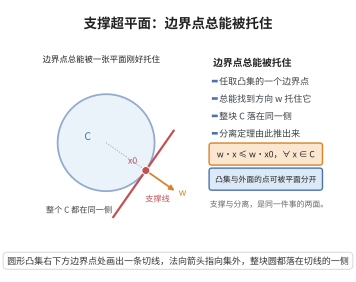

# 支撑超平面定理

> **一句话大白话**：任何一个凸集的边界点，都能被一张"刚好贴着"它的平面托住，使整个凸集都躺在这张平面的一侧，这张平面就是它的支撑超平面。

> **小例子**：取单位圆盘 $C=\{x\in\mathbb{R}^2:\|x\|\le1\}$ 与其边界点 $x_0=(1,0)$。令 $w=(1,0)$，则对一切 $x\in C$ 有 $w^\top x=x_1\le1=w^\top x_0$，直线 $x_1=1$ 就是过 $x_0$ 的一张支撑超平面。

## 一、定理介绍

> **前置依赖**：Hahn-Banach几何形式、正交投影定理、变分不等式、凸函数与凸集、点到超平面的距离公式。

支撑超平面定理是凸几何与凸分析的基本结果，其思想可追溯至 Minkowski 对凸体的研究：任何闭凸集都可表示为包含它的所有闭半空间之交，而这一表示恰恰由各边界点处的支撑超平面给出。定理断言，凸集的每个边界点都落在一张支撑超平面上，等价的几何图像是这个凸集整体位于该超平面的一侧。它是凸集分离定理的"单集合版本"，也是建立凸函数次梯度、Fenchel 共轭对偶与最优性条件的几何基础。在优化中，把可行域在某点用支撑超平面近似就得到对偶方向与灵敏度信息；在经济学中它对应价格向量与边际替代率。作为分离定理的直接推论，它同样可推广到无穷维局部凸空间。

## 几何直观

图意在说明：每个边界点都存在一个支撑方向，使整个凸集躺在这张平面的一侧。

## 二、原理思路

1. 在边界点 $x_0$ 外侧取一列不在闭凸集内的点 $x_k\to x_0$，对每个 $x_k$ 在闭凸集上取距离最近的投影点 $p_k$。
2. 由最近点投影的特征不等式，$w_k=x_k-p_k$ 是 $p_k$ 处的外法向，满足 $w_k^\top(x-p_k)\le0$ 对一切 $x\in\overline{C}$ 成立。
3. 把 $w_k$ 单位化后取收敛子列得极限方向 $w$，令 $k\to\infty$（此时 $p_k\to x_0$），把不等式过渡为 $w^\top(x-x_0)\le0$，于是超平面 $\{x:w^\top x=w^\top x_0\}$ 支撑 $C$。

## 三、定理的严格表述

设 $C\subseteq\mathbb{R}^n$ 为非空凸集，$x_0\in\partial C$ 为 $C$ 的边界点，即 $x_0$ 属于 $C$ 的闭包但不属于其内部。则存在非零向量 $w\in\mathbb{R}^n$，使得

$$
w^{\top}(x-x_0)\le 0\qquad\text{对一切 }x\in C .
$$

等价地，超平面 $H=\{x\in\mathbb{R}^n:w^\top x=w^\top x_0\}$ 过 $x_0$ 且使 $C$ 整体位于半空间 $\{x:w^\top x\le w^\top x_0\}$ 之中，称 $H$ 为 $C$ 在 $x_0$ 处的**支撑超平面**，$w$ 为对应的**支撑法向量**。注意若 $x_0\in\mathrm{int}(C)$，则对任意非零 $w$ 函数 $w^\top(x-x_0)$ 在 $x_0$ 附近取正负两值，故不存在非平凡支撑超平面，这正是定理只对边界点陈述的原因。

## 四、证明过程

**步骤 1（构造外侧逼近序列）。** 因 $x_0\in\partial C$，对每个正整数 $k$ 存在 $x_k\notin\overline{C}$ 且 $\|x_k-x_0\|<1/k$。由于 $C$ 非空凸，其闭包 $\overline{C}$ 为非空闭凸集，且 $x_k\notin\overline{C}$，特别有 $x_k\neq x_0$。

**步骤 2（最近点投影与变分不等式）。** 对每个 $k$，函数 $z\mapsto\|z-x_k\|$ 在闭凸集 $\overline{C}$ 上取到最小值，设最小点为 $p_k\in\overline{C}$。由最近点投影的特征不等式，对一切 $x\in\overline{C}$ 有

$$
(x_k-p_k)^{\top}(x-p_k)\le 0 .
$$

为看清来源，考虑 $z_t=(1-t)p_k+tx\in\overline{C}$（$t\in[0,1]$），由 $\|p_k-x_k\|^2\le\|z_t-x_k\|^2$ 展开并令 $t\downarrow0$ 即得上式。记 $w_k=x_k-p_k$。

**步骤 3（归一化与取极限）。** 因 $x_k\notin\overline{C}$ 而 $p_k\in\overline{C}$，故 $w_k\neq0$。令 $\hat w_k=w_k/\|w_k\|$，则 $\|\hat w_k\|=1$。由单位球面的紧性，存在子列（仍记下标为 $k$）使 $\hat w_k\to w$，其中 $\|w\|=1\neq0$。另一方面 $x_k\to x_0$ 且 $p_k$ 是距 $x_k$ 最近的点，故 $\|p_k-x_k\|\le\|x_0-x_k\|\to0$，从而 $p_k\to x_0$。

**步骤 4（过渡到支撑不等式）。** 把步骤 2 的不等式除以 $\|w_k\|>0$，得 $\hat w_k^\top(x-p_k)\le0$ 对一切 $x\in\overline{C}$ 成立。固定 $x\in\overline{C}$，令 $k\to\infty$：左端 $\hat w_k^\top(x-p_k)\to w^\top(x-x_0)$，故

$$
w^{\top}(x-x_0)\le0\qquad\text{对一切 }x\in\overline{C},
$$

特别地对一切 $x\in C$ 成立。于是 $H=\{x:w^\top x=w^\top x_0\}$ 是 $C$ 在 $x_0$ 处的支撑超平面，$w$ 为其支撑法向量。

$\square$

## 五、应用与意义

- 次梯度与最优性：凸函数在上图边界点处的支撑超平面之法向量恰为次梯度，支撑超平面定理保证次梯度集合非空。
- 对偶理论：Fenchel 对偶、Lagrange 乘子与灵敏度分析都通过支撑超平面把"几何分离"翻译成"乘子存在"。
- 逼近与表示：任何闭凸集是包含它的所有半空间之交，这为凸集的半空间表示与线性不等式的等价描述提供依据。
- 经济学与博弈：价格向量使预算超平面支撑生产集或消费集，边际替代率正是支撑法向量的分量比。
- 机器学习：支持向量机的间隔超平面、感知机收敛性与投影算法的几何解释都依赖支撑超平面的存在性。
- 数值方法：切平面法与割平面法用支撑超平面（即切超平面）逐步逼近可行域或目标函数的水平集。
- 凸体的极值刻画：凸体可由其所有支撑超平面唯一确定，这给出凸体的支撑函数表示，是凸几何的基本语言。

## 课堂问答

**老师**：支撑超平面定理说了什么？

**学生**：非空凸集 $C$ 的每个边界点 $x_0$ 都存在非零向量 $w$ 使 $w^\top(x-x_0)\le0$ 对一切 $x\in C$ 成立，即超平面 $\{x:w^\top x=w^\top x_0\}$ 过 $x_0$ 且 $C$ 整体在其一侧。它是凸集分离定理的单集合版本。

**老师（追问）**：证明的思路是什么？

**学生**：取外侧点列 $x_k\notin\overline C$ 且 $x_k\to x_0$，对每个 $x_k$ 在 $\overline C$ 上取最近投影 $p_k$，由投影特征不等式得 $(x_k-p_k)^\top(x-p_k)\le0$；令 $w_k=x_k-p_k$ 并归一化，取收敛子列得单位方向 $w$，因 $p_k\to x_0$ 过渡即得 $w^\top(x-x_0)\le0$。

**老师（拓展）**：为什么只对边界点成立？

**学生**：若 $x_0\in\mathrm{int}(C)$，则对任意非零 $w$，$w^\top(x-x_0)$ 在 $x_0$ 附近正负都取到，不存在非平凡支撑超平面。常见误区是把支撑误解为必须与 $C$ 只交于一点，其实整个接触面都是支撑面。

## 相关条目

- [凸集分离定理](../第109级-优化理论/凸集分离定理.md)：本定理是其单集合特例，二者可互相推导。
- [正交投影定理](../第31级-泛函分析/正交投影定理.md)：步骤 2 中最近点投影存在唯一性的来源。
- [变分不等式](./变分不等式.md)：投影的特征不等式正是单调变分不等式的原型。
- [凸函数与凸集](./凸函数与凸集.md)：凸集、内部与闭包等概念的定义出处。
- [点到超平面的距离公式](../第100级-机器学习/点到超平面的距离公式.md)：量化支撑超平面与集合间距的对偶距离。
- [凸集与Mazur定理](../第60级-非线性泛函分析/凸集与Mazur定理.md)：无穷维情形下闭凸集与弱闭集的关系。
