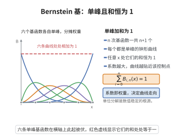

# Bernstein 多项式的定义与恒等式

> **一句话大白话**：Bernstein 多项式是一族"权重函数"，它们在 $[0,1]$ 上非负、且对每个 $x$ 之和恒为 1，因此把函数在采样点上的值按这些权重加权平均，就得到一条紧贴原函数的曲线。

> **小例子**：$n=1$ 时两个权函数为 $1-x$ 与 $x$，两者之和恒等于 1；一般地 $B_n(f;x)=\sum_{k=0}^{n}f(k/n)\,b_{k,n}(x)$ 就是 $f$ 的"随机加权平均"。

## 一、定理介绍

> **前置依赖**：二项式定理、组合公式、常见分布的期望与方差、切比雪夫不等式。

Bernstein 多项式由 Sergei Bernstein 于 1912 年为给出 Weierstrass 逼近定理的构造性证明而引入，其分量称为 **Bernstein 基函数**：

$$
b_{k,n}(x)=\binom{n}{k}x^k(1-x)^{n-k},\qquad k=0,1,\dots,n.
$$

它们非负、在 $[0,1]$ 上之和恒为 1，具有明确的概率意义：$b_{k,n}(x)$ 恰是参数为 $(n,x)$ 的二项分布取值为 $k$ 的概率。由它们线性组合而成的算子 $B_n$ 把连续函数映为多项式，并保持保正性、端点插值与单调性；更关键的是，基函数的一阶、二阶矩满足精确恒等式，它们是把逼近误差 $\|f-B_nf\|_\infty$ 估计到 $O(1/n)$ 的工具，也是 Weierstrass 逼近定理的证明依据。

## 几何直观

图意在说明：n 次 Bernstein 基函数各自单峰，却在每一点上按权重分摊，总和恒为单位一。

## 二、原理思路

把 $b_{k,n}(x)$ 看作一个"质量分布"：$\sum_k b_{k,n}(x)=1$ 表示总质量为 1；$\sum_k k\,b_{k,n}(x)=nx$ 表示其质心恰在 $nx$；而 $\sum_k (k-nx)^2b_{k,n}(x)=nx(1-x)$ 表示质量的离散程度。证明这些恒等式最简洁的办法是引入生成函数

$$
G(t)=\sum_{k=0}^{n}b_{k,n}(x)t^{k}=(1-x+xt)^n,
$$

右端由二项式定理直接得到。对 $t$ 求一阶、二阶导数后取 $t=1$，便分别得到一阶矩与二阶矩；而关于 $x$ 求导则给出基函数的递推公式与导数公式。

## 三、定理的严格表述

**定义（Bernstein 基函数与 Bernstein 多项式）**：对 $n\ge 1$ 及 $k=0,1,\dots,n$ 定义

$$
b_{k,n}(x)=\binom{n}{k}x^k(1-x)^{n-k},\qquad x\in[0,1],
$$

并约定 $k<0$ 或 $k>n$ 时 $b_{k,n}\equiv 0$。对 $f\in C[0,1]$，其 $n$ 次 Bernstein 多项式为

$$
B_n(f;x)=\sum_{k=0}^{n}f\!\left(\frac{k}{n}\right)b_{k,n}(x).
$$

**定理（Bernstein 恒等式）**：对一切 $x\in[0,1]$ 成立

$$
\sum_{k=0}^{n}b_{k,n}(x)=1,\qquad B_n(1;x)=1,
$$

$$
\sum_{k=0}^{n}k\,b_{k,n}(x)=nx,\qquad
\sum_{k=0}^{n}(k-nx)^2b_{k,n}(x)=nx(1-x).
$$

**定理（基函数的递推与导数）**：对 $k=0,1,\dots,n$ 成立

$$
b_{k,n}(x)=(1-x)b_{k,n-1}(x)+x\,b_{k-1,n-1}(x),
$$

$$
\frac{d}{dx}b_{k,n}(x)=n\bigl(b_{k-1,n-1}(x)-b_{k,n-1}(x)\bigr).
$$

## 四、证明过程

**归一性**。由二项式定理，

$$
\sum_{k=0}^{n}b_{k,n}(x)=\sum_{k=0}^{n}\binom{n}{k}x^k(1-x)^{n-k}=(x+1-x)^n=1.
$$

**一阶与二阶矩**。由生成函数 $G(t)=(1-x+xt)^n$ 求导得

$$
G'(t)=nx(1-x+xt)^{n-1},\qquad G''(t)=n(n-1)x^2(1-x+xt)^{n-2}.
$$

取 $t=1$ 得

$$
G'(1)=\sum_{k=0}^{n}k\,b_{k,n}(x)=nx,\qquad
G''(1)=\sum_{k=0}^{n}k(k-1)\,b_{k,n}(x)=n(n-1)x^2.
$$

两式相加给出 $\sum_k k^2b_{k,n}(x)=n(n-1)x^2+nx$；结合 $\sum_k k\,b_{k,n}(x)=nx$ 即得

$$
\sum_{k=0}^{n}(k-nx)^2b_{k,n}(x)=n(n-1)x^2+nx-n^2x^2=nx(1-x).
$$

**递推公式**。由 Pascal 恒等式 $\binom{n}{k}=\binom{n-1}{k}+\binom{n-1}{k-1}$，

$$
b_{k,n}(x)=\binom{n-1}{k}x^k(1-x)^{n-k}+\binom{n-1}{k-1}x^k(1-x)^{n-k},
$$

两项分别提出因子 $(1-x)$ 与 $x$，即得所证递推式。

**导数公式**。直接求导：

$$
\frac{d}{dx}b_{k,n}(x)=\binom{n}{k}x^{k-1}(1-x)^{n-k-1}\bigl(k(1-x)-(n-k)x\bigr).
$$

由 $k\binom{n}{k}=n\binom{n-1}{k-1}$ 与 $(n-k)\binom{n}{k}=n\binom{n-1}{k}$，上式化为

$$
\frac{d}{dx}b_{k,n}(x)=n\,b_{k-1,n-1}(x)-n\,b_{k,n-1}(x).
$$

$\square$

## 五、应用与意义

- **Weierstrass 逼近定理**：由方差恒等式 $\sum_k\left(\frac{k}{n}-x\right)^2b_{k,n}(x)=\frac{x(1-x)}{n}\le\frac{1}{4n}$，配合切比雪夫不等式思想即可证明 $B_n(f;x)$ 在 $[0,1]$ 上一致收敛到 $f$。
- **数值与几何设计**：Bezier 曲线的标量分量正是 Bernstein 多项式，基函数的非负性与归一性保证了曲线的凸包性质与端点插值。
- **保形性质**：若 $f$ 单调或凸，则 $B_n(f;\cdot)$ 亦单调或凸，且 $B_n$ 保持 Lipschitz 常数，是典型的保形逼近算子。
- **推广**：Bernstein 基函数可推广到单纯形上的多元形式，成为样条与有限元基函数的重要来源。

## 课堂问答

**老师**：Bernstein 基函数 $b_{k,n}(x)=\binom{n}{k}x^k(1-x)^{n-k}$ 只是一族二项式系数拼出的多项式，凭什么说它能逼近任意连续函数？先说出它的核心恒等式。

**学生**：关键是一、二阶矩恒等式：$\sum_k b_{k,n}(x)=1$，$\sum_k k\,b_{k,n}(x)=nx$，$\sum_k(k-nx)^2b_{k,n}(x)=nx(1-x)$。它们说明这族权函数总质量为 $1$、质心在 $nx$、方差只有 $nx(1-x)\le1/4$，方差随 $n$ 增大以 $1/n$ 的速度收缩，这正是 $B_n(f;x)=\sum_k f(k/n)b_{k,n}(x)$ 一致收敛的定量来源。

**老师（追问）**：证明这些恒等式，你不必逐项凑系数吧？有没有统一的来源？

**学生**：用生成函数 $G(t)=\sum_k b_{k,n}(x)t^k=(1-x+xt)^n$，由二项式定理直接得到。对 $t$ 逐阶求导再取 $t=1$，得 $G'(1)=\sum k\,b_{k,n}=nx$ 与 $G''(1)=\sum k(k-1)b_{k,n}=n(n-1)x^2$，两式合并得 $\sum k^2b_{k,n}=n(n-1)x^2+nx$，于是方差恒等式立得。常见误区是把对 $t$ 与对 $x$ 的求导混用：对 $x$ 求导得到的是递推 $b_{k,n}=(1-x)b_{k,n-1}+x\,b_{k-1,n-1}$ 与导数 $\frac{d}{dx}b_{k,n}=n(b_{k-1,n-1}-b_{k,n-1})$，而不是矩。

**老师（拓展）**：Bernstein 算子的保形性如何？为什么它被用在 Bézier 曲线里？

**学生**：$B_n$ 保持保正性，且若 $f$ 单调则 $B_nf$ 单调、若 $f$ 凸则 $B_nf$ 凸，还保持 Lipschitz 常数，属于保形逼近算子。用在 Bézier 曲线正因为它把控制点 $f(k/n)$ 按非负、单位分解的权 $b_{k,n}$ 作凸组合，于是曲线落在控制点凸包内、端点插值、且局部修改稳定。
