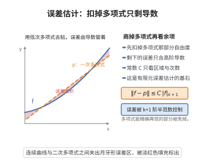

# Bramble-Hilbert 引理

> **一句话大白话**：只要一个线性泛函把所有低次多项式都"看不见"（作用为零），那么它对任意函数的作用就被该函数的最高阶导数控制——因为去掉低次多项式后剩下的部分只能靠最高阶导数来度量。

> **小例子**：用一个 $k$ 次多项式去逼近 $v\in H^{k+1}$，误差的大小不必知道 $v$ 的全部信息，只需知道它的 $(k+1)$ 阶导数的 $L^2$ 大小，这正是有限元与样条插值误差估计中 $\|u-I_hu\|\le Ch^{k+1}|u|_{k+1}$ 的来源。

## 一、定理介绍

> **前置依赖**：Sobolev 空间与弱导数、Rellich-Kondrachov紧嵌入定理、多项式空间与矩条件、弱收敛与下半连续性、平均 Taylor 多项式。

Bramble-Hilbert 引理由 James Bramble 与 Stephen Hilbert 于 1970 年提出，是有限元方法的**误差估计基石**。有限元理论中最常见的步骤是：先用插值算子把任意函数 $u$ 换成分片多项式 $u_h$，再估误差 $\|u-u_h\|$。问题在于 $u$ 毫无光滑性以外的信息可用；Bramble-Hilbert 引理给出的回答是——**只要逼近误差算子在低次多项式上为零（多项式被精确重现），那么误差就被 $u$ 的最高阶导数（半范数）控制**。

这条引理之所以重要，是因为它把两类完全不同的东西联系起来：

1. **逼近的代数条件**（算子能精确再现 $P_k$）——这是容易验证的局部性质；
2. **逼近的解析估计**（误差 $\le C\,|u|_{H^{k+1}}$）——这是需要泛函分析工具的整体结论。

有了它，有限元、样条、插值的误差估计就统一为"**局部多项式重现 + 尺度伸缩**"两步：先在参考单元上由引理得到与尺寸无关的常数，再通过仿射变换把常数与网格尺寸 $h$ 分离，得到 $\|u-I_hu\|_{H^m}\le Ch^{k+1-m}|u|_{H^{k+1}}$。

## 几何直观

图意在说明：商掉低次多项式后，最佳逼近的误差只由高阶半范数控制，与函数的低阶行为无关。

## 二、原理思路

1. **模多项式看问题**：误差估计天然只与 $v$ 模去 $P_k$ 后的"非多项式部分"有关，因此应把问题放到商空间 $H^{k+1}(\Omega)/P_k$ 上。
2. **两个范数在商空间上等价**：在 $H^{k+1}(\Omega)$ 上，完整范数 $\|\cdot\|_{k+1}$ 与半范数 $|\cdot|_{k+1}$ 并不等价（常数使半范数为零而范数非零）；但**模去 $P_k$ 之后它们等价**，这正是引理的内容。
3. **等价性用紧性论证**：用 Rellich-Kondrachov 紧嵌入把"半范数趋零"的序列在低阶范数中抽出收敛子列，其极限既属于 $P_k$ 又被规范化条件逼为零，从而导出矛盾。
4. **规范化（矩条件）**：为在商空间中选代表元，要求前 $k$ 阶矩全部为零；这一线性条件唯一确定 $P_k$ 中的元素，使"减去最优多项式"的操作成为良定义的投影。
5. **尺度伸缩分离常数**：引理在参考单元上给出的常数 $C$ 只依赖单元形状，仿射变换后误差按 $h$ 的幂次缩放，于是得到带 $h$ 的误差阶。

## 三、定理的严格表述

设 $\Omega\subset\mathbb R^n$ 是有界区域，满足锥条件（或强局部 Lipschitz 条件），$k\ge0$ 为整数，$P_k$ 表示次数不超过 $k$ 的多项式空间。记
$$
|v|_{H^{k+1}(\Omega)}=\Bigl(\sum_{|\alpha|=k+1}\|D^\alpha v\|_{L^2(\Omega)}^2\Bigr)^{1/2}
$$
为最高阶半范数。

**定理（Bramble-Hilbert 引理，Hilbert 空间形式）**：存在常数 $C=C(\Omega,k)>0$，使得对一切 $v\in H^{k+1}(\Omega)$，
$$
\inf_{q\in P_k}\|v-q\|_{H^{k+1}(\Omega)}\ \le\ C\,|v|_{H^{k+1}(\Omega)} .
$$
更强的形式是：若 $L$ 是 $H^{k+1}(\Omega)$ 上的有界线性泛函且在 $P_k$ 上恒为零（$L(q)=0,\ \forall q\in P_k$），则
$$
|L(v)|\ \le\ C\,\|L\|_{H^{k+1}}\cdot|v|_{H^{k+1}(\Omega)},\qquad\forall v\in H^{k+1}(\Omega).
$$

**推论 1（一般阶的误差估计）**：对 $0\le m\le k+1$，
$$
\inf_{q\in P_k}\|v-q\|_{H^{m}(\Omega)}\ \le\ C\,|v|_{H^{k+1}(\Omega)} .
$$

**推论 2（仿射尺度形式，有限元误差）**：设 $T$ 是参考单元 $\hat T$ 的仿射像，直径 $h_T$，形状正则（不退化）。若插值算子 $\Pi_T$ 精确重现 $P_k$，则
$$
\|v-\Pi_Tv\|_{H^{m}(T)}\ \le\ C\,h_T^{\,k+1-m}\,|v|_{H^{k+1}(T)},\qquad 0\le m\le k+1,
$$
其中 $C$ 只依赖参考单元与 $k$、$m$，与 $h_T$ 无关。

**推论 3（样条插值误差）**：区间剖分尺寸为 $h$ 的分片 $k$ 次样条插值满足
$$
\|v-s_h\|_{L^2}\le C h^{k+1}|v|_{H^{k+1}},\qquad \|v-s_h\|_{H^1}\le Ch^{k}|v|_{H^{k+1}} .
$$

## 四、证明过程

**证明（引理）。** 分四步：先在规范化子空间上证明范数等价，再由矩条件选取代表元，最后得到商空间形式。

**步骤 1（规范化子空间）。** 定义
$$
V=\Bigl\{v\in H^{k+1}(\Omega):\ \int_\Omega D^\alpha v\,dx=0,\quad \forall\,|\alpha|\le k\Bigr\}.
$$
$V$ 是 $H^{k+1}(\Omega)$ 的闭子空间（矩是连续线性泛函）。以下证明：在 $V$ 上
$$
\|v\|_{H^{k+1}(\Omega)}\le C\,|v|_{H^{k+1}(\Omega)},\qquad\forall v\in V .
$$

**步骤 2（反证 + 紧性）。** 若上式不成立，则存在 $v_j\in V$ 使 $\|v_j\|_{k+1}=1$ 而 $|v_j|_{k+1}\to0$。

由 Rellich-Kondrachov 紧嵌入定理 $H^{k+1}(\Omega)\hookrightarrow\hookrightarrow H^{k}(\Omega)$，序列 $\{v_j\}$ 在 $H^k$ 中有强收敛子列，仍记作 $v_j\to v$ 于 $H^{k}(\Omega)$；又 $\{v_j\}$ 在 $H^{k+1}$ 中有界，故它（沿子列）在 $H^{k+1}$ 中弱收敛于同一 $v$（弱极限与强极限一致）。

**步骤 3（极限是零多项式）。** 半范数 $|\cdot|_{k+1}$ 在 $H^{k+1}$ 中弱下半连续，故
$$
|v|_{H^{k+1}}\le\liminf_{j\to\infty}|v_j|_{H^{k+1}}=0,
$$
于是 $D^\alpha v=0$ 对一切 $|\alpha|=k+1$ 成立，即 $v\in P_k$（连通区域上高阶导数为零的多项式）。又每个矩泛函 $v\mapsto\int_\Omega D^\alpha v$ 在 $H^{k+1}$ 上弱连续，故
$$
\int_\Omega D^\alpha v=\lim_{j\to\infty}\int_\Omega D^\alpha v_j=0,\qquad|\alpha|\le k ,
$$
结合 $v\in P_k$ 与前 $k$ 阶矩全为零，得 $v=0$。

**步骤 4（导出矛盾）。** 由步骤 3，
$$
1=\|v_j\|_{H^{k+1}}^2=\underbrace{\|v_j\|_{H^{k}}^2}_{\to\|v\|_{H^k}^2=0}+\underbrace{|v_j|_{H^{k+1}}^2}_{\to0}\ \longrightarrow\ 0,
$$
矛盾。故步骤 1 中的不等式成立，$|v|_{k+1}$ 是 $V$ 上等价于完整范数的范数。

**步骤 5（矩条件投影与商空间形式）。** 对任意 $v\in H^{k+1}(\Omega)$，求 $q\in P_k$ 使 $v-q\in V$，即要求
$$
\int_\Omega D^\alpha q=\int_\Omega D^\alpha v,\qquad |\alpha|\le k .
$$
这是 $P_k$ 上以 $\alpha$ 为指标的线性方程组，其系数矩阵（关于 $P_k$ 的 Gram 矩阵的线性组合）正定，故解 $q$ 存在唯一。于是 $v-q\in V$，由步骤 1 与 $D^{k+1}q=0$：
$$
\inf_{q'\in P_k}\|v-q'\|_{H^{k+1}}\le\|v-q\|_{H^{k+1}}\le C\,|v-q|_{H^{k+1}}=C\,|v|_{H^{k+1}} .
$$
即得引理。$\square$

**证明（推论 2，尺度分离）。** 在参考单元 $\hat T$ 上由引理得到 $\|v-I_0v\|_{H^m(\hat T)}\le C\|v\|_{H^m(\hat T)}$ 型估计且插值算子精确重现 $P_k$，差函数 $v-\Pi v$ 的前 $k$ 阶矩为零；把仿射映射 $x=B\hat x+b$ 代入 Sobolev 半范数的变换公式，$H^m$ 半范数按 $h^{n/2-m}$ 变换、$H^{k+1}$ 半范数按 $h^{n/2-(k+1)}$ 变换，商的幂次给出 $h^{k+1-m}$，且常数只依赖参考单元的形状正则参数。$\square$

**证明（推论 3）。** 对每个小区间 $I_i$ 应用推论 2（$m=0,1$，$k$ 次样条插值精确重现 $P_k$），把局部估计平方求和并用 $h_i\le h$ 放大即得整体估计。$\square$

## 五、应用与意义

- **有限元误差估计**：Céa 引理给出"误差 $\le$ 最佳逼近误差"，Bramble-Hilbert 引理则给出"最佳逼近误差 $\le Ch^{k+1}|u|_{k+1}$"，两者合起来就是标准的有限元收敛阶定理，见 [有限元方法基础](../第50级-计算数学/有限元方法基础.md)。
- **样条与插值**：分片多项式插值、拟插值与投影算子的误差阶统一由本引理给出，见 [样条插值误差估计](./样条插值误差估计.md)。
- **数值分析与多重网格**：局部单元上的多项式重现条件是估计的代数核心，判断"哪些单元类型能达到最优阶"就化为判断其是否能重现 $P_k$。
- **推广**：引理有 $W^{k+1,p}$（$L^p$）形式、分数阶 Sobolev 形式，以及基于平均 Taylor 多项式的构造性证明（Dupont–Scott、Verfürth），后者给出常数对单元形状的显式依赖。

## 课堂问答

**老师**：有限元误差估计里反复出现 $\|u-I_hu\|\le Ch^{k+1}|u|_{k+1}$，这个 $|u|_{k+1}$ 从哪来？引理本身在说什么？

**学生**：Bramble-Hilbert 引理说的是：只要逼近算子精确重现次数不超过 $k$ 的多项式，误差就被最高阶半范数 $|v|_{H^{k+1}}$ 控制。精确形式是 $\inf_{q\in P_k}\|v-q\|_{H^{k+1}}\le C|v|_{H^{k+1}}$；等价地，任何在 $P_k$ 上取零的有界线性泛函 $L$ 满足 $|L(v)|\le C\|L\|\cdot|v|_{H^{k+1}}$。它把"多项式重现"这一代数条件翻译成"最高阶导数控制误差"这一解析估计。

**老师（追问）**：$H^{k+1}$ 上完整范数与半范数并不等价（常数使半范数为零），你凭什么在模 $P_k$ 之后说它们等价？

**学生**：差别恰恰只来自 $P_k$。在规范化子空间 $V=\{v:\int D^\alpha v=0,\,|\alpha|\le k\}$ 上用紧性反证：若范数不被半范数控制，就有 $\|v_j\|_{k+1}=1$ 而 $|v_j|_{k+1}\to0$；由 Rellich-Kondrachov 紧嵌入 $H^{k+1}\hookrightarrow\hookrightarrow H^k$ 抽出 $v_j\to v$ 于 $H^k$，半范数弱下半连续给出 $|v|_{k+1}=0$ 即 $v\in P_k$，再由前 $k$ 阶矩为零逼出 $v=0$，与 $\|v_j\|=1$ 矛盾。

**老师（拓展）**：得到参考单元上的常数后，怎么把网格尺寸 $h$ 分离出来？

**学生**：用仿射尺度变换。$H^m$ 半范数在 $x=B\hat x+b$ 下按 $h^{n/2-m}$ 缩放，$H^{k+1}$ 半范数按 $h^{n/2-(k+1)}$ 缩放，相除给出 $h^{k+1-m}$，常数只依赖参考单元形状正则性与 $h$ 无关。要点是差函数 $v-\Pi v$ 因精确重现 $P_k$ 而满足前 $k$ 阶矩为零，否则会多出破坏阶数的项。

## 相关条目

- [样条插值误差估计](./样条插值误差估计.md)：本引理是其误差阶的直接来源。
- [B-样条基](./B样条基.md)：样条空间能否精确重现 $P_k$ 由基函数的性质决定。
- [有限元方法基础](../第50级-计算数学/有限元方法基础.md)：Céa 引理 + Bramble-Hilbert 引理 = 收敛阶定理。
- [Rellich-Kondrachov紧嵌入定理](../第40级-偏微分方程/Rellich-Kondrachov紧嵌入定理.md)：步骤 2 紧性论证的关键工具。
- [Sobolev嵌入定理](../第40级-偏微分方程/Sobolev嵌入定理.md)：Sobolev 空间的正则性与紧性背景。
