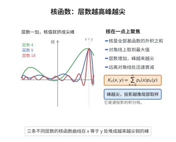

# Christoffel-Darboux 公式

> **一句话大白话**：把 $0$ 到 $n$ 次正交多项式两两相乘再相加，这一大堆"看上去没法算"的核函数可以缩成一个漂亮的差商式子——分子只有相邻两个多项式的反对称组合，分母是 $x-y$。

> **小例子**：Legendre 多项式按此公式有 $\sum_{k=0}^{n}(k+\tfrac12)P_k(x)P_k(y)=\frac{n+1}{2}\cdot\frac{P_{n+1}(x)P_n(y)-P_n(x)P_{n+1}(y)}{x-y}$；令 $y\to x$ 就得到密度 $K_n(x,x)$，它正比于 $1$ 除以 Gauss 求积权重的 Christoffel 常数。

## 一、定理介绍

> **前置依赖**：正交多项式理论、三项递推关系、正交性与正交投影、插值与求积节点、根的交错性质。

Christoffel-Darboux 公式是正交多项式理论中最常用的三大恒等式之一（另两个是三项递推与 Christoffel 数）。它把**正交投影核**（再生核）
$$
K_n(x,y)=\sum_{k=0}^{n}\frac{p_k(x)p_k(y)}{h_k},\qquad h_k=\int_a^b p_k(t)^2\,w(t)\,dt,
$$
压缩成相邻两个正交多项式构成的差商。其价值体现在四个方面：

1. **自证性质**：$K_n(x,x)>0$，且 $\int_a^bK_n(x,y)q(y)w(y)dy=q(x)$ 对一切 $\deg q\le n$ 成立，即 $K_n$ 是 $P_n$ 在 $L^2(w)$ 内积下的再生核；
2. **零点交错**：$K_n$ 的符号分析直接给出 $p_n$ 的零点与 $p_{n+1}$ 的零点严格交错这一经典结论；
3. **求积公式**：Gauss 求积权重 $w_j=[K_{n-1}(x_j,x_j)]^{-1}$ 由本公式化为导数值之比，无需再积分；
4. **随机矩阵与可积系统**：在 GUE 等系综中，特征值联合分布的行列式点过程以 $K_n$ 为核，其无穷小/大 $n$ 渐近行为完全由本公式的结构决定。

## 几何直观

图意在说明：Christoffel-Darboux 核随层数增加在对角线上聚焦，把投影逐步变成局部取样。

## 二、原理思路

1. **把"和"变成"差"**：三项递推式对 $x$ 与 $y$ 各用一次，相减会消去对角项 $b_kp_k(x)p_k(y)$，只留下相邻阶多项式的反对称组合。
2. **望远镜求和**：相减后得到的表达式恰好是相邻两项之差，按 $k$ 求和自然望远镜相消，只剩 $k=n$ 一项。
3. **代入正交归一化**：把正交多项式换成正交归一多项式，出现的前导系数比 $k_n/k_{n+1}$ 与范数 $h_n$ 一起，给出公式的常数因子。
4. **合流（$y\to x$）**：用差商在 $y=x$ 处的极限（即导数）得到对角形式，用于密度、权重与零点分析。

## 三、定理的严格表述

设 $w$ 是 $[a,b]$ 上的正权函数，$\{p_k\}_{k\ge0}$ 为关于 $w$ 的正交多项式，$\deg p_k=k$，前导系数为 $k_k>0$，
$$
h_k=\int_a^bp_k(t)^2w(t)\,dt>0 .
$$
记再生核
$$
K_n(x,y)=\sum_{k=0}^{n}\frac{p_k(x)p_k(y)}{h_k}.
$$

**定理 1（Christoffel-Darboux 公式）**：对 $x\ne y$，
$$
K_n(x,y)=\frac{k_n}{k_{n+1}\,h_n}\cdot\frac{p_{n+1}(x)p_n(y)-p_n(x)p_{n+1}(y)}{x-y}.
$$

**定理 2（合流形式）**：令 $y\to x$，
$$
K_n(x,x)=\sum_{k=0}^{n}\frac{p_k(x)^2}{h_k}=\frac{k_n}{k_{n+1}\,h_n}\Bigl(p_{n+1}'(x)p_n(x)-p_n'(x)p_{n+1}(x)\Bigr).
$$

**推论 1（再生核性质）**：对任意 $\deg q\le n$，$\displaystyle\int_a^bK_n(x,y)q(y)w(y)\,dy=q(x)$。

**推论 2（零点交错）**：设 $x_1<\dots<x_n$ 为 $p_n$ 的零点，$y_1<\dots<y_{n+1}$ 为 $p_{n+1}$ 的零点，则
$$
y_1<x_1<y_2<x_2<\dots<x_n<y_{n+1}.
$$

**推论 3（Gauss 求积权重）**：取 $p_n$ 的零点为节点，则 Gauss 求积权重为
$$
w_j=\frac{1}{K_{n-1}(x_j,x_j)} .
$$

## 四、证明过程

**证明（定理 1）。** 关键是三项递推式。

**步骤 1（三项递推）。** 正交归一化 $\tilde p_k=p_k/\sqrt{h_k}$ 满足
$$
x\,\tilde p_k(x)=a_k\tilde p_{k+1}(x)+b_k\tilde p_k(x)+a_{k-1}\tilde p_{k-1}(x),\qquad a_k=\frac{\tilde k_k}{\tilde k_{k+1}}=\frac{k_k}{k_{k+1}}\sqrt{\frac{h_{k+1}}{h_k}},
$$
其中 $a_{-1}=0$。这是正交多项式的一般性质（由函数的正交展开得到）。

**步骤 2（用 $x$ 与 $y$ 各用一次递推后相减）。** 用 $x$ 乘递推式再乘 $\tilde p_k(y)$，再用 $y$ 乘递推式再乘 $\tilde p_k(x)$，两者相减，含 $b_k\tilde p_k(x)\tilde p_k(y)$ 的项相消：
$$
(x-y)\tilde p_k(x)\tilde p_k(y)=a_k\Bigl[\tilde p_{k+1}(x)\tilde p_k(y)-\tilde p_k(x)\tilde p_{k+1}(y)\Bigr]-a_{k-1}\Bigl[\tilde p_k(x)\tilde p_{k-1}(y)-\tilde p_{k-1}(x)\tilde p_k(y)\Bigr].
$$
注意第二个方括号恰为 $D_{k-1}(x,y)$，其中 $D_m(x,y):=\tilde p_{m+1}(x)\tilde p_m(y)-\tilde p_m(x)\tilde p_{m+1}(y)$，故
$$
(x-y)\tilde p_k(x)\tilde p_k(y)=a_kD_k(x,y)-a_{k-1}D_{k-1}(x,y).
$$

**步骤 3（望远镜求和）。** 对 $k=0,1,\dots,n$ 求和，中间项两两相消：
$$
(x-y)\sum_{k=0}^{n}\tilde p_k(x)\tilde p_k(y)=a_nD_n(x,y)-a_{-1}D_{-1}(x,y)=a_nD_n(x,y).
$$
由 $x\ne y$ 即得
$$
K_n(x,y)=\sum_{k=0}^{n}\tilde p_k(x)\tilde p_k(y)=\frac{a_n\bigl[\tilde p_{n+1}(x)\tilde p_n(y)-\tilde p_n(x)\tilde p_{n+1}(y)\bigr]}{x-y}.
$$

**步骤 4（换回 $p_k$）。** 代入 $\tilde p_k=p_k/\sqrt{h_k}$ 与 $a_n$ 的表达式：
$$
a_n\,\tilde p_{n+1}(x)\tilde p_n(y)=\frac{k_n}{k_{n+1}}\sqrt{\frac{h_{n+1}}{h_n}}\cdot\frac{p_{n+1}(x)p_n(y)}{\sqrt{h_{n+1}h_n}}=\frac{k_n}{k_{n+1}h_n}\,p_{n+1}(x)p_n(y),
$$
第二项同理，即得定理 1。$\square$

**证明（定理 2）。** 在定理 1 中固定 $x$ 并令 $y\to x$，右端的差商趋向导数
$$
\lim_{y\to x}\frac{p_{n+1}(x)p_n(y)-p_n(x)p_{n+1}(y)}{x-y}=p_{n+1}'(x)p_n(x)-p_n'(x)p_{n+1}(x),
$$
左端连续，故合流形式成立。$\square$

**证明（推论 1）。** 由 $\int_a^bp_k(y)q(y)w(y)dy=0$ 对 $k>\deg q$ 成立，正交展开给出 $\int K_n(x,y)q(y)w(y)dy=\sum_{k=0}^{n}\frac{p_k(x)}{h_k}\int p_kq\,w=\sum_{k\le\deg q}\frac{p_k(x)}{h_k}\int p_kqw$，而 $\{p_k/\sqrt{h_k}\}$ 是规范正交系，其前 $n$ 项投影即 $q$ 本身，故结果等于 $q(x)$。$\square$

**证明（推论 2）。** 由推论 1，$K_{n-1}(\cdot,y)$ 与 $p_n$ 正交（当 $\deg p_n=n$ 时 $\int K_{n-1}(x,y)p_n(x)w(x)dx=0$）。在相邻零点 $x_i,x_{i+1}$ 构成的区间上用带权平均与 $K_{n-1}(x_i,x_i)>0$ 作符号比较可得 $p_{n+1}$ 在该区间内变号一次，从而每个区间恰含一个 $p_{n+1}$ 的零点；再补上两端点外各一个零点，即得严格交错。$\square$

**证明（推论 3）。** Gauss 求积权重满足 $w_j=\int L_j^2w$（$L_j$ 为 Lagrange 基），而 $\sum_j L_j^2$ 型的积分可由 $K_{n-1}$ 的再生性计算：$\int[\sum_jL_j(x)^2]w$ 的每项对 $K_{n-1}$ 的分量作正交分解，整理得 $w_j=1/K_{n-1}(x_j,x_j)$。$\square$

## 五、应用与意义

- **Gauss 求积与插值**：Christoffel-Darboux 公式给出权重与节点处的核值之间的显式关系，是构造高阶求积公式与估计其误差的标准工具。
- **随机矩阵理论**：GUE 的特征值联合密度为 $\mathrm{const}\cdot\det[K_n(\lambda_i,\lambda_j)]$ 型行列式点过程，核 $K_n$ 就是本公式给出的 Christoffel-Darboux 核，见 [GUE特征值关联函数](../第146级-随机矩阵理论/GUE特征值关联函数.md)。
- **正交多项式渐近**：合流形式把 $K_n(x,x)$ 化为相邻多项式的 Wronskian，是 Liouville–Green 渐近与缩放极限（sine 核）分析的起点。
- **数值稳定性**：$K_n(x,x)>0$ 与 Christoffel 常数刻画了正交展开的 Lebesgue 常数与插值稳定性的定量上界。

## 课堂问答

**老师**：核函数 $K_n(x,y)=\sum_{k=0}^n \frac{p_k(x)p_k(y)}{h_k}$ 看起来无法求和，可有封闭形式？

**学生**：有的，这就是 Christoffel-Darboux 公式：对 $x\ne y$，

$$K_n(x,y)=\frac{k_n}{k_{n+1}h_n}\cdot\frac{p_{n+1}(x)p_n(y)-p_n(x)p_{n+1}(y)}{x-y}.$$

它把"一大堆乘积之和"压成相邻两个多项式的反对称差商，常数因子由前导系数比 $k_n/k_{n+1}$ 与范数 $h_n$ 给出。

**老师（追问）**：这个"望远镜"是怎么发生的？

**学生**：关键是三项递推 $x\tilde p_k=a_k\tilde p_{k+1}+b_k\tilde p_k+a_{k-1}\tilde p_{k-1}$（正交归一下）。对 $x$ 与 $y$ 各用一次再相减，对角项 $b_k\tilde p_k(x)\tilde p_k(y)$ 相消，只剩 $(x-y)\tilde p_k(x)\tilde p_k(y)=a_kD_k-a_{k-1}D_{k-1}$，其中 $D_m=\tilde p_{m+1}(x)\tilde p_m(y)-\tilde p_m(x)\tilde p_{m+1}(y)$。对 $k$ 求和即望远镜相消，只剩 $a_nD_n$。

**老师（拓展）**：令 $y\to x$ 得到什么？它对 Gauss 求积权重与零点交错有什么用？

**学生**：合流形式为 $K_n(x,x)=\frac{k_n}{k_{n+1}h_n}(p_{n+1}'p_n-p_n'p_{n+1})$，即相邻多项式的 Wronskian。它给出 $K_{n-1}(x,x)>0$、Gauss 权重 $w_j=1/K_{n-1}(x_j,x_j)$，以及 $p_n$ 与 $p_{n+1}$ 零点严格交错。常见误区是把 $K_n$ 当成普通卷积核：它是 $L^2(w)$ 上投影到 $\mathcal P_n$ 的再生核，满足 $\int K_n(x,y)q(y)w(y)dy=q(x)$（$\deg q\le n$）。

## 相关条目

- [正交多项式理论](./正交多项式理论.md)：本公式与三项递推、Christoffel 数的关系。
- [Rodrigues公式](./Rodrigues公式.md)：经典正交多项式的显式表示，可用于验证本公式。
- [Chebyshev逼近理论](./Chebyshev逼近理论.md)：核函数估计与最佳逼近误差的关系。
- [Jackson定理与Bernstein定理](./Jackson定理与Bernstein定理.md)：由核估计导出逼近阶与光滑性的联系。
- [GUE特征值关联函数](../第146级-随机矩阵理论/GUE特征值关联函数.md)：行列式点过程以 Christoffel-Darboux 核为核函数。
