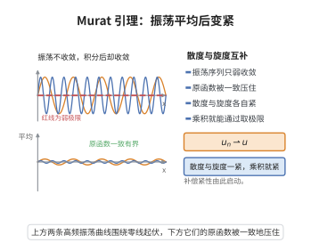

# Murat 引理

> **一句话大白话**：两个各自只弱收敛的向量场，如果一个的散度是紧的、另一个的旋度是紧的，那么它们的内积会弱收敛到极限的内积——补偿紧性由此把"弱收敛"升级为"乘积收敛"。

> **小例子**：在守恒律方程中，通量 $f(u_\varepsilon)$ 与熵 $u_\varepsilon$ 的乘积通常只弱收敛，但若把梯度与旋度（散度）配对后其中一个落在紧集里，Murat 引理就保证该乘积收敛到极限量的乘积。

## 一、定理介绍

> **前置依赖**：补偿紧性（compensated compactness）框架、守恒律方程基本理论、熵条件、Helmholtz 分解与 Sobolev 空间的紧嵌入性质。

Murat 引理是二十世纪七十年代末由 François Murat 与 Luc Tartar 在研究非线性双曲守恒律时引入的补偿紧性理论的核心工具，常称 div-curl 引理；Coifman–Lions–Meyer–Semmes 后来用 Hardy 空间与原子分解给出了另一证明。它的动机是：守恒律的熵不等式只给出解的弱收敛，而熵产率是非线性量，直接取极限会丢失信息。Murat 引理指出，只要参与乘法的两个量中一个具有紧的散度、另一个具有紧的旋度，则它们的内积仍能保持极限，这为证明熵的乘积收敛、进而为 Glimm 格式与补偿紧性方法的收敛性提供了关键一步。

## 几何直观

图意在说明：高频振荡本身只弱收敛，但积分之后被一致控制，散度与旋度互补便得到紧性。

## 二、原理思路

1. 用 Helmholtz 分解把向量场拆成"梯度（旋度为零）部分"与"无散度部分"：散度紧的场其梯度部分紧，旋度紧的场其无散度部分紧。
2. 把内积 $u_\varepsilon\cdot v_\varepsilon$ 按上述分解展开，得到能用紧因子控制的三类项。
3. 逐项取极限：紧因子与有界弱收敛序列相乘可升级为强收敛，含 $\operatorname{div}g_\varepsilon=0$ 的项再用一次分部积分消去无控方向。
4. 合并各极限项，恰好等于 $u\cdot v$，从而得到乘积极限的收敛性。

## 三、定理的严格表述

设 $\Omega\subset\mathbb{R}^2$ 为开集，$\{u_\varepsilon\}$、$\{v_\varepsilon\}$ 为 $L^2(\Omega;\mathbb{R}^2)$ 中有界序列，且

$$
u_\varepsilon\rightharpoonup u,\qquad v_\varepsilon\rightharpoonup v\quad\text{在 }L^2(\Omega;\mathbb{R}^2)\text{ 中}.
$$

若 $\{\operatorname{div}u_\varepsilon\}$ 在 $H^{-1}_{\mathrm{loc}}(\Omega)$ 中相对紧，且 $\{\operatorname{curl}v_\varepsilon\}$ 在 $H^{-1}_{\mathrm{loc}}(\Omega)$ 中相对紧，则

$$
u_\varepsilon\cdot v_\varepsilon\rightharpoonup u\cdot v\qquad\text{在 }\mathcal{D}'(\Omega)\text{ 中},
$$

即对一切试验函数 $\varphi\in C_c^\infty(\Omega)$，

$$
\int_\Omega \varphi\,(u_\varepsilon\cdot v_\varepsilon)\,dx\longrightarrow\int_\Omega \varphi\,(u\cdot v)\,dx.
$$

在 $L^p$ 情形，若 $1/p+1/q=1/r\le 1$，$u_\varepsilon\rightharpoonup u$ 于 $L^p$、$v_\varepsilon\rightharpoonup v$ 于 $L^q$，且相应的散度、旋度在 $W^{-1,p}_{\mathrm{loc}}$、$W^{-1,q}_{\mathrm{loc}}$ 中紧，则 $u_\varepsilon\cdot v_\varepsilon\rightharpoonup u\cdot v$ 于 $L^r_{\mathrm{loc}}$。

## 四、证明过程

**步骤 1（Helmholtz 分解与紧性）。** 分别记 $u_\varepsilon=\nabla\phi_\varepsilon+g_\varepsilon$、$v_\varepsilon=\nabla\psi_\varepsilon+h_\varepsilon$，其中 $\operatorname{div}g_\varepsilon=0$、$\operatorname{div}h_\varepsilon=0$。由 Riesz 表示存在这样的分解，且 $\Delta\phi_\varepsilon=\operatorname{div}u_\varepsilon$、$\operatorname{curl}h_\varepsilon=\Delta\chi_\varepsilon$（二维中无散度场可写为 $h_\varepsilon=\nabla^\perp\chi_\varepsilon$）。

由 $\operatorname{div}u_\varepsilon$ 在 $H^{-1}_{\mathrm{loc}}$ 中相对紧，椭圆估计给出 $\phi_\varepsilon$ 在 $H^1_{\mathrm{loc}}$ 中紧，故 $\nabla\phi_\varepsilon\to\nabla\phi$ 强收敛于 $L^2_{\mathrm{loc}}$。同理 $\operatorname{curl}v_\varepsilon=\Delta\chi_\varepsilon$ 紧，得 $\nabla\chi_\varepsilon$ 在 $L^2_{\mathrm{loc}}$ 中紧，故 $h_\varepsilon=\nabla^\perp\chi_\varepsilon$ 强收敛于 $L^2_{\mathrm{loc}}$。

**步骤 2（内积的三项分解）。** 记 $g_\varepsilon,h_\varepsilon$ 为无散度部分，$g_\varepsilon\rightharpoonup g$、$h_\varepsilon\rightharpoonup h$，且 $\operatorname{div}g=0$、$\operatorname{div}h=0$。于是
$$
u_\varepsilon\cdot v_\varepsilon=\nabla\phi_\varepsilon\cdot\nabla\psi_\varepsilon+\nabla\phi_\varepsilon\cdot h_\varepsilon+g_\varepsilon\cdot\nabla\psi_\varepsilon+g_\varepsilon\cdot h_\varepsilon.
$$

**步骤 3（逐项取极限）。** 对试验函数 $\varphi$：

- 第 1 项 $\int\varphi\,\nabla\phi_\varepsilon\cdot\nabla\psi_\varepsilon$：$\nabla\phi_\varepsilon$ 强收敛于 $L^2_{\mathrm{loc}}$，$\nabla\psi_\varepsilon$ 有界弱收敛，故极限为 $\int\varphi\,\nabla\phi\cdot\nabla\psi$。
- 第 2 项 $\int\varphi\,\nabla\phi_\varepsilon\cdot h_\varepsilon$：$h_\varepsilon$ 强收敛于 $L^2_{\mathrm{loc}}$，故极限为 $\int\varphi\,\nabla\phi\cdot h$。
- 第 4 项 $\int\varphi\,g_\varepsilon\cdot h_\varepsilon$：$h_\varepsilon$ 强收敛，$g_\varepsilon$ 弱收敛，极限为 $\int\varphi\,g\cdot h$。
- 第 3 项 $\int\varphi\,g_\varepsilon\cdot\nabla\psi_\varepsilon$：因 $\operatorname{div}g_\varepsilon=0$，有 $g_\varepsilon\cdot\nabla\psi_\varepsilon=\operatorname{div}(\psi_\varepsilon g_\varepsilon)$，分部积分得
$$
\int\varphi\,g_\varepsilon\cdot\nabla\psi_\varepsilon=-\int\nabla\varphi\cdot g_\varepsilon\,\psi_\varepsilon.
$$
由 $\operatorname{div}v_\varepsilon=\Delta\psi_\varepsilon\in H^{-1}$ 有界，$\psi_\varepsilon$ 在 $H^1_{\mathrm{loc}}$ 中有界，从而在 $L^2_{\mathrm{loc}}$ 中紧，故 $\psi_\varepsilon\to\psi$ 强收敛，于是该极限为 $-\int\nabla\varphi\cdot g\,\psi=\int\varphi\,g\cdot\nabla\psi$。

**步骤 4（合并得结论）。** 把四项极限相加，恰好得
$$
\int_\Omega \varphi\,(u\cdot v)\,dx=\int_\Omega \varphi\,\bigl(\nabla\phi\cdot\nabla\psi+\nabla\phi\cdot h+g\cdot\nabla\psi+g\cdot h\bigr)\,dx.
$$
由于 $u_\varepsilon\cdot v_\varepsilon$ 在 $L^1_{\mathrm{loc}}$ 中一致有界，对每个 $\varphi$ 上述收敛成立即意味着 $u_\varepsilon\cdot v_\varepsilon\rightharpoonup u\cdot v$ 于 $\mathcal{D}'(\Omega)$。$\square$

## 五、应用与意义

- **守恒律的熵收敛**：Murat 引理是证明熵 $\eta(u_\varepsilon)$ 与熵通量 $q(u_\varepsilon)$ 的乘积收敛的关键，直接支撑补偿紧性方法。
- **Glimm 格式与弱解存在性**：为分析格式极限满足熵条件提供紧性机制。
- **一般框架**：引理可推广到 $n$ 维与 $L^p$ 情形，是 div-curl 型补偿紧性结果的原型。
- **其他领域**：在流体力学、磁流体与液晶模型中用于证明非线性量的强收敛。

## 课堂问答

**老师**：Murat 引理（div-curl 引理）说了一件什么事？为什么它叫"补偿紧性"？

**学生**：若 $u_\varepsilon\rightharpoonup u$、$v_\varepsilon\rightharpoonup v$ 于 $L^2$，且 $\{\operatorname{div}u_\varepsilon\}$ 在 $H^{-1}_{\mathrm{loc}}$ 相对紧、$\{\operatorname{curl}v_\varepsilon\}$ 在 $H^{-1}_{\mathrm{loc}}$ 相对紧，则 $u_\varepsilon\cdot v_\varepsilon\rightharpoonup u\cdot v$ 于分布意义。一般弱收敛不保持乘积，但散度/旋度的紧性"补偿"了缺失的强收敛，把乘积的弱极限救回来，这正是补偿紧性。

**老师（追问）**：证明的关键机制是什么？Helmholtz 分解起什么作用？

**学生**：把 $u_\varepsilon=u+w_\varepsilon$、$v_\varepsilon=v+z_\varepsilon$，只需证 $w_\varepsilon\cdot z_\varepsilon\rightharpoonup0$。做分解 $w_\varepsilon=\nabla\phi_\varepsilon+g_\varepsilon$（$\operatorname{div}g_\varepsilon=0$）。由 $\operatorname{div}u_\varepsilon$ 紧，椭圆估计给出 $\phi_\varepsilon$ 在 $H^1_{\mathrm{loc}}$ 紧、$\nabla\phi_\varepsilon$ 强收敛；由 $\operatorname{curl}v_\varepsilon=\Delta\chi_\varepsilon$ 紧得无散度部分 $h_\varepsilon=\nabla^\perp\chi_\varepsilon$ 强收敛。这样内积四项中三项含强收敛因子可直接取极限，第四项 $g_\varepsilon\cdot\nabla\psi_\varepsilon=\operatorname{div}(\psi_\varepsilon g_\varepsilon)$ 用分部积分消去无控方向。

**老师（拓展）**：它对守恒律熵解理论有什么用？$L^p$ 情形如何推广？

**学生**：守恒律里状态与通量满足散度结构，熵对 $(\eta_i,q_i)$ 给出向量场 $(q_i(\nu_\varepsilon),-\eta_i(\nu_\varepsilon))$，用 div-curl 引理可得 Young 测度的交换关系，熵对足够多时可逼 Young 测度为 Dirac 测度，从而 $\nu_\varepsilon$ 几乎处处收敛。$L^p$ 情形：若 $u_\varepsilon\rightharpoonup u$ 于 $L^p$、$v_\varepsilon\rightharpoonup v$ 于 $L^q$，$1/p+1/q=1/r\le1$，散度、旋度分别在 $W^{-1,p},W^{-1,q}$ 紧，则 $u_\varepsilon\cdot v_\varepsilon\rightharpoonup u\cdot v$ 于 $L^r_{\mathrm{loc}}$。常见误区是漏掉"相对紧"这一条，只要求有界是不够的。

## 相关条目

- [compensated-compactness](./compensated-compactness.md)：Murat 引理是补偿紧性理论中最基本的引理。
- [熵条件](./熵条件.md)：熵产率的收敛性判定依赖本引理给出的乘积极限。
- [Glimm格式收敛性](./Glimm格式收敛性.md)：格式的紧性分析使用 Murat 引理处理非线性通量。
