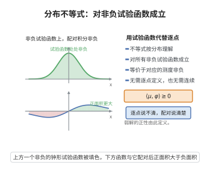

# 分布意义下的不等式

> **一句话大白话**：当解只有"弱解"那样粗糙、连导数点态都不存在时，仍可把不等式理解成"对每个非负试验函数积分后再比较"；这样定义的不等式叫分布意义下的不等式，它把熵条件这类物理要求变成可操作的数学判据。

> **小例子**：说"$\partial_t u+\partial_x f(u)\le 0$ 在分布意义下成立"，意思是：对任意非负试验函数 $\varphi\ge0$，都有 $\iint\bigl(u\varphi_t+f(u)\varphi_x\bigr)\,dx\,dt\ge0$，无需 $u$ 处处可微。

## 一、定理介绍

> **前置依赖**：守恒律方程基本理论、熵条件、凸函数与凸集、分部积分与散度定理。

守恒律方程的弱解通常不可微，其导数只在**分布**意义下存在。为了叙述熵条件、最大值原理与比较原理，必须把"$\le$"从逐点意义推广到分布意义：一个分布 $T$ 称为非负的，如果它对一切非负试验函数的作用都非负。这一约定使得热力学第二定律式的陈述（熵产生的耗散不等式）即便在激波处也有确切含义。

本节给出分布意义下不等式的定义、与经典不等式的相容性，以及最核心的结构性结论：**导数非负的分布必由单调不减函数表示**。这条结论把抽象的分布不等式还原为几乎处处成立的单调性，是弱解理论中反复使用的出发点。

## 几何直观

图意在说明：分布意义下的不等式只需对所有非负试验函数成立，无需逐点定义函数值。

## 二、原理思路

对光滑函数，"$u_t+f(u)_x\le0$"与"对任意 $\varphi\ge0$，$\iint(u\varphi_t+f(u)\varphi_x)\ge0$"由分部积分等价。对一般 $u$，就把后者**取作定义**。关键观察有两点：

1. **正分布是测度**：若 $S\in\mathcal{D}'$ 满足 $\langle S,\varphi\rangle\ge0$ 对一切 $\varphi\ge0$ 成立，则 $S$ 可由一个正 Radon 测度表示，因为它在每个紧集上被 $\|\varphi\|_\infty$ 控制。
2. **导数为正即单调**：若 $T'=\mu\ge0$，则以 $\mu$ 为 Stieltjes 测度构造的累积分布函数 $F(x)=\mu\bigl((c,x]\bigr)$ 单调不减且 $F'=\mu$，故 $T-F$ 的分布导数为零、必为常数，于是 $T$ 几乎处处等于一个单调不减函数。

## 三、定理的严格表述

设 $\Omega\subseteq\mathbb{R}^d$ 为开集，$\mathcal{D}'(\Omega)$ 表示其上的分布空间。

**定义（分布意义下的不等式）**：设 $T_1,T_2\in\mathcal{D}'(\Omega)$。称 $T_1\le T_2$ 在分布意义下成立，如果

$$
\langle T_2-T_1,\varphi\rangle\ge0,\qquad \forall\,\varphi\in C_c^\infty(\Omega),\ \varphi\ge0 .
$$

特别地 $T\ge0$ 指对一切 $\varphi\ge0$ 有 $\langle T,\varphi\rangle\ge0$。

**定理（单调性表示定理）**：设 $T\in\mathcal{D}'\bigl((a,b)\bigr)$ 满足 $T'\ge0$（分布意义）。则存在单调不减的函数 $F:(a,b)\to\mathbb{R}$，使得

$$
\langle T,\varphi\rangle=\int_a^b F(x)\,\varphi(x)\,dx,\qquad \forall\,\varphi\in C_c^\infty(a,b),
$$

即 $T$ 几乎处处等于 $F$。

**命题（与经典情形的相容性）**：若 $u\in C^1(\Omega)$ 且 $T=\partial_tu+\partial_x f(u)$，其中 $f\in C^1$，则在分布意义下 $T\le0$ 当且仅当 $u_t+f(u)_x\le0$ 逐点成立。

**推论（熵不等式）**：设 $(\eta,q)$ 为守恒律 $\nu_t+f(\nu)_x=0$ 的凸熵对。若 $\nu$ 是满足熵条件的允许解，则

$$
\partial_t\eta(\nu)+\partial_x q(\nu)\le0
$$

在分布意义下成立；当解光滑时取等号。

## 四、证明过程

**命题的证明**。设 $u\in C^1$。对任意 $\varphi\in C_c^\infty$，由分部积分与散度定理（一维情形即分部积分）

$$
\bigl\langle \partial_tu+\partial_x f(u),\varphi\bigr\rangle
=\iint\bigl(u\,\partial_t\varphi+f(u)\,\partial_x\varphi\bigr)\,dx\,dt
=-\iint\bigl(u_t+f(u)_x\bigr)\varphi\,dx\,dt .
$$

若逐点有 $u_t+f(u)_x\le0$ 且 $\varphi\ge0$，则右端 $\ge0$，故分布意义下 $T\le0$。反之，若 $T\le0$，则对一切 $\varphi\ge0$ 有 $\iint(u_t+f(u)_x)\varphi\le0$；由于左端连续，若在某点 $x_0$ 处 $u_t+f(u)_x>0$，取 $\varphi$ 为集中在 $x_0$ 附近的正测试函数即得矛盾。故等价性成立。

**引理（正分布在紧集上被上确界范数控制）**。设 $S\ge0$，$K\subset(a,b)$ 紧。取 $\chi\in C_c^\infty(a,b)$ 满足 $\chi\ge0$ 且 $\chi\equiv1$ 于 $K$。对任意实值 $\varphi\in C_c^\infty(K)$，有 $-\|\varphi\|_\infty\chi\le\varphi\le\|\varphi\|_\infty\chi$，由 $S\ge0$ 的线性与保序性得

$$
\bigl|\langle S,\varphi\rangle\bigr|\le\|\varphi\|_\infty\,\langle S,\chi\rangle .
$$

于是 $S$ 是 $C_c(K)$ 上的正线性泛函。

**单调性表示定理的证明**。由引理，$C_c(K)$ 上的正线性泛函经一致逼近可延拓为 $C_c(K)$ 上的连续正线性泛函，由 Riesz 表示定理，存在正 Radon 测度 $\mu_K$ 使 $\langle S,\varphi\rangle=\int\varphi\,d\mu_K$。取 $K$ 递增穷尽 $(a,b)$，这些测度在公共紧集上一致，拼成 $(a,b)$ 上一个局部有限的测度 $\mu\ge0$。

现设 $T'=S=\mu$。固定 $c\in(a,b)$，定义

$$
F(x)=\mu\bigl((c,x]\bigr)\quad(x>c),\qquad F(x)=-\mu\bigl((x,c]\bigr)\quad(x\le c),
$$

则 $F$ 单调不减，且对任意 $\varphi\in C_c^\infty(a,b)$，由 Stieltjes 积分分部公式

$$
\int F\,\varphi'\,dx=-\int\varphi\,d\mu=-\langle T',\varphi\rangle=-\bigl\langle T,\varphi'\bigr\rangle ,
$$

即 $\langle T-F,\varphi'\rangle=0$ 对一切 $\varphi$ 成立。

**零导数为常数**。取 $\theta_0\in C_c^\infty$ 使 $\int\theta_0=1$。对任意 $\varphi\in C_c^\infty$，令

$$
\theta(x)=\int_{-\infty}^{x}\bigl[\varphi(s)-M\theta_0(s)\bigr]ds,\qquad M=\int\varphi .
$$

因总积分为零，$\theta$ 具有紧支集且 $\theta'=\varphi-M\theta_0$。于是

$$
\langle T-F,\varphi\rangle-M\langle T-F,\theta_0\rangle=\bigl\langle T-F,\theta'\bigr\rangle=0,
$$

故 $T-F=C$（常数）作为分布。因此 $T$ 几乎处处等于单调不减函数 $F+C$，定理得证。

**推论的证明**。对凸熵对，光滑解满足 $\eta(\nu)_t+q(\nu)_x=0$。当解出现激波时，由 vanishing viscosity 极限（见熵条件），正则化解满足

$$
\eta(\nu^\varepsilon)_t+q(\nu^\varepsilon)_x=\varepsilon\,\eta(\nu^\varepsilon)_{xx}
-\varepsilon\,\eta''(\nu^\varepsilon)|\nu^\varepsilon_x|^2\le\varepsilon\,\eta(\nu^\varepsilon)_{xx},
$$

其中用到 $\eta''\ge0$（凸性）。令 $\varepsilon\to0^+$，左端趋于 $\eta(\nu)_t+q(\nu)_x$，右端在分布意义下趋于 $0$，故熵不等式在分布意义下成立。$\square$

## 五、应用与意义

- **熵解理论**：Kružkov 熵解的定义本身就是一族分布意义下的不等式，配合单调性表示定理可以推出 $L^1$ 压缩性与比较原理。
- **最大值原理与比较原理**：分布不等式 $(\nu-w)_t+\bigl(f(\nu)-f(w)\bigr)_x\le0$ 直接给出两个解之间的单向控制。
- **数值稳定性**：离散格式若满足"离散熵不等式"，其误差可用同一条分布框架分析，是熵稳定格式的理论依据。
- **广义函数论**：把不等式与测度联系起来，是分布理论、凸分析与偏微分方程弱解理论之间的标准桥梁。

## 课堂问答

**老师**：散度定理的物理内容是什么？它和分部积分、Green 恒等式如何串起来？

**学生**：散度定理说边界通量等于内部散度积分：$\int_\Omega\nabla\cdot F\,dx=\int_{\partial\Omega}F\cdot\nu\,dS$。对乘积 $uG$ 用 $\nabla\cdot(uG)=\nabla u\cdot G+u\nabla\cdot G$ 立即得分部积分 $\int_\Omega u\nabla\cdot G=\int_{\partial\Omega}uG\cdot\nu-\int_\Omega\nabla u\cdot G$；取 $G=\nabla v$ 再交换 $u,v$ 相减得 Green 恒等式。

**老师（追问）**：散度定理本身怎么证？为什么可以先做长方体再拼到一般区域？

**学生**：先在长方体上用微积分基本定理消去 $\partial_iF_i$、再用 Fubini 定理把其余坐标积掉，边界项出现在 $x_i=b_i$ 与 $x_i=a_i$ 两端面，那里 $\nu=\pm e_i$，恰是 $\int F_i\nu_i\,dS$。一般区域用竖条区域（对 $x_d$ 用微积分基本定理，上下图形用第一类曲面积分与 $dS=\sqrt{1+|\nabla\beta|^2}dx'$），再用单位分解拼接，内部界面法向相反成对抵消。

**老师（拓展）**：这个恒等式在弱解与能量方法里扮演什么角色？球面平均又怎么用它？

**学生**：它是"把导数从解身上转移到试验函数身上"的标准手段，是守恒律弱解、熵条件、椭圆边值弱形式的共同基础；能量估计靠它把 $\int u\Delta u$ 转成边界项与 $-\int|\nabla u|^2$。球面平均里对 $F=\nabla u$ 用散度定理，把 $\int_{\partial B_r}\nabla u\cdot\nu\,dS$ 化为 $\int_{B_r}\Delta u\,dy$，从而导出 $\partial_r\bar u$ 的求导公式与 EPD 方程。常见误区是把 $\nu$ 方向或面积元搞错：上下图形外法向相反，符号错一个内部边界就不能抵消。
