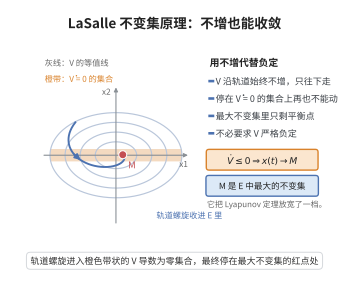

# LaSalle 不变集原理

> **一句话大白话**：即使能量函数只有 $\dot V\le0$（不增而不严格下降），系统也不会乱跑——它最终一定停在"$\dot V=0$ 的最大不变集"里。
>
> **小例子**：有阻尼单摆取总能量 $V$，则 $\dot V=-\text{阻尼}\cdot\dot\theta^2\le0$，而 $\dot V=0$ 只在 $\dot\theta=0$ 处成立；这一集合中唯一能永远停留的完整轨道是下垂平衡点，故摆最终停下。

## 一、定理介绍

> **前置依赖**：Lyapunov 稳定性定理、正定函数与紧集上连续函数的最值、ω-极限集的定义与基本性质、不变集（含最大不变集）、连续可微函数沿轨迹的导数、单调有界序列收敛。

LaSalle 不变集原理（LaSalle invariance principle，亦称不变性原理）由 J. P. LaSalle 于 1960 年代提出，用于处理 Lyapunov 函数导数仅半负定（$\dot V\le0$）时平衡点仍渐近稳定的情形。当 $\dot V\le0$ 只在某些点取零时，轨迹的 ω-极限集被"卡"在使 $\dot V=0$ 的最大不变集内，从而得到收敛性结论。它把 Lyapunov 直接方法与不变集思想结合，是自适应控制、观测器设计与鲁棒控制证明中反复使用的工具。

## 几何直观

图意在说明：V 沿轨道不增时，轨道被逼进导数为零的集合，其最大不变集就是极限所在。

## 二、原理思路

设 $\Omega$ 是紧的正不变集，$V$ 连续可微且 $\dot V\le0$。沿任一由 $\Omega$ 内出发的轨迹 $x(t)$，$V(x(t))$ 单调不增且有下界，故收敛到某常数 $c$。取轨迹的 ω-极限集 $L$：它非空、紧、不变，且 $V\equiv c$ 于其上。由于 $V$ 在 $L$ 上取常值而沿流又不增，$L$ 上必须有 $\dot V=0$；于是 $L$ 含于 $E=\{x:\dot V(x)=0\}$ 的最大不变子集 $M$ 内。最后用紧性论证 $\operatorname{dist}(x(t),M)\to0$。

核心链条是：能量有极限 $\Rightarrow$ ω-极限集上能量为常数 $\Rightarrow$ 该集上 $\dot V=0$ $\Rightarrow$ 落入最大不变集。

## 三、定理的严格表述

考虑自治系统
$$
\dot x=f(x),\qquad f:\Omega\to\mathbb R^n\ \text{局部 Lipschitz},
$$
其中 $\Omega\subset\mathbb R^n$ 是紧的正不变集，即从 $\Omega$ 内出发的不可延拓解对所有 $t\ge0$ 都留在 $\Omega$ 内。设 $V:\Omega\to\mathbb R$ 连续可微，记沿轨迹的导数
$$
\dot V(x)=\nabla V(x)^{\mathsf T}f(x).
$$
令
$$
E=\{x\in\Omega:\dot V(x)=0\},
$$
并记 $M$ 为 $E$ 中关于流的最大不变集，即 $E$ 中所有不变子集的并集。

**LaSalle 不变集原理**：若 $\dot V\le0$ 在 $\Omega$ 上处处成立，则对每个 $x_0\in\Omega$，解 $x(t)$ 有界且
$$
\operatorname{dist}(x(t),M)\to0\qquad(t\to\infty).
$$

**推论（渐近稳定性）**：若 $\Omega$ 含原点、$V$ 在 $\Omega$ 上正定、且 $M=\{0\}$，则原点渐近稳定。事实上由 Lyapunov 稳定性定理原点稳定，而上述结论又给出 $x(t)\to0$。

## 四、证明过程

固定 $x_0\in\Omega$，记 $x(t)=\varphi_t(x_0)$。

**步骤 1（能量收敛）。** 由 $\dot V\le0$，$t\mapsto V(x(t))$ 单调不增；又 $V$ 在紧集 $\Omega$ 上连续故有下界 $m$，于是 $V(x(t))$ 收敛，记
$$
c:=\lim_{t\to\infty}V(x(t))=\inf_{t\ge0}V(x(t))\ge m.
$$

**步骤 2（ω-极限集非空、紧、不变）。** 定义 ω-极限集
$$
L=\bigcap_{s\ge0}\overline{\{x(t):t\ge s\}}=\Big\{y\in\mathbb R^n:\exists\,t_n\to\infty,\ x(t_n)\to y\Big\}.
$$
因 $\Omega$ 紧且轨迹始终留在 $\Omega$ 内，$L$ 是非空紧集。$L$ 是不变集：若 $t_n\to\infty$ 且 $x(t_n)\to y$，则由解对初值与时间的连续性
$$
\varphi_\tau(y)=\lim_{n\to\infty}\varphi_\tau\big(x(t_n)\big)=\lim_{n\to\infty}x(t_n+\tau),
$$
且 $t_n+\tau\to\infty$，故 $\varphi_\tau(y)\in L$ 对每个 $\tau\ge0$ 成立；当 $\tau<0$ 时，因轨迹取值于紧集 $\Omega$ 内可取子列使 $x(t_n+\tau)$ 收敛，极限同样属于 $L$，并且由解的群性质 $\varphi_\tau(y)$ 就是该极限。故 $L$ 对一切 $\tau\in\mathbb R$ 不变。

**步骤 3（$L$ 上 $\dot V\equiv0$）。** 对 $y\in L$，取 $t_n\to\infty,\ x(t_n)\to y$。由 $V$ 连续及步骤 1，
$$
V(y)=\lim_{n\to\infty}V(x(t_n))=c,
$$
故 $V\equiv c$ 于 $L$。又由步骤 2，$\varphi_\tau(y)\in L$ 对所有 $\tau$ 成立，故 $V(\varphi_\tau(y))\equiv c$ 与 $\tau$ 无关，于是
$$
\dot V(y)=\frac{d}{d\tau}V\big(\varphi_\tau(y)\big)\Big|_{\tau=0}=0.
$$
因此 $L\subseteq E$；又 $L$ 是不变集，故 $L\subseteq M$。

**步骤 4（收敛性）。** 反设 $\operatorname{dist}(x(t),M)$ 不趋于 $0$，则存在 $\varepsilon>0$ 与 $t_n\to\infty$ 使
$$
\operatorname{dist}(x(t_n),M)\ge\varepsilon.
$$
因轨迹在紧集 $\Omega$ 内，取子列（仍记作 $t_n$）使 $x(t_n)\to y$。由定义 $y\in L\subseteq M$，故当 $n$ 充分大时 $\operatorname{dist}(x(t_n),M)\le\operatorname{dist}(x(t_n),y)<\varepsilon$，与 $\operatorname{dist}(x(t_n),M)\ge\varepsilon$ 矛盾。因此 $\operatorname{dist}(x(t),M)\to0$。$\square$

**推论的证明。** $V$ 在 $\Omega$ 上正定，由 Lyapunov 稳定性定理原点稳定；又 $M=\{0\}$ 时 $\operatorname{dist}(x(t),M)=\|x(t)\|\to0$，即渐近稳定。$\square$

## 五、应用与意义

- **半负定情形**：弥补 Lyapunov 稳定性定理的不足——$\dot V\le0$ 而零点并非孤立时，仍可借不变集判定收敛。
- **自适应控制**：参数估计误差与状态误差构成的能量函数常仅半负定，靠不变集原理补足收敛性证明（如 MRAC、系统辨识）。
- **观测器与同步**：误差动力学的收敛常由 LaSalle 原理给出，复杂网络同步分析同理。
- **关系与推广**：Barbalat 引理是其非自治推广；LQR 闭环的渐近稳定性常以 LaSalle 原理收尾；Krasovskii、Halanay 型泛函是其时滞系统的推广。

## 课堂问答

**老师**：当 Lyapunov 函数的导数只半负定 $\dot V\le0$ 时，如何还能得到收敛结论？

**学生**：用 LaSalle 不变集原理。设 $\Omega$ 紧、正不变且 $\dot V\le0$，令 $E=\{x:\dot V=0\}$、$M$ 为 $E$ 中关于流的**最大不变集**，则每个解满足 $\operatorname{dist}(x(t),M)\to0$。它把"能量不增"升级为"轨迹收敛到某不变集"。

**老师（追问）**：为什么轨迹最终一定落进 $\dot V=0$ 的集合，而不会停在 $\dot V<0$ 的点？

**学生**：沿轨迹 $V(x(t))$ 单调不增且有下界，故收敛到某常数 $c$。取 $\omega$-极限集 $L$：它非空紧、不变，由 $V$ 连续得 $V\equiv c$ 于 $L$。既然 $V$ 在 $L$ 上恒为常数，沿 $L$ 求导就有 $\dot V\equiv0$ 于 $L$，即 $L\subseteq E$，又 $L$ 不变故 $L\subseteq M$；再由紧性论证 $\operatorname{dist}(x(t),M)\to0$。常见误区是以为必须 $\dot V$ 负定才有渐近稳定——其实 $\dot V\le0$ 加上"最大不变集恰为平衡点"就够了。

**老师（拓展）**：若 $M=\{0\}$ 会怎样？它与 Lyapunov 直接方法如何分工？

**学生**：若 $\Omega$ 含原点、$V$ 在 $\Omega$ 上正定且 $M=\{0\}$，则原点渐近稳定：正定性给稳定性（Lyapunov 定理），而 $\operatorname{dist}(x(t),\{0\})=\|x(t)\|\to0$ 给吸引性。典型流程是先用 Lyapunov 定理证稳定，再用 LaSalle 原理补收敛——LQR 闭环在 $Q$ 半正定时的稳定性证明正是如此收尾。它还是自适应控制（如 MRAC、系统辨识）与复杂网络同步分析的核心工具，非自治推广即 Barbalat 引理。

## 相关条目

- [Lyapunov 稳定性定理](./Lyapunov稳定性定理.md)：LaSalle 原理是其半负定情形的补强，二者常联合使用。
- [Riccati 方程与 LQR 控制](./Riccati方程与LQR控制.md)：LQR 闭环的渐近稳定性证明用到 LaSalle 原理。
