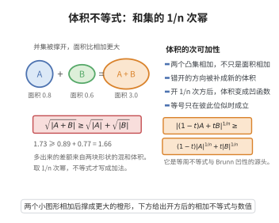

# Brunn-Minkowski 不等式

> **一句话大白话**：两个集合的"闵可夫斯基和"的体积满足 $|A+B|^{1/n}\ge |A|^{1/n}+|B|^{1/n}$：体积像"开 $n$ 次根号后可加"，等号只在两集合互为相似放大时出现。
>
> **小例子**：平面上两个互成相似的图形 $A,B$，其 $A+B$ 的面积不小于"$\sqrt{|A|}+\sqrt{|B|}$ 再平方"，等号当 $B$ 恰为 $A$ 的相似放大/平移时取到。

## 一、定理介绍

> **前置依赖**：Lebesgue 测度、Minkowski 和、Steiner 对称化、凸体概念、层蛋糕表示公式、平移不变性。

Brunn-Minkowski 不等式是凸几何与度量几何中的核心不等式之一，它描述了欧几里得空间中两个凸体（或更一般地，可测集）的 Minkowski 和与其体积之间的深刻关系。该不等式表明，体积的 $1/n$ 次方关于 Minkowski 加法具有凹性，从而揭示了高维空间中体积的 log-凹结构。

## 几何直观

图意在说明：Minkowski 和会把错开的方向补成新体积，取 1/n 次幂后体积才变成可加的凹量。

## 二、原理思路

其基本思想源于一维情形：对两个区间 $[a,b]$ 与 $[c,d]$，它们的和集 $[a+c,b+d]$ 的长度满足
$$
|[a,b]+[c,d]|^{1/1}=|[a,b]|^{1/1}+|[c,d]|^{1/1}.
$$
高维推广后，由于“边角”重叠，体积的 $n$ 次方根不再具有等号，而是变为不等式。证明常从箱体的情形出发，再利用 Steiner 对称化、层蛋糕表示或热核方法逐步推广到一般凸体与可测集。

## 三、定理的严格表述

设 $A,B\subset\mathbb{R}^n$ 为非空 Lebesgue 可测集，且 $A+B=\{a+b:a\in A,\,b\in B\}$ 亦可测。则对任意 $\lambda\in[0,1]$，有
$$
\bigl|\lambda A+(1-\lambda)B\bigr|^{1/n}\ge \lambda|A|^{1/n}+(1-\lambda)|B|^{1/n},
$$
其中 $|\cdot|$ 表示 $n$ 维 Lebesgue 测度。等价地，体积本身满足 log-凹不等式
$$
\bigl|\lambda A+(1-\lambda)B\bigr|\ge |A|^\lambda |B|^{1-\lambda}.
$$
当 $A,B$ 为凸体且彼此位似时，等号成立。

## 四、证明过程

**证明（凸体情形，基于 Steiner 对称化）：**

1. **一维情形。** 对 $\mathbb{R}^1$ 中的区间或更一般的可测集，由平移不变性可知
   $$
   |\lambda A+(1-\lambda)B|\ge \lambda|A|+(1-\lambda)|B|,
   $$
   而 $|\cdot|^{1/1}$ 为线性函数，故不等式成立。

2. **Steiner 对称化。** 对任意凸体 $K\subset\mathbb{R}^n$ 与任意单位方向 $u$，定义 $K$ 关于 $u$ 的 Steiner 对称化 $\sigma_u(K)$：将每个平行于 $u$ 的弦平移到以 $u$ 的正交超平面对称的位置。该操作保持体积，并将凸体变为关于 $u^{\perp}$ 对称的凸体；同时对任意两个凸体 $A,B$，有
   $$
   \sigma_u(A)+\sigma_u(B)\subset \sigma_u(A+B).
   $$

3. **迭代对称化。** 选取一组方向 $(u_k)$ 使其生成的对称体序列收敛到与原始体积相同的球。由 Minkowski 和与对称化的相容性，体积的 $1/n$ 次方在每一步不减。

4. **球体情形。** 若 $A,B$ 分别为半径 $r_A,r_B$ 的球，则
   $$
   |\lambda A+(1-\lambda)B|^{1/n}=\bigl(\omega_n(\lambda r_A+(1-\lambda)r_B)^n\bigr)^{1/n}=\lambda r_A\omega_n^{1/n}+(1-\lambda)r_B\omega_n^{1/n},
   $$
   恰等于 $\lambda|A|^{1/n}+(1-\lambda)|B|^{1/n}$。

5. **结论。** 由对称化单调性与球体等号情形，对任意凸体 $A,B$ 不等式成立。对一般可测集，可通过内逼近与 Brunn-Minkowski-Lusternik 定理的推广得到相同结论。

## 五、应用与意义

Brunn-Minkowski 不等式是等周不等式、Prékopa-Leindler 不等式以及对数凹测度理论的基石。它在凸几何中用于推导 Aleksandrov-Fenchel 不等式与混合体积理论，在概率论中孕育了 Brunn-Minkowski 型浓度不等式，并在泛函分析、最优传输以及信息论中均有深远影响。该不等式还说明：高维体积在 Minkowski 加法下具有强烈的集中与凹性特征，是理解几何测度结构的枢纽工具。

## 课堂问答

**老师**：请陈述 Brunn-Minkowski 不等式，并说明"凹性"体现在哪。

**学生**：对可测集 $A,B\subset\mathbb R^n$ 与 $\lambda\in[0,1]$，$|\lambda A+(1-\lambda)B|^{1/n}\ge\lambda|A|^{1/n}+(1-\lambda)|B|^{1/n}$，即体积的 $n$ 次方根关于 Minkowski 加法是**凹**的；等价地体积本身 log-凹：$|\lambda A+(1-\lambda)B|\ge|A|^\lambda|B|^{1-\lambda}$。

**老师（追问）**：一维其实是等号，为什么高维退化成不等式？等号何时成立？

**学生**：一维时 $|[a,b]+[c,d]|=|[a,b]|+|[c,d]|$，因为长度的 $1$ 次方就是线性函数，等式成立。高维时 Minkowski 和的"边角"会重叠，实际体积小于线性相加所预期的量，故退化为不等式。等号当且仅当 $A,B$ 位似（互为相似放大加平移）。常见误区是把 $\ge$ 记成 $\le$：体积的 $n$ 次方根是凹函数，和集的根**不小于**两根之和。

**老师（拓展）**：Steiner 对称化在这条不等式中起什么作用？

**学生**：它把一般情形化归到球。对称化 $\sigma_u$ 保持体积、改善对称性，且满足相容性 $\sigma_u(A)+\sigma_u(B)\subseteq\sigma_u(A+B)$；迭代一组方向 $(u_k)$ 使对称体逼近与原体积相同的球，沿途 $|{\cdot}|^{1/n}$ 不减。球的情形 $|\lambda A+(1-\lambda)B|^{1/n}=(\omega_n(\lambda r_A+(1-\lambda)r_B)^n)^{1/n}$ 恰好取等，于是对任意凸体成立，一般可测集再用内逼近推广。它是 Aleksandrov–Fenchel 不等式与 Prékopa–Leindler 不等式的基石。
