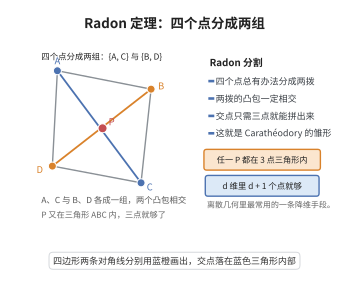

# Radon 定理与 Carathéodory 定理

> **一句话大白话**：Carathéodory定理说"凸包里的一点只需用 $d+1$ 个点就能表达"；Radon定理说 "$d+2$ 个点总能分成两组，两组张成的凸包有公共点"。
>
> **小例子**：平面（$d=2$）里，若某点落在若干个点张成的凸包内，则其能用其中至多 $3$ 个点线性组合表示；而任意 $4$ 个点可分为两组，两组张出的三角形/线段必相交。

## 一、定理介绍

> **前置依赖**：凸包、凸组合、仿射相关性、维数概念、凸集。

Radon 定理与 Carathéodory 定理是凸几何与组合几何中互为表里的一对基本结果。Radon 定理断言：在 $\mathbb{R}^n$ 中，任意 $n+2$ 个点都可以被划分为两个子集，使得这两个子集的凸包相交。Carathéodory 定理则断言：若一点位于某点集的凸包中，则它必可表示为其中至多 $n+1$ 个点的凸组合。两者共同刻画了欧氏空间中凸包的有限组合结构。

## 几何直观

图意在说明：四个点总能分成两拨使凸包相交，而那个交点只需三个点就能表示出来。

## 二、原理思路

- **Radon 定理** 的核心在于维数约束：$n+2$ 个点在 $n$ 维空间中必然仿射相关，从而存在非平凡的线性关系，将正系数与负系数分别归到两个子集即可得到凸包相交。

- **Carathéodory 定理** 的核心在于降维：若点 $x$ 落在某点集的凸包中，则考虑所有包含 $x$ 的单纯形；取维数最小的那个，其顶点数不能超过 $n+1$，否则这些顶点仿射相关，可进一步约化。

两者可通过 Helly 定理相互推导，构成凸几何的“组合三元组”。

## 三、定理的严格表述

### Radon 定理

设 $X\subset\mathbb{R}^n$ 为包含至少 $n+2$ 个点的集合，则存在互不相交的子集 $A,B\subset X$（允许其中一个为空），使得
$$
\operatorname{conv}(A)\cap\operatorname{conv}(B)\neq\varnothing.
$$
通常要求 $A\cup B=X$，$A\cap B=\varnothing$。

### Carathéodory 定理

设 $S\subset\mathbb{R}^n$，$x\in\operatorname{conv}(S)$。则存在 $S$ 中至多 $n+1$ 个点 $x_1,\dots,x_m$（其中 $m\le n+1$）与非负实数 $\lambda_1,\dots,\lambda_m$ 满足 $\sum_{i=1}^m\lambda_i=1$，使得
$$
x=\sum_{i=1}^m\lambda_i x_i.
$$

## 四、证明过程

### Radon 定理的证明

1. **仿射相关性。** 取 $X$ 中 $n+2$ 个点 $x_1,\dots,x_{n+2}$。因为它们位于 $n$ 维空间中，所以仿射相关，即存在不全为零的实数 $\alpha_1,\dots,\alpha_{n+2}$ 满足
   $$
   \sum_{i=1}^{n+2}\alpha_i=0,\qquad \sum_{i=1}^{n+2}\alpha_i x_i=0.
   $$

2. **正负分解。** 令 $I^+=\{i:\alpha_i>0\}$，$I^-=\{i:\alpha_i<0\}$。两者均非空。记 $s=\sum_{i\in I^+}\alpha_i=-\sum_{i\in I^-}\alpha_i>0$。

3. **构造公共点。** 由
   $$
   \sum_{i\in I^+}\alpha_i x_i=-\sum_{i\in I^-}\alpha_i x_i,
   $$
   两边同除以 $s$ 得
   $$
   y:=\sum_{i\in I^+}\frac{\alpha_i}{s}x_i=\sum_{i\in I^-}\frac{-\alpha_i}{s}x_i.
   $$
   左边是 $\{x_i:i\in I^+\}$ 的凸组合，右边是 $\{x_i:i\in I^-\}$ 的凸组合，故 $y\in\operatorname{conv}(X^+)\cap\operatorname{conv}(X^-)$。

### Carathéodory 定理的证明

1. **表示存在性。** 由凸包定义，$x$ 可写成 $S$ 中有限个点的凸组合：
   $$
   x=\sum_{i=1}^k\lambda_i x_i,\quad \lambda_i>0,\ \sum_{i=1}^k\lambda_i=1.
   $$

2. **最小性约化。** 若 $k\le n+1$，结论已成立。设 $k>n+1$，则 $x_1,\dots,x_k$ 仿射相关，故存在不全为零的 $\mu_1,\dots,\mu_k$ 使得
   $$
   \sum_{i=1}^k\mu_i=0,\qquad \sum_{i=1}^k\mu_i x_i=0.
   $$

3. **消去一个点。** 令 $t=\min\{\lambda_i/\mu_i:\mu_i>0\}$（若所有 $\mu_i\le0$ 则取负方向）。则
   $$
   x=\sum_{i=1}^k(\lambda_i-t\mu_i)x_i
   $$
   仍为凸组合，且至少有一个系数为零。重复此步骤直至点数不超过 $n+1$。

## 五、应用与意义

Radon 定理与 Carathéodory 定理是凸几何、组合优化与计算几何的基石。Radon 定理直接用于证明 Helly 定理，并引出 Tverberg 定理等更一般的分割结果；Carathéodory 定理则保证凸包中的每一点都可由有限个极值点表示，是线性规划、凸优化与极值点理论的出发点。在计算几何中，Carathéodory 定理支撑了凸包算法与单纯形方法的正确性分析；Radon 定理则在聚类、鲁棒统计与几何划分问题中提供了划分策略。两者共同揭示了高维空间中凸结构的有限组合本质。

## 课堂问答

**老师**：请分别陈述 Radon 定理与 Carathéodory 定理。

**学生**：Radon 定理：$\mathbb R^n$ 中任意 $n+2$ 个点可分成两组 $A,B$，使 $\operatorname{conv}(A)\cap\operatorname{conv}(B)\ne\varnothing$。Carathéodory 定理：若 $x\in\operatorname{conv}(S)$，则 $x$ 可写成 $S$ 中至多 $n+1$ 个点的凸组合 $x=\sum_{i=1}^m\lambda_ix_i$，其中 $m\le n+1$、$\lambda_i\ge0$、$\sum_i\lambda_i=1$。

**老师（追问）**：Carathéodory 定理中的 $n+1$ 是怎么定出来的？

**学生**：它是降维的下界。由凸包定义，$x$ 可写成有限凸组合 $x=\sum_{i=1}^k\lambda_ix_i$；若 $k>n+1$，则这 $k$ 个点在 $n$ 维空间仿射相关，存在不全为零的 $\mu_i$ 满足 $\sum_i\mu_i=0$ 与 $\sum_i\mu_ix_i=0$。取 $t=\min\{\lambda_i/\mu_i:\mu_i>0\}$，则 $x=\sum_i(\lambda_i-t\mu_i)x_i$ 仍是凸组合且至少一个系数为零，点数减一；反复消点直到 $k\le n+1$。常见误区是以为需要特殊算法，本质只是"仿射相关就消元"。Radon 则相反，用 $n+2$ 个点的仿射相关把正负系数分成两组造出公共点。

**老师（拓展）**：这两个定理与 Helly 定理如何构成"组合三元组"？

**学生**：三者可互推。Radon 是证明 Helly 的核心工具（构造 $m$ 个点后再用 Radon 找凸包交点导出矛盾）；Helly 又能推出 Carathéodory（对包含 $x$ 的单纯形族用 Helly 找到最小维情形）；Carathéodory 也支撑 Helly 的分离论证。三者共同刻画高维凸结构的有限组合本质，并推广为 Tverberg 定理与 Davenport–Schinzel 序列等结果，是线性规划与凸优化的极值点理论出发点。
