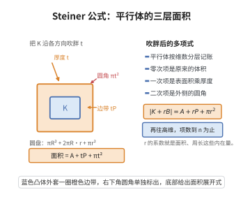

# Steiner 公式

> **一句话大白话**：把凸体沿各方向"吹胖"半径 $r$ 得到平行体，它的体积是一个关于 $r$ 的、次数不超过维数 $n$ 的多项式——胖出来的体积可以按"顶点、棱、面、内部"分层精确记账。

> **小例子**：平面上半径 $R$ 的圆盘以 $r$ 吹胖后是圆盘 $R+r$，面积 $A(r)=\pi R^2+2\pi R\,r+\pi r^2$，其中常数项是原面积、一次项是周长乘 $r$、二次项是"圆角"面积 $\pi r^2$。这正是 Steiner 公式在 $n=2$ 的形式。

## 一、定理介绍

> **前置依赖**：凸体与 Minkowski 和、支撑函数与外法锥、Brunn-Minkowski 不等式、主曲率（概念）、Hausdorff 距离（概念）。

Steiner 公式由 Jakob Steiner 于 1840 年代在研究凸体的平行体（parallel body）时提出，它把"凸体沿所有方向扩张 $r$ 后的体积"展开成关于 $r$ 的多项式，系数由凸体的内在几何量（称为内在体积或 quermassintegrale）给出。提出它的动机是把体积这种整体量分解为"分层贡献"：顶点个数、棱的积分、面的面积、内部体积各贡献一项。该公式是凸几何的基石：它直接蕴含 Brunn-Minkowski 不等式（由多项式的对数凹性）、等周不等式（比较一次项与零次项），并把表面积、平均曲率积分等局部量统一为"内在体积"这一族刚体运动不变的量。对于光滑凸体，系数的积分式表达把几何与分析联系起来。

## 几何直观

图意在说明：凸体向外吹胖 t 后，新增面积可拆成边带 tP 与圆角 πt² 两部分。

## 二、原理思路

1. 先在"光滑严格凸体"情形做局部分析：外法向映射 $\nu:\partial K\to S^{n-1}$ 是微分同胚，用映射 $\Phi(x,t)=x+t\nu(x)$ 把平行体"铺开"成 $\partial K\times[0,r]$，其 Jacobian 恰为 $\prod_{i=1}^{n-1}(1+t\kappa_i)$，$\kappa_i$ 为主曲率。
2. 把该 Jacobian 展开成 $t$ 的多项式，对 $\partial K$ 积分，即得体积是关于 $r$ 的多项式，系数是主曲率初等对称函数的积分。
3. 由 Hausdorff 度量下的逼近，把结论从光滑凸体推广到任意凸体；再定义内在体积使公式具有统一形式。

## 三、定理的严格表述

设 $K\subset\mathbb{R}^n$ 为紧凸体，$B^n$ 为单位球，$\omega_j=|B^j|$ 为 $j$ 维单位球的体积，$K_r=K+rB^n=\{x:\operatorname{dist}(x,K)\le r\}$ 为平行体。则存在只依赖于 $K$ 的非负数 $V_0(K),\dots,V_n(K)$（称为 $K$ 的内在体积，$V_k$ 是 $k$ 维量纲、刚体运动不变的连续量），使得对一切 $r\ge0$，
$$
V_n(K_r)=\sum_{k=0}^{n}\omega_{n-k}\,V_k(K)\,r^{n-k}.
$$
特别地 $V_0(K)=1$、$V_n(K)=|K|$、$V_{n-1}(K)=\frac12 S(K)$（$S(K)$ 为表面积），且 $V_n(K_r)$ 是 $r$ 的次数不超过 $n$ 的多项式。当 $K$ 有 $C^2$ 边界时，
$$
V_n(K_r)=|K|+\int_0^r\!\!\int_{\partial K}\prod_{i=1}^{n-1}\big(1+t\,\kappa_i(x)\big)\,dS(x)\,dt,
$$
其中 $\kappa_1,\dots,\kappa_{n-1}$ 是边界关于外法向的主曲率。

## 四、证明过程

**证明（光滑凸体情形）：**

**步骤 1：外法向映射与平行体的铺开。** 设 $K$ 是 $C^2$ 边界且严格凸的紧凸体。定义
$$
\Phi:\partial K\times[0,r]\to\overline{K_r\setminus K},\qquad \Phi(x,t)=x+t\,\nu(x),
$$
其中 $\nu(x)$ 是 $x$ 处的外单位法向。由凸性与严格凸性，$\Phi$ 是双射（$\overline{K_r\setminus K}$ 的每个点唯一表示为"最近边界点 + 法向高度"）。

**步骤 2：计算 Jacobian。** 取 $\partial K$ 上一点，$e_1,\dots,e_{n-1}$ 为主方向（$d\nu(e_i)=-\kappa_i e_i$，主曲率取外法向符号）。则
$$
d\Phi(e_i)=e_i+t\,d\nu(e_i)=(1+t\kappa_i)e_i,\qquad d\Phi(\partial_t)=\nu(x),
$$
且 $\nu\perp e_i$。故 $d\Phi$ 在正交基下的矩阵对角块为 $\operatorname{diag}(1+t\kappa_1,\dots,1+t\kappa_{n-1},1)$，于是
$$
|\det d\Phi(x,t)|=\prod_{i=1}^{n-1}\big(1+t\,\kappa_i(x)\big).
$$
$\Phi$ 是微分同胚且定向合适时行列式非负（$r$ 小于边界的最小曲率半径）。于是体积元
$$
dy=\Big(\prod_{i=1}^{n-1}(1+t\kappa_i)\Big)\,dS(x)\,dt.
$$

**步骤 3：积分得多项式。** 对 $t$ 从 $0$ 到 $r$、对 $x$ 在 $\partial K$ 上积分：
$$
V_n(K_r)=|K|+\int_0^r\!\!\int_{\partial K}\prod_{i=1}^{n-1}\big(1+t\,\kappa_i\big)\,dS\,dt.
$$
把被积函数按 $t$ 展开，令 $e_j(\kappa)$ 为 $\kappa_1,\dots,\kappa_{n-1}$ 的第 $j$ 个初等对称函数：
$$
\prod_{i=1}^{n-1}(1+t\kappa_i)=\sum_{j=0}^{n-1}e_j(\kappa)\,t^{j},\qquad e_0=1,\ e_1=\sum_i\kappa_i.
$$
代回并对 $t$ 逐项积分，记 $\sigma_j(K)=\int_{\partial K}e_j(\kappa)\,dS$（$\sigma_0=S(K)$ 为表面积），得
$$
V_n(K_r)=|K|+\sum_{j=0}^{n-1}\frac{\sigma_j(K)}{j+1}\,r^{j+1}.
$$
这已是关于 $r$ 的多项式，次数不超过 $n$，且各项系数只依赖 $K$ 的边界曲率积分。

**步骤 4：识别内在体积。** 定义（对光滑凸体）$V_k(K)$ 使得 $\omega_{n-k}V_k(K)$ 等于上式中 $r^{n-k}$ 的系数。例如 $r^n$ 的系数为 $\frac{\sigma_{n-1}}{n}$，而 $\omega_0V_n=|K|$、$\omega_1V_{n-1}=2V_{n-1}=\sigma_0=S(K)$ 与 $|K|,\ S(K)$ 的已知展开一致。特别地由 $\sigma_0=S(K)$ 得 $V_{n-1}(K)=\frac12 S(K)$。

**步骤 5：逼近推广到一般凸体。** 任意紧凸体 $K$ 可被一列 $C^2$ 严格凸体 $K^{(m)}$ 在 Hausdorff 距离下逼近，且 $K^{(m)}\to K$ 时 $|K^{(m)}|\to|K|$、$S(K^{(m)})\to S(K)$、各 $\sigma_j(K^{(m)})\to\sigma_j(K)$（曲率测度的弱收敛）。由于多项式系数连续依赖这些量，取极限即得对任意凸体的 Steiner 公式，内在体积由相应系数的极限定义并保持刚体运动不变、单调、连续。$\square$

## 五、应用与意义

- 由 Steiner 公式的多项式结构可直接推出 Brunn-Minkowski 不等式：$|K+rB|^{1/n}$ 关于 $r$ 凸，从而 $|A+B|^{1/n}\ge|A|^{1/n}+|B|^{1/n}$。
- 比较零次与一次项得到等周不等式与更精细的 Alexandrov–Fenchel 不等式族的入门版本。
- 内在体积与曲率测度是积分几何、随机几何（Buffon 针、Crofton 公式）与凸体体积逼近算法的核心工具。
- 在凸优化与机器学习中，Steiner 公式用于体积极小化、Wulff 构造与球面填充估计。
- Steiner 公式推广到内蕴空间即 Weyl 管体积公式（tube formula），连接几何与谱几何。

## 课堂问答

**老师**：Steiner 公式把平行体的体积写成了什么？

**学生**：$V_n(K_r)=\sum_{k=0}^{n}\omega_{n-k}V_k(K)\,r^{n-k}$，其中 $K_r=K+rB^n$ 是平行体，$V_0,\dots,V_n$ 是内在体积。即把凸体沿所有方向吹胖 $r$ 后的体积是关于 $r$ 的次数不超过 $n$ 的**多项式**，系数只依赖 $K$。

**老师（追问）**：为什么展开后恰是多项式？Jacobian $\prod_i(1+t\kappa_i)$ 是怎么来的？

**学生**：用外法向映射 $\Phi(x,t)=x+t\nu(x)$ 把平行体铺开成 $\partial K\times[0,r]$。在主方向 $e_i$ 上有 $d\Phi(e_i)=(1+t\kappa_i)e_i$，法向分量 $d\Phi(\partial_t)=\nu$ 与 $e_i$ 正交，故 $|\det d\Phi|=\prod_{i=1}^{n-1}(1+t\kappa_i)$，$\kappa_i$ 是主曲率。把乘积按 $t$ 展开得初等对称函数 $e_j(\kappa)$，逐项对 $t$ 积分即得关于 $r$ 的多项式。常见误区是把 $\kappa_i$ 符号搞错：按外法向有 $d\nu(e_i)=-\kappa_ie_i$，在 $r$ 小于最小曲率半径时行列式非负。

**老师（拓展）**：Steiner 公式怎样一举给出 Brunn-Minkowski 与等周不等式？

**学生**：由多项式结构可证 $|K+rB^n|^{1/n}$ 关于 $r$ 是**凸**函数，归一化后即得 $|A+B|^{1/n}\ge|A|^{1/n}+|B|^{1/n}$，这就是 Brunn-Minkowski。比较零次项（体积）与一次项（$V_{n-1}=\frac12 S$，即表面积）并对 $r$ 求导，即得等周不等式 $n\omega_n^{1/n}|E|^{(n-1)/n}\le P(E)$。此外 $V_0=1$、$V_n=|K|$，一整族内在体积把体积、表面积与平均曲率积分统一为刚体运动不变量；推广到内蕴空间即 Weyl 管体积公式。

## 相关条目

- [Brunn-Minkowski 不等式](./Brunn-Minkowski不等式.md)：由 Steiner 公式的多项式对数凹性可推出本不等式。
- [等周不等式](./等周不等式.md)：比较 Steiner 公式的一、零次项即得等周不等式。
- [Sobolev 不等式](./Sobolev不等式.md)：等周与 Sobolev 家族的另一成员，与 Steiner 公式共同支撑几何不等式。
- [Gauss-Bonnet 定理（全局）](../第33级-微分几何/Gauss-Bonnet定理全局.md)：曲率积分与拓扑的关系，解释 $\sigma_{n-1}$ 的拓扑含义。
- [第二基本形式](../第33级-微分几何/第二基本形式.md)：边界主曲率与形状算子的定义来源。
