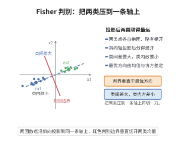

# Fisher 线性判别的最优性

> **一句话大白话**：要把两类样本投到一维直线上然后分开，最佳投影方向是沿 $\boldsymbol{\Sigma}^{-1}(\boldsymbol{\mu}_1-\boldsymbol{\mu}_2)$——它最大化"类间距离平方除以类内方差"这一比值，让两类中心尽量分开、同时类内尽量紧。
>
> **小例子**：判别健康人与病人两组高维化验指标，Fisher 判别找到一个投影方向，使健康人在该方向上的投影尽量集中在一处、病人尽量集中在另一处，两类中心的间距与平均散布的比值最大化，从而分类边界最清晰。

## 一、定理介绍

> **前置依赖**：Cauchy-Schwarz 不等式、协方差矩阵、Mahalanobis 距离、二次型。

Fisher 线性判别是经典监督分类方法。该定理考虑均值分别为 $\boldsymbol{\mu}_1,\boldsymbol{\mu}_2$、共享协方差矩阵 $\boldsymbol{\Sigma}$ 的两类，断言在使 Fisher 比率最大化（等价于 Mahalanobis 意义下类间距离对类内方差的比值最大）的方向为 $\boldsymbol{a}\propto\boldsymbol{\Sigma}^{-1}(\boldsymbol{\mu}_1-\boldsymbol{\mu}_2)$。它提供了"向一维投影后线性可分离性最优"的严格刻画。

## 几何直观

图意在说明：Fisher 判别找的方向使投影后类间距离最大而类内散布最小，边界就取在两类投影均值的中点。

## 二、原理思路

Fisher 比率 $J(\boldsymbol{a})=\frac{(\boldsymbol{a}^\top(\boldsymbol{\mu}_1-\boldsymbol{\mu}_2))^2}{\boldsymbol{a}^\top\boldsymbol{\Sigma}\boldsymbol{a}}$ 对 $\boldsymbol{a}$ 的缩放不变，故可在约束 $\boldsymbol{a}^\top\boldsymbol{\Sigma}\boldsymbol{a}=1$ 下最大化分子。运用在 Mahalanobis 内积 $\langle\boldsymbol{u},\boldsymbol{v}\rangle_{\boldsymbol{\Sigma}}=\boldsymbol{u}^\top\boldsymbol{\Sigma}\boldsymbol{v}$ 下的 Cauchy-Schwarz 不等式，可将分子界定为 $\boldsymbol{d}^\top\boldsymbol{\Sigma}^{-1}\boldsymbol{d}$（$\boldsymbol{d}=\boldsymbol{\mu}_1-\boldsymbol{\mu}_2$），等号当且仅当 $\boldsymbol{a}$ 与 $\boldsymbol{\Sigma}^{-1}\boldsymbol{d}$ 在该内积下共线时成立。

## 三、定理的严格表述

设类 $\pi_1,\pi_2$ 的均值向量为 $\boldsymbol{\mu}_1,\boldsymbol{\mu}_2$，共同协方差矩阵为 $\boldsymbol{\Sigma}$。Fisher 线性判别选择投影方向 $\boldsymbol{a}$ 最大化：
$$
J(\boldsymbol{a})=\frac{(\boldsymbol{a}^\top(\boldsymbol{\mu}_1-\boldsymbol{\mu}_2))^2}{\boldsymbol{a}^\top\boldsymbol{\Sigma}\boldsymbol{a}}.
$$
则最优投影方向为 $\boldsymbol{a}\propto\boldsymbol{\Sigma}^{-1}(\boldsymbol{\mu}_1-\boldsymbol{\mu}_2)$，其最大值为 Mahalanobis 距离平方 $\Delta^2=\boldsymbol{d}^\top\boldsymbol{\Sigma}^{-1}\boldsymbol{d}$（$\boldsymbol{d}=\boldsymbol{\mu}_1-\boldsymbol{\mu}_2$）。

## 四、证明过程

**证明：**

**步骤 1：问题表述。** 记 $\boldsymbol{d}=\boldsymbol{\mu}_1-\boldsymbol{\mu}_2$，最大化等价于求解 $\max_{\boldsymbol{a}\neq0}\frac{(\boldsymbol{a}^\top\boldsymbol{d})^2}{\boldsymbol{a}^\top\boldsymbol{\Sigma}\boldsymbol{a}}$。

**步骤 2：Cauchy-Schwarz 不等式。** 因比率对缩放不变，施加约束 $\boldsymbol{a}^\top\boldsymbol{\Sigma}\boldsymbol{a}=1$。定义内积 $\langle\boldsymbol{u},\boldsymbol{v}\rangle_{\boldsymbol{\Sigma}}=\boldsymbol{u}^\top\boldsymbol{\Sigma}\boldsymbol{v}$，则约束为 $\|\boldsymbol{a}\|_{\boldsymbol{\Sigma}}=1$。由 Cauchy-Schwarz 不等式：
$$
(\boldsymbol{a}^\top\boldsymbol{d})^2=(\langle\boldsymbol{a},\boldsymbol{\Sigma}^{-1}\boldsymbol{d}\rangle_{\boldsymbol{\Sigma}})^2\le\|\boldsymbol{a}\|_{\boldsymbol{\Sigma}}^2\|\boldsymbol{\Sigma}^{-1}\boldsymbol{d}\|_{\boldsymbol{\Sigma}}^2=\boldsymbol{d}^\top\boldsymbol{\Sigma}^{-1}\boldsymbol{d}.
$$

**步骤 3：确定最优解。** 等号成立当且仅当 $\boldsymbol{a}$ 与 $\boldsymbol{\Sigma}^{-1}\boldsymbol{d}$ 在 $\boldsymbol{\Sigma}$-内积下共线，即 $\boldsymbol{a}\propto\boldsymbol{\Sigma}^{-1}(\boldsymbol{\mu}_1-\boldsymbol{\mu}_2)$。此时 $J_{\max}=\Delta^2$，即 Mahalanobis 距离的平方。$\square$

## 五、应用与意义

Fisher 线性判别是线性判别分析（LDA）的理论核心。当两类正态且共享协方差时，其判别规则与 Bayes 最优分类器一致，故该方向既是最大化类间可分性的方向，也是最接近最优分类的方向。在样本中，$\boldsymbol{\mu}_1,\boldsymbol{\mu}_2,\boldsymbol{\Sigma}$ 以其估计代入，算出判别系数并用于分类。LDA 广泛用于生物、医学、金融与机器学习中的分类与特征筛选。其思想可推广至多分类情形及"二次判别"（不共享协方差），是理解分类边界几何与降维可分性的基础工具。

## 课堂问答

**老师**：两类共享协方差矩阵，怎样找最优的一维投影方向？

**学生**：先给结论：最大化 Fisher 比率 $J(\boldsymbol{a})=\frac{(\boldsymbol{a}^\top\boldsymbol{d})^2}{\boldsymbol{a}^\top\boldsymbol{\Sigma}\boldsymbol{a}}$（$\boldsymbol{d}=\boldsymbol{\mu}_1-\boldsymbol{\mu}_2$）的方向是 $\boldsymbol{a}\propto\boldsymbol{\Sigma}^{-1}\boldsymbol{d}$，最大值为 Mahalanobis 距离平方 $\Delta^2=\boldsymbol{d}^\top\boldsymbol{\Sigma}^{-1}\boldsymbol{d}$。

**老师（追问）**：为什么不是 $\boldsymbol{a}\propto\boldsymbol{d}$？$\boldsymbol{\Sigma}^{-1}$ 到底起什么作用？

**学生**：要按类内散布对距离加权。在 $\boldsymbol{\Sigma}$-内积 $\langle\boldsymbol{u},\boldsymbol{v}\rangle_\Sigma=\boldsymbol{u}^\top\boldsymbol{\Sigma}\boldsymbol{v}$ 下用 Cauchy-Schwarz，$(\boldsymbol{a}^\top\boldsymbol{d})^2=\langle\boldsymbol{a},\boldsymbol{\Sigma}^{-1}\boldsymbol{d}\rangle_\Sigma^2\le\|\boldsymbol{a}\|_\Sigma^2\|\boldsymbol{\Sigma}^{-1}\boldsymbol{d}\|_\Sigma^2=\boldsymbol{d}^\top\boldsymbol{\Sigma}^{-1}\boldsymbol{d}$，等号当 $\boldsymbol{a}$ 与 $\boldsymbol{\Sigma}^{-1}\boldsymbol{d}$ 共线。只有 $\boldsymbol{\Sigma}=\boldsymbol{I}$ 时才退化为 $\boldsymbol{a}\propto\boldsymbol{d}$；忽略 $\boldsymbol{\Sigma}^{-1}$ 会让方差大的坐标方向误导投影。

**老师（拓展）**：这个方向和 Bayes 最优分类器是什么关系？

**学生**：两类正态、等协方差时，Fisher 方向正是 Bayes 判别边界 $\boldsymbol{a}^\top\boldsymbol{x}=c$ 的法向，故它同时"最可分"又"最接近最优分类"。多分类要解类间/类内散布矩阵的广义特征问题，协方差不等时判别边界升级为二次曲面（QDA）。
