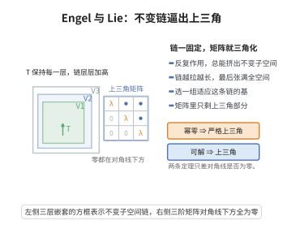

# Engel 定理与 Lie 定理

> **一句话大白话**：若李代数里每个元素 $\operatorname{ad}(X)$ 都幂零，则整个李代数幂零（Engel）；若李代数可解，则任何表示里都能找到公共特征向量，进而所有元素可同时化成上三角矩阵（Lie）。
>
> **小例子**：上三角矩阵构成的李代数（对角线上方），每个内自同态 $\operatorname{ad}$ 都幂零，这就是幂零李代数；而可解李代数如"严格上三角+对角"类，经过合适基变换都能表示为上三角矩阵——这正是 Schur 上三角化定理的代数版本。

## 一、定理介绍

> **前置依赖**：李代数的定义、幂零李代数与降中心列、幂零线性变换、可解李代数、数学归纳法原理。

Engel 定理刻画幂零李代数：所有 $\operatorname{ad}(X)$ 幂零等价于李代数幂零。Lie 定理刻画可解李代数在有限维表示中的行为：其作用可同时上三角化。两条定理是李代数结构理论（Jacobson 根基、可解性判据）与表示论的上三角结构定理的基础。

## 几何直观

图意在说明：反复作用总能挤出不变子空间，把这条链取作基后，矩阵只剩上三角部分。

## 二、原理思路

Engel 定理的充分性通过归纳：先证明存在非零中心元素 $Z$（借助最大真子代数诱导的表示与幂零线性变换的公共零化向量引理），再对 $\mathfrak{g}/\mathbb{C}Z$ 归纳。Lie 定理利用可解李代数的 $[\mathfrak{g},\mathfrak{g}]$ 幂零（由 Engel 定理），配合余维数 $1$ 子代数的归纳，先找公共特征向量，再逐步构造上三角基。

## 三、定理的严格表述

**Engel 定理：** 有限维李代数 $\mathfrak{g}$ 是幂零的当且仅当对每个 $X\in\mathfrak{g}$，$\operatorname{ad}(X)$ 是幂零线性变换。

**Lie 定理：** 设 $\mathfrak{g}$ 是特征零代数闭域上的可解李代数，$V$ 是 $\mathfrak{g}$ 的有限维表示。则存在 $V$ 的一组基，使每个 $\rho(X)$（$X\in\mathfrak{g}$）在该基下是上三角矩阵。

## 四、证明过程

**Engel 定理的证明：**

**步骤 1：必要性。** 若 $\mathfrak{g}$ 幂零，有中心降维列 $\mathfrak{g}\supset\mathfrak{g}^1\supset\cdots\supset\mathfrak{g}^k=0$（$\mathfrak{g}^i=[\mathfrak{g},\mathfrak{g}^{i-1}]$），则 $\operatorname{ad}(X)^n(Y)\in\mathfrak{g}^n$，$n$ 足够大时为零。

**步骤 2：充分性。** 令每个 $\operatorname{ad}(X)$ 幂零。
- **2a：找非零中心元素。** 设 $\mathfrak{h}$ 为最大真子代数，考虑其在 $\mathfrak{g}/\mathfrak{h}$ 上的表示 $\rho(H)=\operatorname{ad}(H)|_{\mathfrak{g}/\mathfrak{h}}$，每个 $\rho(H)$ 幂零，故存在非零 $v$ 被所有 $\rho(H)$ 零化；取 $X$ 代表 $v$，则 $[\mathfrak{h},X]\subset\mathfrak{h}$ 且 $X\notin\mathfrak{h}$，由极大性 $\mathfrak{g}=\mathfrak{h}+\mathbb{C}X$。
- **2b：归纳。** 对非零 $Z\in\mathfrak{z}(\mathfrak{g})$，由归纳假设 $\mathfrak{g}/\mathbb{C}Z$ 幂零，故降维列有限步落入 $\mathbb{C}Z$，从而 $\mathfrak{g}$ 幂零。$\square$

**Lie 定理的证明：**

**步骤 1：归结为公共特征向量。** 由归纳，只需证明存在非零 $v$ 是全体元素的公共特征向量。

**步骤 2：利用可解性。** $\mathfrak{g}$ 可解推出 $[\mathfrak{g},\mathfrak{g}]$ 幂零，由 Engel 定理存在非零 $v$ 被 $[\mathfrak{g},\mathfrak{g}]$ 零化。

**步骤 3：构造公共特征向量。** 取余维数 $1$ 子代数 $\mathfrak{h}$（可解李代数总存在），由归纳存在 $v$ 为 $\mathfrak{h}$ 的公共特征向量。取 $X\in\mathfrak{g}\setminus\mathfrak{h}$，则 $\mathfrak{g}=\mathfrak{h}+\mathbb{C}X$；由 $v,Xv,X^2v,\dots$ 张成的 $W$ 是 $\mathfrak{g}$ 不变子空间，且 $X$ 在 $W$ 上可上三角化，故有特征向量 $w$。

**步骤 4：归纳完成。** $w$ 同时是全体元素的公共特征向量，归纳得 $\mathfrak{g}$ 的表示可上三角化。$\square$

## 五、应用与意义

Engel 与 Lie 定理是李代数结构理论和表示论的基石：Engel 定理用于刻画幂零性、证明 Lie 定理的可解三角化；Lie 定理给出可解李代数表示的上三角结构，是群表示的三角化定理（如酉群可约表示的上三角嵌入）的代数版本。它们在 Lie 根与 Killing 形式理论、Borel 子代数、Lie 定理与谱理论中反复出现，也为有限维群表示中 Jordan 块结构的研究提供框架，是连接抽象代数与表示几何的桥梁。

## 课堂问答

**老师**：Engel 定理与 Lie 定理各说了什么？

**学生**：Engel：有限维李代数 $\mathfrak{g}$ 幂零当且仅当每个 $\operatorname{ad}(X)$ 都是幂零线性变换。Lie：特征 $0$ 代数闭域上的可解李代数，其任何有限维表示都能在一组基下同时上三角化。

**老师（追问）**：Engel 的充分性怎么找到非零中心元？

**学生**：取最大真子代数 $\mathfrak{h}$，考虑它在 $\mathfrak{g}/\mathfrak{h}$ 上的表示 $\rho(H)=\operatorname{ad}(H)$，每个 $\rho(H)$ 幂零，故由幂零线性变换的公共零化向量引理存在非零 $v$ 被全体 $\rho(H)$ 零化。取其代表 $X\notin\mathfrak{h}$，则 $[\mathfrak{h},X]\subset\mathfrak{h}$，由 $\mathfrak{h}$ 极大得 $\mathfrak{g}=\mathfrak{h}+\mathbb{C}X$；再对 $\mathfrak{g}/\mathbb{C}Z$ 归纳并检查降中心列，得到 $\mathfrak{g}$ 幂零。

**老师（拓展）**：Lie 定理如何借助 Engel？

**学生**：$\mathfrak{g}$ 可解推出 $[\mathfrak{g},\mathfrak{g}]$ 幂零，对 $[\mathfrak{g},\mathfrak{g}]$ 用 Engel 定理找到被其零化的非零 $v$。再取余维 $1$ 子代数 $\mathfrak{h}$ 做归纳，得到公共特征向量 $w$；由 $v,Xv,X^2v,\dots$ 张成的不变子空间上 $X$ 可上三角化，逐步拼出整体上三角基。它是 Schur 上三角化定理的代数版本。
