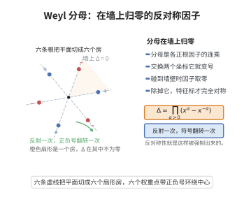

# Weyl 分母公式

> **一句话大白话**：Weyl 群作用下"带符号求和"的那个交错和，可以因式分解成所有正根对应因子的乘积——著名的分母 $\prod(e^{\alpha/2}-e^{-\alpha/2})$ 与交错和 $\sum_w\det(w)e^{w\rho}$ 是同一个东西。

> **小例子**：$\mathfrak{sl}_2$ 只有一个正根 $\alpha$，$\rho=\alpha/2$，Weyl 群 $W=\{1,s\}$。左边 $\varepsilon(1)e^{\alpha/2}+\varepsilon(s)e^{-\alpha/2}=e^{\alpha/2}-e^{-\alpha/2}$，右边就是 $e^{\alpha/2}-e^{-\alpha/2}$，公式平凡成立；在 $\mathfrak{sl}_3$ 中它给出 $e^{\rho}\prod_{\alpha>0}(1-e^{-\alpha})$ 的因式分解。

## 一、定理介绍

> **前置依赖**：根系与正根、Weyl 群与反射、形式指数与特征标、交错性（概念）、Weyl 特征标公式。

Weyl 分母公式（Weyl denominator formula）是 Hermann Weyl 在 1925 年研究紧半单李群表示的特征标公式时得到的关键恒等式。它把 Weyl 群上带符号的指数和（交错和）写成所有正根之积：
$$
\sum_{w\in W}\varepsilon(w)e^{w(\rho)}=\prod_{\alpha\in\Phi^+}\big(e^{\alpha/2}-e^{-\alpha/2}\big).
$$
该式得名于它正是 Weyl 特征标公式的"分母"。提出它的动机是给不可约表示的特征标找一个显式的、可计算的闭式：分子是同类的交错和，分母则被这条公式化为一组乘积，从而特征标成为"交错和之比"。它在表示论、对称函数（Schur 函数的 Jacobi-Trudi 型公式）、Kac-Moody 代数与 Macdonald 恒等式族中都有深远影响，是 Weyl 特征标公式与 Weyl 维数公式的直接来源。

## 几何直观

图意在说明：分母是各正根因子之积，穿过任何一面墙都会让某个因子为零，越过墙壁则整体变号。

## 二、原理思路

1. 交错性：证明 $F=\sum_{w}\varepsilon(w)e^{w\rho}$ 在 Weyl 群作用下满足 $w(F)=\varepsilon(w)F$，故它是交错（反对称）整式。
2. 整除性：对每个正根 $\alpha$，由简单反射 $s_\alpha$ 的反称性可推出 $F$ 被因子 $(e^{\alpha/2}-e^{-\alpha/2})$ 整除。
3. 比较主项定常数：右端乘积也交错、且最高项同为 $e^{\rho}$；交错整式环由该乘积与 Weyl 不变式自由生成，故 $F$ 与乘积只差一个 Weyl 不变因子，比较首项系数得该因子为 $1$。

## 三、定理的严格表述

设 $\mathfrak{g}$ 是秩 $r$ 的复半单李代数，$\Phi$ 为其根系，$\Phi^+$ 为取定的正根系，$W$ 为 Weyl 群，$\varepsilon(w)=\det(w)$ 为符号，$\rho=\frac12\sum_{\alpha\in\Phi^+}\alpha$。则作为形式指数（特征标）的恒等式成立：
$$
\sum_{w\in W}\varepsilon(w)\,e^{w(\rho)}=\prod_{\alpha\in\Phi^+}\big(e^{\alpha/2}-e^{-\alpha/2}\big).
$$
等价地
$$
\prod_{\alpha\in\Phi^+}\big(e^{\alpha/2}-e^{-\alpha/2}\big)=e^{\rho}\prod_{\alpha\in\Phi^+}\big(1-e^{-\alpha}\big).
$$

## 四、证明过程

**证明：**

**步骤 1：$F$ 是交错的。** 记 $F=\sum_{w\in W}\varepsilon(w)e^{w(\rho)}$。对任意 $v\in W$，
$$
v(F)=\sum_{w\in W}\varepsilon(w)e^{vw(\rho)}=\sum_{w'\in W}\varepsilon(v^{-1}w')e^{w'(\rho)}=\varepsilon(v)\sum_{w'\in W}\varepsilon(w')e^{w'(\rho)}=\varepsilon(v)F,
$$
其中用了 $w\mapsto vw$ 是 $W$ 的置换与 $\varepsilon(v^{-1}w')=\varepsilon(v)\varepsilon(w')$。故 $F$ 是 $W$-交错的。

**步骤 2：整除性。** 只需对简单反射 $s=s_{\alpha_i}$（$\alpha_i\in\Phi^+$ 单根）证明 $s(F)=-F$（由步骤 1 取 $v=s$）。由于 $s$ 在权空间上的作用为 $s(\lambda)=\lambda-\langle\lambda,\alpha_i^\vee\rangle\alpha_i$，把 $F$ 按 $e^{\alpha_i}$ 的幂整理成 $F=\sum_{k\in\mathbb{Z}}c_k\,e^{k\alpha_i}$，则由 $s(F)=-F$ 得 $c_k=-c_{-k}$，故 $F$ 的每个单项都以"正负配对"出现，特别地 $F$ 被 $(e^{\alpha_i/2}-e^{-\alpha_i/2})$ 整除（把配对 $c_k(e^{k\alpha_i}-e^{-k\alpha_i})$ 提出因子，或用 $k=1$ 的最低幂次论证）。因各 $(e^{\alpha/2}-e^{-\alpha/2})$（$\alpha\in\Phi^+$）两两互素，$F$ 被它们的乘积整除。

**步骤 3：主项比较。** 展开 $F$ 的项。对 $w\in W$，$w(\rho)=\rho-\sum_{\alpha\in\Phi^+,\,w^{-1}\alpha<0}\alpha$，故 $w(\rho)\le\rho$（在正根锥的支配序下），等号仅当 $w^{-1}\Phi^+=\Phi^+$ 即 $w=e$。因此 $F$ 的最高项（关于支配序）为 $e^{\rho}$，系数 $\varepsilon(e)=1$。

**步骤 4：右端乘积的主项。** 右端 $\prod_{\alpha\in\Phi^+}(e^{\alpha/2}-e^{-\alpha/2})$ 的最高项为 $\prod_{\alpha\in\Phi^+}e^{\alpha/2}=e^{\sum_{\alpha>0}\alpha/2}=e^{\rho}$，系数为 $1$。它与 $F$ 同为 $W$-交错。

**步骤 5：由交错环结构确定等式。** $W$-交错的形式指数构成自由 $\mathbb{Z}[e^{\pm\alpha_1},\dots,e^{\pm\alpha_r}]^{W}$-模，基可取为 $\prod_{\alpha\in\Phi^+}(e^{\alpha/2}-e^{-\alpha/2})$。因此存在 $W$-不变的形式指数 $C$ 使
$$
F=C\cdot\prod_{\alpha\in\Phi^+}\big(e^{\alpha/2}-e^{-\alpha/2}\big).
$$
由步骤 3–4，两边最高项 $e^{\rho}$ 的系数都为 $1$，故 $C=1$。引理得证。$\square$

## 五、应用与意义

- 它把 Weyl 特征标公式的分母写成乘积形式，直接给出分子/分母均可计算的特征标闭式。
- 令 $e^{\alpha}\to1$（形式上取单位元的极限），由因子 $e^{\alpha/2}-e^{-\alpha/2}\to\alpha$ 与 $e^{w\rho}\to1$，得 Weyl 维数公式 $\dim V(\lambda)=\prod_{\alpha>0}\frac{\langle\lambda+\rho,\alpha\rangle}{\langle\rho,\alpha\rangle}$。
- 在对称函数理论中，它与 Schur 函数的 Jacobi-Trudi 型公式、Weyl 特征标公式（Schur 多项式）相互等价。
- 它是 Kac-Moody 代数、Macdonald 恒等式与 Weyl-Kac 特征标公式的原型，也出现在模形式（Dedekind $\eta$ 函数、Jacobi 三重积）中。
- 与 Weyl 积分公式配合，是紧李群特征标正交性与调和分析的代数基础。

## 课堂问答

**老师**：把 Weyl 分母公式写给我看。

**学生**：作为形式指数恒等式，

$$
\sum_{w\in W}\varepsilon(w)e^{w(\rho)}=\prod_{\alpha\in\Phi^+}\big(e^{\alpha/2}-e^{-\alpha/2}\big)=e^{\rho}\prod_{\alpha\in\Phi^+}\big(1-e^{-\alpha}\big),
$$

其中 $\rho=\frac12\sum_{\alpha>0}\alpha$，$\varepsilon(w)$ 是符号。

**老师（追问）**：怎么证明交错和正好因式分解成这些因子？

**学生**：三步。其一，$F=\sum_w\varepsilon(w)e^{w\rho}$ 是 $W$-交错的：由 $w\mapsto vw$ 是置换及 $\varepsilon(v^{-1}w')=\varepsilon(v)\varepsilon(w')$ 得 $v(F)=\varepsilon(v)F$。其二，取简单反射 $s=s_{\alpha_i}$，把 $F$ 按 $e^{\alpha_i}$ 的幂整理后 $s(F)=-F$ 迫使系数 $c_k=-c_{-k}$，故每个因子 $e^{\alpha/2}-e^{-\alpha/2}$ 整除 $F$，正根因子两两互素故其乘积整除 $F$。其三，比较支配序最高项 $e^{\rho}$：两边系数均为 $1$，交错形式整式环以该乘积为自由基，故商恒为 $1$。

**老师（拓展）**：令 $e^{\alpha}\to1$ 会得到什么？

**学生**：因子 $e^{\alpha/2}-e^{-\alpha/2}\to\alpha$，于是乘积趋于 $\prod_{\alpha>0}\alpha$，交错和趋于 $\prod_{\alpha>0}(\lambda+\rho,\alpha)$ 的同型表达式，直接得到 Weyl 维数公式 $\dim V(\lambda)=\prod_{\alpha>0}\frac{\langle\lambda+\rho,\alpha\rangle}{\langle\rho,\alpha\rangle}$。它同时是 Schur 函数恒等式、Kac-Moody 与 Macdonald 恒等式族的原型。

## 相关条目

- [Weyl 特征标公式](./Weyl特征标公式.md)：本公式正是其特征标公式的分母。
- [Weyl 积分公式](./Weyl积分公式.md)：其中被积的 $|\Delta|^2$ 由 Weyl 分母公式给出。
- [半单李代数的分类定理](./半单李代数的分类定理.md)：根系与 Weyl 群的来源，决定 $F$ 的结构。
- [Weyl 特征标公式（第38级-表示论）](../第38级-表示论/Weyl特征标公式.md)：其中含 Weyl 分母公式的等价形式，可交叉参考。
- [根系统与 Dynkin 图](../第39级-李群与李代数/根系统与Dynkin图.md)：正根、单根与 $\rho$ 的定义来源。
- [Weyl 群与 Weyl 室](../第39级-李群与李代数/Weyl群与Weyl室.md)：本公式中交错和的群作用与支配序。
