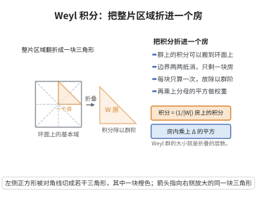

# Weyl 积分公式

> **一句话大白话**：在紧李群上对类函数求积分，可以只在一个极大环面上积分，但要乘上一个"体积权重" $|\Delta(t)|^2$ 来补偿"共轭会把环面铺开多少次"。

> **小例子**：$G=SU(2)$、$T=\{$对角 $\operatorname{diag}(e^{i\theta},e^{-i\theta})\}$、$W=\{\pm1\}$。Weyl 积分公式给出 $\int_{SU(2)}f\,dg=\frac{1}{2}\int_0^{2\pi}f(\theta)\,|e^{i\theta}-e^{-i\theta}|^2\frac{d\theta}{2\pi}$，权重 $|e^{i\theta}-e^{-i\theta}|^2=4\sin^2\theta$，与 $SU(2)$ 的显式 Haar 测度一致。

## 一、定理介绍

> **前置依赖**：紧李群与 Haar 测度、极大环面与极大环面定理、Weyl 群与反射、根空间分解、Weyl 分母公式。

Weyl 积分公式（Weyl integration formula）由 Hermann Weyl 于 1925–1926 年为研究紧李群的表示与特征标而建立。它断言：对紧连通李群 $G$ 上的中心（类）函数，群上的积分可以化为极大环面 $T$ 上的积分，并乘上 Jacobi 型权重 $|\Delta(t)|^2$，其中 $\Delta$ 是 Weyl 分母。提出它的动机是把不可约特征标的正交性（在 $L^2(G)$ 上）化为环面上的正交性（在 $L^2(T)$ 上），从而可以调用三角级数的正交性来证明 Weyl 特征标公式。它是紧李群调和分析、Peter-Weyl 定理与表示论中一切显式计算的基础，也是随机矩阵理论（Weyl 室的均匀测度、$\beta=2$ 系综）与对称空间积分公式的原型。

## 几何直观

图意在说明：群上的积分沿墙折叠后只剩一个基本房，重复的层数由 Weyl 群的阶数给出。

## 二、原理思路

1. 极大环面定理保证每个共轭类与 $T$ 相交，故 $G$ 在共轭下的像可由映射 $\phi:G/T\times T\to G$、$(gT,t)\mapsto gtg^{-1}$ 覆盖。
2. 计算 $\phi$ 的 Jacobi 行列式：把 $\mathfrak{g}$ 按 $\operatorname{Ad}(T)$ 分解为 $\mathfrak{t}\oplus\bigoplus_{\alpha>0}(\mathfrak{g}_\alpha\oplus\mathfrak{g}_{-\alpha})$，每个根平面贡献因子 $|e^{\alpha}(t)-1|^2$，乘起来得 $\prod_{\alpha>0}|e^{\alpha}(t)-1|^2$。
3. 把 Haar 测度按变量代换推前：由于 $\phi$ 在正则集上是 $|W|$ 重覆盖，积分中出现 $\frac{1}{|W|}$ 因子；由 Weyl 分母公式，$\prod_{\alpha>0}|e^{\alpha}(t)-1|^2=|\Delta(t)|^2$，公式得证。

## 三、定理的严格表述

设 $G$ 是紧连通李群，$\mathfrak{g}=\operatorname{Lie}G$ 的复化有根系 $\Phi$ 与正根系 $\Phi^+$，$T$ 是极大环面，$W=N_G(T)/T$ 是 Weyl 群，$dg$、$dt$ 分别为 $G$、$T$ 上的正规化 Haar 测度。设 $f$ 是连续类函数，即 $f(gtg^{-1})=f(t)$ 对一切 $g\in G$、$t\in T$ 成立。则
$$
\int_G f(g)\,dg=\frac{1}{|W|}\int_T f(t)\,\big|\Delta(t)\big|^2\,dt,
$$
其中 Weyl 分母与权重为
$$
\Delta(t)=\prod_{\alpha\in\Phi^+}\big(e^{\alpha/2}(t)-e^{-\alpha/2}(t)\big)=\sum_{w\in W}\varepsilon(w)e^{w(\rho)}(t),\qquad
\big|\Delta(t)\big|^2=\prod_{\alpha\in\Phi^+}\big|e^{\alpha}(t)-1\big|^2 .
$$

## 四、证明过程

**证明：**

**步骤 1：共轭映射。** 定义光滑映射
$$
\phi:G/T\times T\to G,\qquad \phi(gT,t)=g\,t\,g^{-1}.
$$
由极大环面定理，$\phi$ 是满射：$G$ 的每个元素都共轭于某个 $t\in T$。设 $T_{\mathrm{reg}}=\{t\in T:e^{\alpha}(t)\neq1\ \forall\alpha\in\Phi\}$ 为正则元集合，其在 $T$ 中稠密且余维数 $\ge1$ 的补集为零测集。

**步骤 2：$\phi$ 在正则点处是 $|W|$ 重局部微分同胚。** 若 $t\in T_{\mathrm{reg}}$，则 $gtg^{-1}=t$ 蕴含 $g\in N_G(T)$（正则元的中心化子就是 $T$）。于是 $\phi(gT,t)=\phi(g'T,t)$ 当且仅当 $g^{-1}g'\in N_G(T)$，即 $g'T=g'^{-1}\cdots$ 对应 $N_G(T)/T=W$ 的不同陪集。故 $\phi$ 在 $(eT,t)$（$t$ 正则）附近恰是 $|W|$ 重的，且 $\phi$ 把这些分支映满 $G$ 的正则点集。因此对类函数 $f$（在共轭下不变），
$$
\int_G f\,dg=\frac{1}{|W|}\int_{T_{\mathrm{reg}}}\int_{G/T}f(t)\,J(t)\,d(gT)\,dt,
$$
其中 $J(t)$ 是 $\phi$ 关于 $G/T$ 方向与 $T$ 方向的 Jacobi 因子（下两步骤计算）。

**步骤 3：计算 Jacobi 因子。** 在 $\mathfrak{g}$ 上取 $\operatorname{Ad}(G)$-不变内积，使 $\mathfrak{g}=\mathfrak{t}\oplus\bigoplus_{\alpha\in\Phi^+}(\mathfrak{g}_\alpha\oplus\mathfrak{g}_{-\alpha})$ 为正交直和。考察 $d\phi$ 在 $(eT,t)$：切空间 $T_{eT}(G/T)\cong\mathfrak{g}/\mathfrak{t}$，切空间 $T_tT\cong\mathfrak{t}$。对 $X\in\mathfrak{g}$ 与 $\xi\in\mathfrak{t}$，
$$
d\phi(X,\xi)=\operatorname{Ad}(t)X-X+\xi.
$$
在根空间 $\mathfrak{g}_\alpha$（实形式中每个正根对应一个二维实平面）上，$\operatorname{Ad}(t)-1$ 的作用特征值为 $e^{\alpha}(t)-1$ 与 $e^{-\alpha}(t)-1$，其复模长为 $|e^{\alpha}(t)-1|$，二维实 Jacobi 因子为 $|e^{\alpha}(t)-1|^2$。故
$$
J(t)=\prod_{\alpha\in\Phi^+}\big|e^{\alpha}(t)-1\big|^2.
$$

**步骤 4：用 Weyl 分母公式改写。** 由 Weyl 分母公式 $\Delta(t)=\sum_w\varepsilon(w)e^{w\rho}(t)=\prod_{\alpha>0}(e^{\alpha/2}-e^{-\alpha/2})$，取模长平方：
$$
\big|\Delta(t)\big|^2=\prod_{\alpha\in\Phi^+}\big|e^{\alpha/2}(t)-e^{-\alpha/2}(t)\big|^2.
$$
对 $t\in T$（幺正），$|e^{\alpha/2}(t)|=1$，故
$$
\big|e^{\alpha/2}-e^{-\alpha/2}\big|^2=\big|e^{-\alpha/2}\big|^2\big|e^{\alpha}-1\big|^2=\big|e^{\alpha}-1\big|^2.
$$
于是 $|\Delta(t)|^2=J(t)$。

**步骤 5：合并。** 把步骤 3–4 代入步骤 2，注意 $\int_{G/T}d(gT)=1$（正规化测度）与 $f$ 是类函数（故 $f(gtg^{-1})=f(t)$ 与 $gT$ 无关），得
$$
\int_G f\,dg=\frac{1}{|W|}\int_{T_{\mathrm{reg}}}f(t)\,\big|\Delta(t)\big|^2\,dt=\frac{1}{|W|}\int_T f(t)\,\big|\Delta(t)\big|^2\,dt,
$$
最后一步把 $T_{\mathrm{reg}}$ 换为 $T$：$T\setminus T_{\mathrm{reg}}$ 是零测集，且 $|\Delta|^2$ 在其上为零、$f$ 连续，积分值不变。$\square$

## 五、应用与意义

- 它是紧李群上把类函数积分化为环面积分的基本工具，直接支撑 Peter-Weyl 定理与特征标正交性。
- 由它可推出 Weyl 特征标公式：环面上三角函数的正交性使 $\langle\chi_\lambda,\chi_\mu\rangle=\delta_{\lambda\mu}$ 的验证变得直接。
- 在随机矩阵理论中，$|\Delta|^2$ 正是 $\beta=2$ 系综（GUE、CUE）的特征值联合密度中的 Vandermonde 因子，是 Selberg 积分与谱统计的起点。
- 在对称空间与 Lie 群上的调和分析中，它是 Harish-Chandra 积分公式、球函数理论的有限维原型。
- 在物理中，它与 Chern-Simons 理论、格点规范理论的配分函数积分（Weyl 积分）密切相关。

## 课堂问答

**老师**：紧群上类函数的积分能化到一个环面上算吗？

**学生**：能，公式为

$$
\int_G f(g)\,dg=\frac{1}{|W|}\int_T f(t)\,\big|\Delta(t)\big|^2\,dt,\qquad \big|\Delta(t)\big|^2=\prod_{\alpha\in\Phi^+}\big|e^{\alpha}(t)-1\big|^2.
$$

**老师（追问）**：权重 $|\Delta(t)|^2$ 与因子 $\frac1{|W|}$ 各自补偿什么？

**学生**：考虑覆盖映射 $\phi:G/T\times T\to G$、$(gT,t)\mapsto gtg^{-1}$。把 $\mathfrak{g}$ 按 $\operatorname{Ad}(T)$ 分解为 $\mathfrak{t}\oplus\bigoplus_{\alpha>0}(\mathfrak{g}_\alpha\oplus\mathfrak{g}_{-\alpha})$，根平面 $\mathfrak{g}_\alpha$ 上 $\operatorname{Ad}(t)-1$ 的实二维 Jacobi 因子为 $|e^\alpha(t)-1|^2$，相乘即 $J(t)$。$\phi$ 在正则点 $t\in T_{\mathrm{reg}}$（$e^\alpha(t)\neq1$）处恰是 $|W|$ 重覆盖（来自 $N_G(T)/T$ 的陪集），故积分前出现 $\frac1{|W|}$。再用幺正性 $|e^{\alpha/2}-e^{-\alpha/2}|^2=|e^\alpha-1|^2$，由分母公式得 $J=|\Delta|^2$。

**老师（拓展）**：这个权重在别处还有身份吗？

**学生**：有。$|\Delta|^2$ 正是随机矩阵 $\beta=2$ 系综（GUE、CUE）特征值联合密度里的 Vandermonde 因子，是 Selberg 积分与谱统计的起点；它也是 Harish-Chandra 积分公式与球函数理论的有限维原型，并支撑特征标正交性的证明。

## 相关条目

- [Weyl 特征标公式](./Weyl特征标公式.md)：本公式是其特征标正交性证明的核心工具。
- [Weyl 分母公式](./Weyl分母公式.md)：本公式的权重 $|\Delta|^2$ 由该公式给出。
- [Peter-Weyl 定理](./Peter-Weyl定理.md)：紧李群调和分析的整体框架，与本公式互为基础。
- [李群与李代数的对应定理](./李群与李代数的对应定理.md)：根系与极大环面的李代数来源。
- [Peter-Weyl 定理（第38级-表示论）](../第38级-表示论/Peter-Weyl定理.md)：含紧群表示分解，可交叉参考。
- [Weyl 群与 Weyl 室](../第39级-李群与李代数/Weyl群与Weyl室.md)：本公式中 Weyl 群、$|W|$ 因子与正则性的定义来源。
