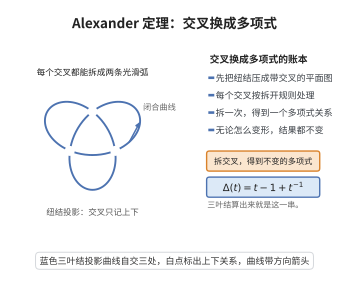

# Alexander 定理

> **一句话大白话**：任何一条纽结或链环，都可以在空间里被连续扭成"一束辫子首尾相接"的样子——于是所有链环都能用辫子群里的一个元素来描述。

> **小例子**：三叶结可表示为 $B_2$ 中 $\sigma_1^3$ 的闭辫子；平凡纽结是不打结辫子 $\sigma_1\sigma_1^{-1}$ 的闭包。于是三叶结的所有量子不变量，都能通过辫子群 $B_2$ 的表示来计算。

## 一、定理介绍

> **前置依赖**：纽结与链环、辫子群与闭辫子、同位与 Reidemeister 移动、Markov 定理（概念）、辫子群的表示。

Alexander 定理（J. W. Alexander，1923）是辫子理论与纽结理论之间的桥梁，它断言：$\mathbb{R}^3$ 中的每个链环都与某个闭辫子同位（isotopic），即从辫子群到链环类型集的自然映射
$$
\bigsqcup_{n\ge1}B_n\longrightarrow\{\text{链环的同位类}\}
$$
是满射。提出它的动机是给链环一个"代数坐标"：纽结的几何对象难以直接操作，而辫子群的群运算与表示论是成熟的工具。Alexander 定理保证了这种"代数化"不损失信息，配合 Markov 定理（两个辫子给出同一链环当且仅当由共轭与稳定化相联系），就能把链环不变量定义在辫子群表示上。这正是量子不变量（Jones、HOMFLY、Reshetikhin–Turaev 不变量）的构造框架：用量子群的 $R$-矩阵给出 $B_n$ 的表示，再取 Markov 迹得到链环不变量。

## 几何直观

图意在说明：把纽结投影的每个交叉按拆开规则记账，就能算出一个在变形下不变的多项式。

## 二、原理思路

证明是构造性（算法性）的，核心是"选一条轴，把链环理成绕轴单调旋转"。
1. 取一条与链环 $L$ 不相交的直线（辫子轴）$A$，并考虑过 $A$ 的半平面族（按辐角 $\theta$ 参数化）。
2. 通过有限次同位（本质上是 Reidemeister 移动），把 $L$ 变得"关于 $A$ 是正的"：即辐角函数 $\theta$ 沿 $L$ 严格单调递增，且 $L$ 与每个半平面横截相交于有限点。
3. 沿某一半平面剪开，交点给出 $n$ 个"股"，按 $\theta$ 递增追踪各股即读出一个辫子字 $\beta\in B_n$；把 $\beta$ 的端点按剪开面重新粘合（闭包），即还原 $L$。

## 三、定理的严格表述

设 $L\subset\mathbb{R}^3$ 是 $m$ 分支链环。则存在 $n\ge1$ 与辫子 $\beta\in B_n$，使 $L$ 与 $\beta$ 的闭辫子（closure）$\hat\beta$ 同位：
$$
L\sim\hat\beta.
$$
等价地，对每个 $n$，记 $\hat{\;}:\bigsqcup_n B_n\to\mathcal{L}$（$\mathcal{L}$ 为链环同位类集）为闭包映射，则它是满射。进一步（Markov 定理）：$\hat\beta_1=\hat\beta_2$ 当且仅当 $\beta_1$ 与 $\beta_2$ 可由以下 Markov 移动互相转换——共轭 $\beta\sim\alpha\beta\alpha^{-1}$ 与稳定化 $\beta\leftrightarrow\beta\sigma_n^{\pm1}$（$\beta\in B_n\subset B_{n+1}$）。因此 $f$ 是链环不变量当且仅当 $f$ 在 $B_n$ 上满足 Markov 迹条件。

## 四、证明过程

**证明（Alexander 算法）：**

**步骤 1：选取辫子轴。** 取直线 $A=\{0\}\times\{0\}\times\mathbb{R}$（必要时先对 $L$ 微扰使其与 $A$ 无交且横截）。对每条以 $A$ 为边界的射线半平面 $P_\theta=\{(r\cos\theta,r\sin\theta,z):r>0\}$，定义 $L$ 上点绕 $A$ 的辐角 $\theta$。

**步骤 2：一般位置调整。** 先对 $L$ 作通用小同位，使 $\theta|_L$ 只有有限个临界点，且 $L$ 与每个 $P_\theta$ 的交集有限。对 $L$ 上每个"坏点"（$\theta$ 的临界点，即 $L$ 在该处切向平行于半平面法向），在它附近做一个小的 Reidemeister 型同位（把该处的小弧段沿径向"推过"轴外侧），可逐个消去临界点而不改变链环类型。由于临界点有限，有限步后得到 $L'$，其 $\theta| _{L'}$ 无临界点。

**步骤 3：得到正辫子。** $\theta| _{L'}$ 无临界点是说 $\theta$ 沿 $L'$ 的每个连通分支严格单调（或严格单调递减）。对单调递减的分支，做一个绕轴"翻转"的同位（例如把该分支替换为绕 $A$ 转半圈的外侧弧），使其变为严格递增。于是 $L'$ 的每条分支沿 $\theta$ 严格递增，且与任一固定 $P_{\theta_0}$ 横截相交于有限个点。

**步骤 4：切面与读出辫子。** 取定 $P_0=P_{\theta_0}$（$\theta_0$ 避开所有交点）。$L''=L'\cap(\mathbb{R}^3\setminus A)$ 被 $P_0$ 切成 $n=\#(L'\cap P_0)$ 条弧，每条弧连接 $P_0$ 上的两个端点并在 $\theta$ 增大时从 $P_0$ 的"此侧"绕到"彼侧"。每个这样的弧给出 $B_n$ 中一个生成元 $\sigma_i$ 或 $\sigma_i^{-1}$（按 $P_0$ 上端点的连线在 $L'$ 中的拓扑位置判定：若端点由上层交叉连接则为 $\sigma_i$，下层连接则为 $\sigma_i^{-1}$）。沿 $\theta$ 递增依次读取，得辫子字
$$
\beta=\sigma_{i_1}^{\epsilon_1}\sigma_{i_2}^{\epsilon_2}\cdots\sigma_{i_k}^{\epsilon_k}\in B_n .
$$

**步骤 5：闭包还原。** 由构造，$\beta$ 的闭包 $\hat\beta$ 就是把步骤 4 中 $P_0$ 两侧按端点配对重新粘合所得的链环，恰为 $L''$，而 $L''$ 与 $L$ 同位。故 $L\sim\hat\beta$，满射性得证。

**步骤 6：Markov 定理的相容性（引用与说明）。** 闭包映射的纤维由 Markov 定理刻画：同一链环可由不同 $n$、不同共轭类表示，其差别正是共轭与稳定化。因此若在辫子群表示上定义的量 $F$ 满足 $F(\alpha\beta\alpha^{-1})=F(\beta)$ 与 $F(\beta\sigma_n^{\pm1})=F(\beta)$（迹条件），则 $\hat\beta\mapsto F(\beta)$ 良定义，即给出一链环不变量。$\square$

## 五、应用与意义

- 它把链环理论"代数化"为辫子群，使群表示论成为构造链环不变量的标准工具。
- 它是量子不变量的构造前提：量子群的 $R$-矩阵给出 $B_n$ 表示，配合 Markov 迹即得 Jones、HOMFLY、Reshetikhin–Turaev 不变量。
- 与 Markov 定理结合给出"辫子群 Markov 迹对应链环不变量"的一般原理，是 Temperley–Lieb 代数方法与 Birman–Wenzl 代数方法的基础。
- 在统计力学与量子计算中，辫子群表示（任意子、拓扑量子门）正是可容错量子计算的代数来源。
- 在分析上它联系到曲面映射类群、Dehn 手术与曲线的几何表示，是低维拓扑的核心桥梁。

## 课堂问答

**老师**：每一个链环都能用辫子表示吗？

**学生**：能。$\mathbb{R}^3$ 中每个链环都与某个闭辫子同位，即闭包映射 $\bigsqcup_{n\ge1}B_n\to\mathcal{L}$（$\mathcal{L}$ 为链环同位类集）是满射。

**老师（追问）**：怎么把几何的链环读成一个辫子字？

**学生**：取一条与链环不相交的轴 $A$，用绕轴的半平面族按辐角 $\theta$ 参数化。先作一般位置微扰并做 Reidemeister 型同位消去 $\theta$ 的临界点，使 $\theta$ 沿每分支严格单调，且与每个半平面横截相交于有限点。取定半平面 $P_0$ 切开得 $n$ 个交点即 $n$ 股，按 $\theta$ 递增依次读取交叉的上/下穿越，得到 $\beta=\sigma_{i_1}^{\epsilon_1}\cdots\sigma_{i_k}^{\epsilon_k}\in B_n$；把端点按 $P_0$ 配对重新粘合即得闭包 $\hat\beta$，与 $L$ 同位。

**老师（拓展）**：既然已经满射，为什么还要 Markov 定理？

**学生**：因为闭包映射并不单射——同一链环可由不同 $n$、不同共轭类表示。Markov 定理说 $\hat\beta_1=\hat\beta_2$ 当且仅当二者可经共轭 $\beta\sim\alpha\beta\alpha^{-1}$ 与稳定化 $\beta\leftrightarrow\beta\sigma_n^{\pm1}$ 互相转换。故要定义不变量 $F$，必须满足 $F(\alpha\beta\alpha^{-1})=F(\beta)$ 与 $F(\beta\sigma_n^{\pm1})=F(\beta)$，这就是"$R$ 矩阵表示加 Markov 迹"的量子不变量构造套路。

## 相关条目

- [量子迹与 Jones 多项式的关系](./量子迹与Jones多项式的关系.md)：直接使用本定理把链环化为闭辫子后取量子迹。
- [R 矩阵的存在唯一性](./R矩阵的存在唯一性.md)：给出 $B_n$ 表示所需的 $R$ 矩阵，是构造不变量的一环。
- [Yang-Baxter 方程的解与量子群的关系](./Yang-Baxter方程的解与量子群的关系.md)：$R$ 矩阵满足的辫子关系，保证辫子表示良定义。
- [量子群 Uq(sl2) 的表示分类](./量子群Uq(sl2)的表示分类.md)：提供辫子表示所用的不可约表示。
- [Alexander 多项式](../第62级-低维拓扑/Alexander多项式.md)：与本条目同名的经典不变量，但内容不同（那里是纽结的 $\mathbb{Z}[t^{\pm1}]$ 不变量，本条目是辫子表示定理），可对照理解。
- [曲面映射类群](../第62级-低维拓扑/曲面映射类群.md)：辫子群是圆盘映射类群，与本文的辫子几何密切相关。
