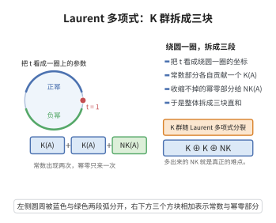

# Bass-Heller-Swan 定理

> **一句话大白话**：把环 $R$ 换成 Laurent 多项式环 $R[t,t^{-1}]$ 后，K 群的变化是"一个旧 $K$ 群 + 一个低一阶的旧 $K$ 群 + 两团尼罗无知（Nil-K）"：$K_n(R[t,t^{-1}])\cong K_n(R)\oplus K_{n-1}(R)\oplus NK_n(R)\oplus NK_n(R)$。
>
> **小例子**：对 $n=1$，$K_1(R[t,t^{-1}])\cong K_1(R)\oplus K_0(R)\oplus NK_1(R)\oplus NK_1(R)$——"加一个变量再取逆"，K 群仿佛"复制"外加一个"阶下降"的一层。

## 一、定理介绍

> **前置依赖**：代数 K 群 $K_0$、$K_1$、局部化正合序列、Nil-K 群、多项式环的同伦不变性。

Bass-Heller-Swan 定理给出 Laurent 多项式环的 K 群分解，是计算多项式环 K 群的基础结果。它揭示出"引入一个可逆变量"对 K 群的影响：除保留原 K 群外，额外贡献低一阶的 K 群与标志性 Nil 群两团。Nil 群 $NK_n(R)=\ker(K_n(R[t])\to K_n(R))$ 测度"非平凡高阶生成元"。

## 几何直观

图意在说明：把 Laurent 多项式看成圆周上的函数，K 群便分裂为两个常数份与一个幂零份的直和。

## 二、原理思路

证明对 $n=0$ 情形利用局部化序列：把 $R[t,t^{-1}]$ 视为 $R[t]$ 对乘法封闭集 $S=\{t^n:n\ge0\}$ 的局部化，并结合 $K_0(R[t])\cong K_0(R)$（多项式的同伦不变性）与 $K_1(R[t])$ 的 Nil 分解，仔细分析局部化序列中各环态，得到所需的 $K_0$ 分解；高阶情形推广到 $NK_n(R)$。

## 三、定理的严格表述

设 $R$ 为含幺环。则：
$$
K_1(R[t,t^{-1}])\cong K_1(R)\oplus K_0(R)\oplus NK_1(R)\oplus NK_1(R),
$$
其中 $NK_1(R)=\ker(K_1(R[t])\to K_1(R))$（由 $t\mapsto1$ 诱导）是 Nil-K 群。更一般地，对 $n\ge0$：
$$
K_n(R[t,t^{-1}])\cong K_n(R)\oplus K_{n-1}(R)\oplus NK_n(R)\oplus NK_n(R),
$$
其中 $NK_n(R)=\ker(K_n(R[t])\to K_n(R))$。

## 四、证明过程

**证明（对 $n=0$ 的情形）：**

**步骤 1：改写为局部化。** $R[t,t^{-1}]=S^{-1}R[t]$，其中 $S=\{t^n:n\ge0\}$，对 $R[t]$ 与 $S$ 应用局部化序列：
$$
K_1(R[t])\to K_1(R[t,t^{-1}])\to K_0(R)\to K_0(R[t])\to K_0(R[t,t^{-1}]).
$$

**步骤 2：利用同伦不变性。** 因 $R[t]$ 是多项式环，$K_0(R[t])\cong K_0(R)$；又 $K_1(R[t])\cong K_1(R)\oplus NK_1(R)$。

**步骤 3：分析正合列。** 通过分析局部化序列中各映射并利用 $K_0(R[t,t^{-1}])$ 的定义，解得：
$$
K_0(R[t,t^{-1}])\cong K_0(R)\oplus K_0(R).
$$
更精确追踪 Nil 项，即得 $K_1(R[t,t^{-1}])\cong K_1(R)\oplus K_0(R)\oplus NK_1(R)\oplus NK_1(R)$；高阶 $n$ 由类似局部化论证推广。$\square$

## 五、应用与意义

该定理是多项式与 Laurent 环 K 群计算的关键，直接导出 $K_n(\mathbb{Z}[t,t^{-1}])\cong K_n(\mathbb{Z})\oplus K_{n-1}(\mathbb{Z})\oplus(\text{零调项})$ 等结果。Nil 群 $NK_n(R)$ 反映"高阶不稳定"的信息，在研究 K 群的稳定性、代数 K 理论与同伦论（如 $K(\mathbb{Z})$ 的 Adams 谱序列）中至关重要。它也启发对 $K_n(R[t])$、自由环与全同伦 K 理论的研究，是计算代数 K 群与拓扑 K 理论联系的基础工具。

## 课堂问答

**老师**：把环换成 Laurent 多项式环 $R[t,t^{-1}]$ 后，$K$ 群会发生什么？请说出最一般形式的分解。

**学生**：结论是
$$
K_n(R[t,t^{-1}])\cong K_n(R)\oplus K_{n-1}(R)\oplus NK_n(R)\oplus NK_n(R),
$$
其中 $NK_n(R)=\ker(K_n(R[t])\to K_n(R))$ 是 Nil 群。取 $n=0$ 时 $K_{-1}=0$，就退化为 $K_0(R[t,t^{-1}])\cong K_0(R)\oplus K_0(R)$。

**老师（追问）**：$K_0(R)$ 凭空多出一份，多出来的那个究竟是从哪条正合列里冒出来的？

**学生**：因为 $R[t,t^{-1}]=S^{-1}R[t]$（$S=\{t^n:n\ge0\}$），局部化序列给出
$$
K_1(R[t,t^{-1}])\to K_0(R)\to K_0(R[t])\to K_0(R[t,t^{-1}]).
$$
利用同伦不变性 $K_0(R[t])\cong K_0(R)$，中间那个态是恒等，连接态 $K_1(R[t,t^{-1}])\to K_0(R)$ 的余核正是新增的那份 $K_0(R)$。

**老师（拓展）**：那两团重复出现的 Nil 群，是否只是形式摆设？

**学生**：不是，它度量的是 $K_n(R[t])\to K_n(R)$ 中被 $t\mapsto1$ 抹掉的"非平凡高阶生成元"，是 $K$ 群不稳定性的来源；正是它让 $K_n(\mathbb{Z})$ 的 Adams 谱序列计算变得复杂。当环正则时 $NK_n=0$，Bass-Heller-Swan 才退化成清爽的裂解。
