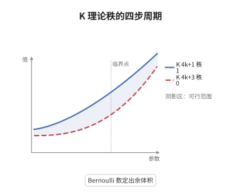

# Borel 定理与 K 理论的秩

> **一句话大白话**：$\mathbb Z$ 的 K 群虽然大多算不出来，但它们的"秩"（自由部分的维数）被 Borel 完全定死了：只有下标 $\equiv1\pmod 4$ 的 $K$ 群秩为 $1$，其余全为有限群。
>
> **小例子**：$K_3(\mathbb Z)=\mathbb Z/48$ 有限，$K_5(\mathbb Z)\cong\mathbb Z\oplus(\text{有限})$ 秩为 $1$，$K_7(\mathbb Z)=\mathbb Z/240$ 又有限；而 $K_1(\mathbb Z)=\mathbb Z/2$ 秩为 $0$，是 $4k+1$ 型里唯一的例外。

## 介绍

Quillen 算出 K 群之后，人们发现 $K_n(\mathbb Z)$ 大多是有限群，唯独某些阶会出现一个 $\mathbb Z$ 自由部分。Borel 在 1974 年用算术群的上同调与 regulator 映射确定了这个自由部分的维数：对一般数域的整数环，$\mathrm{rank}\,K_{2m-1}$ 只依赖实嵌入与复嵌入的个数以及 $m$ 的奇偶。对 $\mathbb Z$ 而言结论极简：$K_{4k+1}$ 的秩为 $1$，其余正阶 K 群秩为 $0$（即有限）。更进一步，自由部分的"体积"由 $\zeta$ 的负整数值给出，而后者正比于 Bernoulli 数。这条定理由此把代数 K 理论与数论中的特殊值连在一起，成为 Lichtenbaum-Quillen 猜想与算术 K 理论的起点。它把"K 群有多大"变成了"$\zeta$ 值有多大"。

## 几何直观

图意在说明：横轴是下标 $n$，纵轴是 $\mathrm{rank}\,K_n(\mathbb Z)$。柱子呈现出四步一循环：$n\equiv1\pmod4$ 且 $n\ge5$ 时高度为 $1$，$n\equiv3\pmod4$ 时高度为 $0$，偶数阶也全部为 $0$。图上的两条参考线分别标出"秩一"与"秩零"，提醒读者 $K_1$ 虽然下标是 $1$ 但秩为 $0$，是这条周期律的唯一破例；柱子之间的高度差不代表群的大小，因为秩为零的群里还装着 $\mathbb Z/48$、$\mathbb Z/240$ 这样的挠部分。

## 分析

**前置依赖**：K 理论、Bernoulli 数、regulator；补充：数域的 $\zeta$ 函数、算术群的上同调。

**数学内涵**：
- 有限生成：对整数环 $O_F$，$K_n(O_F)$ 是有限生成阿贝尔群（Borel）。
- 秩公式：对 $m\ge2$，$\dim_{\mathbb Q}(K_{2m-1}(O_F)\otimes\mathbb Q)$ 等于 $r_1+r_2$（$m$ 奇）或 $r_2$（$m$ 偶），其中 $r_1,r_2$ 是实嵌入与复嵌入的个数。
- 对 $\mathbb Z$：$r_1=1,r_2=0$，故 $\mathrm{rank}\,K_{4k+1}(\mathbb Z)=1$（$k\ge1$），$\mathrm{rank}\,K_{4k+3}(\mathbb Z)=0$；偶数阶 $K_{4k},K_{4k+2}$ 全是有限群。
- 挠部分不算秩：$K_3(\mathbb Z)=\mathbb Z/48$、$K_7(\mathbb Z)=\mathbb Z/240$ 秩为零却有非平凡挠。
- regulator：自由部分到 $\mathbb R$ 的嵌入是格，其余体积正比于 $|\zeta(-4k-1)|=|B_{4k+2}|/(4k+2)$。
- 常见误区：把 $4k+1$ 写成 $4k-1$，或把 $K_1(\mathbb Z)=\mathbb Z/2$ 也算作秩 $1$。$K_1$ 对应 $k=0$，必须排除。

**结构**：
1. 构造 regulator 映射，说明它的像在 $\mathbb R^{d}$ 中是格，从而 K 群有限生成。
2. 用对称空间上同调的 Hodge 分解算出格的秩，得到 $r_1+r_2$ 与 $r_2$ 两种情形。
3. 用 $\zeta$ 的负整数值计算格的余体积，把它与 Bernoulli 数联系起来。

## 思考过程

Quillen 的计算给出 $K_3(\mathbb Z)=\mathbb Z/48$、$K_4(\mathbb Z)=0$、$K_5(\mathbb Z)$ 含一个 $\mathbb Z$，这些零散结果看不出规律。Borel 的出发点是把 K 群映射到一个连续对象：整数环的 K 理论可以作用在对称空间上，把元素变成同调类，于是离散的 K 群落进实向量空间，其像是一个格。障碍在于这个映射并不显然：需要先证明 K 群有限生成，才能谈"格"；而有限生成性又依赖算术群的上同调有限性，两者互为表里。关键的观察是，格的秩由对称空间上同调的 Hodge 型决定，而 Hodge 型的分布恰好以 $4$ 为周期，于是秩也以 $4$ 为周期。最后一步是把余体积算出来，这正好是 $\zeta$ 的负整数值；由函数方程，这些值可以写成 Bernoulli 数，K 理论与数论的特殊值由此打通。

## 证明过程

**定理**：设 $F$ 为数域，$r_1,r_2$ 为其实嵌入与共轭复嵌入对的个数，$O_F$ 为整数环。则 $K_n(O_F)$ 有限生成，且对 $m\ge2$
$$
\dim_{\mathbb Q}\big(K_{2m-1}(O_F)\otimes\mathbb Q\big)=
\begin{cases}
r_1+r_2, & m\ \text{为奇数},\\
r_2, & m\ \text{为偶数},
\end{cases}
$$
并且 regulator 的余体积与 $|\zeta_F(1-2m)|$ 只差一个有理因子。

**证明**：

### 1. regulator 与有限生成

把 $K_{2m-1}(O_F)$ 经 Hurewicz 同态送入算术群 $\mathrm{GL}_N(O_F)$ 所作用对称空间的同调，再投影到相应的实系数同调群，得到 regulator 映射
$$
r_m:K_{2m-1}(O_F)\longrightarrow H_{2m-1}\big(\text{对称空间};\mathbb R\big)\cong\mathbb R^{d_m}.
$$
算术群的上同调有限性（Borel-Serre 紧化）保证核有限，像离散，故 $K_{2m-1}(O_F)$ 有限生成，其自由部分同构于一个格。

### 2. 秩由 Hodge 型决定

对称空间的上同调带 Hodge 分解 $H^{p,q}$。$2m-1$ 次同调中能承载 K 理论类的只有满足 $p=m-1,q=m$ 或其共轭的分量：实嵌入贡献 $r_1$ 个、复嵌入贡献 $r_2$ 个，而能否出现取决于 $m$ 的奇偶。逐项计数得
$$
d_m=\begin{cases}r_1+r_2,& m\ \text{奇},\\ r_2,& m\ \text{偶}.\end{cases}
$$
取 $F=\mathbb Q$ 即 $r_1=1,r_2=0$：$m=2k+1$ 给秩 $1$（对应 $K_{4k+1}$，$k\ge1$），$m=2k+2$ 给秩 $0$（对应 $K_{4k+3}$）。偶数阶没有这样的分量，故 $K_{4k},K_{4k+2}$ 全为挠群。

### 3. 余体积与 Bernoulli 数

格的基本域体积由 $\zeta_F$ 在负整点的值给出：
$$
\operatorname{vol}\big(K_{2m-1}(O_F)/\text{torsion}\big)\sim|\zeta_F(1-2m)|,
$$
比例因子只含 $2$ 与 $\pi$ 的幂。对 $F=\mathbb Q$，由 $\zeta(1-2m)=-\dfrac{B_{2m}}{2m}$ 得 $2m=4k+2$ 时
$$
\operatorname{vol}\big(K_{4k+1}(\mathbb Z)/\text{torsion}\big)\sim\frac{|B_{4k+2}|}{4k+2}.
$$
于是秩为 $1$ 的那些 K 群，其自由生成元的"尺度"完全由 Bernoulli 数决定。$\square$

## 课堂问答

**老师**：为什么 $K_{4k+1}(\mathbb Z)$ 的秩是 $1$，而 $K_{4k+3}(\mathbb Z)$ 的秩是 $0$？这个 $4$ 的周期从哪里来？

**学生**：周期来自对称空间上同调的 Hodge 型。$2m-1$ 次同调里能承载 K 理论类的分量只在 $m$ 的奇偶之间切换，而对 $\mathbb Z$ 只有 $r_1=1$ 个实嵌入，于是 $m$ 奇时贡献一维、$m$ 偶时贡献零维。换成 $m$ 的下标就是 $2m-1\equiv1$ 或 $3\pmod4$。

**老师（追问）**：秩为零就等于 K 群平凡吗？

**学生**：不等于。秩只数自由部分，挠部分完全看不见。典型例子是
$$
K_3(\mathbb Z)=\mathbb Z/48,\qquad K_7(\mathbb Z)=\mathbb Z/240,
$$
两者秩都为零却都非平凡。所以 Borel 定理只说"有多大"，不说"是什么"；确定挠部分要更精细的工具，如 étale 上同调与 Lichtenbaum-Quillen 猜想。

**老师（拓展）**：Bernoulli 数在这里是以什么身份出现的？

**学生**：以 $\zeta$ 的负整数值的身份出现：$\zeta(1-2m)=-B_{2m}/(2m)$。Borel 证明 regulator 的余体积与这个值成比例，因此 $K_{4k+1}(\mathbb Z)$ 的自由生成元的尺度由 $B_{4k+2}/(4k+2)$ 控制。推广到一般数域，比例因子换成 $\zeta_F$ 的相应特殊值；而 Lichtenbaum 猜想进一步断言 K 群的大小本身（不只是余体积）也由 $\zeta$ 值与 étale 上同调共同决定。
