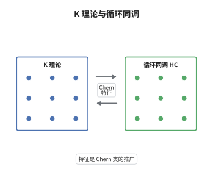

# Chern 特征与循环同调

> **一句话大白话**：K 理论里装着向量丛，循环同调里装着微分形式，Connes 与 Karoubi 造了一座桥 $ch:K_*(A)\to HC_*(A)$，把前者翻译成后者，翻译出来的东西正是经典 Chern 特征的代数版。
>
> **小例子**：取 $A=C^\infty(S^2)$，则 $K_0(A)\cong\mathbb Z^2$ 由两个向量丛生成，$HC_0(A)$ 是函数模交换子；$ch_0$ 把投影 $p$ 送到 $\operatorname{tr}(p)$，$ch_1$ 则把 $p$ 送到 $\operatorname{tr}((p\,\mathrm dp\,\mathrm dp))$，后者积出来的就是第一 Chern 数。

## 介绍

K 理论是"模"的不变量，循环同调是"迹"的不变量，两者来源完全不同：前者来自投射模与正合列，后者来自 Hochschild 复形与算子迹。Connes 与 Karoubi 在 1980 年代构造了 Chern 特征 $ch:K_n(A)\to HC_n(A)$，把 K 理论映到循环同调，并且在 $K_0$ 上就是矩阵的迹。它的意义在于：K 理论极其难算，循环同调却可以用线性代数（迹、微分形式）直接写出，于是"算 K 群"被替换成"算迹与微分形式"。在交换情形，配合 Hochschild-Kostant-Rosenberg 定理，这条通道退化为经典的 de Rham Chern 特征，$ch$ 的各阶分量就是 Chern 类。它把"K 理论的几何内容"提炼成了"上同调类"。

## 几何直观

图意在说明：左栏是难以直接计算的 K 群，右栏是可以用迹写出的循环同调；中间的箭头就是 $ch$，它把 $K_0$ 中的投影送到迹、把高阶元素送到循环链。右栏下方标注的 de Rham 类是交换情形下的落点：当 $A$ 是光滑流形上的函数环时，循环同调通过 Hochschild-Kostant-Rosenberg 定理变成微分形式，$ch$ 的像就还原成熟悉的 Chern 特征与 Chern 类。

## 分析

**前置依赖**：循环同调、K 理论；补充：Hochschild 同调、Dennis 迹、HKR 定理。

**数学内涵**：
- Dennis 迹：$K_n(A)\to HH_n(A)$，把矩阵的元素逐个取出再按循环顺序排列，是 $ch$ 的原料。
- Connes-Karoubi 特征：$ch_n:K_n(A)\to HC_n(A)$，由 Dennis 迹与自然映射 $HH_n\to HC_n$ 复合而成，对 $n\ge0$ 都有定义。
- 显式公式：对投影 $p=p^2=p^*$，$ch_n(p)=\dfrac{1}{n!}\operatorname{tr}\big((p\,\mathrm dp\,\mathrm dp)^n\big)\in HC_{2n}(A)$。
- 乘法相容：$ch$ 是分次环同态，左边用 cup 积，右边用 shuffle 积。
- 与 Chern 类：对 $A=C^\infty(M)$，HKR 给出 $HC_n(A)\cong\Omega^n(M)/\mathrm d\Omega^{n-1}(M)$，$ch$ 的像就是 $ch(E)=\operatorname{tr}\big(e^{\nabla^2/2\pi i}\big)$；其 $2k$ 阶分量与 $c_k$ 由 Newton 多项式互相决定。
- 常见误区：以为 $ch$ 总是同构。只有有理化并在特定情形（如 $A=\mathbb C$、幂零扩张、光滑交换代数）才是同构，一般 K 理论比循环同调大得多。

**结构**：
1. 从投影的迹出发定义 $ch$ 的零阶与高阶分量，验证它是循环上闭链。
2. 借 Dennis 迹与 SBI 序列把定义延拓到全部 $K_n$，并验证乘法相容。
3. 在交换情形用 HKR 定理把 $ch$ 与 de Rham Chern 特征对齐。

## 思考过程

Connes 的动机来自指标定理：椭圆算子的解析指标可以用迹写出，而迹天然生活在循环同调里，因此 K 理论到循环同调应该有一条自然通道。障碍在于 K 理论的高阶元素不是矩阵而是环路，无法直接取迹。Karoubi 的办法是先在 $K_0$ 上把迹写清楚，再利用"任何 K 理论元素都可由投影与可逆元拼出"这一事实逐阶搬运；搬运过程中必须检查迹的循环性，否则会依赖于矩阵表示的选择。第二个障碍是符号与归一化：$\mathrm dp$ 不是闭形式，只有 $(p\,\mathrm dp\,\mathrm dp)^n$ 才是闭的，这个组合恰是 Chern-Weil 理论中曲率的代数替代。最后一步是把结论与经典 Chern 特征对齐，HKR 定理为此提供了字典，于是"代数 K 理论的 Chern 特征"与"微分几何的 Chern 类"被确认为同一个东西。

## 证明过程

**定理**：设 $A$ 为特征零域上的含幺结合代数。则存在自然的分次环同态
$$
ch:K_*(A)\longrightarrow HC_*(A),
$$
它在 $K_0$ 上由 $ch_0([p])=\operatorname{tr}(p)\in A/[A,A]=HC_0(A)$ 给出，并与 cup 积、shuffle 积相容；当 $A=C^\infty(M)$ 时，$ch$ 与经典的 de Rham Chern 特征在 HKR 同构下一致。

**证明**：

### 1. 投影的 Chern 特征

对投影 $p\in M_N(A)$，令 $\omega=p\,\mathrm dp\,\mathrm dp$，它是 $M_N(\Omega^2A)$ 中的元素且满足 $\omega^2=0$ 的循环类比。定义
$$
ch_n(p)=\frac{1}{n!}\operatorname{tr}\big(\omega^n\big)\in HC_{2n}(A).
$$
循环性来自迹的 $\operatorname{tr}(XY)=\operatorname{tr}(YX)$；闭性来自 $\mathrm d\omega=0$ 在循环商中的成立，因为 $\mathrm dp=[\mathrm d,p]$ 且 $p^2=p$ 迫使 $\mathrm dp=p\,\mathrm dp+\mathrm dp\,p$。于是 $ch_n(p)$ 是良定义的循环同调类，且对 $n=0$ 退化为 $\operatorname{tr}(p)$。

### 2. 延拓到全部阶

Dennis 迹 $\operatorname{tr}_D:K_n(A)\to HH_n(A)$ 把可逆矩阵的环路按矩阵元展开。复合自然映射 $I:HH_n(A)\to HC_n(A)$ 得
$$
ch= I\circ \operatorname{tr}_D:K_n(A)\to HC_n(A).
$$
SBI 序列 $HH_n\xrightarrow{I}HC_n\xrightarrow{S}HC_{n-2}\xrightarrow{B}HH_{n-1}$ 说明 $I$ 的像正好是那些被 $S$ 杀死的类，而 Dennis 迹的像落在其中，故 $ch$ 取值于 $HC_n$。乘法相容性由 shuffle 积与 cup 积在同伦层面的一致性给出：两个投影的 cup 积对应张量积投影，其迹按 $ch(p\otimes q)=ch(p)\cdot ch(q)$ 分解。

### 3. 与 Chern 类对齐

取 $A=C^\infty(M)$。HKR 定理给出
$$
HC_n(A)\cong\Omega^n(M)\big/\mathrm d\Omega^{n-1}(M),\qquad HP_*(A)\cong H^*_{\mathrm{dR}}(M),
$$
且 $ch_n(p)$ 的像正是 $\dfrac{1}{n!}\operatorname{tr}\big((p\,\mathrm dp\,\mathrm dp)^n\big)$，它与曲率形式 $\nabla^2$ 的相应幂在 de Rham 上同调中相等。于是 $ch(E)=\sum_n ch_n(E)$ 就是经典 Chern 特征，其 $2k$ 阶分量与 $c_k(E)$ 由 Newton 多项式互相确定，从而 $ch$ 确实是 Chern 类的推广。$\square$

## 课堂问答

**老师**：K 理论和循环同调一个是模的不变量、一个是迹的不变量，凭什么认为它们之间有自然映射？

**学生**：因为 K 理论的低阶元素本身就是矩阵。$K_0$ 的元素是投影类，取迹就落到 $A/[A,A]=HC_0$；$K_1$ 的元素是可逆元，取迹的循环展开就落到 $HC_1$。Dennis 迹把这一观察系统化到所有阶，Connes 与 Karoubi 再验证它穿过 $HH_n\to HC_n$，映射因此自然。

**老师（追问）**：为什么高阶分量要用 $(p\,\mathrm dp\,\mathrm dp)^n$ 而不是 $\mathrm dp$ 的其它组合？

**学生**：因为只有这个组合在循环商里是闭的。由 $p^2=p$ 得 $\mathrm dp=p\,\mathrm dp+\mathrm dp\,p$，于是 $\mathrm d(p\,\mathrm dp\,\mathrm dp)=0$，而单独的 $\mathrm dp$ 甚至不是恰当形式的循环类比。这个组合正是 Chern-Weil 理论中曲率的代数替身，取 $n$ 次方再取迹就得到 $2n$ 次上同调类。

**老师（拓展）**：这条通道在什么意义上是"同构"？

**学生**：只在有理化之后、并且要对代数加条件。对 $A=\mathbb C$，$K_{2k}(\mathbb C)\otimes\mathbb Q\cong\mathbb Q$、奇数阶为零，$ch$ 是同构；对幂零扩张，Goodwillie 定理说明相对 K 理论的有理化与相对循环同调一致（差一次平移）。一般情况下 $ch$ 远非同构，K 理论含有循环同调看不到的整性信息，这正是算术 K 理论要处理的部分。
