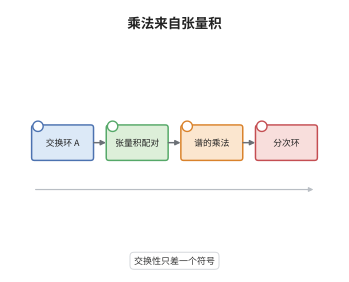

# K 理论的乘法结构

> **一句话大白话**：K 群不只有加法，对交换环还能把两个模"张量相乘"，由此在 $\bigoplus_iK_i(A)$ 上得到一圈乘法（cup 积），使 K 理论成为一个分次交换环。
>
> **小例子**：取 $A=F$ 为域，$K_1(F)\otimes K_1(F)\to K_2(F)$ 把 $a\otimes b$ 送到 Steinberg 符号 $\{a,b\}$；于是 $\{2,3\}\cdot\{5,7\}$ 这类符号乘积就是 cup 积在低阶的具体形状，而它与普通乘法只差一个符号 $(-1)^{ij}$。

## 介绍

K 群最初只是逐阶定义的阿贝尔群，彼此之间没有运算关系。Grothendieck 早就知道 $K_0$ 在张量积下是环；Quillen 的 Q 构造与加号构造则说明，对交换环 $A$，张量积 $\otimes_A$ 是一个双正合函子，因而在 K 理论谱上诱导出配对 $K(A)\wedge K(A)\to K(A)$。把这一配对按阶展开，就得到 cup 积 $K_i(A)\otimes K_j(A)\to K_{i+j}(A)$。它使 $K_*(A)$ 成为分次交换环，$K_0(A)$ 充当幺元。这件事把"K 理论是一堆群"升级为"K 理论是一个环谱"，也解释了为什么 $\lambda$-运算、Adams 运算与 Chern 特征都能在 K 理论上定义。它把"逐阶求和"变成了"整体成环"。

## 几何直观

图意在说明：最左端只有环 $A$；第二步把两个有限生成射影模张量相乘，这一步是双正合的；第三步在 K 理论谱的层面得到乘法映射 $K(A)\wedge K(A)\to K(A)$；最右端的方框是它按阶展开后的结果，即分次环 $K_*(A)$。注意方框里没有出现直和：直和给出的是加法与 H 空间结构，乘法必须从张量积来，两者是两条不同的通道。

## 分析

**前置依赖**：Q 构造、环结构；补充：双正合函子、谱、分次交换性。

**数学内涵**：
- 配对：$\otimes_A:\mathcal P(A)\times\mathcal P(A)\to\mathcal P(A)$ 是双正合函子，由加性定理诱导谱映射 $K(A)\wedge K(A)\to K(A)$。
- 具体形式：矩阵的 Kronecker 积 $GL_m(A)\times GL_n(A)\to GL_{mn}(A)$ 给出成群的双线性映射，群完备化后即为 cup 积。
- 分次交换：$x\cup y=(-1)^{ij}y\cup x$ 对 $x\in K_i(A)$、$y\in K_j(A)$ 成立，符号来自球面 smash 积 $S^i\wedge S^j$ 的交换同伦。
- 幺元：$1=[A]\in K_0(A)$，因为 $A\otimes_A M\cong M$；$K_0(A)$ 在 $\otimes$ 下是 Grothendieck 环。
- 适用边界：只有 $A$ 交换时 $K_*(A)$ 才是环；非交换环上 $M\otimes_A N$ 不再是 $A$-模，只剩 $K_*(A)$ 作为 $K_*(\mathbb Z)$-模的结构。
- 常见误区：以为 cup 积由直和给出。直和是加法（H 空间乘法），cup 积由张量积给出，两者混淆会把 $K_1$ 上的乘法算错。

**结构**：
1. 说明张量积是双正合函子，因而在谱层面给出配对。
2. 用张量积的结合约束与单位约束验证结合律与幺元。
3. 用球面交换同伦计算符号，得到分次交换性。

## 思考过程

在 Quillen 之前，$K_1$ 与 $K_2$ 之间并没有自然的乘法：$K_1$ 是行列式、$K_2$ 是 Steinberg 符号，两者看似无关。真正的线索来自 $K_0$：向量丛的张量积给出环结构，而 Chern 特征又把这个环结构送到上同调环。于是问题变成：$K_0$ 的乘法能否提升到高阶？Quillen 的答案是肯定的，但需要一件新工具——双正合函子的 K 理论配对，这正是加性定理的用武之地。障碍在交换性：两个模的张量积只在同构意义下交换，而这个交换同构搬到 K 理论谱上之后，还要与球面的交换同伦复合，于是凭空多出一个符号。因此 K 理论只能是分次交换而非严格交换，这个符号不是技术瑕疵，而是拓扑来源的直接印记。后来人们进一步发现，交换环的 K 理论谱其实是 $E_\infty$ 环谱，cup 积只是它的一阶影子。

## 证明过程

**定理**：设 $A$ 为交换环。则 cup 积使 $K_*(A)=\bigoplus_{i\ge0}K_i(A)$ 成为分次交换环，$K_0(A)$ 为幺元，且对 $x\in K_i(A)$、$y\in K_j(A)$ 有
$$
x\cup y=(-1)^{ij}\,y\cup x .
$$

**证明**：

### 1. 双正合函子给出配对

$\otimes_A$ 在每个变量上都是正合函子，故它是双正合函子。由 Waldhausen 加性定理，双正合函子诱导 K 理论谱的映射，于是有
$$
\cup:\ K(A)\wedge K(A)\longrightarrow K(A).
$$
在低阶它可以显式写成 Kronecker 积：$X\in GL_m(A)$、$Y\in GL_n(A)$ 映到 $X\otimes Y\in GL_{mn}(A)$，该映射对两个变量分别成群同态，故在群完备化后仍良定义。

### 2. 结合律与幺元

张量积的结合约束 $\alpha:(M\otimes N)\otimes P\to M\otimes(N\otimes P)$ 是自然同构，且满足五边形公理，故三元 cup 积在 K 理论中与括号无关，结合律成立。单位约束 $\lambda:A\otimes M\to M$ 是自然同构，故 $[A]\cup y=y$，幺元为 $K_0(A)$ 中的 $[A]$。于是 $K_*(A)$ 是含幺分次环，$K_0$ 部分就是射影模的 Grothendieck 环。

### 3. 分次交换性与符号

交换约束 $\tau:M\otimes N\to N\otimes M$ 是自然同构且满足 $\tau_{N,M}\circ\tau_{M,N}=\mathrm{id}$，所以模层面的对称本身不带符号。符号出现在谱层面：把 $x\in K_i$、$y\in K_j$ 相乘要先对接两个球面，而交换次序需要经过球面的交换同伦 $S^i\wedge S^j\to S^j\wedge S^i$，其次数为 $(-1)^{ij}$。因此
$$
x\cup y=(-1)^{ij}\,y\cup x,
$$
且当 $i$ 或 $j$ 为偶数时符号消失。特别地 $K_1$ 上 cup 积反交换，$K_1\otimes K_1\to K_2$ 把 $a\otimes b$ 送到 $\{a,b\}$，与 Steinberg 符号的斜对称性完全吻合。$\square$

## 课堂问答

**老师**：为什么 K 理论的乘法要用张量积，而不能像加法那样用直和？

**学生**：直和已经被加法用掉了：它给出 $K_0$ 的群运算与 $BGL(A)^+$ 的 H 空间结构，若再用它定义乘法，只会得到同一个运算。张量积才是新的信息，它在 $K_0$ 上给出射影模的环结构，把这一结构提升到谱上就得到 cup 积。两者在低阶可以区分：$[M]+[N]=[M\oplus N]$，而 $[M]\cup[N]=[M\otimes N]$。

**老师（追问）**：分次交换性里的符号 $(-1)^{ij}$ 是从哪里来的，能不能消掉？

**学生**：来自球面的交换同伦。$S^i\wedge S^j\to S^j\wedge S^i$ 的度数是 $(-1)^{ij}$，而 cup 积是两个球面映射的 smash，因此符号不可避免。它不能消掉：若强行要求严格交换，就等于要求该交换映射度数为 $+1$，与 $i,j$ 都为奇数时的实际度数矛盾。这个符号与上同调环的杯积符号同源。

**老师（拓展）**：非交换环上还剩什么结构？

**学生**：环结构失效，因为 $M\otimes_A N$ 一般不再是左 $A$-模，无法作为 K 理论的元素。剩下的性质是：$K_*(A)$ 是 $K_*(\mathbb Z)$-模，乘法通过 $\mathbb Z$-模的张量积作用于系数。此外若 $A$ 交换，K 理论谱还是 $E_\infty$ 环谱，cup 积只是它的一阶展开，$\lambda$-运算与 Adams 运算都建立在这一结构之上。
