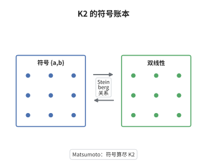

# Milnor $K_2$ 与 Steinberg 符号

> **一句话大白话**：对域 $F$，$K_2(F)$ 可以完全写成"符号 $\{a,b\}$ 的账本"：只要记住双线性、斜对称与 Steinberg 关系这三条规则，就能把任何符号算式化简。
>
> **小例子**：在 $\mathbb F_7$ 里 $1-2=-1=6$，于是 Steinberg 关系直接给出 $\{2,6\}=1$；而在 $\mathbb R$ 上 $\{-1,-1\}$ 是非平凡符号，$K_2(\mathbb R)\cong\{\pm1\}$ 正是由它生成。

## 介绍

Milnor 在 1970 年前后把 $K_2$ 的符号运算提炼成一个独立的代数对象：以 $F^\times\otimes_{\mathbb Z}F^\times$ 为原料，把 $a\otimes(1-a)$ 全部商掉，得到的群记作 $K_2^M(F)$。这个定义只需要域论，不需要矩阵群，因而可以逐阶推广成 Milnor K 理论 $K_n^M(F)$。Matsumoto 定理则把它接回 Quillen 的定义：$K_2^M(F)$ 同构于 $K_2(F)=\ker(St(F)\to E(F))$。这条等式把"矩阵的换位子计算"与"乘法群的双线性代数"对撞在一起，是代数 K 理论与数论（Hilbert 符号、二次互反律、Brauer 群）之间最主要的通道。它把"算 $K_2$"变成了"算符号"。

## 几何直观

图意在说明：左栏第一块是生成元 $\{a,b\}$，第二块是双线性规则，第三块是 Steinberg 关系；三条信息一起送进右栏，就把 $K_2(F)$ 完全确定下来。图里没有矩阵，因为 Matsumoto 定理的要旨正是：$K_2$ 的矩阵来源可以被彻底忘掉，剩下的只是符号之间的三条运算规则；斜对称并不是额外假设，而是由前两块推出来的推论。

## 分析

**前置依赖**：域论、$K_1$、符号；补充：Steinberg 群、张量代数、Brauer 群。

**数学内涵**：
- 定义：$K_2^M(F)=F^\times\otimes_{\mathbb Z}F^\times\big/\langle a\otimes(1-a)\ :\ a\ne0,1\rangle$，其中 $\{a,b\}$ 记 $a\otimes b$ 的像。
- 双线性：$\{a_1a_2,b\}=\{a_1,b\}\{a_2,b\}$ 与 $\{a,b_1b_2\}=\{a,b_1\}\{a,b_2\}$。
- 斜对称：$\{a,b\}\{b,a\}=1$，即 $\{b,a\}=\{a,b\}^{-1}$。
- Steinberg：$\{a,1-a\}=1$ 对 $a\ne0,1$；由此得 $\{a,-a\}=1$ 与 $\{a,a\}=\{a,-1\}$。
- 主定理：$K_2^M(F)\cong K_2(F)$，其中 $K_2(F)=\ker(St(F)\to E(F))$ 是 Steinberg 群到初等矩阵群的核。
- 常见误区：以为 $K_n^M(F)\cong K_n(F)$ 对所有 $n$ 成立。实际只在 $n\le2$ 成立，从 $n=3$ 起 Milnor K 群只是 Quillen K 群的"符号部分"。

**结构**：
1. 用 Weyl 元素与对角矩阵构造符号 $\{a,b\}$，验证它落在 $K_2(F)$ 中。
2. 逐条验证双线性、斜对称与 Steinberg 关系，说明它们确实在 $K_2(F)$ 中成立。
3. 用泛性质证明 $K_2^M(F)$ 与 $K_2(F)$ 满足同一组生成与关系，从而同构。

## 思考过程

$K_2$ 最初是作为 Steinberg 群的核出现的，这个定义极难计算：要判断一个换位子是否属于核，得在无限维矩阵群里做长串运算。Milnor 的突破口是注意到所有已知的 $K_2$ 计算都只用到符号，而符号的运算规则少得惊人。真正的障碍在于要证明"符号够用"——即 $K_2(F)$ 里没有符号之外的隐蔽元素。Matsumoto 的证明把这件事化归为 Steinberg 群的结构定理：$St(F)$ 由 $x_{ij}(a)$ 生成，而任何关系都可归约为少数几条，逐条翻译过去就得到符号的三条规则。选择"斜对称"作为公理之一是有代价的：它不是独立的，可以由双线性与 Steinberg 推出，但把它显式列出能让计算者不必每次重推。这套写法后来直接催生了 Milnor K 理论与 Bloch-Kato 猜想。

## 证明过程

**定理**：设 $F$ 为域。则 $K_2(F)$ 由符号 $\{a,b\}$（$a,b\in F^\times$）生成，且仅满足双线性、斜对称与 Steinberg 关系；等价地，对任意阿贝尔群 $A$ 与双线性映射 $\psi:F^\times\times F^\times\to A$，只要 $\psi(a,1-a)=1$，就存在唯一同态 $\tilde\psi:K_2(F)\to A$ 使 $\tilde\psi(\{a,b\})=\psi(a,b)$。

**证明**：

### 1. 符号落在 $K_2$ 里

对互异的 $i,j,k$ 定义 Weyl 元素与对角元
$$
w_{ij}(a)=x_{ij}(a)x_{ji}(-a^{-1})x_{ij}(a),\qquad h_{ij}(a)=w_{ij}(a)w_{ij}(-1),
$$
直接计算得 $\varphi(h_{ij}(a))=\operatorname{diag}(a,a^{-1},1,\dots,1)$。令
$$
\{a,b\}=[h_{ij}(a),h_{ik}(b)]\in St(F),
$$
则 $\varphi(\{a,b\})=1$，因为对角矩阵彼此交换，故 $\{a,b\}\in\ker\varphi=K_2(F)$。

### 2. 三条关系在 $K_2(F)$ 中成立

双线性来自 $h_{ij}(ab)=h_{ij}(a)h_{ij}(b)$，取换位子即得 $\{ab,c\}=\{a,c\}\{b,c\}$。Steinberg 关系用恒等式
$$
w_{ij}(a)\,x_{ij}(1-a)\,w_{ij}(a)^{-1}=x_{ji}\big((a-1)/a\big)
$$
在 $St(F)$ 内作换位子计算，化到 $\{a,1-a\}=1$；再由 $\{a,-1\}\{a,a\}=\{a,-a\}=1$ 得 $\{a,a\}=\{a,-1\}$。斜对称则是推论：由双线性
$$
\{ab,ab\}=\{a,a\}\{a,b\}\{b,a\}\{b,b\},
$$
而 $\{ab,ab\}=\{ab,-1\}=\{a,-1\}\{b,-1\}=\{a,a\}\{b,b\}$，两边相除即 $\{a,b\}\{b,a\}=1$。

### 3. 泛性质给出同构

设 $\psi$ 为满足条件 $\psi(a,1-a)=1$ 的双线性映射。由 $St(F)$ 的泛性质，$\psi$ 延拓为同态 $St(F)\to A$；又因 $\psi$ 双线性，对角元 $h_{ij}(a)$ 的像只依赖 $a$，换位子 $\{a,b\}$ 的像为 $\psi(a,b)$。于是 $\psi$ 在 $K_2(F)$ 上诱导同态 $\tilde\psi$，且由符号生成性唯一。取 $\psi$ 为万有符号映射即知 $K_2(F)$ 与 $K_2^M(F)$ 有同一泛性质，两者同构。$\square$

## 课堂问答

**老师**：$K_2$ 本来定义为 Steinberg 群的核，为什么要费力把它改写成符号的商群？

**学生**：因为核里的元素无法直接列举。改写成 $F^\times\otimes F^\times$ 的商之后，$K_2$ 变成一个有生成元、有关系式的组合对象，任何计算都只需化简符号，像 $\{a,a\}=\{a,-1\}$ 这样的化简一步到位。代价是要证明"没有遗漏"，这正是 Matsumoto 定理的内容。

**老师（追问）**：三条关系里，斜对称是不是多余的？

**学生**：作为公理它多余，作为结论它必要。由双线性与 Steinberg 可以推出 $\{a,a\}=\{a,-1\}$，把它代进
$$
\{ab,ab\}=\{a,a\}\{a,b\}\{b,a\}\{b,b\}
$$
并与 $\{ab,ab\}=\{a,a\}\{b,b\}$ 比较，即得 $\{a,b\}\{b,a\}=1$。所以斜对称是推论，但把它写在前面能让"反交换"这一直觉立刻可用。

**老师（拓展）**：这套符号代数能推到 $K_3$ 吗？

**学生**：不能照搬。Milnor K 理论确实把 $\{a_1,\dots,a_n\}$ 逐阶定义下去，但 $K_n^M(F)\to K_n(F)$ 从 $n=3$ 起一般不再是同构，Quillen 的 $K_3$ 含有符号之外的内容。$n=2$ 的例外正是 Matsumoto 定理；而 $K_2^M(F)/2\cong{}_2Br(F)$ 这类结论（Merkurjev-Suslin）说明符号在挠层面上仍然强力。
