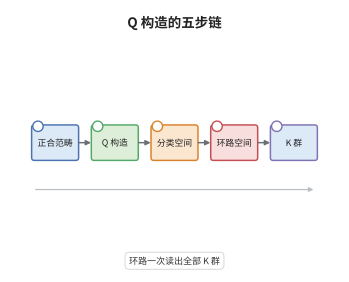

# Quillen 的 Q 构造

> **一句话大白话**：高阶 K 群不必再去数矩阵，而是把"正合列"本身当成道路，绕一个环路空间再取同伦群：$K_i(A)=\pi_i(\Omega BQA)$。
>
> **小例子**：取 $A=\mathbb Z$，则 $K_0(\mathbb Z)=\mathbb Z$ 由秩给出、$K_1(\mathbb Z)=\mathbb Z/2$ 由行列式给出；在 Q 构造里前者的身份是 $\pi_1(BQ)$，环路一次后变成 $\pi_0(\Omega BQ)$，$K_2,K_3,\dots$ 依次接在其后。

## 介绍

Quillen 在 1973 年用 Q 构造给出了高阶 K 群的统一定义，这是代数 K 理论从"逐阶手工定义"走向"一个空间包办所有阶"的转折点。它的出发点是：$K_0$ 的泛性质只用到"短正合列给出加法关系"，$K_1$ 只用到"自同构"，两者其实是同一件事的低阶影子。Q 构造把正合范畴 $\mathcal P$ 改造成另一个范畴 $Q\mathcal P$：对象原封不动，态射却换成"先满射出来、再单射进去"的分解。于是每一条正合列在 $BQ\mathcal P$ 里自动成为一个二单形，$K_0$ 的加法关系就变成基本群里的关系；再环路一次，全部高阶信息都从同伦群里长出来。它把"如何定义 $K_i$"化归为"如何读一个空间的同伦群"。

## 几何直观

图意在说明：第一个方框里只有对象与正合列，还没有任何群；第二步保留对象、把"分解"升级成态射，得到范畴 $Q\mathcal P$；第三步取分类空间，正合列在此变成二单形；第四步环路一次，把 $\pi_1$ 平移到 $\pi_0$；最后一步读出 $K_i=\pi_i(\Omega BQ\mathcal P)$。整条链说明 K 群不是算出来的，而是从"正合列如何嵌套"这一组合数据里读出来的。

## 分析

**前置依赖**：代数 K 理论、单纯集、同伦群；补充：正合范畴、Grothendieck 群、分类空间。

**数学内涵**：
- 对象：$Q\mathcal P$ 的对象与 $\mathcal P$ 完全相同，即有限生成射影 $A$-模（或正合范畴的任意对象），不添也不删。
- 态射：从 $M$ 到 $N$ 的态射是三元组 $(p,i)$，即图表 $M\xleftarrow{p}L\xrightarrow{i}N$，其中 $p$ 是容许满射、$i$ 是容许单射，按同构取商。
- 合成：两个态射用拉回 $L\times_N L'$ 拼接；正合范畴的公理保证拉回存在，且拼接出的两个箭头仍是容许的。
- 群结构：直和 $\oplus$ 使 $BQ\mathcal P$ 成为同伦交换 H 空间，故 $\pi_1(BQ\mathcal P)$ 是群，并且恰为 $K_0(\mathcal P)$。
- 定义：$K_i(\mathcal P):=\pi_i(\Omega BQ\mathcal P)$，基点取零对象；对 $i\ge1$ 这与通常的 $K_i$ 一致。
- 常见误区：以为 $K_i=\pi_i(BQ)$。实际差一维，应为 $K_i=\pi_{i+1}(BQ)$；不环路会把所有阶数整体错开。

**结构**：
1. 定义 $Q\mathcal P$ 的态射与合成，验证它与 $\mathcal P$ 对象相同、态射由正合列给出。
2. 用直和说明 $BQ\mathcal P$ 是 H 空间，并从二单形与群完备化读出 $\pi_1(BQ\mathcal P)\cong K_0(\mathcal P)$。
3. 环路一次，把 $\Omega BQ\mathcal P(A)$ 与 $K_0(A)\times BGL(A)^+$ 比较，得到全部 $K_i$。

## 思考过程

难题出在 $K_1$ 之后：$K_0$ 有 Grothendieck 群的泛性质可用，$K_1$ 有 Whitehead 引理可用，但 $K_2$ 已只能靠 Steinberg 群硬造，再往上更无从下手。Quillen 的观察是，这两个低阶定义背后其实是同一个动作——把短正合列当作一条可以拼接的道路。于是他不再问"$K_2$ 该是什么群"，而问"哪个空间的同伦群会同时给出所有 $K_i$"。障碍有两个：正合范畴原有的态射不够用，必须让"对象之间的分解"也成为态射，否则正合列无法变成单形；而这样造出的态射并不可逆，只能先取分类空间再环路。另一个障碍是基点与群结构，直和只在同构意义下交换，所以必须证明 $BQ$ 是同伦交换 H 空间，$\pi_1$ 才真是 $K_0$ 而不是一个光秃秃的集合。这两步打通之后，Q 构造与加号构造的比较就顺理成章，$K_i$ 的统一定义随之落地。

## 证明过程

**定理**：设 $\mathcal P$ 为正合范畴，$Q\mathcal P$ 如上定义。则 $BQ\mathcal P$ 连通且为同伦交换 H 空间，$\pi_1(BQ\mathcal P)\cong K_0(\mathcal P)$；并且对 $\mathcal P=\mathcal P(A)$（有限生成射影 $A$-模）有
$$
\Omega BQ\mathcal P(A)\simeq K_0(A)\times BGL(A)^+,
$$
从而 $K_i(A)=\pi_i(\Omega BQ\mathcal P(A))$ 对一切 $i\ge0$ 成立。

**证明**：

### 1. Q 确是范畴

恒等态射取 $M\xleftarrow{\mathrm{id}}M\xrightarrow{\mathrm{id}}M$，它是容许的。给定两个态射
$$
M\xleftarrow{\ p\ }L\xrightarrow{\ i\ }N,\qquad N\xleftarrow{\ p'\ }L'\xrightarrow{\ i'\ }P,
$$
在 $\mathcal P$ 中取拉回 $L\times_N L'$，合成定义为
$$
M\xleftarrow{\ p\circ\pi\ }L\times_N L'\xrightarrow{\ i'\circ\pi'\ }P .
$$
局部化正合范畴中，容许满射沿容许单射的拉回仍是容许满射，两个容许单射的复合仍是容许单射，故合成合法。结合律由拉回的泛性质给出，恒等律显然。于是 $Q\mathcal P$ 是范畴。

### 2. 二单形与 $K_0$

一条短正合列 $0\to L\xrightarrow{i}M\xrightarrow{q}N\to0$ 给出 $Q\mathcal P$ 中的三个态射：$L\to M$ 取 $(L\xleftarrow{\mathrm{id}}L\xrightarrow{i}M)$，$M\to N$ 取 $(M\xleftarrow{\mathrm{id}}M\xrightarrow{0}N)$，$L\to N$ 同理取零映射。这三条边构成一个二单形，在 $\pi_1$ 层面读出的关系正是
$$
[M]=[L]+[N].
$$
另一方面，Quillen 的群完备化定理给出 $\Omega BQ\mathcal P$ 是 $\mathcal P$ 在直和下按同构类作群完备化的结果，故 $\pi_0(\Omega BQ\mathcal P)$ 是 $K_0(\mathcal P)$。而 $\pi_0(\Omega BQ\mathcal P)=\pi_1(BQ\mathcal P)$，两路信息一致，得到 $\pi_1(BQ\mathcal P)\cong K_0(\mathcal P)$。

### 3. 环路与加号构造的比较

把 $\coprod_{n\ge0}BGL_n(A)$ 在直和下作群完备化，得到 $\mathbb Z\times BGL(A)^+$；而 $BQ\mathcal P(A)$ 同样实现该群完备化，故
$$
\Omega BQ\mathcal P(A)\simeq K_0(A)\times BGL(A)^+ .
$$
注意 $BGL(A)^+$ 连通且 $\pi_1(BGL(A)^+)=GL(A)/E(A)=K_1(A)$，于是对 $i\ge1$ 有 $\pi_i(\Omega BQ\mathcal P(A))=\pi_i(BGL(A)^+)=K_i(A)$，$i=0$ 时由第 2 步给出 $K_0(A)$。$\square$

## 课堂问答

**老师**：Q 构造为什么不直接拿短正合列当态射，而非要绕成"先满射出来、再单射进去"的分解？

**学生**：因为短正合列不是两个对象之间的箭头，它有三个对象。把它压成从 $M$ 到 $N$ 的箭头，只能保留"商掉一个子对象"这一信息，于是取中间对象 $L$，让 $M\xleftarrow{p}L$ 记满射、$L\xrightarrow{i}N$ 记单射，$L$ 同时扮演核。这样正合列才成为一个可复合的箭头，而不是一段无头无尾的图表。

**老师（追问）**：$\pi_1(BQ)=K_0$ 这一步，正合列究竟怎样变成群里的关系？

**学生**：短正合列给出二单形，三条边分别是 $L\to M$、$M\to N$ 与 $L\to N$，其中后两条都取零映射作为容许单射。二单形在基本群里给出的等式是
$$
[M]=[L]+[N],
$$
这与 Grothendieck 群的定义关系逐字相同；再加上直和给出的交换律，$\pi_1$ 满足的正是 $K_0$ 的泛性质。

**老师（拓展）**：如果换成 Waldhausen 的 $S_\bullet$ 构造，K 群还是同一个吗？

**学生**：是同一个。对正合范畴，一致性定理给出 $\Omega|wS_\bullet\mathcal P|\simeq\Omega BQ\mathcal P$。差别在适用范围：Q 构造要求正合范畴，$S_\bullet$ 只要求有余纤维化与弱等价，因此还能处理拓扑空间与环谱，得到 $A$-理论。注意 $S_\bullet$ 也必须先环路一次，否则 $\pi_0$ 只数到对象而丢掉群结构。
