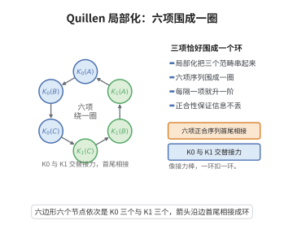

# Quillen 的局部化正合序列

> **一句话大白话**：把环 $R$ 局部化（乘某个乘法封闭集 $S^{-1}R$）会影响 K 群，其影响由"被局部化杀掉的部分"（剩余域上的 K 群）精确追账：存在长正合序列 $\cdots\to K_{n+1}(R_S)\to\bigoplus K_n(\kappa(\mathfrak{p}))\to K_n(R)\to K_n(R_S)\to\cdots$。
>
> **小例子**：取 $R=\mathbb{Z}$、$S=\mathbb{Z}\setminus\{0\}$，则 $R_S=\mathbb{Q}$；局部化序列把 $\mathbb{Z}$、"丢掉的素数"与 $\mathbb{Q}$ 的 K 群连接起来，构成一条"对账链条"。

## 一、定理介绍

> **前置依赖**：高次 K 群的 Quillen Q 构造、精确范畴、纤维化序列与同伦群、环的局部化、剩余域。

Quillen 的局部化正合序列是高次 K 理论的核心结果之一。它把环的 K 群、局部化的 K 群以及由纵向 R 中的剩项（$S$ 中某元素作用下挠的模的 K 群，此处表现为剩余域直和）联系起来，提供了计算和应用 K 群的长正合工具，是 Quillen Q 构造最重要的一则应用。

## 几何直观

图意在说明：局部化把三个范畴的 K 群连成首尾相接的六项正合序列，K0 与 K1 交替传递信息。

## 二、原理思路

证明基于 Quillen 的 Q 构造与精确范畴的纤维化序列。考虑三个精确范畴：$\mathcal{P}(R)$（有限生成射影 $R$-模）、$\mathcal{P}(R_S)$（有限生成射影 $R_S$-模）、$\mathcal{C}$（在 $S$ 中某元素作用下挠的有限生成 $R$-模）。Quillen 定理给出一串纤维化 $BQ\mathcal{C}\to BQ\mathcal{P}(R)\to BQ\mathcal{P}(R_S)$，取同伦群即得长正合序列。

## 三、定理的严格表述

设 $R$ 为 Dedekind 整环，$S\subset R$ 为乘法闭子集，记 $R_S=S^{-1}R$。则有长正合序列：
$$
\cdots\to K_{n+1}(R_S)\to\bigoplus_{\mathfrak{p}\in\operatorname{Spec}(R)\setminus\operatorname{Spec}(R_S)}K_n(\kappa(\mathfrak{p}))\to K_n(R)\to K_n(R_S)\to\cdots,
$$
其中 $\kappa(\mathfrak{p})=R_\mathfrak{p}/\mathfrak{p}R_\mathfrak{p}$ 是 $\mathfrak{p}$ 的剩余域，$\operatorname{Spec}(R)\setminus\operatorname{Spec}(R_S)$ 是在局部化中"丢掉"的素理想。

## 四、证明过程

**证明思路：**

**步骤 1：构造精确范畴。** 取 $\mathcal{P}(R)$（有限生成射影 $R$-模）、$\mathcal{P}(R_S)$（有限生成射影 $R_S$-模），以及 $\mathcal{C}$（在 $S$ 中某元素作用下挠的有限生成 $R$-模）。

**步骤 2：Quillen 纤维化序列。** 由 Quillen 定理（Q 构造的纤维化），有纤维化：
$$
BQ\mathcal{C}\to BQ\mathcal{P}(R)\to BQ\mathcal{P}(R_S).
$$

**步骤 3：取同伦群。** 对该纤维化取同伦群，$BQ\mathcal{C}$ 的 K 群分解到剩余域直和 $\bigoplus_{\mathfrak{p}\in\operatorname{Spec}(R)\setminus\operatorname{Spec}(R_S)}K_n(\kappa(\mathfrak{p}))$，$BQ\mathcal{P}(R)$ 与 $BQ\mathcal{P}(R_S)$ 分别为 $K_n(R)$ 与 $K_n(R_S)$，从而得到长正合序列。$\square$

## 五、应用与意义

局部化正合序列是计算高次 K 群的主力工具：用它可推导 Bass-Heller-Swan 定理（$K_n(R[t,t^{-1}])$ 的分解）、求 $K_n(\mathbb{Z})$、$K_n(\mathbb{Q})$ 乃至代数整数环的 K 群。它与 Milnor K 理论、Galois 上同调及算术 K 理论（在 Lichtenbaum-Quillen 猜想与 Kato 猜想背景下）紧密相连，是把局部代数对象（剩余域）拼合成全局不变量（K 群）的典型"局部-整体"方法。

## 课堂问答

**老师**：局部化 $R\to R_S$ 会改变 $K$ 群，Quillen 的局部化序列怎样精确"记账"？

**学生**：对 Dedekind 整环 $R$ 与乘法闭集 $S$，有长正合序列
$$
\cdots\to K_{n+1}(R_S)\to\bigoplus_{\mathfrak{p}}K_n(\kappa(\mathfrak{p}))\to K_n(R)\to K_n(R_S)\to\cdots,
$$
其中 $\mathfrak{p}$ 遍历在局部化中被丢掉的素理想，$\kappa(\mathfrak{p})$ 是剩余域。中间那团"丢失的信息"由各剩余域的 $K$ 群拼成。

**老师（追问）**：这条长正合列究竟从哪个范畴论事实"取同伦群"得来？

**学生**：来自 Quillen Q 构造的纤维化：三个精确范畴 $\mathcal{P}(R)$、$\mathcal{P}(R_S)$ 与"被 $S$ 中某元素杀死的挠模"范畴 $\mathcal{C}$ 给出
$$
BQ\mathcal{C}\to BQ\mathcal{P}(R)\to BQ\mathcal{P}(R_S),
$$
对它取同伦群，$BQ\mathcal{C}$ 那一项恰好分解到剩余域直和，于是得到长正合列。

**老师（拓展）**：它是"局部-整体"的典型，能具体支撑哪些结论？

**学生**：Bass-Heller-Swan 定理正是对局部化序列的运用；此外 $K_n(\mathbb{Z})$、$K_n(\mathbb{Q})$ 及代数整数环的 $K$ 群计算都靠它，并连接 Milnor K 理论与算术 K 理论。注意它要求 $R$ 为 Dedekind 整环，一般环需换成更复杂的版本。
