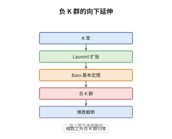

# 负 K 群

> **一句话大白话**：K 群不只有 $K_0,K_1,K_2,\dots$，Bass 还往下造出了 $K_{-1},K_{-2},\dots$，办法是把"Laurent 多项式环"当作一次升维，再看 $K_0$ 多出来多少。
>
> **小例子**：对域 $F$ 有 $K_0(F[t,t^{-1}])\cong\mathbb Z\cong K_0(F)$，故 $K_{-1}(F)=0$；而对维数只有 $1$ 的环，$K_{-2}$ 及更低的群全部为零，负 K 群在维数之外自动消失。

## 介绍

Bass 在 1968 年的书中注意到，K 理论的长正合序列总在 $K_0$ 处被"截断"，而截断纯粹是定义造成的，不是几何事实。他的办法是把 K 群沿负方向补齐：定义 $K_{-1}(A)$ 为 $K_0(A)$ 到 $K_0(A[t,t^{-1}])$ 的余核，再对 Laurent 扩张迭代。这样得到的一列 $K_{-n}(A)$ 使 Bass 基本定理对一切整数下标成立，局部化序列也向左无限延伸。负 K 群不是猎奇：它度量环"离正则有多远"，与幂零群、割补失效、非正则奇点直接相关。它把"K 理论为什么停在 $K_0$"变成了"环的维数还能撑住多少层"。

## 几何直观

图意在说明：最底层是已知的 $K_0$；往上一层把系数环换成 $A[t,t^{-1}]$，这相当于给环"加一个圆周方向"；第三层的 Bass 基本定理说 $K_0$ 在新环里分裂成"老 $K_0$ 加上一个新的余核"；最上层把这个余核记作 $K_{-1}$，再迭代就得到 $K_{-n}$。顶部的截断提示说明：这种向下延伸不能无限进行，维数一旦用尽，负 K 群就归零。

## 分析

**前置依赖**：$K_0$、$K_1$、局部化；补充：Bass 基本定理、幂零 K 群、Krull 维数。

**数学内涵**：
- 定义：$K_{-1}(A):=\operatorname{coker}\big(K_0(A)\to K_0(A[t,t^{-1}])\big)$，并令 $K_{-n}(A):=K_{-1}\big(A[t_1^{\pm1},\dots,t_{n-1}^{\pm1}]\big)$。
- Bass 基本定理：$K_n(A[t,t^{-1}])\cong K_n(A)\oplus K_{n-1}(A)\oplus NK_n(A)\oplus NK_n(A)$，其中 $NK_n$ 是幂零部分。
- 幂零不变性：对 $n\le0$ 有 $NK_n(A)=0$，因此上式在负方向退化为纯粹的递推，可以逐层向下定义。
- 局部化序列左延：$\cdots\to K_n(A)\to K_n(S^{-1}A)\to K_{n-1}(\text{挠部分})\to\cdots$ 对一切 $n\in\mathbb Z$ 成立，不再停在 $K_0$。
- 维数依赖：若 $A$ 的 Krull 维数为 $d$，则 $K_{-n}(A)=0$ 对 $n>d$；这正是"负 K 群只在维数之内可能非零"。
- 常见误区：以为负 K 群是凑出来的记号。实际它等于非连通 K 理论谱的负阶同伦群，也与 $K_0$ 的幂零现象（Nil 群）严格对应。

**结构**：
1. 用 $K_{-1}$ 的余核定义说明它确实度量 $K_0$ 在 Laurent 扩张下的新增长。
2. 借 Bass 基本定理与 $NK_0=0$ 把定义迭代到任意负阶。
3. 用局部化序列的左延与维数归纳证明 $K_{-n}(A)=0$（$n>d$）。

## 思考过程

Bass 面对的是一个尴尬局面：局部化序列写在 $K_0$ 处就断了，而断口处明明还有信息——$K_0(A[t,t^{-1}])$ 比 $K_0(A)$ 大出的部分无法安放。他的关键判断是：既然正方向的 K 群由"逐步加一个变量"给出，负方向也可以照办，只不过要把"加变量"理解为取 Laurent 环。障碍在于必须保证这个余核真的与 $K_0$ 的加法结构相容，否则定义出的东西没有函子性；Bass 基本定理正好提供了这个相容性，它把 $K_n(A[t,t^{-1}])$ 精确地拆成四块，其中两块是同一个幂零群。第二个障碍是"何时停"：如果负 K 群永远非零，定义就没有计算价值。Bass 用维数归纳证明它在 $n>\dim A$ 处消失，这才让负 K 群成为有限而有效的资料。后来人们发现它正是非连通 K 理论谱的负阶同伦群，定义从此不再依赖具体构造。

## 证明过程

**定理**：设 $A$ 为含幺环，$K_{-1}(A)=\operatorname{coker}(K_0(A)\to K_0(A[t,t^{-1}]))$，$K_{-n}(A)=K_{-1}(A[t_1^{\pm1},\dots,t_{n-1}^{\pm1}])$。则这些群良定义、对环同态函子化，且若 $A$ 的 Krull 维数为 $d$，则 $K_{-n}(A)=0$ 对一切 $n>d$。

**证明**：

### 1. 余核定义与分解

对 $A[t,t^{-1}]$，Bass 基本定理给出
$$
K_0(A[t,t^{-1}])\cong K_0(A)\oplus K_{-1}(A),
$$
其中 $K_{-1}(A)$ 按定义就是余核，同构由"把 $A[t,t^{-1}]$-模沿 $t$ 的作用分解"给出。函子性来自 $K_0$ 与 Laurent 扩张都是函子的，余核因而是函子的。

### 2. 迭代与幂零部分的消失

对 $n\le0$，幂零 K 群 $NK_n(A)$ 恒为零，因为幂零自同态在负阶不产生新的同伦信息。于是基本定理在负方向退化为
$$
K_{-n}(A[t,t^{-1}])\cong K_{-n}(A)\oplus K_{-n-1}(A),
$$
逐层取余核即得 $K_{-n}(A)=K_{-1}(A[t_1^{\pm1},\dots,t_{n-1}^{\pm1}])$，定义自洽。局部化序列的构造与正方向完全相同，只是同伦群允许负指标，于是它自动向左无限延伸。

### 3. 维数截断

对 $d=\dim A$ 归纳。$d=0$ 时 $A$ 为 Artin 环，$A[t,t^{-1}]$ 的 $K_0$ 与 $A$ 的 $K_0$ 一致，故 $K_{-1}(A)=0$，从而所有更低阶也为零。设结论对维数小于 $d$ 的环成立，取 $A$ 的一个非零因子 $x$，考察局部化序列
$$
K_{0}(A/xA)\to K_{-1}(A)\xrightarrow{\ \cdot x\ }K_{-1}(A)\to K_{-2}(A/xA).
$$
右端维数为 $d-1$，由归纳假设 $K_{-2}(A/xA)=0$。于是乘 $x$ 在 $K_{-1}(A)$ 上是满射；再对 $K_{-1}(A)$ 用一次同样的论证（它对更低的负阶成立）即知 $K_{-1}(A)=0$，逐层上推得 $K_{-n}(A)=0$ 对所有 $n>d$。$\square$

## 课堂问答

**老师**：负 K 群凭什么可以"往下定义"，正 K 群的定义方式为什么不能直接照搬？

**学生**：因为正 K 群靠"加变量 + 取同伦群"逐阶上升，而负方向没有可以取的同伦群。Bass 换了个入口：把 Laurent 扩张视为一次升维，$K_0(A[t,t^{-1}])$ 比 $K_0(A)$ 多出的那部分就记作 $K_{-1}(A)$，余核定义保证它是函子性的。这一步能走通，全靠 Bass 基本定理给出的分裂。

**老师（追问）**：为什么 $K_{-n}(A)=0$ 对 $n>\dim A$ 成立，而正 K 群没有这种截断？

**学生**：负 K 群度量的是"环的维数不足以支撑更高层的分解"。证明用维数归纳：局部化序列把 $K_{-1}(A)$ 夹在 $K_0(A/xA)$ 与 $K_{-2}(A/xA)$ 之间，右端维数降了一层，由归纳为零，于是乘 $x$ 满射，逐层推出全零。正 K 群没有这类消失，因为它记录的是模的射影分解，维数越高反而越丰富。

**老师（拓展）**：负 K 群在具体计算中出现过吗？

**学生**：出现过。$K_{-1}$ 与 Nil 群密切相关，是"割补失效"的代数影子；在非正则环上负 K 群常常非零，因此可作为正则性的探测器。另一方面，把 K 理论谱非连通化之后，$K_{-n}$ 就是它的负阶同伦群，这条观点使负 K 群自然进入循环同调与拓扑循环同调的比较定理。
