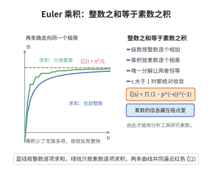

# Euler 乘积公式

> **一句话大白话**：Riemann Zeta 函数又是"全整数之和"，又是"全素数之积"——$\zeta(s)=\sum_{n\ge1}n^{-s}=\prod_{p}(1-p^{-s})^{-1}$，两个完全不同的算式实际上是同一个函数。
>
> **小例子**：取 $s=2$，$\zeta(2)=\frac{\pi^2}{6}$。它一方面等于 $\frac{1}{1^2}+\frac{1}{2^2}+\frac{1}{3^2}+\cdots$，另一方面等于 $\prod_p(1-p^{-2})^{-1}=\frac{2^2}{2^2-1}\cdot\frac{3^2}{3^2-1}\cdot\frac{5^2}{5^2-1}\cdots$。

## 一、定理介绍

> **前置依赖**：算术基本定理、几何级数、级数与无穷乘积的绝对收敛、Riemann Zeta 函数的定义。

Euler 乘积公式由欧拉于 1737 年发现，是解析数论的第一块基石。它把 Zeta 函数与素数分布联系起来：Zeta 函数的级数形式给出"算术"的视角，乘积形式给出"素数"的视角。这一恒等式之所以成立，完全依赖于算术基本定理——每个正整数唯一地分解为素数幂之积。

## 几何直观

图意在说明：算术基本定理保证每个整数唯一分解，因此全体整数求和与全体素数求积是同一个数。

## 二、原理思路

其核心思想是：在 $\operatorname{Re}(s)>1$ 时，每个素数 $p$ 对应一个几何级数
$$(1-p^{-s})^{-1}=\sum_{k\ge0}p^{-ks}=1+p^{-s}+p^{-2s}+\cdots,$$
将所有素数的这类级数相乘并展开，由算术基本定理，每一项恰好对应一个正整数的 $n^{-s}$，于是乘积等于 $\sum_{n\ge1}n^{-s}$。绝对收敛保证了展开与重排的合法性。

## 三、定理的严格表述

设 $\zeta(s)=\sum_{n=1}^{\infty}\frac{1}{n^s}$ 对 $\operatorname{Re}(s)>1$。则
$$\zeta(s)=\prod_{p\ \text{素数}}\left(1-\frac{1}{p^s}\right)^{-1},\qquad \operatorname{Re}(s)>1,$$
且乘积关于 $s$ 在 $\operatorname{Re}(s)>1$ 的紧子集上绝对一致收敛。

## 四、证明过程

**证明：**

**步骤 1：几何级数。** 对每个素数 $p$，$|p^{-s}|<1$，故
$$\left(1-\frac{1}{p^s}\right)^{-1}=\sum_{k=0}^{\infty}\frac{1}{p^{ks}}.$$

**步骤 2：乘积展开。** 对所有素数取乘积，由算术基本定理，每个正整数 $n$ 唯一写成 $n=\prod_p p^{k_p}$（有限个 $k_p$ 非零），故展开后 $n^{-s}$ 的系数为 $1$：
$$\prod_{p}\left(1-\frac{1}{p^s}\right)^{-1}=\sum_{n=1}^{\infty}\frac{1}{n^s}=\zeta(s).$$

**步骤 3：合法性验证。** 需证明乘积绝对收敛以保证展开合法。当 $s=\sigma=\operatorname{Re}(s)>1$ 时，
$$\sum_{p}\sum_{k=1}^{\infty}\frac{1}{|p^{ks}|}=\sum_{p}\frac{1}{p^{\sigma}-1}\le\sum_{p}\frac{1}{p^{\sigma}}\cdot\frac{1}{1-p^{-\sigma}}<\infty.$$
故乘积绝对收敛，级数与乘积的换序成立。$\square$

## 五、应用与意义

Euler 乘积公式是素数分布理论的总枢纽。它是证明 $\prod_p(1-p^{-s})$ 途经 Zeta 函数的解析性质（如无零点区域、函数方程）从而推出素数定理的基础；它也直接证明素数无穷多（令 $s\to1^+$，$\zeta(s)\to\infty$ 保证素数是无穷集合）。高维推广（对 Dirichlet L-函数、对 Dedekind Zeta 函数）同样由 Euler 乘积公式奠基，是解析与代数数论交汇的核心工具。

## 课堂问答

**老师**：Euler 乘积公式一句话是什么，它凭什么成立？

**学生**：结论是 $\zeta(s)=\prod_p(1-p^{-s})^{-1}$（$\operatorname{Re}s>1$）。它成立完全依赖算术基本定理：每个素数贡献一个几何级数 $(1-p^{-s})^{-1}=\sum_{k\ge0}p^{-ks}$，相乘展开后由正整数唯一素因子分解，$n^{-s}$ 的系数恰为 $1$，故乘积等于 $\sum_n n^{-s}=\zeta(s)$。

**老师（追问）**：展开与重排的合法性靠什么保证？

**学生**：靠绝对收敛。当 $s=\sigma>1$ 时
$$
\sum_p\sum_{k\ge1}\frac{1}{p^{k\sigma}}=\sum_p\frac{1}{p^\sigma-1}\le\sum_p\frac{1}{p^\sigma}\cdot\frac{1}{1-p^{-\sigma}}<\infty,
$$
故乘积绝对收敛，级数与无穷乘积可自由换序。

**老师（拓展）**：用它可以怎样"顺手"证明素数无穷多？

**学生**：令 $s\to1^+$，$\zeta(s)\to+\infty$（调和级数发散），而有限个素数只能乘积出有限的 $\prod_p(1-p^{-s})^{-1}$，矛盾，故素数必为无穷集。更一般地，Dirichlet L-函数与 Dedekind Zeta 函数的乘积公式同源于此，是解析与代数数论交汇的枢纽。
