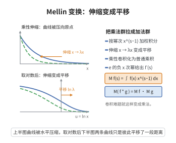

# Mellin 变换

> **一句话大白话**：Mellin 变换是把函数 $f(x)$ 按"幂次 $x^{s-1}$ 加权积分"的变换，它把乘法尺度 $x\to\lambda x$ 变成加性平移，从而把"乘性卷积"变成"普通乘积"。

> **小例子**：$f(x)=e^{-x}$ 的 Mellin 变换是 $\int_0^\infty e^{-x}x^{s-1}dx=\Gamma(s)$，正是 Gamma 函数。于是 $\Gamma$ 的所有性质（递推、极点、函数方程）都可从 Mellin 变换的一般理论读出。

## 一、定理介绍

> **前置依赖**：Fourier 变换与反演、Laplace 变换、留数定理、Dirichlet 级数（概念）。

Mellin 变换由 Hjalmar Mellin 于 1896–1902 年系统发展，是把 Fourier–Laplace 变换适配到正实数乘法群的版本。对定义在 $(0,\infty)$ 上的函数 $f$，其 Mellin 变换为
$$
\mathcal{M}f(s)=\int_0^\infty f(x)\,x^{s-1}\,dx=\int_0^\infty f(x)\,x^{s}\,\frac{dx}{x},
$$
可视为乘法群 $(\mathbb{R}_{>0},\cdot)$ 上的傅里叶变换。提出它的动机是处理数论与特殊函数中普遍出现的"乘性结构"：Dirichlet 级数 $\sum a_nn^{-s}$、素数分布、Riemann $\zeta$ 与 $\Gamma$ 函数、模形式都与 Mellin 变换天然相容。它的核心价值在于三条：一、把乘性卷积化为乘积；二、给出解析函数的反演公式（Perron 公式的来源）；三、把数论的求和问题化为复分析中的积分与极点问题。它是解析数论、调和分析与渐近分析的标准工具。

## 几何直观

图意在说明：Mellin 变换把乘法尺度的伸缩改写为对数坐标下的平移，乘性卷积随之变成普通乘积。

## 二、原理思路

1. 换元 $x=e^{t}$ 把 Mellin 变换化为双边 Laplace/傅里叶变换：$\mathcal{M}f(s)=\int_{-\infty}^{\infty}f(e^{t})e^{st}\,dt$，于是 Fourier 反演立刻给出 Mellin 反演公式。
2. 反演公式：在收敛竖线 $\operatorname{Re}s=c$ 上做 Fourier 反演，得 $f(x)=\frac{1}{2\pi i}\int_{c-i\infty}^{c+i\infty}\mathcal{M}f(s)x^{-s}ds$，这提供了由解析函数恢复原函数的手段（Perron 公式即其离散步）。
3. 由换元与 Fubini 得乘性卷积定理与 Parseval 恒等式；对 $f(x)=x/(e^x-1)$ 或 $e^{-x}$ 逐项展开可直接算出 $\Gamma\zeta$ 的积分表示。

## 三、定理的严格表述

设 $f:(0,\infty)\to\mathbb{C}$ 局部可积，且存在 $a<b$ 使
$$
\int_0^1|f(x)|x^{a-1}dx<\infty,\qquad \int_1^\infty|f(x)|x^{b-1}dx<\infty .
$$
则在带形域 $a<\operatorname{Re}s<b$ 内 $\mathcal{M}f(s)=\int_0^\infty f(x)x^{s-1}dx$ 解析，且满足：

（i）反演公式是对 $a<c<b$，
$$
f(x)=\frac{1}{2\pi i}\int_{c-i\infty}^{c+i\infty}\mathcal{M}f(s)\,x^{-s}\,ds
$$
（在 $f$ 的连续点处成立）。

（ii）乘性卷积定理：定义 $(f*g)(x)=\int_0^\infty f(y)\,g(x/y)\,\frac{dy}{y}$，则
$$
\mathcal{M}(f*g)(s)=\mathcal{M}f(s)\cdot\mathcal{M}g(s).
$$

（iii）Parseval 恒等式：对适当衰减的 $f,g$，
$$
\int_0^\infty f(x)\,g(x)\,\frac{dx}{x}=\frac{1}{2\pi i}\int_{c-i\infty}^{c+i\infty}\mathcal{M}f(s)\,\mathcal{M}g(1-s)\,ds .
$$

作为典型例子，
$$
\Gamma(s)\,\zeta(s)=\int_0^\infty \frac{x^{s-1}}{e^{x}-1}\,dx\qquad(\operatorname{Re}s>1).
$$

## 四、证明过程

**证明：**

**步骤 1：化为双边 Laplace 变换。** 令 $x=e^{t}$（$t\in\mathbb{R}$），则 $dx=e^t dt$，于是
$$
\mathcal{M}f(s)=\int_0^\infty f(x)x^{s-1}dx=\int_{-\infty}^{\infty}f(e^{t})e^{st}\,dt=:\mathcal{L}F(s),
$$
其中 $F(t)=f(e^{t})$。当 $s=\sigma+i\tau$ 时 $\mathcal{L}F(\sigma+i\tau)=\int F(t)e^{\sigma t}e^{i\tau t}dt$，即 $F(t)e^{\sigma t}$ 的傅里叶变换。由假设，$F(t)e^{\sigma t}\in L^1(\mathbb{R})$ 对每个 $\sigma\in(a,b)$，故积分绝对收敛且在带形域内解析（积分号下求导合法，因被积函数在 $\sigma$ 的紧子区间上被可积函数控制）。

**步骤 2：反演公式。** 固定 $c\in(a,b)$，记 $G_c(t)=F(t)e^{ct}\in L^1(\mathbb{R})$。由傅里叶反演定理（$G_c$ 在连续点处）
$$
G_c(t)=\frac{1}{2\pi}\int_{-\infty}^{\infty}\hat{G_c}(\tau)e^{i\tau t}d\tau,\qquad
\hat{G_c}(\tau)=\int_{-\infty}^{\infty}G_c(t)e^{-i\tau t}dt=\mathcal{M}f(c+i\tau).
$$
于是
$$
f(e^{t})=e^{-ct}G_c(t)=\frac{1}{2\pi}\int_{-\infty}^{\infty}\mathcal{M}f(c+i\tau)e^{i\tau t}d\tau .
$$
令 $s=c+i\tau$（$ds=i\,d\tau$）、$x=e^{t}$，得
$$
f(x)=\frac{1}{2\pi i}\int_{c-i\infty}^{c+i\infty}\mathcal{M}f(s)\,x^{-s}\,ds .
$$

**步骤 3：乘性卷积定理。** 直接计算（换元 $x=yu$）：
$$
\mathcal{M}(f*g)(s)=\int_0^\infty\!\!\Big(\int_0^\infty f(y)g(x/y)\frac{dy}{y}\Big)x^{s-1}dx
=\int_0^\infty\!\!\int_0^\infty f(y)g(u)(yu)^{s-1}\frac{dy}{y}du=\mathcal{M}f(s)\mathcal{M}g(s),
$$
第二步用了 Fubini（绝对收敛由带形域假设与 $f*g$ 的相应增长条件保证）。

**步骤 4：Parseval 恒等式。** 把反演公式 $g(x)=\frac{1}{2\pi i}\int_{d-i\infty}^{d+i\infty}\mathcal{M}g(w)x^{-w}dw$ 代入 $\int_0^\infty f(x)g(x)\frac{dx}{x}$，交换积分次序并用 $\int_0^\infty x^{s-w-1}dx=2\pi i\,\delta(s-w)$（在竖线积分意义下的正交关系），取 $d=1-c$，即得
$$
\int_0^\infty f(x)g(x)\frac{dx}{x}=\frac{1}{2\pi i}\int_{c-i\infty}^{c+i\infty}\mathcal{M}f(s)\mathcal{M}g(1-s)\,ds .
$$

**步骤 5：$\Gamma$ 与 $\zeta$ 的积分表示。** 对 $x>0$ 展开几何级数
$$
\frac{1}{e^{x}-1}=\frac{e^{-x}}{1-e^{-x}}=\sum_{n=1}^{\infty}e^{-nx}\qquad(x>0).
$$
代回并逐项积分（非负项，Tonelli 定理允许交换）：
$$
\int_0^\infty\frac{x^{s-1}}{e^{x}-1}dx=\sum_{n=1}^{\infty}\int_0^\infty x^{s-1}e^{-nx}dx=\sum_{n=1}^{\infty}\frac{\Gamma(s)}{n^{s}}=\Gamma(s)\zeta(s),
$$
其中用了换元 $u=nx$ 得 $\int_0^\infty x^{s-1}e^{-nx}dx=\Gamma(s)n^{-s}$，且当 $\operatorname{Re}s>1$ 时 $\sum n^{-s}$ 收敛。$\square$

## 五、应用与意义

- 它是解析数论的核心工具：Dirichlet 级数 $\sum a_nn^{-s}$ 是累加函数 $A(x)=\sum_{n\le x}a_n$ 的 Mellin–Stieltjes 变换，Perron 公式、显式公式皆由此而来。
- $\Gamma(s)\zeta(s)$ 的积分表示是 $\zeta$ 函数方程、$\Gamma$ 函数性质与 Theta 变换（Poisson 求和）之间的桥梁。
- 在渐近分析中，Mellin 变换给出调和和、$\sum_{n\le x}f(n)$ 的 Mellin 型渐近展开，是圆法之外的另一条主脉。
- 在调和分析与非交换几何中，它是谱作用原理、热核渐近与 Seeley–deWitt 系数的展开工具。
- 在信号处理与算法分析中，Mellin 变换用于尺度不变滤波与除法型分治算法的复杂度分析。

## 课堂问答

**老师**：Mellin 变换为什么被称为"乘法群上的傅里叶变换"？

**学生**：换元 $x=e^t$ 直接给出
$$
\mathcal{M}f(s)=\int_0^\infty f(x)x^{s-1}dx=\int_{-\infty}^{\infty}f(e^t)e^{st}dt,
$$
右边正是 $F(t)=f(e^t)$ 的双边 Laplace / 傅里叶变换。于是乘性尺度 $x\to\lambda x$ 变为加性平移，乘性卷积变为乘积：$\mathcal{M}(f*g)=\mathcal{M}f\cdot\mathcal{M}g$。

**老师（追问）**：反演公式与 Perron 公式的来历是什么？

**学生**：由傅里叶反演在竖线 $\operatorname{Re}s=c$ 上得
$$
f(x)=\frac{1}{2\pi i}\int_{c-i\infty}^{c+i\infty}\mathcal{M}f(s)\,x^{-s}\,ds,
$$
再把累加函数 $A(x)=\sum_{n\le x}a_n$ 用 Stieltjes 型的 Mellin 表示联系到 $\sum a_nn^{-s}$，就是 Perron 公式，它是显式公式的技术来源。

**老师（拓展）**：举一个靠 Mellin 变换"一眼看出"特殊函数性质的例子。

**学生**：$f(x)=e^{-x}$ 给出 $\mathcal{M}f(s)=\Gamma(s)$；对几何级数逐项积分得
$$
\Gamma(s)\zeta(s)=\int_0^\infty\frac{x^{s-1}}{e^x-1}\,dx\quad(\operatorname{Re}s>1),
$$
由此 $\zeta$ 的解析延拓与函数方程都能从 Theta 变换、Poisson 求和里读出。误区是只在 $\operatorname{Re}s>1$ 里看它，而忽略它其实是收敛条 $a<\operatorname{Re}s<b$ 上的解析对象。

## 相关条目

- [素数定理](./素数定理.md)：其显式公式与 Perron 公式本质是 Mellin 反演。
- [Riemann Zeta 函数的函数方程](./RiemannZeta函数的函数方程.md)：由 $\Gamma\zeta$ 的 Mellin 积分表示与 Theta 变换推出。
- [Euler 乘积公式](./Euler乘积公式.md)：与 $\Gamma\zeta$ 的积分表示共同给出 $\zeta$ 的解析结构。
- [Ikehara-Wiener Tauber 定理](./Ikehara-WienerTauber定理.md)：其推导依赖 Mellin–Stieltjes 表示与 Perron 公式。
- [Zeta 函数函数方程（第44级-解析数论）](../第44级-解析数论/Zeta函数函数方程.md)：含同一函数方程的另一种推导，可交叉参考。
- [Dedekind Zeta 函数](../第53级-代数数论/DedekindZeta函数.md)：其解析延拓与分解同样依赖 Mellin 变换。
