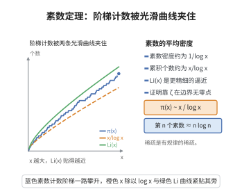

# 素数定理

> **一句话大白话**：第 $x$ 个素数大约在 $x\log x$ 附近，或者说 $x$ 以内素数的个数约等于 $\frac{x}{\log x}$。素数"平均密度"约 $\frac1{\log x}$，越往后越稀疏但以确定速率递减。
>
> **小例子**：$x=10^6$ 时 $\pi(x)=78498$，而 $\frac{10^6}{\log10^6}\approx72382$。用更精细的 $\operatorname{Li}(x)=\int_2^x\frac{dt}{\log t}\approx78628$ 逼近更准（差约 $130$）。

## 一、定理介绍

> **前置依赖**：Chebyshev 函数与 von Mangoldt 函数、Riemann Zeta 函数与无零点区域、Mellin 变换与显式公式、Ikehara-Wiener Tauber 定理。

素数定理定量地回答"素数到底有多少"，是解析数论的核心成就。它由 Legendre、Gauss 猜出，1896 年哈达玛与 de la Vallée Poussin 各自独立证明（借助 Zeta 函数无零点区域），后被 Selberg 与 Erdős 用初等方法重新证明。其核心断言：$\pi(x)\sim\frac{x}{\log x}$。

## 几何直观

图意在说明：素数个数这串阶梯虽然参差，其整体走势却被 x/log x 精确刻画，Li(x) 则贴得更近。

## 二、原理思路

证明的关键是建立"素数信息"与"Zeta 函数"之间的桥梁。定义 Chebyshev 函数 $\psi(x)=\sum_{n\le x}\Lambda(n)$（$\Lambda$ 为 von Mangoldt 函数），它与 $\pi(x)$ 相差至多 $O(\sqrt x\log x)$，故只需证 $\psi(x)\sim x$。而 $-\frac{\zeta'(s)}{\zeta(s)}=\sum_{n\ge1}\Lambda(n)n^{-s}$ 的 Mellin 逆变换给出 $\psi(x)$ 的显式公式（以 Zeta 零点为留数）。若无零点区域（$\zeta$ 在 $\operatorname{Re}(s)\ge1$ 无零点），再配合 Ikehara-Wiener Tauber 定理，即可推出 $\psi(x)\sim x$。

## 三、定理的严格表述

设 $\pi(x)=\#\{p\le x:p\text{ 素数}\}$。则
$$\pi(x)\sim\frac{x}{\log x}\quad(x\to\infty).$$
等价地，
$$\pi(x)\sim\operatorname{Li}(x)=\int_2^x\frac{dt}{\log t}.$$

## 四、证明过程

**证明（经典解析方法概要）：**

**步骤 1：化为 $\psi(x)\sim x$。** 由分部求和，$\psi(x)\sim x\iff\pi(x)\sim\frac{x}{\log x}$。故证后者等价命题。

**步骤 2：显式公式。** 对 $\operatorname{Re}(s)>1$，有 $-\frac{\zeta'(s)}{\zeta(s)}=\sum_{n\ge1}\Lambda(n)n^{-s}$。由 Mellin 变换与移动积分路径得
$$\psi(x)=x-\sum_{\rho}\frac{x^\rho}{\rho}-\frac{\zeta'(0)}{\zeta(0)}-\frac12\log(1-x^{-2}),$$
求和遍历非平凡零点 $\rho$。

**步骤 3：无零点区域。** 存在绝对常数 $c>0$，使 $\zeta(s)\neq0$ 当 $\operatorname{Re}(s)\ge1-\frac{c}{\log(|\operatorname{Im}s|+2)}$（由不等式 $3+4\cos\theta+\cos2\theta=2(1+\cos\theta)^2\ge0$ 及 $\zeta$ 的对数导数推出）。

**步骤 4：应用 Tauber 定理。** 由步骤 3，在 $\operatorname{Re}(s)\ge1$ 上 $-\frac{\zeta'(s)}{\zeta(s)}-\frac1{s-1}$ 解析。取 $a_n=\Lambda(n)\ge0$，其生成 Dirichlet 级数 $\sum a_nn^{-s}=-\frac{\zeta'(s)}{\zeta(s)}$ 满足 Ikehara-Wiener 定理条件（$-\frac{\zeta'(s)}{\zeta(s)}-\frac1{s-1}$ 连续延拓到 $\operatorname{Re}(s)\ge1$），故 $\psi(x)\sim x$，从而 $\pi(x)\sim\frac{x}{\log x}$。$\square$

## 五、应用与意义

素数定理是数论分析方法的巅峰与范式。它直接推动了对素数的精确计数（威伟的 $\operatorname{Li}(x)$ 逼近）、素数在算术级数中的分布（Dirichlet 定理）的精致化，并为 Riemann 假设提供"无条件"基准——若 RH 成立则误差为 $O(x^{1/2}\log x)$。其证明技术（Mellin 变换、显式公式、Tauber 定理）广泛用于 L-函数、算术几何与格点计数，是现代解析数论的通用语言。

## 课堂问答

**老师**：素数定理的断言是什么？为什么要先绕到 Chebyshev 函数 $\psi$？

**学生**：结论是 $\pi(x)\sim\frac{x}{\log x}$，等价地 $\pi(x)\sim\operatorname{Li}(x)=\int_2^x\frac{dt}{\log t}$。绕到 $\psi(x)=\sum_{n\le x}\Lambda(n)$ 是因为 $\pi$ 与 $\psi$ 只差 $O(\sqrt x\log x)$，故只需证更强的 $\psi(x)\sim x$，而 $\psi$ 直接与 $-\frac{\zeta'}{\zeta}$ 挂钩。

**老师（追问）**：从 $-\frac{\zeta'}{\zeta}$ 到 $\psi(x)\sim x$ 的最后一步用了什么？

**学生**：用显式公式与无零点区域。先有
$$
-\frac{\zeta'(s)}{\zeta(s)}=\sum_{n\ge1}\Lambda(n)n^{-s},
$$
经 Mellin 逆变换得 $\psi(x)=x-\sum_\rho\frac{x^\rho}{\rho}-\frac{\zeta'(0)}{\zeta(0)}-\frac12\log(1-x^{-2})$；再由 $3+4\cos\theta+\cos2\theta=2(1+\cos\theta)^2\ge0$ 推出 $\zeta$ 在 $\operatorname{Re}s\ge1$ 无零点，于是 $-\frac{\zeta'(s)}{\zeta(s)}-\frac{1}{s-1}$ 连续，对非负系数 $a_n=\Lambda(n)$ 用 Ikehara-Wiener 定理即得 $\psi(x)\sim x$。

**老师（拓展）**：Riemann 假设会给这个误差带来什么改观？

**学生**：若 RH 成立，显式公式中 $\sum_\rho\frac{x^\rho}{\rho}$ 的规模被 $\sqrt x$ 控制，误差降为 $\psi(x)=x+O(\sqrt x\log^2x)$，即 $\pi(x)=\operatorname{Li}(x)+O(\sqrt x\log x)$。常见误区是以为素数定理等价于 RH，其实素数定理只需"无零点区域"这一弱得多的信息。

## 相关条目

- [素数定理（第44级-解析数论）](../第44级-解析数论/素数定理.md)：与本条目为同一定理，另收录于第44级-解析数论，可交叉参考。
