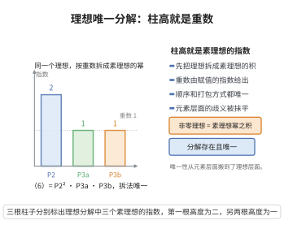

# 理想唯一分解定理

> **一句话大白话**：普通整数里 $6=2\cdot3$ 分解唯一，但在 $\mathbb{Z}[\sqrt{-5}]$ 里 $6=2\cdot3=(1+\sqrt{-5})(1-\sqrt{-5})$ 拆法不唯一。补救的办法是：把"理想"当作基本单位，每个非零理想都仍能**唯一**拆成素理想的乘积。
>
> **小例子**：在 $\mathbb{Z}[\sqrt{-5}]$ 中，$6$ 对应的主理想 $(6)$ 拆成素理想的乘积：$(6)=(2,1+\sqrt{-5})^2(3,1-\sqrt{-5})(3,1+\sqrt{-5})$，这种拆法是唯一的，尽管元素的拆法不唯一。

## 一、定理介绍

> **前置依赖**：数域整数环是 Dedekind 整环、Noether 性、分式理想与理想逆、素理想与极大理想。

该定理指出：数域整数环是 Dedekind 整环，而 Dedekind 整环中每个非零真理想都唯一分解为素理想之积。这是代数数论的奠基性结论——它用"理想"恢复了对有理整数缺失的唯一分解，代价是从"元素"层面提升到"理想"层面。它是类域论、素理想分解理论的基础。

## 几何直观

图意在说明：元素分解可以不唯一，但把理想拆成素理想的幂时，每个指数都唯一确定，柱高就是重数。

## 二、原理思路

证明分成存在性与唯一性两步：
- **存在性**用"上升下降"技巧：对非零真理想 $\mathfrak a$，取包含它的极大理想 $\mathfrak p_1$，利用分式理想逆 $\mathfrak p_1^{-1}$ 得到 $\mathfrak a=\mathfrak p_1\mathfrak a_1$ 且 $\mathfrak a_1\supsetneq\mathfrak a$；反复操作，Noether 性保证过程有限，最终得到素理想之积。
- **唯一性**用素理想性质：若 $\mathfrak a\subseteq\mathfrak p$ 且 $\mathfrak p$ 素，则某个因子因子 $\subseteq\mathfrak p$，配合极大理想可逐项匹配两种分解。

## 三、定理的严格表述

设 $K$ 为数域，$\mathcal{O}_K$ 为整数环。则任意非零真理想 $\mathfrak a\subset\mathcal{O}_K$ 可唯一（在同构以素理想乘积的意义下、不计次序）分解为
$$\mathfrak a=\mathfrak p_1^{e_1}\mathfrak p_2^{e_2}\cdots\mathfrak p_r^{e_r},$$
其中 $\mathfrak p_i$ 是互不相同的非零素理想，$e_i\ge1$。

## 四、证明过程

**证明：**

**存在性。** 若 $\mathfrak a$ 是素理想则显然。否则设 $\mathfrak p_1$ 是包含 $\mathfrak a$ 的极大理想（存在，因 Noether 环中任何非零理想都含于极大理想）。在分式理想群中令 $\mathfrak a_1=\mathfrak p_1^{-1}\mathfrak a$，则 $\mathfrak a=\mathfrak p_1\mathfrak a_1$。因 $\mathfrak p_1$ 极大，$\mathfrak p_1^{-1}\supsetneq\mathcal{O}_K$，故 $\mathfrak a_1=\mathfrak p_1^{-1}\mathfrak a\supsetneq\mathfrak a$（"除平凡值后变大"）。对 $\mathfrak a_1$ 重复此操作得 $\mathfrak a_1=\mathfrak p_2\mathfrak a_2,\dots$。严格递增的理想链 $\mathfrak a\subsetneq\mathfrak a_1\subsetneq\mathfrak a_2\subsetneq\cdots$ 由 Noether 性（$\mathcal{O}_K$ Noether）必然有限，故最终 $\mathfrak a=\mathfrak p_1\cdots\mathfrak p_s$（合并同族素理想得到指数形式）。$\blacksquare$

**唯一性。** 设有两种分解 $\prod_i\mathfrak p_i^{e_i}=\prod_j\mathfrak q_j^{f_j}$。对任一 $\mathfrak p_i$，因 $\mathfrak p_i\supseteq\prod_j\mathfrak q_j^{f_j}$，由素理想定义，存在 $j$ 使 $\mathfrak q_j\subseteq\mathfrak p_i$。因 $\mathcal{O}_K$ 维数为 1，非零素理想即极大，故 $\mathfrak q_j=\mathfrak p_i$。约去公因子，归纳即得两种分解相同（不计次序、指数相等）。$\blacksquare$

由此唯一分解成立。$\square$

## 五、应用与意义

理想唯一分解是算术的理论核心。它直接导出：(1) 非零分式理想构成自由阿贝尔群，其生成元为非零素理想；(2) 理想类群 $Cl(K)$ 良定义且有限；(3) 数域中素理想分解理论（$p\mathcal{O}_K=\prod\mathfrak p_i^{e_i}$，$e_i$ 为分歧指数）。此结论推广到 Dedekind 概形、模曲线上的算术问题，是类域论与算术几何"素理想分解"叙述的基本机制。

## 课堂问答

**老师**：在 $\mathcal{O}_K$ 中元素分解不唯一，凭什么理想分解就唯一？

**学生**：因为 $\mathcal{O}_K$ 是 Dedekind 整环，每个非零真理想可唯一（不计次序）写成
$$
\mathfrak a=\mathfrak p_1^{e_1}\mathfrak p_2^{e_2}\cdots\mathfrak p_r^{e_r},
$$
其中 $\mathfrak p_i$ 为互异非零素理想。唯一性来自：若 $\mathfrak a\subseteq\mathfrak p$ 且 $\mathfrak p$ 素，则某因子含于 $\mathfrak p$，而维数为 $1$ 使非零素理想即极大，故该因子恰等于 $\mathfrak p$，约去后归纳。

**老师（追问）**：存在性为什么必须依赖 Noether 性？

**学生**：用"上升"技巧：取包含 $\mathfrak a$ 的极大理想 $\mathfrak p_1$，令 $\mathfrak a_1=\mathfrak p_1^{-1}\mathfrak a$，则 $\mathfrak a=\mathfrak p_1\mathfrak a_1$ 且 $\mathfrak a_1\supsetneq\mathfrak a$。反复操作得严格递增的理想链
$$
\mathfrak a\subsetneq\mathfrak a_1\subsetneq\mathfrak a_2\subsetneq\cdots,
$$
Noether 性保证它必然有限，故最终落到素理想之积。

**老师（拓展）**：这条定理立刻带来哪些结构性结论？

**学生**：非零分式理想构成以非零素理想为基的自由阿贝尔群；由理想逆与离散性可定义 $Cl(K)$ 并证明其有限；素理想分解 $p\mathcal{O}_K=\prod\mathfrak p_i^{e_i}$ 的指数 $e_i$ 由此得名。误区是把 $(6)$ 的两条元素分解当成反例，它们恰是同一理想唯一分解的两种"读法"。
